# ipmc-fwupdate: bootloader design (Phase 12)

Internal design document for the sector-0 bootloader `ipmc-fwupdate`. The owner's requirements
are `Documentation/bootloader.md` (requirements 1 to 13, 10-25-2026); where this design and that
file differ, that file holds. Nothing here is built yet: the text describes what exists today in
present tense and the planned bootloader in plain plan wording ("the bootloader checks ...").
The work starts after Phase 11 (DEBUG menu and capture log, UART rings and APP_UART, `ipmc-app`)
is complete. Phase 11b goes ahead as briefed (`.scratch/brief_uart_rings.md` D3, the runtime's
vector table in sector 0); section 5 states what the runtime relink to 0x0800_8000 involves when
this work starts.

Facts about the part come from RM0368 (STM32F401 reference manual) and DS10086 (datasheet) as
cited in the existing code, Cortex-M facts from the ARMv7-M architecture. Sizes marked
"measured" come from the release ELF of 10-25-2026 (`arm-none-eabi-nm --size-sort`, Tier-2/3
build, before the 11b changes); every other size is an estimate that the first Phase 12 build
replaces with a measurement (section 3.3).

## 1. Fixed requirements this design follows

| bootloader.md | Requirement in short | Where here |
|---|---|---|
| 1, 9 | Sector 0 holds the bootloader (and its vector table) and nothing else; no bootloader command and no runtime code erases or programs sector 0; software protection only, no option bytes | 2, 9 |
| 2, 3 | Separate erase commands for sector 1 (FRU store) and sectors 2-7 (runtime); Intel HEX download; records outside the erase target refused | 8 |
| 4 | SHA-256 digest of the runtime in a fixed header, written by a post-build step, checked at every reset; the whole bootloader with SHA-256 fits 16 KB with margin; a build check fails above 16 KB | 3.3, 3.4, 4 |
| 5 | Valid image, pin 0 and no request: start the runtime (after the countdown when one is set), no session. Otherwise listen on both UARTs for `WAKEUP` with no time limit; the first port to get it is the only port for the session | 6, 8.1 |
| 6 | Boot countdown `IPMC_BOOT_COUNTDOWN` (0..=30 s, 0 = off): a valid image waits N s for `WAKEUP` on both UARTs, then starts | 6.1, 6.2, 6.5 |
| 7 | A MenuBuilder-style flat command line: HELP, INFO, ERASE FRU, ERASE APP (with CONFIRM), LOAD, VERIFY, RUN, RESET; prompt `IPMC_BOOT_PROMPT` plus one space; the menu engine shared with the runtime when it fits | 8.2 to 8.5 |
| 8 | Runtime vector table at 0x0800_8000, header at one fixed address; the same start steps for every image; a build check rejects an image with either elsewhere | 4, 5, 6.4 |
| 10 | Start-up trace on the console at every reset, one short line per step | 6.2 |
| 11 | BOOTLOADER pin PC10: 1 at reset always stays in the bootloader | 6.1, 7.2 |
| 12 | DEBUG console command and `ipmc-app` command request the bootloader across a reset | 7.1 |
| 13 | Bench test over APP_UART (COM5) and the DEBUG command, including a power cut during an update | 13.3 |

## 2. Memory map

Flash (RM0368 Table 5, STM32F401xE, 512 KB; owner layout):

| Region | Sectors | Addresses | Size | Holds | Written by |
|---|---|---|---|---|---|
| BOOT | 0 | 0x0800_0000..0x0800_3FFF | 16 KB | the bootloader: its vector table, code and constants | SWD or the drive copy on the bench only |
| STORE | 1 | 0x0800_4000..0x0800_7FFF | 16 KB | the FRU flash store (FRU image, settings byte, unit fields) | the runtime store; the bootloader on `ERASE FRU` / `LOAD` to FRU |
| APP | 2-7 | 0x0800_8000..0x0807_FFFF | 480 KB | the runtime firmware: vector table at 0x0800_8000, image header at 0x0800_8200, then code, constants, the `.data` load image | the bootloader on `ERASE APP` / `LOAD`; SWD |

Sector sizes inside APP (RM0368 Table 5): sectors 2 and 3 are 16 KB, sector 4 is 64 KB,
sectors 5 to 7 are 128 KB.

RAM (96 KB at 0x2000_0000). Today the runtime's `.uninit` section (the 16-byte `KEPT` request
sequence state of `bsp/reset_cause.rs`) sits after `.bss`, at an address that moves with every
build (0x2000_4590 in the measured ELF). The bootloader zeroes its own `.bss` and copies its
`.data` at every reset, so a word that must cross a reset through the bootloader needs a fixed
place that the bootloader's start-up code never touches:

| Region | Addresses | Size | Holds |
|---|---|---|---|
| NOINIT | 0x2000_0000..0x2000_00FF | 256 B | offset 0x00: the boot request (4 words, section 7.1); offset 0x10 onward: the runtime's `.uninit` (`KEPT`, and the panic record of DAL-D gap G11 later) |
| RAM | 0x2000_0100..0x2001_7FFF | 95.75 KB | `.data`, `.bss`, heap-free statics and the stack (top of RAM) of whichever image runs |

Every address above is written once, in one linker include file `flash_map.x` (section 3.2),
read by both linker scripts. Rust code that needs an address takes it from a linker symbol
(`__app_vectors`, `__app_header`, `__fru_store_start`, `__boot_request`) and checks it at start
against the RM0368 Table 5 sector geometry, held as datasheet constants in `ipmc-fwimage`
(section 3.1), as 11b's `store_region_ok` does for the store. Drift failure mode: a bootloader
and a runtime built from different `flash_map.x` versions disagree on the header or request
address; the bootloader then finds no header and stays (safe), and a request is lost (the
board starts the runtime).

## 3. Crates and build

### 3.1 Crates

| Crate | Kind | Holds |
|---|---|---|
| `crates/ipmc-fwupdate` | firmware binary, its own cargo workspace (as `crates/ipmc-nucleo-f401re` is), `thumbv7em-none-eabihf`, own `link.x` | `main.rs` (start-up order of section 6), the session glue (UART bytes in, lines to the menu, answers out), the jump |
| `crates/ipmc-fwimage` | core library, `no_std`, `forbid(unsafe_code)`, panic free, host-tested, root workspace member | the RM0368 sector geometry and the region policy (which address a target allows), the image header layout (encode, decode, check), the boot request words (encode, check), the start decision as a pure function, the Intel HEX record parser, the `LOAD` state machine over a `FlashOps` trait, the start-up trace and INFO line formatter |
| `crates/ipmc-fwimage` binary `fwimage` (`src/bin/fwimage.rs`, `std`) | host tool, built only for the host | `patch` (fills the header length and digest), `check` (the bootloader's image check run on the built image), `combine` (the drive-copy image); called by `gen.ps1` |
| `crates/ipmc-bsp-f401re` | firmware library, `no_std`, its own workspace for its gates | the board support both images use (section 3.2) |
| `crates/ipmc-wire` | existing | gains `sha256` (section 3.4) beside `crc32`; `zero_checksum` and `hex_byte` serve the Intel HEX parser |
| `crates/ipmc-menu` | existing | gains a flat layer (section 3.3) that the bootloader uses alone |

The bootloader is Tier-1 public code: it names no Tier-2/3 feature, has no `cfg(tier23)` and no
`cfg(ipmc_eval)`. An evaluation runtime image is one more runtime image to it (header flag
bit 1, section 4).

### 3.2 Sharing the BSP drivers

Recommendation: split a shared BSP library crate `crates/ipmc-bsp-f401re` out of
`crates/ipmc-nucleo-f401re/src/bsp/`, and make both binaries depend on it. It takes the modules
the bootloader needs, unchanged in behaviour: `clock.rs` (gains `restore_reset_state`,
section 6.4), `uart.rs` (the 11b two-port driver with rings), the register layer of `flash.rs`
(key sequence, BSY wait, error flags, cache reset, sector erase, program), `led.rs`,
`systick.rs`, `static_slot.rs`, `reset_cause.rs` (decode split into `read` without clearing and
`take`; the raw word read helper; `KEPT`; the boot request words), `ga.rs` for the NVMRO sample,
the new `boot_pin.rs` (PC10, owner "boot_pin"), `fault.rs`, and the `flash_map.x` include. The
runtime keeps everything IPMB and sensor specific (`i2c_*`, `ipmb_*`, `board_pins.rs`,
`eval_timer.rs`) and its store policy (the `FlashLog` impl that allows sector 1 only).

The flash split is the one structural change: the register layer refuses any address below
0x0800_4000 and any sector number 0 itself (bootloader.md requirement 9: both drivers refuse
sector 0), and the callers' policies sit on top of it: the runtime's store allows sector 1 only;
the bootloader's `LOAD` allows the target of the last erase. Two independent refusals stand in
front of sector 0: the policy in `ipmc-fwimage` and the register layer.

The alternative, `#[path]` mounting of single files from the runtime's `src/bsp/` into the
bootloader, is not recommended:

| | Shared BSP crate | `#[path]` mounting |
|---|---|---|
| One copy of each function | yes | yes (the same file compiled twice) |
| Module paths | normal crate paths (`ipmc_bsp_f401re::uart`) | the mounting crate must rebuild the runtime's module tree, because the files use `super::ga`, `super::systick` and so on; a move in the runtime breaks the bootloader build |
| Lint and format gates | its own `cargo clippy` / `cargo fmt --check` | linted twice, under two crates with different dead-code sets |
| Why the Tier23 bridge uses `#[path]` | n/a | the private repository boundary (decision 16); no such boundary exists here |

Costs of the split: one more workspace and gate (clippy and fmt inside
`crates/ipmc-bsp-f401re` for the thumb target, because `cargo clippy` lints only workspace
members, so neither binary's run covers the library); and the `#[interrupt]` handlers for USART1
and USART2 move into a library crate. A handler in a library is linked only when its object is
linked; with `lto = true` and `codegen-units = 1` the exported handler symbols stay, and a build
check confirms it: `arm-none-eabi-nm` of both ELFs lists `USART1` and `USART2` as their own
symbols, not as aliases of `DefaultHandler`. The BSP depends on `ipmc-sensors` (feature
`stm32f401`) for the pin owner `ports`, as the runtime does today; LTO drops what the bootloader
does not call.

### 3.3 Size budget

Design target: the bootloader image (`.vector_table` + `.text` + `.rodata` + `.data` load
image) stays at or below 12 KB (75 % of sector 0), leaving at least 4 KB. Hard limit: the BOOT
region of the bootloader's `link.x` is `LENGTH = 16K`, so a larger image is a link error, and
`gen.ps1 build` also fails when `ipmc-fwupdate.bin` exceeds 16 384 bytes; it prints the size,
the percentage of 16 KB, and a warning above the 12 KB target.

Two estimates follow. The first reuses `ipmc-menu` as it is (grouped engine, `core::fmt`
formatting); the second uses a flat layer of `ipmc-menu` and no `core::fmt`.

| Part | ipmc-menu as is | Flat layer, no `core::fmt` | Basis |
|---|---|---|---|
| Start-up and vector table (101 entries), HardFault and DefaultHandler | 0.7 KB | 0.7 KB | measured: `.vector_table` 404 B, `Reset` 62 B, `HardFault` 24 B, `DefaultHandler` 28 B; plus cortex-m-rt `.data`/`.bss` init |
| Clock start (shared `clock.rs`) and `restore_reset_state` | 0.6 KB | 0.6 KB | estimate |
| Pin owner (`ports`: claim, configure) | 2.0 KB | 2.0 KB | measured: `Pins::configure` 1 590 B, `claim` 166 B (LTO inlines callers into these, so the figure is an upper bound) |
| UART driver, two ports, RX and TX rings, one interrupt body | 1.2 KB | 1.2 KB | measured today (one port, blocking TX): `USART2` 164 B, `putc` 194 B, `flush` 118 B; 11b adds the TX ring and the second port |
| Flash register layer (erase, program x8/x32, refusals) | 0.6 KB | 0.6 KB | measured: `erase` 346 B, `take_errors` 56 B |
| LED, SysTick, BOOTLOADER pin | 0.5 KB | 0.5 KB | measured: `led::update` 224 B, `set_mode` 100 B |
| SHA-256 (section 3.4) | 1.2 KB | 1.2 KB | estimate: 256 B round constants + rolled compression loop + update and finish |
| Intel HEX parser and `LOAD` state machine | 1.0 KB | 1.0 KB | estimate |
| Header check, start decision, boot request, jump | 0.6 KB | 0.6 KB | estimate |
| Boot countdown (6.5; compiled out when `IPMC_BOOT_COUNTDOWN` is 0) | 0.2 KB | 0.2 KB | estimate: the message, one digit a second, the two-port `WAKEUP` check shared with the stay path |
| Menu engine | 3.0 KB | 1.0 KB | measured: 3 548 B of `ipmc_menu` symbols in the runtime (grouped tables, group help, usage lines) |
| `core::fmt` | 1.6 KB | 0 | measured: `Formatter::pad` 642 B, `pad_integral` 418 B, `fmt::write` 262 B, `u32` Display 234 B |
| Number writer (decimal, hex) | 0 | 0.2 KB | estimate |
| Command handlers, help, trace and INFO text | 1.2 KB | 1.2 KB | estimate |
| `memcpy` / `memset` | 0.8 KB | 0.8 KB | measured: `memcpy` 660 B, `__aeabi_memcpy4` 164 B |
| **Total** | **15.2 KB** | **11.8 KB** | |
| **Left of 16 KB** | **0.8 KB (5 %)** | **4.2 KB (26 %)** | |

Finding: `ipmc-menu` reused as it is fits inside 16 KB by this estimate, but leaves under 1 KB,
not the clear margin the owner asks for. Its cost is the engine (about 3 KB) plus the
`core::fmt` machinery it uses for usage lines and the padded help columns (`{:<width$}` pulls
in `Formatter::pad`).

Recommendation: give `ipmc-menu` a flat layer inside the same crate (no second engine): a
function set over one `&[Command<C>]` table that tokenises a line, matches keyword rows
(case-insensitive, exact, MenuBuilder match rules), runs the handler, and prints the help table
with the separator column computed from the longest syntax, writing padding spaces and text
through `MenuOutput::write_str` without `core::fmt`. The grouped `Menu` of the console is
rebuilt on that layer (each group is one flat table), so the console behaves as today and
`ipmc-menu`'s tests keep passing. The bootloader links only the flat layer and writes numbers
through one small decimal and hex digit writer (placed in `ipmc-menu` beside the flat layer, so
it exists once), and no `core::fmt` path is reachable from the bootloader: no `{}` formatting,
no `#[derive(Debug)]` output, no `fault::claim_failed` with formatted owner names (the
bootloader reports a claim failure with fixed text). A further lever, if a measurement needs
it: `opt-level = "z"` for the bootloader's release profile.

Order of work: the first Phase 12 step builds the bootloader skeleton (start-up, clock, both
UARTs, the start-up trace, the jump) and measures it; the measured table replaces the estimates
above before the protocol code is written, so the menu decision is made on numbers.

### 3.4 Image digest: SHA-256

The owner chose SHA-256 (bootloader.md requirement 4): a CRC-32 detects accidental corruption
only, and MD5 collisions are practical to construct. The STM32F401 has no HASH peripheral, and
its CRC unit computes only a CRC-32, so the bootloader computes SHA-256 in software.

Implementation: one compact SHA-256 in `crates/ipmc-wire/src/lib.rs` (`no_std`,
`forbid(unsafe_code)`, a state struct with `new`, `update(&[u8])`, `finish() -> [u8; 32]`), beside `crc32`,
so the bootloader, the `fwimage` host tool and any later user share one copy. It keeps the
64-word round-constant table (256 B) and a rolled 64-round compression loop over a 16-word
circular message schedule (64 B of stack instead of the 256 B full schedule).

| Choice | Image size | Notes |
|---|---|---|
| Own compact implementation (recommended) | about 1.0 to 1.2 KB | no dependency added to the image (DAL-D G10 lists every linked crate as previously developed software); size and loop form under our control |
| `sha2` crate (RustCrypto) with its small-size software backend (`force-soft-compact` in the 0.10 series; confirm the feature name in the version chosen) | about 1.5 to 2.5 KB | brings `digest`, `block-buffer`, `generic-array`, `crypto-common` into the image; each is one more previously developed crate to assess |

Tests (host, `cargo test -p ipmc-wire`): the FIPS 180-4 example messages and their published
digests:

| Message | SHA-256 |
|---|---|
| empty | e3b0c442 98fc1c14 9afbf4c8 996fb924 27ae41e4 649b934c a495991b 7852b855 |
| "abc" | ba7816bf 8f01cfea 414140de 5dae2223 b00361a3 96177a9c b410ff61 f20015ad |
| "abcdbcdecdefdefgefghfghighijhijkijkljklmklmnlmnomnopnopq" (448 bits, two blocks) | 248d6a61 d20638b8 e5c02693 0c3e6039 a33ce459 64ff2167 f6ecedd4 19db06c1 |
| one million "a" | cdc76e5c 9914fb92 81a1c7e2 84d73e67 f1809a48 a497200e 046d39cc c7112cd0 |

plus every message length 0 to 300 bytes (all padding cases, the 55/56/64-byte block edges) and
one 480 KB generated buffer compared against `sha2` as a dev-dependency only (an independent
implementation; it never reaches the image), and a split test: the same data fed in chunks of
1, 3, 63, 64 and 65 bytes gives the same digest as one call.

Time: a rolled compression loop at `opt-level = "s"` runs at roughly 50 to 80 core cycles per
byte on the Cortex-M4 from flash with 2 wait states and the ART prefetch and caches on (the
shared `clock.rs` enables them). At 60 cycles per byte and 84 MHz:

| Image | Bytes | Hash time at 84 MHz (range at 50 to 80 cycles/byte) |
|---|---|---|
| Runtime today (measured `.bin` of 10-25-2026) | 111 668 | about 80 ms (66 to 106 ms) |
| Whole APP region | 491 520 | about 350 ms (293 to 468 ms) |

The bootloader hashes the length the header states (section 4), not the whole region, so the
start-up time follows the image size. The start-up trace prints the measured time (DWT cycle
counter, converted with 32-bit arithmetic: no 64-bit division in the image; the runtime's
`u64_div_rem` is 864 B measured).

A digest that matches proves the bytes in sectors 2 to 7 are the bytes
the build hashed; it does not prove who built them, because anyone who can build an image can
also compute its digest and write it into the header. Proving origin needs a signature: the
build signs the digest with a private key kept off the board, and the bootloader verifies the
signature with the public key it holds (32 bytes for Ed25519) before it starts the image.

An Ed25519 signature is a later option, sized here. A verifier needs the curve arithmetic (a double scalar multiply over
GF(2^255 - 19)) and SHA-512 (Ed25519 hashes with SHA-512 internally; about 1.5 to 2 KB with its
80 64-bit constants). Published Cortex-M4 figures put a verifier between about 5 KB of code (the
smallest portable forms, taking on the order of 1 to 3 s per verify at 84 MHz) and about 10 to
20 KB (assembly-tuned or table-based forms, roughly 30 to 250 ms). Against the 11.8 KB estimate
of section 3.3 that leaves 4.2 KB, Ed25519 does not fit sector 0: even the smallest verifier plus
SHA-512 (about 6.5 to 7 KB) overruns the 16 KB. A signature check needs either a smaller
bootloader than this design (for example no menu: a fixed command parser), or a verifier
outside sector 0, which requirement 1 does not allow. This is open question 9.

### 3.5 Build and images

`gen.ps1 build` after the relink (section 5):

1. Build the bootloader: `cargo build --release` in `crates/ipmc-fwupdate`. The link fails when
   the image exceeds the 16 KB BOOT region. `arm-none-eabi-objcopy -O binary --gap-fill 0xFF`
   gives `ipmc-fwupdate.bin`; the script checks it is at most 16 384 bytes and prints its size.
2. Build the runtime as today (`IPMC_TIER23`, `IPMC_EVAL` handling unchanged).
3. `objcopy -O binary --gap-fill 0xFF` of the runtime ELF gives the APP image starting at
   0x0800_8000 (the ELF holds nothing below it).
4. `fwimage patch`: reads that image, checks the header placeholder at offset 0x200, writes the
   image length and then the SHA-256 digest into it (section 4), writes the 64 header bytes to
   `app_header.bin`.
5. `arm-none-eabi-objcopy --update-section .app_header=app_header.bin` writes the same 64 bytes
   into the runtime ELF (same section size), giving the patched ELF; steps 3 and 4 are rerun from
   the patched ELF and `fwimage check` runs the bootloader's own image check (the same
   `ipmc-fwimage` code) on the result. A mismatch fails the build.
6. `objcopy -O ihex` of the patched ELF gives `ipmc-nucleo-f401re.hex`, the file for `LOAD`.
7. `fwimage combine` writes `ipmc-board.bin`: the bootloader at offset 0, FFh up to 0x8000
   (rest of sector 0 and all of sector 1), the APP image from 0x8000.

| Image | Covers | Used for | Erases |
|---|---|---|---|
| `ipmc-board.bin` | sectors 0 to the end of the runtime | drive copy (`gen.ps1 flash`, `NOD_F401RE`) | the bootloader, the FRU store (written as FFh, the owner accepts the loss of the unit fields), the runtime sectors |
| `ipmc-nucleo-f401re.elf` (patched) | sectors 2 onward | SWD (`gen.ps1 flash -Swd`, OpenOCD `program ... verify reset`) | only the sectors the image covers: the bootloader and the FRU store stay |
| `ipmc-fwupdate.elf` | sector 0 | SWD (`gen.ps1 flash -Swd -Bootloader`), bench only | sector 0 only |
| `ipmc-nucleo-f401re.hex` (patched) | sectors 2 onward | `LOAD` over a UART (`tools/fwupdate`) | nothing by itself; `ERASE APP` erases first |

No runtime-only `.bin` is ever offered for the drive copy: the ST-LINK drive programs a `.bin`
from 0x0800_0000, so a runtime-only `.bin` would land on the bootloader. The intermediate APP
image is named `ipmc-nucleo-f401re.app.img`, and `gen.ps1 flash` copies only `ipmc-board.bin`.
The `-Eval` build gets the same steps (`-eval` in each file name, header flag bit 1).

## 4. Runtime image header

At 0x0800_8200, 64 bytes, little-endian, one fixed address for every build (bootloader.md
requirement 8). Why there: the runtime vector table is 101 words (404 B, measured), and ARMv7-M
requires a VTOR table to be aligned to its size rounded up to a power of two (512 B here), so
0x0800_8200 is the first address no vector table of this part can reach. Why a header and not a
trailer: a trailer's address depends on the image length, so the bootloader would have to trust
a length to find the check that is supposed to validate it.

| Offset | Size | Field | Value and check |
|---|---|---|---|
| 0x00 | 4 | magic | 0x434D_5049, the ASCII bytes `IPMC` in memory order. FFFF_FFFFh = erased ("missing"); any other value = "bad magic" |
| 0x04 | 2 | header format | 1 |
| 0x06 | 2 | header size | 64 |
| 0x08 | 4 | image length | bytes from 0x0800_8000; a multiple of 4; at least 0x240 (vector table area and header) and at most 491 520 (480 KB) |
| 0x0C | 4 | firmware version | bytes major, minor, patch, 0 of the runtime crate version (the source of the Device ID firmware revision, decision 1) |
| 0x10 | 4 | build flags | bit 0: Tier-2/3 extension built in; bit 1: evaluation build; other bits 0 |
| 0x14 | 4 | vector table address | 0x0800_8000 (checked equal) |
| 0x18 | 8 | reserved | 0 |
| 0x20 | 32 | SHA-256 digest | FIPS 180-4 SHA-256 of the hashed range below |

Hashed range: the bytes from 0x0800_8000 to 0x0800_8000 + length, minus the 32 digest bytes
(0x0800_8220..0x0800_823F): the hash runs over 0x0800_8000..0x0800_821F, then over
0x0800_8240..(0x0800_8000 + length). Every other header field is inside the hash, so a changed
length, version or flag is a mismatch. The build hashes the `--gap-fill 0xFF` image, so gaps
between output sections are FFh in the hash; `LOAD` never writes a gap (no record covers it),
so after `ERASE APP` the gap bytes in flash are FFh as well.

Who writes what: the runtime crate holds one `#[used] #[link_section = ".app_header"]` static
built by a const function of `ipmc-fwimage` (`header::placeholder(version, flags)`), with the
magic, format, size, version, flags and vector address filled at compile time and the length and
digest as FFh. `fwimage patch` fills length and digest (section 3.5). The layout constants
(offsets, magic, size) exist once, in `ipmc-fwimage::header`, used by the runtime static, the
`fwimage` tool and the bootloader.

Image check (one function, `ipmc_fwimage::header::check`, run by the bootloader at every reset,
by `VERIFY`, `RUN` and `LOAD` end, and by `fwimage check` at build time), in order:

1. Magic: erased gives `missing`, other values `bad magic`.
2. Format 1, size 64, vector table address 0x0800_8000, length in range and a multiple of 4,
   else `bad header`.
3. Vector table: word 0 (initial stack pointer) 8-byte aligned and inside
   0x2000_0100..=0x2001_8000 (RAM above NOINIT); word 1 (reset handler) odd (Thumb) and, with
   bit 0 cleared, inside 0x0800_8240..(0x0800_8000 + length); else `bad vector table`.
4. SHA-256 over the hashed range equal to the stored digest, else `digest mismatch`.

## 5. Relinking the runtime at 0x0800_8000

What exists after 11b: the runtime's custom `link.x` with VECTORS (sector 0, `.vector_table`
only), STORE (sector 1) and FLASH (sectors 2-7) regions, and a `.bin` built with
`--gap-fill 0xFF` that starts at 0x0800_0000. What the relink at the start of Phase 12 changes:

1. `flash_map.x` (new, in `crates/ipmc-bsp-f401re`, found through a `cargo:rustc-link-search`
   line in each binary's `build.rs`): the regions BOOT, STORE, APP, NOINIT and RAM of section 2,
   and the symbols `__fru_store_start`/`__fru_store_end` (kept from 11b), `__app_vectors =
   ORIGIN(APP)`, `__app_header = ORIGIN(APP) + 0x200`, `__boot_request = ORIGIN(NOINIT)`. The
   runtime's `memory.x` becomes a one-line `INCLUDE flash_map.x` (cortex-m-rt's build script
   still finds a `memory.x`).
2. Runtime `link.x`: `.vector_table` at ORIGIN(APP); a new `.app_header` output section at
   `__app_header` with `KEEP`; `.text`, `.rodata` and the `.data` load image after it; `.uninit`
   moved into NOINIT at ORIGIN(NOINIT) + 0x10; nothing in BOOT or STORE. Linker asserts:
   `ADDR(.vector_table) == 0x08008000`, `ADDR(.app_header) == 0x08008200`,
   `SIZEOF(.app_header) == 64`, `.vector_table` ends at or before `__app_header`, no output
   section in BOOT or STORE, `.uninit` fits NOINIT above the request words. These make
   requirement 8's build check part of the link: an image with the table or header elsewhere
   does not link. `fwimage check` (section 3.5 step 5) checks the patched result as well.
3. cortex-m-rt features `set-vtor` and `set-sp` (both offered by cortex-m-rt 0.7.7) on the
   runtime: its reset handler then writes VTOR with its own table address and loads SP from it,
   so the runtime also starts correctly when a debugger runs it from its reset vector without the
   bootloader. The bootloader still performs the full start sequence of section 6.4.
4. The 11b store check `store_region_ok(start, end, vectors_end, text_start)` changes its
   arguments: the vector table end becomes the bootloader region end (0x0800_4000) and the
   program start becomes `__app_vectors`; its table-driven test rows change with it.
5. `.app_header` static in the runtime (`src/app_header.rs`, section 4); `SYS VERSION` and the
   banner print the header version and the first 8 bytes of the digest, read from flash.
6. `gen.ps1`: the build steps and images of section 3.5; `flash` copies `ipmc-board.bin`;
   `flash -Swd` programs the patched runtime ELF (sectors 2 onward only); `-Bootloader` adds the
   bootloader ELF. The comment block at the top states what each path erases.
7. The bench's first change-over: a board that holds a Phase 11 image (runtime vector table in
   sector 0) takes one drive copy of `ipmc-board.bin`. This erases the FRU store once.
8. Debugging: gdb `load` of the patched ELF works as today (it programs sectors 2 onward). A
   `load` of the unpatched cargo ELF leaves the length and digest as FFh, and the bootloader
   reports `bad header` and stays, by design; program the patched ELF and use the cargo ELF for
   symbols only.

Nothing else in the runtime moves: no code address is fixed, the vector table is still emitted
by cortex-m-rt, and the RAM layout above NOINIT stays a normal cortex-m-rt layout.

## 6. Start-up

### 6.1 Sequence

```mermaid
stateDiagram-v2
    [*] --> Startup: reset
    Startup --> Run: image valid, pin 0,&#10;no request, countdown 0
    Startup --> Countdown: image valid, pin 0,&#10;no request, countdown N
    Countdown --> Run: N s without WAKEUP
    Countdown --> Session: WAKEUP on one port
    Startup --> Wait: image invalid, pin 1&#10;or request
    Run --> [*]: restore reset state&#10;VTOR, SP, jump
    Wait --> Session: WAKEUP on one port
    Session --> Session: commands, LOAD
    Session --> Run: RUN (image valid)
    Session --> [*]: RESET
```



1. cortex-m-rt reset: the bootloader's own `.data` and `.bss` set up in RAM (never in NOINIT);
   HardFault and DefaultHandler defined (fault blink on LD2, park).
2. `reset_cause::read`: decode RCC_CSR without writing RMVF, so the runtime still reads and
   clears the flags itself (`reset_cause::take`), and its banner shows the cause of the reset.
3. `clock::init` (shared): 84 MHz from HSE bypass, HSI fallback, flash wait states and ART on.
4. Pin owner `ports::init`; console UART (USART2, `IPMC_CONSOLE_BAUD`) up; trace line 1.
5. Trace line 2 (reset cause).
6. BOOTLOADER pin (PC10): claim as input with pull-down, wait `IPMC_FWU_PIN_SETTLE_US` (100 us,
   a bounded cycle-count delay from HCLK), read once; trace line 3. Settle time: the internal
   pull-down (about 40 kOhm, DS10086 RPD) against about 20 pF of pin, track and jumper gives an
   RC of about 0.8 us; 100 us is over 100 time constants, and also covers an external pull-down
   of a target board with a short cable. The pin is not read again.
7. Boot request: read the four request words at `__boot_request` (section 7.1), then clear the
   check word; the request counts only when RCC_CSR shows a software reset. Trace line 4.
8. Image check (section 4); trace lines 5 and 6 (header, then digest and time).
9. Decision (table below); trace line 7.
10. Start: trace line 8, flush the console, restore the reset state and jump (section 6.4).
    Countdown: section 6.5; it ends in the start or in a session.
    Stay: start SysTick and the LED wait pattern, start APP_UART (USART1) when
    `IPMC_APP_UART_ENABLE` is 1, and wait for `WAKEUP` on both ports (section 8.1).

Decision (a pure function in `ipmc-fwimage`, host-tested row by row):

| BOOTLOADER pin | Request | Image check | Decision | Reason text |
|---|---|---|---|---|
| 0 | none | valid, `IPMC_BOOT_COUNTDOWN` 0 | start the runtime at once; no UART listening | |
| 0 | none | valid, `IPMC_BOOT_COUNTDOWN` N > 0 | countdown (6.5): a session on `WAKEUP`, else the start after N s | |
| 1 | any | any | stay | `BOOTLOADER pin` |
| 0 | yes | any | stay | `requested` |
| 0 | none | missing | stay | `no image` |
| 0 | none | bad magic / bad header / bad vector table | stay | `bad magic` / `bad header` / `bad vector table` |
| 0 | none | digest mismatch | stay | `digest mismatch` |

The pin row comes before the request row, so the trace names the pin when both apply. A stay
waits for `WAKEUP` with no time limit (bootloader.md requirement 5); only a reset or a power
cycle leaves it before `WAKEUP`. The countdown applies only to the valid-image rows: a stay never
counts down.

### 6.2 Start-up trace

On the console (USART2) at every reset, before and independent of the port choice. The text is
fixed except for the fields in angle brackets; labels are padded to one column (16 characters).

```
ipmc-fwupdate v<x.y.z> (sector 0)
Reset cause:    <power-on | brown-out | reset pin (button or debugger) | software reset | independent watchdog | window watchdog | low-power management | unknown>
BOOTLOADER pin: <0 | 1 (forced)>
Request:        <none | bootloader requested by the runtime firmware (<console | app port>)>
Runtime image:  header at 0x0800_8200: <found, v<x.y.z>, <n> bytes, flags <hh>h | missing | bad magic | bad header (<field>) | bad vector table>
Image check:    <SHA-256 <first 16 hex digits> match, <t> ms | SHA-256 <first 16 hex digits> MISMATCH, <t> ms | not run>
Decision:       <starting the runtime | countdown <N> s for WAKEUP on COM3 or COM5 | staying in the bootloader: <reason>, waiting for WAKEUP on COM3 or COM5>
Starting the runtime firmware at 0x0800_8000
```

The last line prints only on the start path (after the countdown when one runs). `Request`
names the interface that asked (from the request words). With `IPMC_APP_UART_ENABLE 0` the
decision and countdown lines name COM3 alone. The digest line prints the first 8 bytes (16 hex digits) of the computed digest to
keep the line short; `INFO` and `VERIFY` print all 64 digits and the stored value. The reset
cause texts are those of `ResetCause::text` (shared `reset_cause.rs`). `Image check` reads `not
run` when the header check already failed. The texts name the bench PC ports as
bootloader.md requires (COM3 is the console USART2, COM5 is APP_UART USART1); a field PC's
port numbers differ (open question 14).

Example, valid image, normal power-on (296 bytes with CR LF):

```
ipmc-fwupdate v0.1.0 (sector 0)
Reset cause:    power-on
BOOTLOADER pin: 0
Request:        none
Runtime image:  header at 0x0800_8200: found, v0.1.0, 111668 bytes, flags 00h
Image check:    SHA-256 1f3a09c27b54e6d8 match, 81 ms
Decision:       starting the runtime
Starting the runtime firmware at 0x0800_8000
```

Printing time at 115200 baud, 8N1 (10 bits, 86.8 us per byte): 296 bytes take 25.7 ms; the
longest variant (a stay with the longest reset cause and request texts, about 380 bytes) takes
about 33 ms. The UART TX ring sends in the background: lines 1 to 5 (about 160 bytes, 14 ms)
leave while the hash runs, so the start path adds only the last three lines (about 120 bytes,
10 ms) after the hash, plus the flush. Time from reset to the runtime's reset handler for
today's image: about 1 ms clock and UART start, 0.1 ms pin settle, about 80 ms hash, about 10 ms
trace tail: about 91 ms; for a 480 KB image about 361 ms. A countdown adds its N seconds on
top (3 s with the bench default: about 3.09 s for today's image); the field image uses 0. Open
question 6 asks whether the system allows this.

Which lines reach the `WAKEUP`-chosen port: the trace lines go to the console only. With
`IPMC_BOOT_COUNTDOWN 0`, APP_UART stays silent before `WAKEUP`, so a payload CPU on that port
sees no unsolicited text at a reset; with N > 0 the two countdown lines of 6.5 go to both ports,
APP_UART included (bootloader.md requirement 6). After `WAKEUP` the
chosen port gets `OK` and the prompt; `INFO` prints the same start-up record (the same
formatter, so the text exists once) on the chosen port. When the console is the chosen port the
trace is already on its screen.

### 6.3 What the bootloader touches on the start path

Clock tree (PLL, HSE, flash ACR), GPIOA/GPIOC clocks and the pins PA2, PA3 (console) and PC10
(BOOTLOADER pin), USART2 and its interrupt, the DWT cycle counter (hash time), RCC_CSR (read
only), the four NOINIT request words. It never touches the IPMB pins (PB8, PB9, PA8, PB4), the
GA and NVMRO straps, PWR_EN (PB5), PAYLOAD_RST_OUT_N (PA9), the ADC, I2C1, I2C3 or the FRU
store. USART1 (APP_UART, PB6/PB7, and PA11/PA12 with flow control) and SysTick join the list only
while a countdown runs; the start sequence of 6.4 resets them with the rest.

### 6.4 Start sequence (the same for every image, `RUN` included)

The bootloader leaves the processor as a reset leaves it, for every part it touched, so the
runtime's start-up order (`main.rs`) runs unchanged. In `ipmc_bsp_f401re::boot::start_runtime`:

1. Re-run the image check when the last check is older than a flash write (`RUN` after `LOAD`).
2. Flush the console TX ring and wait for TC (the existing bounded `flush`).
3. Mask interrupts (`cpsid i`); NVIC: clear every enable (ICER) and every pending bit (ICPR);
   SysTick: CTRL = 0, clear a pending SysTick (ICSR PENDSTCLR).
4. Peripheral reset through RCC: USART1 and USART2 (APB2RSTR, APB1RSTR), GPIOA, GPIOB and
   GPIOC (AHB1RSTR), each pulsed set then clear; the clock enables back to their reset values.
   The pins return to their reset state (inputs, no pull) with the GPIO reset.
5. `clock::restore_reset_state` (shared `clock.rs`): switch SYSCLK to HSI and wait for SWS
   (bounded), PLL off and wait for PLLRDY clear (bounded), HSE and bypass off, flash latency back
   to 0 after the switch. This step is needed: the runtime's `clock::init` clears PLLON while it
   configures the PLL, and RM0368 6.3.1 ignores a PLLON clear while the PLL drives SYSCLK, so a
   runtime started on the bootloader's PLL would configure a running PLL.
6. DWT: disable the cycle counter (the runtime starts it itself).
7. VTOR = 0x0800_8000 (`__app_vectors`), `dsb`, `isb`.
8. One `asm!` block (one `unsafe`, with its `// SAFETY:` line naming the checked vector table):
   load MSP from word 0, clear CONTROL (thread mode, MSP, no FPU context), `cpsie i` (the NVIC
   holds no enabled interrupt, so nothing can fire), branch to word 1.

The runtime then starts exactly as from a reset, except that RAM is not random (the runtime's
start-up code initialises everything it uses) and RCC_CSR still holds the flags of the reset
that started the bootloader. The bootloader never starts IWDG; section 10 covers the watchdog.

### 6.5 Boot countdown (`IPMC_BOOT_COUNTDOWN`)

bootloader.md requirement 6. `IPMC_BOOT_COUNTDOWN` in `ipmi_defs.h` gives the countdown in
seconds, guarded in `ipmc-defs` to 0..=30 (a value outside fails the build, naming the define).
Bench default 3; a field image uses 0. With 0 the countdown code is not compiled into the image
(a constant `if` the compiler folds), and a valid image starts at once.

With N > 0 and the decision "countdown" (valid image, pin 0, no request):

1. SysTick starts (the 1 ms clock); APP_UART starts when `IPMC_APP_UART_ENABLE` is 1.
2. On both ports: `Send WAKEUP on COM3 or COM5 within N s to stay in the bootloader` (N as a
   number), CR LF, then the digit `N` with no line end.
3. Each following second: a space and the next lower number on the same line (`3 2 1`), on both
   ports. The window is N s measured on SysTick from the moment the first digit is queued.
4. Both ports listen with the `WAKEUP` rules of 8.1 (one `LineEditor` each, no echo, other
   lines unanswered). A complete `WAKEUP` line on either port inside the window ends the
   countdown on both ports with CR LF, answers `OK` on that port, opens the session there and
   stops the other port, as in 8.1. The console then gets `Decision:       staying in the
   bootloader: WAKEUP in countdown`, so the console record shows why the board stayed.
5. When N s pass without `WAKEUP`: CR LF on both ports, then the start path (trace line 8,
   flush, section 6.4). A `WAKEUP` whose line end arrives after the window is not answered.

The countdown text is 64 bytes plus CR LF (one-digit N), then 2 bytes a second, so printing
does not stretch the window (the TX ring holds it). LD2 shows the wait blink of section 10
during the countdown. The countdown never runs after a stay decision, after `RESET`
in a session (the next reset decides again, so `RESET` with a valid image counts down again when
N > 0), or before `RUN` (a deliberate start). The decision and the window end are one pure
function in `ipmc-fwimage` (inputs: N, elapsed ms, `WAKEUP` seen on a port and when; result:
keep counting with the digit to print, start, or session on that port), tested on the host.

## 7. Entry into the bootloader

### 7.1 Request from the runtime

Today `reset_cause.rs` keeps the IPMB request sequence across a software reset in `KEPT`: four
words in `.uninit`, the last one the XOR of the others with a magic constant, accepted only
after a software reset and cleared on read. The boot request uses the same method with its own
words, at the fixed address `__boot_request` (NOINIT offset 0, section 2), so the bootloader and
the runtime find it although they are separate links:

| Word | Content |
|---|---|
| 0 | request magic (`ipmc_fwimage::request::MAGIC`) |
| 1 | requesting interface: 1 = console (`DEBUG BOOTLOADER`), 2 = app port (`BOOTLOADER`) |
| 2 | reserved, 0 |
| 3 | check word: word 0 XOR word 1 XOR word 2 XOR `request::CHECK_MAGIC` |

- The runtime writes the words with volatile writes (`reset_cause::request_bootloader(interface)`,
  shared BSP), then restarts through the existing processor reset path of a Cold Reset
  (`reset_gate`: the answer leaves the port and an accepted FRU write is saved first, or
  `IPMC_RESET_WAIT_MS` passes), so the FRU store is consistent before the reset.
- The bootloader reads the words with the shared raw word read (the `asm!` load `reset_cause.rs`
  uses, valid for never-written RAM), clears the check word, and accepts the request only when
  RCC_CSR shows a software reset (SFTRSTF) and the check word matches. After a power-on the RAM
  content matches with probability 2^-32 and is refused anyway by the reset-cause test.
- An RTC backup register (RM0368 RTC_BKPxR, kept through a system reset) is the alternative. It
  needs no linker coordination, but it needs the PWR clock and the backup-domain write enable
  (DBP) in both images, more code in sector 0, and it does not remove the need for NOINIT: the
  runtime's `KEPT` words must survive the bootloader's RAM start-up anyway. Not recommended.

Runtime commands:

| Where | Command | Answer, then |
|---|---|---|
| Console, DEBUG group | `DEBUG BOOTLOADER` | `Restarting into the bootloader` (and, while payload power is on, a second line `Payload power drops at the reset`), then the request and the reset path |
| APP_UART, `ipmc-app` | `BOOTLOADER` (one `COMMANDS` row, one handler, one test row, and `AppHost::request_bootloader`) | `OK BOOTLOADER`, flushed on the app port, then the request and the reset path |

### 7.2 BOOTLOADER pin (PC10)

PC10 (morpho CN7-1; VDD 3.3 V is on CN7-5) at logic 1 at reset keeps the processor in the
bootloader whatever the image check says (bootloader.md requirement 11). Both images configure
it as an input with the internal pull-down, so an open pin reads 0; a target board adds an
external pull-down and a jumper or test point to 3.3 V. One owner module, `boot_pin.rs`
(owner "boot_pin"), claims it in both images: in the runtime from Phase 11b on (input,
pull-down, its level in `SYS STATUS`), moved into the shared BSP in Phase 12. The bootloader
reads it once (section 6.1 step 6). This is the field entry for a runtime that is valid but
does not work: jumper the pin, power-cycle, and reflash with the field utility (section 12).

## 8. The session on the chosen UART

### 8.1 WAKEUP and the port choice

- These rules apply to a stay and, inside its window, to the countdown of 6.5; a `WAKEUP` in the
  countdown opens the same session.
- Both ports run the shared interrupt-driven driver while the bootloader waits: the console
  (USART2, PA2/PA3, `IPMC_CONSOLE_BAUD`) and APP_UART (USART1, PB6 TX, PB7 RX, `IPMC_APP_UART_BAUD`,
  RTS/CTS on PA12/PA11 when `IPMC_APP_UART_FLOW` is 1), the same settings the runtime uses, read
  from the same `ipmi_defs.h`. With `IPMC_APP_UART_ENABLE 0` only the console listens.
- Each port has its own `ipmc-menu` `LineEditor` while waiting. A line ends at CR, LF or CR LF;
  printable ASCII only; at most `IPMC_MENU_LINE_MAX` (128) characters, a longer line is dropped.
- A line matches when its single token is `WAKEUP` in any letter case (surrounding spaces
  allowed, as the menu tokeniser trims them). Before the choice, nothing is echoed and no other
  line gets an answer on either port: a payload CPU that sends its normal `ipmc-app` requests to
  a board in the bootloader sees silence, and its own timeout applies.
- The first port to complete a `WAKEUP` line answers `OK` and becomes the session port. The
  bootloader then stops the other USART (RCC reset) and returns its pins to inputs; that port
  stays silent until the next reset. Bytes already received on the other port are discarded.
- `WAKEUP` is also a row of the command table, answered `OK`, so a host tool that repeats it
  after the choice gets a clear answer.

### 8.2 Command line

The flat MenuBuilder table (`FUNCTION:COMMAND:DESCRIPTION` rows, keywords case-insensitive and
exact, explicit match on token count and keyword positions, `HELP` and `?` aliases, help columns
on a separator computed from the longest syntax), served by the flat layer of `ipmc-menu`
(section 3.3). Prompt: `IPMC_BOOT_PROMPT` (`"boot>"` by default) followed by one space, so a
person and the field utility see at once that the board is in the bootloader and not the runtime
console (bootloader.md requirement 7). In command mode the bootloader echoes typed characters as the
console does; in `LOAD` record mode it echoes nothing and prints no prompt between records.
Every handler ends with one status line, `OK ...` or `ERR <CODE> <text>`, in the `ipmc-app`
style; the engine's own messages (unknown command, wrong arguments) start with `ERR` as well, so
a tool tests only the first word.

| Command | Answer |
|---|---|
| `WAKEUP` | `OK` |
| `HELP`, `?` | the table, then `OK` |
| `INFO` | the start-up record of section 6.2 (with all 64 digest digits, computed and stored), `Bootloader: ipmc-fwupdate v<x.y.z>`, `Port: <CONSOLE \| APP_UART> <baud> 8N1 RTS/CTS <on \| off>`, `Erase target: <none \| FRU \| APP>`, then `OK` |
| `ERASE FRU` | `Erase sector 1 (FRU flash store)? Type CONFIRM` (prompt); see 8.3 |
| `ERASE APP` | `Erase sectors 2-7 (runtime firmware)? Type CONFIRM` (prompt); see 8.3 |
| `CONFIRM` | runs the pending erase: `OK ERASED <FRU \| APP> <ms> ms`, or `ERR FLASH <fault>` / `ERR NVMRO`; with nothing pending `ERR NOTHING_PENDING` |
| `LOAD` | `OK LOAD <FRU \| APP>: send records`, then record mode (8.4); with no erase in this session `ERR NOT_ERASED erase first` |
| `VERIFY` | `OK VERIFY valid SHA-256 <64 hex> <ms> ms`, or `ERR IMAGE <reason> computed <64 hex> stored <64 hex>` |
| `RUN` | `OK RUN`, then the start sequence of 6.4; `ERR IMAGE <reason>` when the check fails |
| `RESET` | `OK RESET`, flush, SYSRESETREQ. The request words are already cleared, so a valid image starts unless the BOOTLOADER pin is 1 |

### 8.3 Erase

- `ERASE FRU` and `ERASE APP` arm a pending erase; the next line must be `CONFIRM`. Any other
  line cancels it (`ERR CANCELLED`) and is not run as a command.
- NVMRO: the shared register layer samples NVMRO before each erase and program, as today, and
  refuses with `ERR NVMRO` while it is asserted, for both targets (open question 3 asks whether
  NVMRO protects the runtime firmware or only the FRU store).
- `ERASE APP` erases sector 2 first: it holds the vector table and the header, so from its first
  erase step on, a power cut leaves `missing` and the board stays in the bootloader at the next
  reset. Then sectors 3 to 7 in order.
- Times (DS10086 Table 45, PSIZE x32): 2 s maximum for a 128 KB sector (cited in `flash.rs`);
  the 16 KB and 64 KB maxima are taken from the same table when this is coded. `ERASE APP` is
  bounded by the sum of the six sector maxima (about 8 s with the usual 16 KB / 64 KB values);
  the answer comes once, at the end, with the measured time. The core stalls during each erase
  (it runs from the same flash bank, RM0368 3.5.1); the host sends nothing until the answer
  (stop-and-wait), so no byte arrives during the stall.
- A completed erase sets the session's erase target (`FRU` or `APP`), which `LOAD` uses.

### 8.4 LOAD record mode

Every line that starts with `:` is one Intel HEX record. The bootloader answers each record with
one line before it reads the next. Checks, in order (the parser and the state machine live in
`ipmc-fwimage`, host-tested; the flash writes go through a `FlashOps` trait that the bootloader
implements over the shared register layer and the tests implement over a RAM model):

1. Form: `:` then an even number of hex digits, at least 10 digits (count, address, type,
   checksum), the count field equal to the data length. Else `ERR FORMAT`.
2. Checksum: the sum of every record byte including the checksum is 0 modulo 256
   (`ipmc_wire::zero_checksum` of all bytes is 0, the same two's-complement checksum IPMB uses).
   Else `ERR CHECKSUM`.
3. Type:

   | Type | Name | Action |
   |---|---|---|
   | 00 | data | checks 4 to 7, then programs |
   | 01 | end of file | count 0; ends `LOAD` (below) |
   | 04 | extended linear address | count 2; sets the upper 16 address bits; `OK` |
   | 05 | start linear address | count 4; accepted and ignored, `OK` (objcopy writes the ELF entry point; the bootloader starts from the vector table) |
   | 02, 03 | extended segment address, start segment address | refused, `ERR TYPE` (20-bit segment addressing; the build never writes them, and a 02 would change the address arithmetic) |
   | other | | refused, `ERR TYPE` |

4. Wrap: offset + count must not pass 0x1_0000 (no record crosses a 64 KB segment). Else
   `ERR WRAP`.
5. Range: the absolute address (upper bits from the last 04 record, 0 before any) and the whole
   record must lie inside the session's erase target: APP 0x0800_8000..0x0807_FFFF, FRU
   0x0800_4000..0x0800_7FFF. Anything else, sector 0 in every case, is `ERR RANGE`. The register
   layer refuses sector 0 again on its own.
6. Erased: every target byte reads FFh, else `ERR NOT_ERASED` (no byte is programmed twice; a
   repeated or overlapping record is refused).
7. Program and read back: aligned words at PSIZE x32, an unaligned head or tail byte by byte at
   PSIZE x8 (RM0368 3.5.4; both allowed at 2.7 to 3.6 V), so records of any alignment work; read
   back and compare, else `ERR VERIFY`; a flash fault is `ERR FLASH <fault>` (the
   `FlashError::name` text). Then `OK`.

Line limits: the record line goes through the same `LineEditor` (`IPMC_MENU_LINE_MAX` 128): a
16-byte record is 43 characters, a 32-byte record 75, and the longest record that fits carries
58 data bytes (11 + 2 x 58 = 127). A longer line is `ERR LINE_TOO_LONG`. objcopy writes 16-byte
records; the host tool may re-chunk to 32 (section 12).

End of file: for the APP target the bootloader runs the image check and answers `OK END <n>
records <bytes> bytes, image valid` or `ERR IMAGE <reason>` (the records are in flash, but the
image is not startable); for the FRU target `OK END <n> records <bytes> bytes`. Then the
prompt returns.

Leaving record mode early: a line that does not start with `:` ends it with `ERR ABORTED` and
is not run; no line for `IPMC_FWU_LOAD_IDLE_S` seconds ends it with `ERR TIMEOUT`. After a
record error the bootloader stays in record mode, so the host can resend that record (a line
damaged on the wire programs nothing: `FORMAT`, `CHECKSUM` and `LINE_TOO_LONG` fail before any
write). After `ERR VERIFY` or `ERR FLASH` the target bytes may be partly programmed; the host
aborts and starts again with an erase.

Pacing: stop-and-wait, one record in flight. The bootloader never holds more than one line, the
RX ring (256 bytes) holds a whole line, and the host sends nothing while the core stalls on a
flash program, so no flow control is needed. With `IPMC_APP_UART_FLOW 1` on APP_UART, RTS/CTS
also holds a sender that ignores the protocol; the console has no handshake lines. A sender that
streams without waiting loses bytes during the stalls; the damaged lines fail `FORMAT` or
`CHECKSUM` and are refused, never programmed.

Throughput estimate at 115200 baud: a 32-byte record is 75 characters plus CR LF (6.7 ms), the
answer `OK` CR LF (0.3 ms), programming 8 words (well under 1 ms), plus the PC's USB serial
turnaround (1 to 16 ms, the adapter's latency setting). Today's image is about 3 500 records of
32 bytes: about 30 to 85 s.

### 8.5 Error codes

`FORMAT`, `CHECKSUM`, `TYPE`, `WRAP`, `RANGE`, `NOT_ERASED`, `VERIFY`, `FLASH <fault>`, `NVMRO`,
`LINE_TOO_LONG`, `ABORTED`, `TIMEOUT`, `NOT_ERASED erase first` (LOAD without an erase),
`CANCELLED`, `NOTHING_PENDING`, `IMAGE <reason>` with the reasons of section 4 (`missing`, `bad
magic`, `bad header`, `bad vector table`, `digest mismatch`). One enum in `ipmc-fwimage` with
`name()`, used by the answers and the tests.

## 9. Never bricking

What protects sector 0:
- No bootloader command addresses sector 0: the erase commands name sector 1 or sectors 2 to 7,
  and `LOAD` refuses any record below 0x0800_4000 (FRU target) or 0x0800_8000 (APP target).
- Both flash drivers share one register layer that refuses SNB 0 and any address below
  0x0800_4000, so neither the runtime's store code nor the bootloader can write sector 0 through
  a policy bug. The runtime has no command that erases or programs anything but sector 1.
- Protection is software only: no sector is write-protected in the option bytes, and nothing on
  the bench writes option bytes over SWD (owner 10-25-2026, bootloader.md requirement 9).
- `ERASE APP` erases the header sector first; a power cut at any point of an update leaves an
  image that fails the check, so the board stays in the bootloader and takes the update again.
- A bootloader change is a bench job (SWD or the drive copy), never a field update.

What remains a risk:
- A bad bootloader image flashed on the bench (one that faults before the console, or starts a
  bad runtime). Recovery is the ST-LINK: SWD (connect under reset, `ipmc-fwupdate.elf` again) or
  the drive copy of a good `ipmc-board.bin`; the drive copy also programs through SWD, so it
  works whatever the target code does. Neither image reconfigures PA13/PA14 (SWD), and nothing
  sets readout protection (RDP level 2 would end SWD access for good).
- A runtime-only `.bin` copied to the drive by hand lands at 0x0800_0000 over the bootloader.
  `gen.ps1` never writes such a file (section 3.5); recovery is the drive copy of
  `ipmc-board.bin`.
- The STM32 system-memory boot (BOOT0 high, RM0368 2.4) is a second bench recovery path that
  needs no working code in flash; it is not part of this design.
- A target board without an SWD connector loses the ST-LINK recovery; the board design keeps
  SWD reachable (open question 11).

Option-byte write protection, a later option outside this design: clearing nWRP0 (RM0368 3.6)
makes the flash controller refuse any erase or program of sector 0 by any code, so a software
fault could not reach it. The costs: only SWD or the ST-LINK (option byte programming) removes
it, so every bootloader change on the bench needs an option-byte step first; a drive copy of
`ipmc-board.bin` to a protected board fails on sector 0 (FAIL.TXT) until the protection is
removed; a mass erase does not clear it. It would be set at the end of board production, not on
the bench.

## 10. The IPMC while in the bootloader

- IPMB: no service. The bootloader never configures the IPMB pins; they stay inputs at their
  reset state, so the IPMC holds neither bus and acknowledges no address. A Chassis Manager sees
  no answer from 82h (on IPMB-A and IPMB-B) for the whole session.
- Payload power: a processor reset releases PWR_EN (PB5) with every GPIO (decision 21), and the
  bootloader never drives it, so it stays an input: on the NUCLEO-F401RE it floats; on a target
  board its pull resistor (or an external hold) decides. PAYLOAD_RST_OUT_N (PA9, open drain)
  stays released. If the payload CPU is to send the update over APP_UART, it needs power through
  the reset and the session, which only a board-level hold gives (open question 1).
- LED (LD2, PA5, shared `led.rs`): off on the start path (the LED code does not run); during
  the countdown, while waiting for `WAKEUP` and in command mode a 50 % blink at `IPMC_FWU_LED_WAIT_CHZ`; each `LOAD`
  record retriggers the activity blink (`led::activity`); a HardFault or a start-up failure the
  console cannot report gives the fault blink (`IPMC_FAULT_BLINK_CHZ`).
- Console: the start-up trace at every reset; the command line only when the console is the
  session port. The runtime's console menu does not exist in the bootloader.
- Watchdog: the bootloader does not start IWDG. Started by software, IWDG stops at the next
  reset, so a runtime watchdog (DAL-D gap G11) does not run into the bootloader session; a
  hardware-started IWDG would need an option byte, which this design does not set.

VITA 46.11 and IPMI questions this raises (for the owner; no spec text quoted here): see open
questions 4, 5 and 7 in section 15.

## 11. New `ipmi_defs.h` defines

Tunables the bootloader adds (column layout and comment style of the file, range guards in
`ipmc-defs`):

```
#define IPMC_FWU_PIN_SETTLE_US 100      /* wait after configuring the BOOTLOADER pin (PC10, pull-down) before the one read at reset, us (10..=10000); 100 us is over 100 RC time constants of the internal pull-down and the pin load */
#define IPMC_FWU_LED_WAIT_CHZ 200       /* LD2 blink rate while the bootloader waits for WAKEUP or a command, centi-Hz (2 Hz, distinct from the runtime heartbeat) */
#define IPMC_FWU_LOAD_IDLE_S 30         /* LOAD record mode ends with ERR TIMEOUT after this many seconds without a line (1..=600) */
#define IPMC_BOOT_COUNTDOWN 3           /* seconds a valid runtime image waits for WAKEUP on COM3 or COM5 before it starts (0..=30); 0 = no countdown, the image starts at once (field image); every second delays the first IPMB answer after a reset by one second */
#define IPMC_BOOT_PROMPT "boot>"        /* bootloader command-line prompt, printed followed by one space; printable ASCII, 1..=16 bytes */
```

Reused unchanged: `IPMC_CONSOLE_BAUD`, `IPMC_APP_UART_ENABLE`, `IPMC_APP_UART_BAUD`,
`IPMC_APP_UART_FLOW`, the UART ring sizes, `IPMC_MENU_LINE_MAX`, `IPMC_MENU_TOKENS_MAX`,
`IPMC_FAULT_BLINK_CHZ`. The bootloader version is its crate version (as the runtime's is). The
countdown is the only timed wait before the start; a stay has no time limit (bootloader.md
requirement 5). Guards in `ipmc-defs`: `IPMC_BOOT_COUNTDOWN` in 0..=30, `IPMC_BOOT_PROMPT`
1..=16 printable bytes with no space (the one space is added by the code). Addresses are layout,
not tunables: they live in `flash_map.x`.

## 12. Host tool `tools/fwupdate/`

`tools/fwupdate/fwupdate.py`, Python with pyserial from `tools/python-ipmi/.venv`, settings in
one module `tools/fwupdate/fwu_settings.py` (WAKEUP repeat interval and give-up time, per-record
answer timeout, erase answer timeout above the `ERASE APP` bound, record size, record retries),
each with a command-line override. The baud rates come from `ipmi_defs.h`
(`IPMC_CONSOLE_BAUD`, `IPMC_APP_UART_BAUD`), read as `gen.ps1` reads the console baud, because
the IPMC and the tool must agree on them.

- `--port COM3` (console) or `--port COM5` (APP_UART); `--baud` overrides. One program holds a
  COM port at a time, so a terminal on that port is closed first.
- `--enter console|app`: asks a running runtime for the bootloader first (`DEBUG BOOTLOADER` on
  the console, or `BOOTLOADER` on the app port, either port independent of `--port`), then waits.
- `wakeup`: sends `WAKEUP` every 200 ms until `OK` or the give-up time; used before every other
  action, and repeatable (after the choice it still answers `OK`). With a countdown image the
  user resets or power-cycles the board while the tool repeats `WAKEUP`, and the first one inside
  the window opens the session (no jumper, no runtime command); the tool reports when it sees the
  countdown line and when the session prompt (`IPMC_BOOT_PROMPT`, read from `ipmi_defs.h`)
  arrives.
- `info`, `verify`, `run`, `reset`: one command each, the answer printed; exit code 0 on `OK`.
- `erase-fru`, `erase-app`: the command, then `CONFIRM`, then the long answer wait.
- `update <file.hex>`: pre-check, `ERASE APP` + `CONFIRM`, `LOAD`, the records stop-and-wait
  (a record answered `ERR FORMAT`, `ERR CHECKSUM` or `ERR LINE_TOO_LONG` is resent up to the
  retry count; any other `ERR` aborts with the record number), the end record, `VERIFY`,
  `RUN` unless `--no-run`. Progress shows records, bytes and the rate.
- Pre-check before any erase: parse the whole file with the same type rules as the bootloader,
  build the memory image with FFh in the gaps, require every byte inside 0x0800_8000..0x0807_FFFF,
  find the header at 0x0800_8200, check magic, length and vector table, and recompute the
  SHA-256 with `hashlib` (an implementation independent of `ipmc-wire`). A file that fails is
  refused before the working image is erased. `--no-precheck` exists for the refusal tests of
  section 13.3.
- Re-chunking: by default the tool sends the memory image as aligned 32-byte records (FFh
  inside a record only where the build image has FFh, so the flash ends equal to the hashed
  image); `--as-is` sends the file's records unchanged.
- Field reflash utility: the same tool, run by a field engineer with the BOOTLOADER pin jumpered
  to 3.3 V. `fwupdate.py --port <COMx> --field update ipmc-nucleo-f401re.hex` prints "power-cycle
  the board now", sends `WAKEUP` until the board answers (it needs no running runtime and works
  on either UART), updates, and then prints "remove the BOOTLOADER jumper and power-cycle"
  instead of sending `RUN` (with the jumper in place a reset stays in the bootloader). The field
  image has `IPMC_BOOT_COUNTDOWN 0`, so the jumper (or a runtime request) is the field way in; on
  a bench image the countdown entry of `wakeup` works without the jumper. How the
  utility is delivered to a field PC (a Python environment, or one packaged executable) is open
  question 10.
- Unit tests (`pytest`, no board): the hex reader and pre-check against good and broken files;
  the update sequence against a fake transport that plays the bootloader's answers, including a
  resend after `ERR CHECKSUM`, an abort after `ERR RANGE`, an erase timeout, and `WAKEUP`
  repeated until `OK`.

## 13. Tests

### 13.1 Host tests (`cargo test --workspace`)

Table-driven, one test per behaviour (dupcheck rule):

| Area | Crate | Cases |
|---|---|---|
| SHA-256 | `ipmc-wire` | the FIPS 180-4 rows of section 3.4, lengths 0 to 300, 480 KB against `sha2` (dev-dependency), chunked feeding |
| Header | `ipmc-fwimage` | placeholder bytes; `patch` then `check` round trip; every field corrupted in turn gives its reason; the digest bytes excluded from the hash; erased header `missing`; vector table rows (SP unaligned, SP in NOINIT, SP above RAM, even reset vector, reset vector outside the image) |
| Region policy | `ipmc-fwimage` | rows for both targets at each boundary (first and last allowed byte, one below, one past, a record straddling a boundary), sector 0 refused for every target, the register-layer refusal as its own row |
| Intel HEX | `ipmc-fwimage` | each type 00/01/04/05 accepted; 02, 03 and unknown types refused; bad checksum; odd digit count; count mismatch; non-hex digit; type 01 with data; 04 with count 3; wrap at the segment end; data before any 04 record (address 0, `RANGE`) |
| LOAD state machine | `ipmc-fwimage` | over a RAM flash model: a full objcopy-shaped image; `NOT_ERASED` on a repeated record; unaligned head and tail bytes; `VERIFY` and `FLASH` faults injected; resend after `CHECKSUM` succeeds; abort and idle timeout (time injected); end of file runs the image check |
| Start decision | `ipmc-fwimage` | every row of the decision table in 6.1, and the trace reason text of each |
| Countdown | `ipmc-fwimage` | N = 0 starts at once; N = 3 prints `3`, `2`, `1` at 0, 1000 and 2000 ms and starts at 3000 ms; `WAKEUP` at 2999 ms opens the session on its port; a `WAKEUP` line ending at 3000 ms or later is not answered; `WAKEUP` on both ports in the same pass: the first in arrival order wins; a stay decision never counts down |
| Boot request | `ipmc-fwimage` | encode then check; wrong magic; wrong check word; refused without a software reset; interface 1 and 2 |
| Session | `ipmc-fwimage` | `WAKEUP` on port A then on port B: B ignored; other lines before `WAKEUP` unanswered; `CONFIRM` armed, cancelled by another line, `NOTHING_PENDING`; `LOAD` before an erase refused |
| Trace and INFO text | `ipmc-fwimage` | exact lines for each variant of 6.2 |
| Menu flat layer | `ipmc-menu` | the existing tests unchanged on the rebuilt grouped menu; the flat table match, help columns and number writer |
| Build tool | `ipmc-fwimage` (`fwimage`) | `patch` refuses an image whose header placeholder is not at 0x200 or whose vector table is not at offset 0; `combine` places the three parts at 0, FFh fill and 0x8000 |

Firmware gates, added to `.claude/CLAUDE.md` gate 4 when the work starts: `cargo clippy
--release -- -D warnings` and `cargo fmt -- --check` inside `crates/ipmc-fwupdate` and inside
`crates/ipmc-bsp-f401re`; `gen.ps1 build` with the 16 KB bootloader check and the `fwimage check`
of the runtime; `arm-none-eabi-nm` shows `USART1` and `USART2` handlers in both ELFs. The emulator
replay numbers of gate 9 do not move (no IPMI change). `python -I tools/dupcheck.py` covers the new
crates.

### 13.2 Measurements on the board (first step of Phase 12)

The bootloader image size by part (`nm --size-sort`), replacing the estimates of 3.3; the SHA-256
time for today's image (start-up trace) and for a 480 KB test image; the time from reset to the
runtime banner; the `ERASE APP` time per sector against the DS10086 maxima.

### 13.3 Bench test plan

Setup: NUCLEO-F401RE; the console on COM3 (ST-LINK virtual COM port); a 3.3 V USB serial
adapter on APP_UART as COM5 (adapter RX to PB6, adapter TX to PB7, GND; RTS/CTS to PA12/PA11
only for the flow-control cases); the Aardvark on IPMB-A for the IPMB checks; a jumper wire for
PC10 (CN7-1) to 3.3 V (CN7-5). Each run records the bootloader and runtime versions and the
runtime digest from `INFO`. The board ends with the default `ipmc-board.bin` and the default
`ipmi_defs.h`.

| # | Test | Expected |
|---|---|---|
| B1 | Drive copy of `ipmc-board.bin` (default `IPMC_BOOT_COUNTDOWN 3`), power-on, nothing sent | trace with `found`, `match`, `countdown 3 s for WAKEUP on COM3 or COM5`; the countdown line and `3 2 1` on COM3 and on COM5; then the start line and the runtime banner; reset cause in the runtime banner is power-on |
| B2 | Time from reset to the runtime banner, with the default countdown and with `IPMC_BOOT_COUNTDOWN 0` (define restored byte for byte afterwards) | trace hash time about 80 ms for today's image; about 3.1 s overall with the countdown, under 0.2 s and no countdown line with 0 |
| B3 | `DEBUG BOOTLOADER` on COM3, then `fwupdate.py --port COM5 wakeup` | trace `Request: ... (console)`, `staying ... requested`; `OK` on COM5; `WAKEUP` typed on COM3 afterwards gets no answer |
| B4 | `BOOTLOADER` on the app port (`tools/app-port`), then `WAKEUP` on COM3 | `OK BOOTLOADER`; trace `(app port)`; session on COM3; COM5 silent |
| B5 | Full update on COM5: a runtime built with a changed version | `ERASE APP` time printed; every record `OK`; `OK END ... image valid`; `RUN`; the runtime banner shows the new version; python-ipmi Get Device ID times out during the session and answers after `RUN` |
| B6 | Full update on COM3 | as B5 |
| B7 | `LOAD` before an erase; `ERASE APP` then another line instead of `CONFIRM` | `ERR NOT_ERASED erase first`; `ERR CANCELLED`, nothing erased (`INFO` still `valid`) |
| B8 | A hand-made hex with one record at 0x0800_0000 and one at 0x0800_4000, sent with `--no-precheck` after `ERASE APP` | both `ERR RANGE`; after a reset the bootloader trace prints its version (sector 0 intact); with SWD, `verify_image ipmc-fwupdate.elf` passes |
| B9 | One record with a damaged checksum (tool test option) | `ERR CHECKSUM`, the resend `OK`, the update completes |
| B10 | A hex with one data byte changed and its record checksum corrected (`--no-precheck`) | `ERR IMAGE digest mismatch` at the end; reset: trace `MISMATCH`, stays; a correct update then recovers |
| B11 | Power cut during `LOAD` at about half (pull the Nucleo's USB cable, which powers the board) | after power returns: trace `digest mismatch` (or `bad header`), stays, waits; `fwupdate.py update` completes; `RUN` starts the new runtime |
| B12 | Power cut during `ERASE APP` | trace `missing` (or `bad header`), stays; recovery as B11 |
| B13 | `ERASE FRU` + `CONFIRM`, then `RUN` | the runtime loads the built FRU image (store empty), unit fields back to the `ipmi_defs.h` defaults |
| B14 | Power cut during `ERASE FRU` with a valid runtime | the runtime starts after the countdown (no request); its store is erased or unchanged, never half-written |
| B15 | BOOTLOADER pin: jumper PC10 to 3.3 V, power-on with a valid runtime | trace `BOOTLOADER pin: 1 (forced)`, `staying ... BOOTLOADER pin`; field-utility run (`--field`) on COM5 and on COM3; jumper off, power-cycle: the runtime starts; pin open: `0` |
| B16 | Runtime `SYS STATUS` with the jumper on and off (from Phase 11b on) | the level shown matches |
| B17 | `DEBUG BOOTLOADER`, `WAKEUP`, then `RESET` with a valid runtime and the pin open | `OK RESET`; the trace shows `Request: none`, the countdown runs and the valid runtime starts (the request was consumed) |
| B18 | Board with sectors 2-7 erased (SWD erase or `ERASE APP` then reset) | trace `missing`, `no image`, waits; an update recovers |
| B19 | IPMB during a session | the Aardvark sees no ACK from 82h and a free bus (SCL and SDA high) |
| B20 | APP_UART with `IPMC_APP_UART_FLOW 1` and RTS/CTS wired | update on COM5 completes; restore the define byte for byte afterwards |
| B21 | SWD path (once WinUSB is installed): `gen.ps1 flash -Swd` with a changed runtime | sectors 2 onward only: the FRU unit fields written before survive, the bootloader version is unchanged |
| B22 | Countdown entry instead of the PC10 jumper: `fwupdate.py --port COM5 wakeup`, then press the black reset button | the tool sees the countdown line, its `WAKEUP` inside the window gets `OK`; the console shows `staying in the bootloader: WAKEUP in countdown`; COM3 output stops after the countdown line ends; a full update (as B5) runs in that session |
| B23 | As B22 on COM3 | session on COM3; COM5 silent after the countdown line ends |
| B24 | `WAKEUP` sent after the last digit (tool started late) | no `OK`; the runtime starts |
| B25 | Prompt check | every session prompt is `boot> ` (`IPMC_BOOT_PROMPT` and one space); the runtime console prompt differs |

## 14. DAL-D notes

`Documentation/dal-d.md` covers the runtime image; a bootloader adds a second loaded item and a
field-loading function, which DO-178C treats as part of the software life cycle (field-loadable
software and its loading; the section numbers are confirmed against the licensed text, as the
other **confirm** items of dal-d.md).

- The bootloader is part of the certified software. Its failure can stop the IPMC from running
  at all, so its level is at least the runtime's (G1: the PSAC and the SDP name it; G3: it gets
  its own HLR set from bootloader.md, with stable IDs).
- Configuration identity (G5, G8): the header SHA-256 is the runtime image's identity. Each test
  report records it with the bootloader version, and the SCI lists both; the reserved header
  bytes can carry a build identifier later.
- Load integrity: the digest check at every reset and after `LOAD` is the on-target check that a
  loaded image is the built image. It shows integrity, not origin (section 3.4); whether the
  system needs origin (a signature) is for the system safety and security assessment (open
  question 9).
- Tools (section 7 of dal-d.md): `fwupdate.py` and `fwimage` need no qualification as long as
  the bootloader's own check verifies their output on the target; `fwimage check` at build time
  is supporting evidence only.
- Previously developed software (G10): the own SHA-256 adds no crate; `sha2` stays a host
  dev-dependency.
- Test credit (G14): the bench tests of 13.3 on the board carry the credit; the host tests are
  supporting evidence.
- Field loading procedure: the aircraft's data-loading method (part numbering, load media,
  conformity check after the load) is the integrator's; the UART path here is a maintenance and
  bench path, and the PSAC states which one the product uses.

## 15. Open questions for the owner

1. Payload power during an update: the reset releases PWR_EN and the bootloader leaves it an
   input, so a payload CPU that sends the update over APP_UART loses power unless the board
   holds it. Is the payload CPU expected to be the updater (then the target board needs the
   PWR_EN hold of decision 21), or is the update always from a maintenance PC?
2. Should `DEBUG BOOTLOADER` and the `ipmc-app` `BOOTLOADER` command be refused while payload
   power is on (FRU in M4), or only warn as designed?
3. NVMRO: does it protect only the FRU store (sector 1) or the runtime firmware as well? The
   design refuses both erases while NVMRO is asserted.
4. Does the target system expect an IPMI firmware-upgrade path over IPMB (for example the
   PICMG HPM.1 upgrade commands) instead of, or as well as, the UART path?
5. What should a Chassis Manager see during an update: silence on IPMB (this design), or a
   minimal responder in the bootloader that answers Get Device ID with the IPMI "device firmware
   update in progress" indication? The second needs IPMB slave code in sector 0 (size, and a
   second copy of link-layer code that the no-duplication rule forbids unless it is shared).
6. Start-up time: about 91 ms from reset to the runtime for today's image (about 361 ms for a
   480 KB image), plus `IPMC_BOOT_COUNTDOWN` seconds (3 s on the bench, 0 in the field). Does
   the system state a limit for the IPMC to answer on IPMB after power-on or a reset?
7. Should the runtime move the FRU through a VITA 46.11 deactivation (to M1, payload off)
   before it resets into the bootloader, so the Chassis Manager sees an orderly change rather
   than a silent IPMC?
8. A requested or pin-forced stay waits for `WAKEUP` with no time limit (requirement 5), so an
   unanswered request keeps the IPMC off IPMB until a reset or power cycle. Is that accepted for
   the field, or should a requested stay with a valid image start the runtime after a time?
9. Origin check: is an image signature (Ed25519 over the digest) wanted later? It does not fit
   sector 0 with this design (section 3.4); it would need a smaller bootloader (no menu) or a
   change to requirement 1.
10. Field utility delivery: a Python environment on the field PC, or one packaged executable?
11. Does the target board keep an SWD connector for recovery (section 9)?
12. `LOAD` to the FRU target (requirement 9): which tool makes the hex for sector 1 (a store
    image in the `ipmc-fru` persist record format)? Until one exists, `ERASE FRU` is the only
    sector-1 operation the bench tests.
13. Once `WAKEUP` has chosen a port, the session has no idle timeout (only `LOAD` has one).
    Accepted?
14. The countdown, decision and stay texts name the bench PC ports (`COM3 or COM5`), as
    bootloader.md requires. A field PC numbers its ports differently; should the field image
    print the UART names (`console or APP_UART`) instead, or is the bench wording kept?
15. Field image build: `ipmi_defs.h` is the one tunables file and its default countdown is 3
    (bench). How is the field image (`IPMC_BOOT_COUNTDOWN 0`) made: an edited `ipmi_defs.h` in
    a release procedure, or a default of 0 with the bench setting 3 locally?
