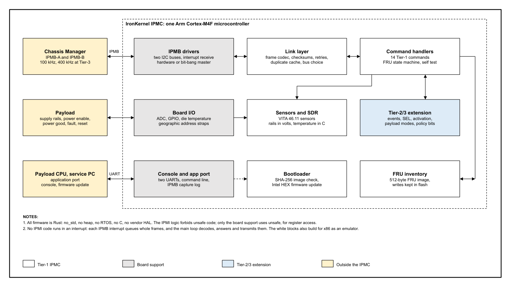

<table style="width:100%; border:none; margin:0; padding:0;">
<tr>
<td style="text-align:left; border:none; padding:0; width:50%;"></td>
<td style="text-align:right; border:none; padding:0; width:50%; vertical-align:bottom;"><strong>Product Brief</strong> Revision 10-27-2026</td>
</tr>
</table>

<h1 style="font-size:30px; margin-top:18px;">VITA 46.11 IPMC in Rust</h1>

Intelligent Platform Management Controller firmware for VPX plug-in modules: Tier-1, Tier-2 and
Tier-3 on one Arm Cortex-M4F microcontroller, written entirely in Rust.

The IronKernel IPMC is the management controller firmware a VPX plug-in module needs to take part
in an ANSI/VITA 46.11-2022 system. It answers the Chassis Manager on the redundant IPMB-A and IPMB-B
buses, reports the module's identity, FRU inventory and sensors, runs the FRU state machine that
controls payload power, and at Tier-2 and Tier-3 sends events and keeps a System Event Log. On the
reference board it runs on a single STM32F401RE Arm Cortex-M4F microcontroller, with no FPGA, no
RTOS and no C code. It is built natively and entirely in Rust with the standard Rust compiler
(`rustc` 1.99.1, stable). The IPMI logic contains no hardware code, so the IPMC moves to other
processors with a new board support layer: other Arm Cortex-M and Cortex-A CPUs, the Arm-based
PIC32C microcontrollers, and the RISC-V soft processors Nios V and MicroBlaze V in an FPGA.

### Highlights

- Memory-safe by construction: the Rust compiler rejects buffer overruns, use-after-free and data races at build time; the IPMI logic forbids `unsafe` code
- No heap, no RTOS, no C: all memory is fixed at build time
- Designed to meet DO-178C Level D (DAL-D), with a Level D plan, gap analysis and tool assessment
- Builds with the Ferrocene safety-qualified Rust compiler today, for programs that ask for a qualified toolchain
- Boot image validation: the bootloader checks the image's length and SHA-256 digest before every start
- Tier-1, Tier-2 and Tier-3 from one source tree
- Dual IPMB with per-bus queues, retries on the other bus and a duplicate cache
- Supply rails in volts and die temperature in degrees C
- PC emulator of the same IPMI code; 1,240 test cases, none failing

### At a glance

| Item | Value |
|---|---|
| Standard | ANSI/VITA 46.11-2022, IPMI v2.0 |
| Tiers | 1, 2 and 3 |
| Processor | STM32F401RE (reference board); ports to Arm, PIC32C, Nios V, MicroBlaze V |
| Flash used | 141 KB runtime, 23 KB bootloader |
| RAM used | 25 KB static |
| IPMB | two buses, 100 kHz; 400 kHz at Tier-3 |
| Language | Rust, `no_std`; `rustc` 1.99.1 stable |
| PC build | emulator, x86-64 |

## How it works

**Figure 1.** The IronKernel IPMC on the module (product-brief, sheet 1)

Each IPMB interrupt stores whole frames in a queue for its bus; the main loop merges both queues
in arrival order, drops repeated requests through the duplicate cache, and answers each one. The
IPMI logic (frame codec, link layer, commands, sensors, SDR, FRU state machine) has no hardware
code, so it is tested on a PC and moves to another microcontroller with a new board support layer.

| Area | Features |
|---|---|
| IPMB link | IPMB-A and IPMB-B, each with its own receive state; hardware I2C or bit-bang master; six tries per request, resent on the other bus; Set IPMB State; a build switch for strict VITA 46.11 or same-bus responses |
| Commands | the 13 Tier-1 mandatory commands and Broadcast Get Device ID; 4 more commands and event messages at Tier-2; 18 more at Tier-3 (Tiers, page 3) |
| Sensors and SDR | the VITA 46.11 mandatory sensors; five supply rails in volts and the die temperature in degrees C, with Full SDR records and thresholds |
| FRU inventory | 512-byte FRU 0 image with Board and Product areas; Write FRU Data kept in on-chip flash across a reset; write protection input; serial numbers, part numbers, asset tag and manufacturing date writable per unit |
| FRU state and payload | FRU states M0 to M7; payload power enable, power good, fault and reset signals; startup self test |
| Firmware update | bootloader in its own flash sectors; image length and SHA-256 check before every start; Intel HEX load over the console or the application port, with a host update tool |
| Payload CPU link | application port (UART) for status, local IPMI requests and the per-unit FRU fields |
| Diagnostics | console command line; IPMB capture log of every frame, exported as CSV or as a trace for Wireshark |
| Configuration | one Rust file holds every tunable: identity strings, sensor names and thresholds, bus enables, master method, IPMB rules; compile-time checks reject invalid values |

## Tiers

| Tier | Commands | What the Tier adds |
|---|---|---|
| Tier-1 | 14 | Device ID, self test, Device SDR, sensor readings, FRU inventory read and write, VSO capabilities, Set IPMB State, Device Locator Record ID, FRU address information |
| Tier-2 | 18 | event receiver, Platform Event messages to the Chassis Manager, Cold Reset, FRU Control Capabilities |
| Tier-3 | 36 | Warm Reset, FRU Control, FRU activation and policy bits, payload modes, sensor event enables, the System Event Log and its time, FRU hash, Mandatory Sensor Numbers, BMC global enables, 400 kHz IPMB |

## Verification

| Evidence | Result |
|---|---|
| Host and tool tests (Rust and Python) | 1,240 test cases recorded with their results: 1,173 passed, 0 failed, 67 bench rows deferred or not testable on the evaluation board |
| Conformance suite | written from the VITA 46.11 and IPMI texts only, by an author who does not read the implementation; runs against the board or the emulator. Tier-3 build: 101 requirements, 78 passed, 0 failed, 23 not testable on the emulator; Tier-2 build: 65 requirements, 54 passed, 0 failed, 11 not testable |
| Captured system traffic | the emulator replays the IPMB traffic of a live VPX chassis and compares every answer |
| Third-party Chassis Manager | an independent VITA 46.11 Chassis Manager's Linux code, compiled for a PC and driving a real IPMB, discovers the IPMC, walks its SDR, reads its FRU inventory and sensors: 198 requests, 198 answers, no checksum errors |

## Offerings

| Offering | Contents |
|---|---|
| Tier-1 source | the full Tier-1 source, free to download, build and evaluate; a commercial license for deployment in a product |
| Tier-2 and Tier-3 licenses | source of the Tier-2/3 extension, per project or part number, with 12 months of updates and support; units are royalty-free |
| Evaluation image | a Tier-3 firmware image for the NUCLEO-F401RE board ([buy the board](https://www.digikey.com/en/products/detail/stmicroelectronics/NUCLEO-F401RE/4695525), part 497-14360-ND) that serves the IPMB for a fixed time after each start |
| Engineering services | port to your microcontroller and board, your sensors, FRU and SDR content, bring-up against your Chassis Manager |

### Hardware needed

The IPMC needs two I2C ports for IPMB-A and IPMB-B, GPIO for the geographic address straps and
the payload power signals, an ADC for the rails, and one UART for the console. Commands that VITA
46.11 requires only for a payload system interface, subsidiary FRU EEPROMs or a power supply
module are outside the standard build.
