<table style="width:100%; border:none; margin:0; padding:0;">
<tr>
<td style="text-align:left; border:none; padding:0; width:50%;"><strong>CONFIDENTIAL DOCUMENT &#8211; DO NOT DISCLOSE</strong></td>
<td style="text-align:right; border:none; padding:0; width:50%;"><strong>Revision 10-26-2026</strong></td>
</tr>
</table>
<hr style="border:none; border-top:2px solid #000; margin:4px 0 12px 0;">

<div style="height: 8.2in; display: flex; flex-direction: column; justify-content: center; text-align: center;">
<h1 style="border: none;">VITA 46.11 Tier-1 IPMC Software Specification</h1>
<p style="font-size: 16px;">IPMIRustFRU: Rust IPMC firmware for the NUCLEO-F401RE, x86 emulator and bench tools</p>
<p style="font-size: 16px;"><strong>Revision 10-26-2026</strong></p>
</div>

<div style="page-break-after: always;"></div>

<table style="width:100%; border:none; margin:0; padding:0;">
<tr>
<td style="text-align:left; border:none; padding:0; width:50%;"><strong>CONFIDENTIAL DOCUMENT &#8211; DO NOT DISCLOSE</strong></td>
<td style="text-align:right; border:none; padding:0; width:50%;"><strong>Revision 10-26-2026</strong></td>
</tr>
</table>
<hr style="border:none; border-top:2px solid #000; margin:4px 0 12px 0;">

## Quick Start

1. Host tests and the emulator, from the repository root (Rust stable, GNU host):
   `cargo test --workspace`, then
   `cargo run -p ipmc-emu -- replay vectors/sbc_ab.vec --b-fitted 1 --b-enabled 1 --policy alternate --quiet`
   (the capture file is local only; on a fresh clone the capture tests skip with a message).
2. Firmware build and flash (NUCLEO-F401RE on USB):
   `powershell -ExecutionPolicy Bypass -File crates/ipmc-nucleo-f401re/gen.ps1 flash`.
   `flash` builds the bootloader (sectors 0-1) and the runtime (from sector 3) and copies the board
   image `ipmc-board.bin` to the drive; `flash -Swd` programs the patched runtime ELF over SWD
   instead (section 12.1; the two paths treat the FRU store differently, section 9.1).
   The console is COM3 at 115200 8N1; `gen.ps1 console "sys status"` sends one command and prints
   the reply.
3. Bench check with an independent IPMI implementation (Aardvark on IPMB-A, PB8/PB9):
   `tools\python-ipmi\.venv\Scripts\ipmitool.exe -I aardvark -t 0x82 raw 0x06 0x01`
   answers `00 01 80 00 01 02 09 00 00 00 4b 49 00 00 00 00`;
   `python tools/board_test_report.py` runs every bench check and writes
   `Documentation/board_test_report.md`.
4. Capture log and application port: `DEBUG DUMP` on the console prints the IPMB capture log
   (section 10.11); `python -I tools\capture\capture2pcap.py dump.txt -o dump` turns a saved dump
   into a file Wireshark opens. A USB-serial adapter on PB6/PB7 (COM5 on the bench) reaches the
   application port (section 7.6):
   `tools\python-ipmi\.venv\Scripts\python.exe tools\app-port\app_cli.py --port COM5 INFO STATUS`.
5. Firmware update over a UART (section 16): `gen.ps1 build` writes the patched runtime
   `ipmc-nucleo-f401re.hex`; `python tools\fwupdate\fwupdate.py --port COM5 --enter app --enter-port COM5
   update ipmc-nucleo-f401re.hex` asks the running firmware for the bootloader (`BOOTLOADER CONFIRM`
   on the application port), erases the runtime sectors, loads the file record by record, compares the
   SHA-256 the bootloader reports with the file and starts the new runtime.

## Table of Contents

1. [Overview](#1-overview)
2. [System Context](#2-system-context)
3. [Requirements](#3-requirements)
4. [Architecture](#4-architecture)
5. [Build-Time Configuration](#5-build-time-configuration)
6. [Module Descriptions](#6-module-descriptions)
7. [Interfaces](#7-interfaces)
8. [Clocking, Reset and Start-Up](#8-clocking-reset-and-start-up)
9. [Memory Map and Data Layouts](#9-memory-map-and-data-layouts)
10. [Data Flow and Protocol](#10-data-flow-and-protocol)
11. [Software API](#11-software-api)
12. [Build, Integration, and Configuration](#12-build-integration-and-configuration)
13. [Verification](#13-verification)
14. [Example Sequences](#14-example-sequences)
15. [Bootloader](#15-bootloader)
16. [Firmware Update and Image Integrity](#16-firmware-update-and-image-integrity)
17. [Constraints and Limitations](#17-constraints-and-limitations)

The section 10 diagrams are Mermaid state and sequence diagrams and one WaveDrom timing diagram;
the block drawings are the seven sheets of the `ipmc-software` drawing set
(`diagrams/src/ipmc-software.js`, rendered to `diagrams/out/png/`): sheet 1 crate structure (Figure
4-1), sheet 2 request path (Figure 10-1), sheet 3 sensor data, FRU state and persistence (Figure
10-2), sheet 4 build, test and bench setup (Figure 13-1), sheet 5 flash map and images (Figure 9-1),
sheet 6 firmware update data path (Figure 16-1), sheet 7 payload processor integration (Figure 7-1).
The Google Slides reference copies wait for the Drive folder (`diagrams/drive-config.json` holds
`folder_id` TBD); until it is set, the source and the rendered sheets are the drawing set.

<div style="page-break-after: always;"></div>

<table style="width:100%; border:none; margin:0; padding:0;">
<tr>
<td style="text-align:left; border:none; padding:0; width:50%;"><strong>CONFIDENTIAL DOCUMENT &#8211; DO NOT DISCLOSE</strong></td>
<td style="text-align:right; border:none; padding:0; width:50%;"><strong>Revision 10-26-2026</strong></td>
</tr>
</table>
<hr style="border:none; border-top:2px solid #000; margin:4px 0 12px 0;">

## 1. Overview

IPMIRustFRU is an Intelligent Platform Management Controller (IPMC) for a VPX plug-in module,
written in Rust to ANSI/VITA 46.11-2022 Tier 1. It runs on an STM32F401RE (NUCLEO-F401RE board),
answers a Chassis Manager over the redundant Intelligent Platform Management Bus (IPMB-A and
IPMB-B, I2C at 100 kHz; 400 kHz FAST-MODE at Tier-3), serves the FRU 0 inventory and the Device SDR repository, reports the
seven mandatory VITA sensors and keeps Write FRU Data in on-chip flash across a reset. The same
IPMI code builds for the PC as an emulator that replays captured Chassis Manager traffic or
serves a live Chassis Manager over TCP. This document explains how the code works, crate by
crate and module by module, for a software engineer who maintains or extends it.

The primary function is a Tier-1 IPMC: the 13 Tier-1 mandatory commands plus Broadcast Get Device
ID, the 7 mandatory sensors, FRU 0 with Common Header, Board Info and Product Info areas,
the FRU 0 Operational State machine (M0, M1, M4, M6; M5 at Tier-3), dual-bus link rules (alternation,
resend on the other bus, Set IPMB State), a startup self test and NVMRO write protection.

The firmware runs on the STM32F401RE with the bit-bang IPMB master (default) or
the hardware I2C master. The x86 emulator offers capture replay (`replay`), real-time TCP serving
(`serve`) and an SDR dump (`sdr`).

The firmware has two serial ports, both interrupt driven. The console (USART2, the ST-LINK
virtual COM port) carries the command line, including the DEBUG group: the IPMB capture log
records every whole frame received and sent and every trace line, and the console dumps it as CSV
or as trace rows for a spreadsheet or Wireshark (section 10.11). The application port (APP_UART,
USART1 on PB6 and PB7) lets a payload CPU on the same board ask for status, run IPMI requests
locally and write the per-unit FRU fields (serial numbers, part numbers, asset tag,
manufacturing date); its protocol is the `ipmc-app` crate (section 7.6).

The firmware is two images in one flash. The bootloader in sectors 0 and 1 starts first after every
reset, checks the runtime firmware against the length and SHA-256 digest of its image header, and starts
it, or stays and serves a command session on the console or the application port, where the runtime
can be erased and loaded again as Intel HEX records (sections 15 and 16). The runtime firmware in
sectors 3 to 7 is the IPMC described in the other sections; sector 2 holds the FRU flash store.

The public build is the Tier-1 IPMC described here. A commercial release build adds a private
Tier-2/3 extension through the hook interface of section 4 (Build modes and the Tier-2/3 extension).
The public build answers every command the Tier-1 table does not own C1h; section 7.2 lists the commands
VITA 46.11 requires at Tier 2 and Tier 3 and the commands the commercial build answers; its tests are in
`Documentation/ipmc_test_coverage.md` (section "Tier-2/3 extension").

The public build leaves out the Tier-2 and Tier-3 functions (events, payload power control
by the Chassis Manager, FRU activation policy; they belong to the commercial release build),
optional Tier-1 commands (Get Mandatory Sensor Numbers,
FRU Control Capabilities, Get IPMB Link Info, Get FRU Hash, Get Device GUID, Set SEL Time:
all answer C1h), subsidiary FRUs, and IPMI bridging. The built FRU image has no Internal Use
or MultiRecord area; `verify` still checks those areas when a written image contains them.

The code is the authority for every statement here. Where the VITA 46.11-2022 text and the
captured live Chassis Manager disagree, the code follows the specification.

<div style="page-break-after: always;"></div>

<table style="width:100%; border:none; margin:0; padding:0;">
<tr>
<td style="text-align:left; border:none; padding:0; width:50%;"><strong>CONFIDENTIAL DOCUMENT &#8211; DO NOT DISCLOSE</strong></td>
<td style="text-align:right; border:none; padding:0; width:50%;"><strong>Revision 10-26-2026</strong></td>
</tr>
</table>
<hr style="border:none; border-top:2px solid #000; margin:4px 0 12px 0;">

## 2. System Context

- **Target device:** STM32F401RET6 (Cortex-M4F, 512 KB flash, 96 KB RAM) on the NUCLEO-F401RE,
  84 MHz system clock from the 8 MHz ST-LINK MCO clock in HSE bypass.
- **Operating environment:** bare metal, `no_std`, one cooperative main loop plus interrupt
  handlers that move bytes, stamp times and drive the LED (the I2C slaves, the USART1 and USART2
  rings, SysTick).
  No RTOS, no heap.
- **Host build:** `x86_64-pc-windows-gnu` (the same sources build for
  `x86_64-unknown-linux-gnu`); the emulator is a `std` binary.
- **Dependencies:** `cortex-m 0.7.10`, `cortex-m-rt 0.7.7`, `stm32f4 0.16.0` (PAC, feature
  `stm32f401`), `heapless 0.8.0` (SPSC queues), `panic-halt 1.0.0`, `embedded-hal 1.0.0`
  (bus traits of the example external sensor drivers). Every version is an exact `=` requirement.
- **Peers on the IPMB:** a Chassis Manager at 8-bit address 20h (`IPMB_CM_ADDR8`; the captured
  live Chassis Manager uses 10h). The IPMC answers at (40h + GA[4:0]) x 2: slot 1 is 82h.
- **Bench:** an Aardvark I2C host adapter on IPMB-A with its pull-ups on, driven by python-ipmi
  as the Chassis Manager; the ST-LINK USB port carries the console (COM3) and the drag-and-drop
  flash drive (`NOD_F401RE`); a USB-serial adapter (COM5) on PB6 and PB7 carries the application
  port (`tools/app-port/app_cli.py`).
- **Normative documents:** ANSI/VITA 46.11-2022 (local, licensed, not in the repository),
  IPMI v2.0 rev 1.1, IPMI Platform Management FRU Information Storage Definition v1.0 rev 1.3,
  RM0368 (STM32F401 reference manual), DS10086 (datasheet), UM10204 (I2C-bus specification).

| Term | Meaning |
|---|---|
| IPMB | Intelligent Platform Management Bus: I2C with IPMI framing and two checksums |
| rsSA / rqSA | responder / requester slave address, 8-bit form (7-bit address shifted left, R/W bit 0) |
| NetFn | network function; even for a request, odd (request + 1) for its response |
| VSO | VITA Standards Organization; its Group Extension defining-body byte is 03h |
| SDR | Sensor Data Record; the Device SDR repository lives in the IPMC |
| FRU | Field Replaceable Unit; FRU 0 is the module that holds the IPMC |
| GA, GAP | geographic address straps GA[4:0] and their odd-parity strap |
| NVMRO | non-volatile memory read-only strap; asserted, the IPMC writes no non-volatile memory |
| T1..T9, C1 | VITA 46.11 Table 4.1.1-1 timing and retry parameters |
| APP_UART | the application UART (USART1) between the IPMC and the payload CPU |

<div style="page-break-after: always;"></div>

<table style="width:100%; border:none; margin:0; padding:0;">
<tr>
<td style="text-align:left; border:none; padding:0; width:50%;"><strong>CONFIDENTIAL DOCUMENT &#8211; DO NOT DISCLOSE</strong></td>
<td style="text-align:right; border:none; padding:0; width:50%;"><strong>Revision 10-26-2026</strong></td>
</tr>
</table>
<hr style="border:none; border-top:2px solid #000; margin:4px 0 12px 0;">

## 3. Requirements

### Functional requirements

| ID | Requirement | Rule | Where |
|---|---|---|---|
| FR-001 | Answer the Tier-1 mandatory commands of Tables 10.1.1-1 and 10.1.2-1; every other command answers C1h | Rules 4.2-2, 4.1.1-16 | `ipmc-core/src/commands.rs` |
| FR-002 | Answer Broadcast Get Device ID (general-call 00h before the frame) at the own address only | IPMI 20.9 | `link.rs` `on_frame` |
| FR-003 | FRU Device ID other than 0 answers C9h (Get FRU Address Info ignores the ID when a physical address key is given) | Rules 4.2-3, 4.1.1-17 | `cmd/mod.rs` `check_fru_device_id` |
| FR-004 | Power-up bus state: IPMB-A enabled, IPMB-B isolated until Set IPMB State | Rule 4.1.1-4 | `link.rs` `BusPair::power_up` |
| FR-005 | Accept requests on both buses; alternate transmissions between enabled buses | Rules 4.1.1-5, 4.1.1-6 | `link.rs` `choose_tx_bus` |
| FR-006 | Resend a failed transmission on the other bus, at most `IPMB_TX_RETRIES` times | Rule 4.1.1-7 | `link.rs` `on_tx_result` |
| FR-007 | Refuse a Set IPMB State that leaves no bus enabled (CCh) | Rule 4.1.8-3 | `link.rs` `plan_ipmb_state` |
| FR-008 | Bus state changes only by Set IPMB State or a persistent local fault | Rule 9.3-10 | `link.rs`, `ipmb_link.rs` |
| FR-009 | A retried request (same requester, sequence, command and data) is answered from a cache and runs no handler | Obs 4.1.1-6 (a retry keeps its sequence number) | `dupcache.rs` |
| FR-010 | Report sensors 0..6 with the layouts of Tables 10.2.1-1 to 10.2.7-1, and sensor 7 (Payload Mode, Table 10.2.8-1) at Tier-3 | Table 10.2-1 | `sensor.rs`, `dispatch.rs` `read_sensor` |
| FR-011 | FRU 0 holds Common Header, Board Info and Product Info areas; Chassis Info offset 00h | Rules 8.1-2, 8.1-3 | `ipmc-fru/src/records.rs` |
| FR-012 | FRU data readable whatever the payload power | Rule 8-1 | `cmd/storage.rs` |
| FR-013 | Write FRU Data while NVMRO is asserted answers 80h and changes nothing; an application port `FRU SET` answers `ERROR NVMRO` and changes nothing; no flash write while NVMRO is asserted | Rules 8-3, 8-5, Rec 4.1.10-1 | `cmd/storage.rs`, `app_port.rs`, `persist.rs`, `drivers/flash.rs`, `bsp/flash_regs.rs` |
| FR-014 | FRU 0 state machine M0 to M1 on the initial checks, M1 to M4 on valid payload power, M4 to M6 on power loss, M6 to M1 on a complete shutdown; at Tier-3 also M4 to M5 on a deactivation request, M5 to M4 when it is cleared and M5 to M6 on power loss | Section 4.1.5, Rules 4.1.5.4.1-2, 4.1.5.4.2-3, 4.1.5.4.3-2, 4.1.5.4.4-2, 4.1.5.4.4-5, 4.1.5.4.5-1 | `fru_state.rs` |
| FR-015 | A payload power-on request in M6 is refused, and an extension can refuse it through the `power_on_allowed` hook; one check serves the boot power-on, the handler hand-off and the console | Rules 4.1.5.4.5-2, 4.1.5.4.2-1 | `fru_state.rs` `check_power_on`, `ext.rs` `check_power_on` |
| FR-016 | An invalid hardware address (even parity or GA = 0) isolates both buses and keeps the FRU in M0 | Rules 4.1.5.4.1-4, 4.1.5.4.1-5 | `addr.rs`, `link.rs` |
| FR-017 | Startup self test of the FRU image and the SDR chain; 55h 00h or 57h with the failure bits; a failure keeps the FRU in M0; rerun after each accepted Write FRU Data | IPMI Table 20-5, Rule 4.1.5.4.1-9, Rec 8-2 | `selftest.rs` |
| FR-018 | Write FRU Data and an application port `SET` survive a reset (`IPMC_FRU_PERSIST true`); the FRU store is flash sector 2 alone | owner decisions 10-23-2026 and 10-25-2026 | `persist.rs`, `fru_log.rs`, `memory.x`, `link.x` |
| FR-019 | No IPMC pull-ups on the IPMB lines | Rule 9.2.3-2 | `drivers/ipmb_pins.rs`, `i2c_hw.rs` |
| FR-020 | A (netFn, cmd) the Tier-1 table does not own goes to the extension hook; the Tier-1 build has none and answers C1h | Rules 4.2-2, 4.1.1-16 | `ext.rs`, `dispatch.rs` |
| FR-021 | A Tier-2/3 build sends requests one at a time: a response wait of `IPMB_REQ_TIMEOUT_MS` (T3), up to `IPMB_REQ_RETRIES` retries with the same sequence number, a failed transmission retried on the other bus after T6 (60 ms minimum), T4 between new requests, T9 before a sequence number is reused; a Tier-1 build sends none | Rules 4.1.1-9, 4.1.1-10, 7-4, Table 4.1.1-1 | `requester.rs`, `link.rs` |
| FR-022 | A Cold Reset request restarts the processor once its response has left the egress queue, the application port output has left and an accepted FRU write is saved, or after `IPMC_RESET_WAIT_MS` | IPMI v2.0 20.2 | `reset_gate.rs`, `ipmb_link.rs` |
| FR-023 | The optional speed byte of Set IPMB State sets each bus to 100 kHz (00b) or, at Tier-3 on a fitted bus, 400 kHz (01b); every other value, a reserved bit and 400 kHz below Tier-3 answer CCh with no change; every bus starts and restarts at 100 kHz | Rules 4.1.1-4.3, 4.1.1-4.4, 4.1.1-14 | `cmd/vita.rs`, `link.rs` `plan_ipmb_speed` |
| FR-024 | A pending Warm Reset (set by an extension handler) restarts the link state and the requester without a processor reset, once its response has left and an accepted FRU write is saved, or after `IPMC_RESET_WAIT_MS` | IPMI v2.0 20.3 | `reset_gate.rs`, `ipmb_link.rs`, `link.rs` `restarted` |
| FR-025 | A pending payload reset (set by an extension handler) holds PAYLOAD_RST_OUT_N (PA9, open drain) low for `IPMC_PAYLOAD_RESET_PULSE_MS` without blocking the main loop; the FRU state does not change | Rule 4.1.2-9 | `reset_pulse.rs`, `sensing.rs` |
| FR-026 | Every whole IPMB frame the IPMC receives (before the parser) or sends (with its outcome) and every trace line goes into a RAM ring of `IPMC_LOG_SIZE` bytes, oldest overwritten first; the console dumps it as CSV or as trace rows | owner, Phase 11 (PLAN, 10-25-2026) | `ipmc-log`, `log_cmds.rs`, `ipmb_link.rs` |
| FR-027 | A payload CPU on APP_UART gets, per request line, zero or more `KEY: value` data lines and exactly one final line (`OK` or `ERROR <CODE>: <sentence>`), with the optional tag on the final line, in text a person reads and a parser splits; a `FRU SET` of a unit field rewrites that field in place, moves no area and goes to the flash through the Write FRU Data save path | owner, Phase 11 (PLAN, 10-25-2026) | `ipmc-app`, `app_port.rs`, `ipmc-fru/src/unit.rs` |
| FR-028 | The bootloader checks the runtime image header (magic, format, size, length, vector table address), the vector table and the SHA-256 digest at every reset, and starts the runtime only when the check passes and no pin or request keeps the bootloader; a failed check keeps the bootloader and its command session | owner, Phase 12 (PLAN decisions 31 to 37) | `ipmc-boot/src/header.rs`, `decision.rs`, `src/boot/main.rs` |
| FR-029 | The runtime is erased and loaded again over the console or the application port as Intel HEX records, one record in flight, each record range-checked, erased-checked and read back; sectors 0 and 1 are refused twice and sector 3 is erased first | owner, Phase 12 | `ipmc-boot/src/load.rs`, `geometry.rs`, `session.rs`, `bsp/flash_regs.rs`, `tools/fwupdate/fwupdate.py` |

### Performance requirements

| Item | Target | Notes |
|---|---|---|
| Response time | at most 227 ms (T5) | request STOP to response STOP; `RESPONSE_DEADLINE_MS`, late ones counted |
| One master write | at most T2 + T1 = 80 ms | retries included; `WRITE_BUDGET_NS`; one write per pass |
| Clock stretch | at most 3 ms (T8) | `IPMB_STRETCH_TIMEOUT_US 3000` |
| Bus-free wait | at least 60 ms (T2) | `IPMB_BUS_FREE_TIMEOUT_MS 60`; ends at the write budget |
| One IPMB frame | at most 20 ms (T1) | `ipmb_common.rs` `T1_FRAME_NS` |
| IPMB clock | 100 kHz maximum; 400 kHz maximum in FAST-MODE (Tier-3) | half bit 5000 ns; measured SCL period 12.0 us (83 kHz). FAST-MODE: bit-bang 6795 ns (about 147 kHz), hardware master 2981 ns (about 335 kHz) |
| Runtime image check | 172 ms for the 139 456-byte image at 84 MHz | `header::check` SHA-256, once per reset; `Image check:` line of the bootloader trace; about 1.2 us per byte |
| Flash sector erase | typical 250 ms, at most 500 ms (16 KB sector, x32 programming), core stalled; 198 ms measured on the bench | DS10086 Table 45; IPMB slaves off the bus meanwhile; one erase per 60 saves, and only when the bus is quiet |

### Compliance requirements

ANSI/VITA 46.11-2022 Tier 1, Layer 1 IPMC (VSO revision 22h); IPMI v2.0 rev 1.1 message formats,
completion codes (Table 5-2) and the Group Extension defining-body rule (Table 5-1, section 5.3.1).
The spec-only suite in `tools/conformance/` (section 13) checks the IPMC against those texts.

<div style="page-break-after: always;"></div>

<table style="width:100%; border:none; margin:0; padding:0;">
<tr>
<td style="text-align:left; border:none; padding:0; width:50%;"><strong>CONFIDENTIAL DOCUMENT &#8211; DO NOT DISCLOSE</strong></td>
<td style="text-align:right; border:none; padding:0; width:50%;"><strong>Revision 10-26-2026</strong></td>
</tr>
</table>
<hr style="border:none; border-top:2px solid #000; margin:4px 0 12px 0;">

## 4. Architecture

### Crate structure

**Figure 4-1.** Crate structure and dependencies (ipmc-software, sheet 1)

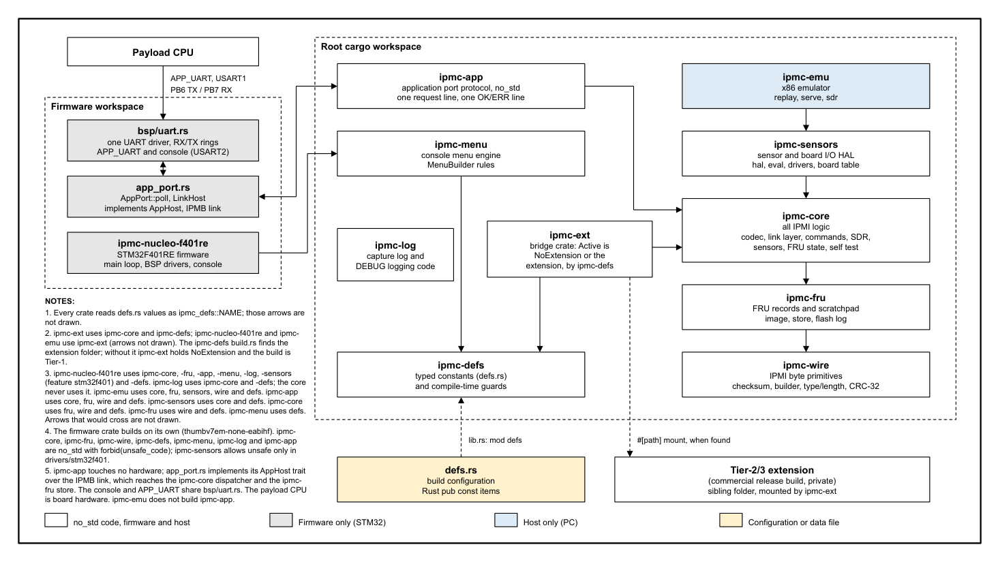

Source: `diagrams/src/ipmc-software.js`, sheet 1.

The code is a Cargo workspace of eleven crates plus the firmware crate, which is its own
workspace (it builds only for `thumbv7em-none-eabihf`). Dependencies point one way: the binaries at
the top (the emulator, the two firmware binaries and the `fwimage` tool), the IPMI and bootloader logic in
the middle, the configuration reader at the bottom. The bridge crate `ipmc-ext` sits between the IPMI
logic and the binaries; it is the only place the private Tier-2/3 extension enters the build.

| Crate | Kind | Holds |
|---|---|---|
| `ipmc-defs` | `no_std` library | the build configuration as Rust (`src/defs.rs`, and the extension's `defs_tier23.rs` when the extension is built in): one typed `pub const` per define, no parser, compile-time guards on every value, the IPMB timing arithmetic (`i2c_timing.rs`) and the one detection of the Tier-2/3 extension (`build.rs`, `tier23_detect.rs`, `dep_cfg.rs`) |
| `ipmc-wire` | `no_std` library | IPMI byte primitives: zero checksum, const record builder, type/length ASCII field, CRC-32, SHA-256 (`Sha256`), the boot request check word, hex-byte parser |
| `ipmc-fru` | `no_std` library | every FRU 0 record (image build, decoder, `verify`), the FRU field editor (`unit.rs`) and the manufacturing date (`date.rs`), the RAM scratchpad (`FruStore`) and the flash store (`persist`) |
| `ipmc-core` | `no_std` library, `forbid(unsafe_code)`, no allocator | every IPMI decision: frame codec, address decode, link layer with the IPMB requester, duplicate cache, queues, byte ring, shared names (`names.rs`), command table, dispatcher, extension hook interface, handlers, SDR repository, Tier rules, event enables, sensor encoders, FRU state machine, self test, reset gate, trace hook |
| `ipmc-log` | `no_std` library, `forbid(unsafe_code)`, no allocator | the capture log and the logging logic of the DEBUG menu: record ring (`record.rs`), CSV and trace printers (`print.rs`), the paced dump (`dump.rs`), the trace tee (`tee.rs`) and the log switches with their status lines (`switches.rs`); depends on `ipmc-core` and `ipmc-defs` |
| `ipmc-boot` | `no_std` library with a host binary, `forbid(unsafe_code)`, no allocator | every bootloader decision with no F401 code: the image header and its one check, the SHA-256 digest use, the start decision and the countdown, the boot request words, the region policy of erase and `LOAD`, the command table and the session state machine, the Intel HEX parser, the trace text, and the `fwimage` host tool (section 15); depends on `ipmc-defs`, `ipmc-wire`, `ipmc-fru` and `ipmc-menu` |
| `ipmc-ext` | `no_std` library, `forbid(unsafe_code)` | the bridge: `ipmc_ext::Active` is `NoExtension` in the Tier-1 build and the extension's state when `ipmc-defs` found it; the firmware and the emulator hold one `Active` |
| `ipmc-sensors` | `no_std` library | sensor and board-I/O HAL: four traits, hardware-free evaluation, drivers (simulation, STM32F401 ADC/GPIO behind feature `stm32f401`, example I2C/SPI parts), board table, sampling monitor, payload reset pulse timing, GPIO pin ownership |
| `ipmc-menu` | `no_std` library, no dependencies besides `ipmc-defs` | the console menu engine (MenuBuilder rules, tiered groups) |
| `ipmc-app` | `no_std` library, `forbid(unsafe_code)`, no allocator; a reference crate for a customer application (PLAN decision 27) | the application port protocol: line assembler, command table `COMMANDS`, handlers, and the `AppHost` trait through which the firmware gives the protocol its view of the board (section 6.8) |
| `ipmc-emu` | host `std` binary and library | the x86 emulator: vector reader, `Emulator`, capture replay (also the Event Receiver), real-time `serve`, SDR dump |
| `ipmc-nucleo-f401re` | one crate, `no_std`, its own cargo workspace: a library and two binaries | the library (`src/lib.rs`, `src/bsp/`) is the board support both images use: clock, UART driver, LED, SysTick, DWT cycle counter, strap pins, NVMRO and the BOOTLOADER pin, reset cause, FLASH register layer, boot request words, fault handlers, `static_slot`, the `out!` console macro; the runtime binary (`src/main.rs`, `src/drivers/`, sectors 3-7) holds start-up, the hardware only the runtime uses (IPMB masters, I2C slaves, IPMB and board pins, the FRU store driver), the console, the application port transport and the composition of the crates above; the bootloader binary `ipmc-boot` (`src/boot/`, sectors 0-1) is the glue of `ipmc-boot`: start sequence and jump, line editors, session loop, flash access |

### Layering rules

- `ipmc-core` decides; the firmware and the emulator move values. A handler never touches
  hardware; a driver never decides an IPMI response.
- No IPMI code runs in an interrupt. The I2C interrupt posts whole frames to a per-bus
  single-producer single-consumer queue; the main loop runs the link layer and the handlers.
- Two images, one library: the runtime and the bootloader link the same `src/bsp/` code and never run
  together. The bootloader owns the processor from reset until it jumps; `src/boot/start.rs` returns every
  peripheral it used to its reset state before the jump, and the runtime start-up then runs unchanged
  (section 15.6). `bsp/flash_regs.rs` refuses sectors 0 and 1 for both.
- One owner per hardware resource: `ports` owns GPIOA..GPIOC and hands out pin claims;
  `drivers/i2c_hw.rs` owns I2C1 and I2C3; the bit-bang master owns the IPMB pins only while it
  transmits; `bsp/flash_regs.rs` owns the FLASH registers after clock start-up (`drivers/flash.rs`
  is the store policy over it); `uart.rs` owns
  USART1, USART2 and their pins; `led.rs` owns PA5; `ga.rs` owns the strap pins (GA, GAP, NVMRO
  and the BOOTLOADER pin); `ipmb_link.rs` owns the static Link, the dispatch Context and the
  capture log; `app_port.rs` moves bytes between the APP_UART rings and `ipmc-app` and owns
  nothing else.
- The application protocol never touches hardware: `ipmc-app` asks the board through the
  `AppHost` trait, and the per-unit FRU fields reach the flash through the one path a Chassis
  Manager's Write FRU Data uses (the RAM image, the dirty mark, the save step).
- The dispatcher asks the extension hook only after the Tier-1 table has no row for a command, so
  a Tier-1 command cannot be replaced. Nothing specific to a Tier-2/3 command, event or hook is
  written in this repository: board support, processor functions (reset, flash, timers, the I2C
  speed) and the link layer, the IPMB requester included, live here; the Tier-2/3 commands, hooks and sensor
  events live in the extension.
- One implementation of each function, judged by behaviour (`tools/dupcheck.py` is a gate): one
  checksum, one frame parser and encoder, one GA decode, one sensor-read function, one record
  builder, one retry loop shared by both master methods.
- One file for every tunable value: `crates/ipmc-defs/src/defs.rs` (section 5). Values fixed by a specification
  or datasheet stay in the module that owns them, with the rule cited beside each.

### Key design choices

- The link layer (`ipmc-core/src/link.rs`) is a pure state machine: frames go in with the STOP
  time, responses come out with the bus to use, results come back. The same object runs in the firmware
  and the emulator, so the dual-bus rules are tested on the PC against 309 captured exchanges.
- The bit-bang master (`drivers/i2c_bitbang.rs`) drives the slave's own pins. The I2C peripheral stays
  a slave; for a transmission it is switched off, the same pins are driven open-drain as GPIO,
  then the peripheral is switched back on. This follows the earlier PIC32 controller and avoids
  the STM32 I2C master state machine; the hardware master stays available behind
  `IPMB_MASTER_MODE`.
- The response bus is chosen at first transmission (`Link::next_tx`), not at queue time, so
  alternation follows the frames really handed to a driver, resends included.
- The duplicate cache (`dupcache.rs`) is keyed by the exact request, so a retry runs no handler and a
  retried Write FRU Data or Set IPMB State takes effect once.
- Set IPMB State uses a hand-off (`PendingIpmbState`). The handler cannot reach the Link; it
  validates against a read-only view and leaves the change for `Link::poll`, which applies it
  before the response is queued.
- The FRU flash store (`ipmc-fru/src/persist.rs`) is an append-only log in one sector (flash
  sector 2, 16 KB, 31 records of 528 bytes) with a commit word programmed last and a CRC-32 per
  record; the highest sequence number wins at boot, and a power cut at any word of an append
  leaves the previous record loadable. The save that finds the sector full erases it and writes
  the newest image first (owner decision 10-25-2026, no second copy): a power cut between that
  erase and that write loses the stored image, and the next start-up loads the built image.
- The capture log (`ipmc-log/src/record.rs`) is one byte ring of whole records. Every trace
  sink the firmware hands to the core is a `LoggedTrace`, which records the line and prints it on
  the console unless the IPMI console trace is off (section 10.11).
- Both UART ports run one driver (`bsp/uart.rs`) with a receive and a transmit ring each; a
  write never waits for the wire, and a line that does not fit the transmit ring is dropped and
  counted (section 6.6).
- Configuration is checked at compile time (`ipmc-defs`). A malformed or out-of-range define fails the
  build with its line number or the guard that names it.
- The requester (`requester.rs`) sits in the link layer. The request sequence number, response
  matching and the resend timing sit beside the response path of `Link`, so one `next_tx` hands
  out both and responses keep priority over requests. The extension decides what to send and
  when; a Tier-1 build never sends a request (Rule 7-4).
- A processor reset uses a hand-off (`reset_gate.rs`). A handler asks for a Cold Reset through
  `Context::pending_reset`; the owner of the processor performs it when the gate says nothing is
  lost (section 8.2).
- Processor and payload services use a hand-off (`dispatch.rs`). A handler never switches
  payload power, pulses the payload reset output or restarts the link; it leaves a request in the
  `Context` (`pending_power`, `pending_payload_reset`, `pending_reset`) and the owner of that
  resource performs it (section 6.3, section 8.2).
- The tier rules live in one place (`tier.rs`). Get Device ID, the Device SDR records, the event
  enables, the FRU state machine, the sensor count and the IPMB speed derive their
  Tier-dependent behaviour from six rules (section 9.6).

<div style="page-break-after: always;"></div>

<table style="width:100%; border:none; margin:0; padding:0;">
<tr>
<td style="text-align:left; border:none; padding:0; width:50%;"><strong>CONFIDENTIAL DOCUMENT &#8211; DO NOT DISCLOSE</strong></td>
<td style="text-align:right; border:none; padding:0; width:50%;"><strong>Revision 10-26-2026</strong></td>
</tr>
</table>
<hr style="border:none; border-top:2px solid #000; margin:4px 0 12px 0;">

### Build modes and the Tier-2/3 extension

One source tree builds two kinds of image. The public build is the Tier-1 IPMC of this document.
The commercial release build adds the Tier-2/3 extension, which lives in a private sibling folder
named `IPMIRustFRU_Tier23`; this repository holds only the hook interface, the bridge and the
detection. The public Tier-1 build answers every Tier-2/3 command C1h (section 7.2).

| Build | Selected by | `IPMC_TIER` | `ipmc_ext::Active` |
|---|---|---:|---|
| Public Tier-1 | sibling folder absent, or `IPMC_TIER23=0` | 1 | `NoExtension` |
| Commercial release, Tier-2 | folder present, its `defs_tier23.rs` sets `IPMC_TIER` 2 | 2 | the extension |
| Commercial release, Tier-3 (the default) | its `defs_tier23.rs` sets `IPMC_TIER` 3 | 3 | the extension |
| Evaluation (section 8.4) | `IPMC_EVAL=1` with the extension, release profile | as the commercial build | the extension |

`crates/ipmc-defs/build.rs` is the one detection point; its rules are pure functions in
`tier23_detect.rs`, tested by `tests/tier23.rs`.

| `IPMC_TIER23` | Result |
|---|---|
| unset | on when both marker files exist (the extension's `defs_tier23.rs` and its library source), off when neither exists; exactly one present fails the build ("half a Tier23 checkout") |
| `0` | off, whatever exists: the public Tier-1 build |
| `1` | on; a missing marker file fails the build and names it |
| any other value | fails the build |

- Defines: off uses `defs.rs` plus `IPMC_TIER` = 1 (a `cfg(not(tier23))` constant in `lib.rs`);
  on, `lib.rs` mounts the extension's `defs_tier23.rs` (a `#[path]` module under `cfg(tier23)`)
  and re-exports it beside `defs.rs`; a name in both files is ambiguous where it is used and
  fails the build. The guards of the extension's defines are mounted from the extension folder
  (`defs_guards.rs`).
- `ipmc-defs` publishes the decision. It declares `links = "ipmc_defs"` and prints
  `cargo:tier23=1` or `0` (and `cargo:eval=1` or `0`); cargo hands these to each direct dependent
  as `DEP_IPMC_DEFS_TIER23` and `DEP_IPMC_DEFS_EVAL`. `build.rs` also sets `cfg(tier23)` for
  `ipmc-defs` itself and exports `ipmc_defs::TIER23_BUILT`.
- The dependents share one build-script step. `ipmc-ext` and the firmware crate include
  `crates/ipmc-defs/dep_cfg.rs` and call `cfg_from_defs(key, cfg, path)`, which turns the
  published value into `cfg(tier23)` or `cfg(ipmc_eval)`. They read no file and no other
  variable, so they cannot disagree with `ipmc-defs`.
- With `cfg(tier23)`, `ipmc-ext` mounts the extension's sources through a relative
  `#[path]` and `Active` is the extension's state type; otherwise `Active` is `NoExtension`. A
  compile-time assertion requires a build without the extension to report `IPMC_TIER` 1.
- The build script cannot watch a folder that is missing, so after adding
  it to a tree already built without it, run `cargo clean -p ipmc-defs`. `gen.ps1 build` sets
  `IPMC_TIER23` from the folder.
- `IPMC_EVAL` is unset or 0 (off) or 1 (on); `IPMC_EVAL=1` without the
  extension, or outside the release profile, fails the build. On, it prints a build warning with
  the length and sets `cfg(ipmc_eval)`.

The hook interface is `ipmc_core::ext::Extension`, five methods with a default for the last four.

| Method | Called | Purpose |
|---|---|---|
| `command(ctx, req, out)` | by the dispatcher, after the Tier-1 table has no row for (netFn, cmd) and the LUN and VSO checks passed | answers a command the extension owns with its name and a `Handler`-style result; `None` gives C1h. For NetFn 2Ch the request data and `out` exclude the VSO byte, as for a `Handler` |
| `poll(ctx, requester, now_ms, trace)` | once per `Link::poll`, after the queued requests are answered and `ctx.link` is refreshed | the extension sends its requests through the `Requester` |
| `on_sample(ctx, transition, now_ms, trace)` | once per sensor sample, after `Context::update_sensors` stored the snapshot and stepped the FRU state machine | `transition` is the FRU state change that sample made, if any |
| `warm_reset()` | once, after the owner applied a Warm Reset (`Context::warm_reset` ran) | the extension re-initialises its volatile state (a request in flight, its event timers) and keeps what a Warm Reset keeps (section 8.2) |
| `power_on_allowed(ctx)` | by `ext::check_power_on`, after the FRU state machine's own check passed | whether payload power may come on now; the default allows it, so the Tier-1 build is unchanged, and a Tier-3 extension answers false while the FRU is activation-locked (Rule 4.1.5.4.2-1) |

`NoExtension` answers nothing and takes the defaults of the hooks. `ext::feed_sensors(ctx, ext, now_ms,
snapshot, trace)` is the one sensor-sample entry of the firmware and the emulator: it calls
`update_sensors`, then `on_sample` with the transition, and returns the transition.
`ext::check_power_on(ctx, ext)` is the one combined power-on check: `FruMachine::check_power_on`
first (`PowerOnRefused::DeactivationInProgress` in M6), then `power_on_allowed`
(`PowerOnRefused::ActivationLocked`); the first refusal is returned. The boot power-on, the
`pending_power` On hand-off and the console `POWER ON` all call it.

<div style="page-break-after: always;"></div>

<table style="width:100%; border:none; margin:0; padding:0;">
<tr>
<td style="text-align:left; border:none; padding:0; width:50%;"><strong>CONFIDENTIAL DOCUMENT &#8211; DO NOT DISCLOSE</strong></td>
<td style="text-align:right; border:none; padding:0; width:50%;"><strong>Revision 10-26-2026</strong></td>
</tr>
</table>
<hr style="border:none; border-top:2px solid #000; margin:4px 0 12px 0;">

## 5. Build-Time Configuration

`crates/ipmc-defs/src/defs.rs` is the single build configuration. It is plain Rust with no parse
or generation step: one `pub const NAME: T = value;` item per tunable, each with a `///` comment
that carries the rule beside it, in the order of the sections below. The file holds no `use`, no
function, no macro and no check; a person changes a build by editing a value (and, for a choice,
the variant of a small enum). Every crate reads a value as `ipmc_defs::NAME`; `lib.rs` re-exports
the module (`pub use defs::*`).

Each define has the type its consumers need:

| Kind | Type | Examples |
|---|---|---|
| switch or enable | `bool` | `IPMB_BUS_B_ENABLE`, `IPMC_FRU_PERSIST`, `IPMC_SUPPORT_SENSOR` |
| size, depth, count, length used as an index | `usize` | `IPMB_MSG_MAX`, `IPMC_LOG_SIZE`, `IPMC_FRU_SIZE`, the `IPMC_FRU_*_MAX` rooms |
| wire or register value of a fixed width | `u8`, `u16` | `IPMB_CM_ADDR8`, `IPMB_GA_FORCED`, `IPMC_DEVICE_ID`, `IPMC_PRODUCT_ID`, `IPMC_EMU_PORT` |
| time, rate, frequency, other number | `u32` | `IPMB_I2C_HZ`, `IPMC_SENSOR_PERIOD_MS`, `IPMC_MANUFACTURER_ID` |
| signed number | `i32` | the `IPMC_TEMP_*_C` thresholds and `IPMC_SIM_TEMP_C` |
| text | `&str` | `IPMC_FW_NAME`, the FRU strings, the SDR ID strings |
| choice between alternatives | enum | `MasterMode`, `TxPolicy`, `StrapSource`, `Source`, `TraceLevel` |

A define that names an earlier one is an expression of it (`pub const B: usize = A;`). Because
the types state each define's kind, a wrong type or a value outside its type fails to compile at the
define or at its consumer, and the build needs no `[i32]` tag or `{0, 1}` guard. `lib.rs` holds
more than 100 compile-time guards (`const _: () = assert!(..)`, written out and from the
FRU-string, SDR-name and rail guard macros) that tie values to their rules (for example
`IPMB_STRETCH_TIMEOUT_US` at most 3000, the T8 limit; `IPMC_FRU_SIZE` a multiple of 8; every FRU
string at most 63 bytes); a failed guard stops the build and names the define. The Python bench
tools read the values they share with the IPMC (`IPMC_EMU_PORT`, `IPMC_APP_UART_BAUD`,
`IPMC_APP_LINE_MAX`, `IPMC_CONSOLE_BAUD`) through `tools/defs.py`, the one reader of the file
outside the Rust build.

Prefixes: `IPMB_` for bus values, `IPMC_` for controller and application values. The tables
below group the defines; the file itself carries the rule beside each item.

### Bench and test switches

The block at the top of `defs.rs` holds the switches to check before a system build (PLAN 3.7
decision 24).

| Define | Default | Meaning |
|---|---:|---|
| `IPMC_EVENTS_AT_BOOT` | `false` | read only by a build with the extension, no effect in a Tier-1 build: false (bench) starts the event generator off and the console prints `Events: off from start-up`; true (system build) starts it on. `DEBUG EVENTS ON` or `OFF` changes it at run time; the behaviour is in `../IPMIRustFRU_Tier23/Documentation/` (private) |
| `IPMC_LOG_AT_BOOT` | `true` | the capture log records from start-up; `DEBUG LOG ON` or `OFF` changes it at run time |
| `IPMC_I2C_TRACE_AT_BOOT` | `false` | one console line per IPMB frame in and out from start-up; `DEBUG TRACE I2C ON` or `OFF` changes it at run time; a row that does not fit the console TX ring whole is dropped and counted (`tx_lines_dropped`), and the frame stays in the capture log |

### IPMB link and drivers

| Define | Default | Meaning |
|---|---:|---|
| `IPMB_MASTER_MODE` | `MasterMode::BitBang` | master method of both buses; `MasterMode::Hardware` selects the hardware I2C master |
| `IPMB_BUS_A_ENABLE` | `true` | IPMB-A built in; must be true (Rule 4.1.1-1) |
| `IPMB_BUS_B_ENABLE` | `false` | IPMB-B built in; 0 on the one-Aardvark bench (Get VSO Capabilities then reports one interface) |
| `IPMB_I2C_HZ` | 100000 | IPMB clock, STANDARD-MODE |
| `IPMB_I2C_FAST_HZ` | 400000 | IPMB FAST-MODE clock (Rule 4.1.1-4.4; Tier-3, entered with the Set IPMB State speed byte); fixed at 400000, the hardware master derives its CCR and TRISE from it (RM0368 18.6.8, 18.6.9) |
| `IPMB_MSG_MAX` | 32 | whole frame, rsSA to the second checksum |
| `IPMB_TX_POLICY` | `TxPolicy::Alternate` | response bus: alternate (Rule 4.1.1-6) or `TxPolicy::Arrival`, the request's bus |
| `IPMB_CM_ADDR8` | 20h | Chassis Manager address; only guarded, no code reads it (responses go to each request's rqSA) |
| `IPMB_DUP_CACHE` | 64 | duplicate-cache entries (8..=64) |
| `IPMB_DUP_WINDOW_MS` | 3000 | retry window: covers 11 attempts of 250 ms, below the 3.846 s sequence reuse of the captured Chassis Manager |
| `IPMB_TX_RETRIES` | 3 | resends of one response on the other bus (3..=10, C1) |
| `IPMB_REQ_TIMEOUT_MS` | 250 | wait for the response to a request this IPMC sent, before a retry (60..=250; T3max, Rule 4.1.1-9; T6 spaces the retries) |
| `IPMB_REQ_RETRIES` | 10 | retries of a request after its first transmission (3..=10; C1max, Rule 4.1.1-10): 11 transmissions x 250 ms = 2.75 s, inside the T9 expiry of 5 s |
| `IPMB_REQ_GAP_MS` | 5 | least time from one new request to the next (at least 5; T4, Table 4.1.1-1) |
| `IPMC_RESET_WAIT_MS` | 3000 | longest wait before a pending Cold Reset runs anyway (1..=5000): the response leaving the egress queue, one flash sector erase (at most 500 ms) and the FRU write fit inside it |
| `IPMC_PAYLOAD_RESET_PULSE_MS` | 100 | time PAYLOAD_RST_OUT_N (PA9) is held low by a payload reset pulse (1..=1000; Rule 4.1.2-9) |
| `IPMB_INGRESS_DEPTH` | 8 | received requests held for `Link::poll` (1..=32) |
| `IPMB_TXQ_DEPTH` | 4 | response frames in the egress queue |
| `IPMB_RX_QUEUE_DEPTH` | 4 | frames one bus interrupt can post before the main loop drains them (2..=16) |
| `IPMB_BITBANG_HALF_NS` | 5000 | bit-bang half bit |
| `IPMB_BITBANG_FAST_LOW_NS` | 1400 | bit-bang SCL low time in FAST-MODE (1300..=100000; the I2C fast-mode tLOW minimum is 1300 ns) |
| `IPMB_BITBANG_FAST_HIGH_NS` | 1000 | bit-bang SCL high time in FAST-MODE (600..=100000; the I2C fast-mode tHIGH minimum is 600 ns) |
| `IPMB_STRETCH_TIMEOUT_US` | 3000 | longest stretched SCL (T8) |
| `IPMB_BUS_FREE_TIMEOUT_MS` | 60 | T2 share of the master write budget (T2 + T1); the free-bus wait ends at that budget |
| `IPMB_ARB_RETRIES` | 3 | same-bus retries after arbitration loss (0..=10) |
| `IPMB_FAULT_STREAK` | 8 | consecutive bus-fault errors before a bus is marked faulted (2..=64) |
| `IPMB_FAULT_CLEAR_MS` | 1000 | both lines idle-high this long before a fault clears |
| `IPMC_IPMI_TRACE` | `true` | one trace line per dispatched request, and the link and event lines (failed transmissions, resends, requests sent). false removes the link and dispatcher lines at compile time, so they are absent from the capture log as well as from the console; the status lines stay (FRU log saves, bus faults, bus speed changes, resets, and the FRU state change line) |
| `IPMC_LOG_SIZE` | 8192 | capture log ring, bytes (1024..=16384, a power of two; the stack reservation check of `link.x` fails a build whose statics leave too little RAM); the usable size is one byte less, because the ring keeps a slot empty; each `DEBUG DUMP` row walks the log from its start, so a larger log makes the dump slower per row |
| `IPMC_STACK_RESERVE_BYTES` | 35840 | runtime stack reservation, bytes (multiple of 8, below the RAM size): RAM that must stay free above the statics; `link.x` fails the link when the statics leave less |
| `IPMC_BOOT_STACK_RESERVE_BYTES` | 8192 | bootloader stack reservation, bytes (multiple of 8, below the RAM size); `boot.x` fails the link when the statics leave less |
| `IPMC_LOG_TEXT_MAX` | 160 | longest trace line the log keeps, bytes (32..=200); a longer line is cut and ends in `...` |

### Straps, identity and FRU

| Define | Default | Meaning |
|---|---:|---|
| `IPMB_GA_SOURCE` | `StrapSource::Forced` | GA from this file (bare Nucleo, no straps wired) or `StrapSource::FromPins` |
| `IPMB_GA_FORCED` | 01h | slot 1, hardware address 41h, IPMB 82h; GAP generated for odd parity |
| `IPMB_NVMRO_SOURCE`, `IPMB_NVMRO_FORCED` | forced, 0 | NVMRO deasserted (writes allowed) |
| `IPMC_DEVICE_ID`, `IPMC_DEVICE_REVISION`, `IPMC_DEVICE_PROVIDES_SDRS` | 01h, 0, 1 | Get Device ID byte 2, byte 3 bits 3:0, byte 3 bit 7 |
| `IPMC_IPMI_VERSION` | 02h | IPMI 2.0 (least significant digit in bits 7:4) |
| `IPMC_SUPPORT_*` | sensor 1, FRU inventory 1, others 0 | Get Device ID byte 7 |
| `IPMC_MANUFACTURER_ID` | 000000h | unspecified until an IANA enterprise number is registered |
| `IPMC_PRODUCT_ID` | 494Bh | product ID |
| `IPMC_FRU_BOARD_*`, `IPMC_FRU_PRODUCT_*`, `IPMC_FRU_FILE_ID` (the board file ID), `IPMC_FRU_PRODUCT_FILE_ID` (empty), `IPMC_FRU_ASSET_TAG` | strings | FRU board and product area fields |
| `IPMC_FRU_MFG_DATE` | `2026-10-23 00:00` | manufacturing date, `YYYY-MM-DD HH:MM` (UTC), 1996-01-01 00:01 to 9999-12-31 23:59; the build checks it with the date parser of `date.rs`. It is the default of the VITA 34h record (section 6.2) |
| `IPMC_FRU_SIZE` | 512 | FRU inventory area size: the built image with every field's reserved room and the 14-byte date record (section 9.2); the flash record is 528 bytes, 31 per sector |
| `IPMC_FRU_CONSOLE_WRITE` | `true` | true = the console `FRU` menu sets every field (`SET`) and restores the built image (`RESTORE`); false = the menu is read only (`SHOW`, `DUMP`, `STORE`, `FIELDS`, `GET`) and `SET` and `RESTORE` do not exist (not in `HELP`, a typed `SET` is an unknown command) |
| `IPMC_FRU_PERSIST` | `true` | Write FRU Data and the application port survive reset (the flash store, sector 2 alone, 16 KB); false keeps the FRU in RAM and a reset restores the built image |
| `IPMC_FRU_BOARD_MFR_MAX`, `IPMC_FRU_BOARD_PRODUCT_MAX`, `IPMC_FRU_BOARD_SERIAL_MAX`, `IPMC_FRU_BOARD_PART_MAX`, `IPMC_FRU_BOARD_FILE_ID_MAX`, `IPMC_FRU_PRODUCT_MFR_MAX`, `IPMC_FRU_PRODUCT_NAME_MAX`, `IPMC_FRU_PRODUCT_PART_MAX`, `IPMC_FRU_PRODUCT_VERSION_MAX`, `IPMC_FRU_PRODUCT_SERIAL_MAX`, `IPMC_FRU_ASSET_TAG_MAX`, `IPMC_FRU_PRODUCT_FILE_ID_MAX` | 24, 32, 24, 24, 16, 24, 32, 24, 16, 24, 24, 16 | room the built areas reserve for each text field, bytes, whatever the default string's length (the serial numbers 17..=63, so that a MAC address text fits; the others 2..=63; each default must fit). An update up to this length rewrites its field in place and no area moves. The product version default must equal the crate's major.minor; a value written later is not checked against it |
| `IPMC_FRU_PERSIST_DELAY_MS` | 1000 | quiet time after the last write before a save |
| `IPMC_FRU_SCAN_CHUNK` | 64 | bytes per read when the log checks a range for erased flash (a multiple of 4, 16..=272; the buffer lives on the stack) |
| `IPMC_FRU_ERASE_QUIET_MS` | 500 | run-time erase waits for an empty egress queue and this long without a received frame |
| `IPMC_FRU_PAUSE_WAIT_MS` | 40 | longest wait for an IPMB slave to go idle before an erase |
| `IPMC_URGENT_LINK_WAIT_MS` | 250 | longest wait of the urgent save before a Cold Reset for the link to hold no accepted request and no untransmitted response (228..=1000): longer than the 227 ms response deadline, so an accepted request is answered first. `IPMC_RESET_WAIT_MS` must exceed it plus `IPMC_FRU_PAUSE_WAIT_MS` plus 500 ms, the DS10086 Table 45 sector erase maximum (16 KB sector) |
| `IPMC_PAYLOAD_MODES` | 3 | payload operational modes this payload supports, bit n = mode n (modes 0..=14, bit 0 set, bit 15 clear): 3 is modes 0 and 1. The Payload Mode sensor SDR record (sensor 7, Tier-3) carries it as its reading and assertion masks |
| `IPMC_SDR_*_NAME` | strings | SDR ID strings, 2..=16 bytes (locator at most 6); `IPMC_SDR_PAYLOAD_MODE_NAME` names sensor 7 (Tier-3 only) |

### Console, clock, LED, sensors and emulator

| Define | Default | Meaning |
|---|---:|---|
| `IPMC_CONSOLE_BAUD` | 115200 | console UART, 8N1 (`gen.ps1` reads the same line) |
| `IPMC_CONSOLE_BYTES_PER_POLL` | 16 | console bytes per main-loop pass; at most one command line per pass |
| `IPMC_UART_RX_BUF` | 256 | console receive ring, bytes; a power of two, one slot stays empty, and the usable bytes (size - 1) cover `IPMC_MENU_LINE_MAX` |
| `IPMC_UART_TX_BUF` | 4096 | console transmit ring, bytes, a power of two; 4096 bytes are 356 ms at 115200 baud |
| `IPMC_APP_UART_ENABLE` | `true` | the application port APP_UART (USART1) runs; false leaves USART1 off and parks its pins |
| `IPMC_APP_UART_BAUD` | 115200 | application port baud rate, 8N1 |
| `IPMC_APP_UART_FLOW` | `false` | true = RTS/CTS hardware handshake on PA12/PA11; false = TX and RX only, and PA11/PA12 stay unclaimed |
| `IPMC_APP_UART_RX_BUF`, `IPMC_APP_UART_TX_BUF` | 256, 1024 | application port rings, bytes, powers of two; the receive ring holds at least one line (`IPMC_APP_LINE_MAX` + 2), the transmit ring (512 at least) takes the output in pieces: the output buffer drains into it across main-loop passes (`drain`) and no guard ties the ring to `ANSWER_MAX`; the ring holds `IPMC_APP_UART_TX_BUF` - 1 bytes at once |
| `IPMC_APP_LINE_MAX` | 128 | longest application port request line, bytes (16..=`IPMC_APP_UART_RX_BUF` - 3) |
| `IPMC_APP_BYTES_PER_POLL` | 32 | most application port bytes one main-loop pass takes |
| `IPMC_APP_PROMPT` | `APP> ` | application port prompt, printed after the banner and after every answer and in front of the echo of every request; 1..=16 printable ASCII bytes, the last a space (`tools/app-port/app_cli.py` reads it through `tools/defs.py`) |
| `IPMC_BOOT_PROMPT` | `BOOT> ` | bootloader command-mode prompt (Phase 12); same rules as `IPMC_APP_PROMPT` |
| `IPMC_BOOT_COUNTDOWN_BENCH`, `IPMC_BOOT_COUNTDOWN_FIELD` | 3, 0 | seconds a valid runtime image waits for `WAKEUP` on CLI or APP before it starts (0..=30); `IPMC_BOOT_COUNTDOWN` (in `ipmc-defs/src/lib.rs`) selects the field value in a `gen.ps1 build -Field` image (`cfg(ipmc_field)`); each second delays the first IPMB answer after a reset by one second; 0 compiles no countdown (section 15.3) |
| `IPMC_FWU_PIN_SETTLE_US`, `IPMC_FWU_LED_WAIT_CHZ`, `IPMC_FWU_LOAD_IDLE_S` | 100, 200, 30 | bootloader: wait after configuring the BOOTLOADER pin before its one read (10..=10000 us); LD2 blink rate while it waits for `WAKEUP` or a command (centi-Hz); seconds without a line before `LOAD` ends with `ERR TIMEOUT` (1..=600) |
| `IPMC_BOOT_COMPARE_CHUNK`, `IPMC_BOOT_READ_CHUNK` | 64, 256 | bootloader stack buffers: bytes read back to verify a programmed record (1..=255) and bytes read per step of the SHA-256 image check (1..=1024) |
| `IPMC_CONSOLE_UART_NAME`, `IPMC_APP_UART_NAME` | `CLI`, `APP` | the names the firmware and the bootloader print for USART2 and USART1 (`SYS STATUS` lines `CLI UART:` and `APP UART:`, the `APP UART not started` line); 1..=8 printable ASCII bytes, no space; a PC's port number is never printed |
| `IPMC_APP_FRU_WRITE` | `true` | the application port may `FRU SET` the unit fields and run the IPMI Write FRU Data request; false refuses both with `ERROR WRITE_DISABLED` (the table `WRITE_REFUSED` in `commands.rs` lists the refused NetFn and command pairs), while `FRU GET` and the other `IPMI` requests (FRU Control, Set IPMB State, Set Event Receiver) still run, as from the Chassis Manager |
| `IPMC_MENU_LINE_MAX`, `IPMC_MENU_TOKENS_MAX` | 128, 40 | console line and token limits |
| `IPMC_FRU_DUMP_BYTES_PER_LINE` | 16 | bytes on one line of `FRU DUMP` (1..=16) |
| `IPMC_FW_NAME`, `IPMC_CONSOLE_PROMPT` | `ipmc-nucleo-f401re`, `CLI` | firmware name of the banner, `SYS VERSION`, the application port banner and its `INFO` answer; root prompt text (1..=16 printable ASCII bytes, no space; the menu appends the group path and `> `) |
| `IPMC_HSE_HZ`, `IPMC_SYSCLK_HZ` | 8000000, 84000000 | clock input and system clock (PLL values checked at compile time) |
| `IPMC_LED_*`, `IPMC_FAULT_BLINK_CHZ` | 1 Hz heartbeat, 10 Hz activity, 5 Hz fault | LD2 patterns (centihertz) |
| `IPMC_ADC_INTERNAL_SOURCE` | `Source::Hw` | VDDA and die temperature from ADC1 |
| `IPMC_ADC_EXTERNAL_SOURCE` | `Source::Sim` | rails A0..A3 simulated (unwired on the bench) |
| `IPMC_FAULT_SOURCE`, `IPMC_POWER_SOURCE` | `IPMC_SRC_HW` | fault inputs and PWR_EN on the pins |
| `IPMC_POWER_AT_BOOT` | `true` | request payload power at start-up |
| `IPMC_PGOOD_TIMEOUT_MS` | 1000 | longest wait for PGOOD after PWR_EN |
| `IPMC_SENSOR_PERIOD_MS` | 1000 | sensor sample period |
| `IPMC_ADC_AVERAGE` | 8 | conversions averaged per ADC read |
| `IPMC_SENSOR_TRACE` | `TraceLevel::Events` | sensor console lines at start-up |
| `IPMC_RAIL0..4_*`, `IPMC_RAIL_NONCRIT_PCT`, `IPMC_RAIL_CRIT_PCT` | 5 rails, 5 %, 10 % | rail names, nominal mV, dividers, windows; rail 4 is `+3.3V_AUX` (3300 mV, divider 2:1, A3 on PB0) |
| `IPMC_TEMP_*_C` | LNC 0, LC -10, UNC 70, UC 85, UNR 100 | temperature thresholds |
| `IPMC_SIM_*` | 25 C, every input pin high | simulator start values: PGOOD asserted, FAULT_N, OVERTEMP_N and PAYLOAD_RESET_N deasserted |
| `IPMC_EMU_PORT`, `IPMC_EMU_SERVE_POLL_MS`, `IPMC_EMU_TX_DONE_DELAY_MS` | 5470, 1, 1 | emulator TCP port, step period, transmit time |
| `IPMC_EMU_VECTOR_LINE_MAX`, `IPMC_EMU_REPORT_LINES_MAX`, `IPMC_EMU_ERROR_ECHO_MAX` | 512, 8, 80 | emulator line and report limits |

The four request and reset defines in the IPMB table are read by the link layer, the reset gate
and the requester in every build; a Tier-1 build compiles them and sends no request. The
FAST-MODE and payload defines are read in every build as well; the timing in `ipmc-defs`
`i2c_timing.rs` is used only after a Set IPMB State with a 400 kHz speed byte (Tier-3), and the
reset pulse and payload mode values only by the Tier-3 handlers and the Payload Mode sensor
record.

A build with the extension also mounts the extension's own defines file (`defs_tier23.rs`) through the
mechanism of section 4 (Build modes and the Tier-2/3 extension). Its defines, among them the Tier the
build reports, the evaluation length and the event log size, are listed in section 7.2 (Switches). The public `defs.rs` names no Tier-2/3 feature; a name
defined in both files fails the build.

Pin assignments are not in `defs.rs`: they live in the owning board-support module
(`drivers/ipmb_pins.rs`, `bsp/ga.rs`, `drivers/board_pins.rs`, `bsp/uart.rs`) and in
`Documentation/nucleo_f401re_pinout.md`. Python bench-tool settings live in
`tools/chassis-manager/cm_settings.py`; only values the IPMC and a tool must agree on (such as
`IPMC_EMU_PORT`) are read by the tools from `defs.rs` through `tools/defs.py`.

<div style="page-break-after: always;"></div>

<table style="width:100%; border:none; margin:0; padding:0;">
<tr>
<td style="text-align:left; border:none; padding:0; width:50%;"><strong>CONFIDENTIAL DOCUMENT &#8211; DO NOT DISCLOSE</strong></td>
<td style="text-align:right; border:none; padding:0; width:50%;"><strong>Revision 10-26-2026</strong></td>
</tr>
</table>
<hr style="border:none; border-top:2px solid #000; margin:4px 0 12px 0;">

## 6. Module Descriptions

Each module file opens with a comment that states its purpose, its owner rules and the
specification tables it implements; the paragraphs below summarise them and say how the modules
connect.

### 6.1 `ipmc-defs`, `ipmc-wire`

`crates/ipmc-defs/` (`build.rs`, `src/defs.rs`, `src/lib.rs`, `src/i2c_timing.rs`)

`src/defs.rs` is the configuration (section 5); `src/lib.rs` re-exports it, mounts the extension's
`defs_tier23.rs` and `defs_guards.rs` under `cfg(tier23)`, and holds the compile-time guards.
`build.rs` reads no define and writes no file. It is the one detection point of the Tier-2/3
extension (section 4, Build modes and the Tier-2/3 extension): it reads `IPMC_TIER23` and
`IPMC_EVAL`, checks the extension's marker files (`defs_tier23.rs` and
`crates/ipmc-tier23/src/lib.rs`) and publishes the decision. `tier23_detect.rs` holds the pure
rules (`parse_mode`, `decide`, `parse_eval`, `check_eval`); `dep_cfg.rs` is the build-script step
`ipmc-ext` and the firmware crate share.

`i2c_timing.rs` is the IPMB timing arithmetic, hardware-free and host-tested, shared by the
bit-bang master, the hardware master and the bus-free waits. `cycles_for(ns, core_hz)` converts a
time to core cycles, rounding up. `BitPhases::standard` and `BitPhases::fast` give the bit-bang
SCL low and high phases in cycles (100 kHz: `IPMB_BITBANG_HALF_NS` each; 400 kHz:
`IPMB_BITBANG_FAST_LOW_NS` and `IPMB_BITBANG_FAST_HIGH_NS`) with the slack above the minimum high
time (4.0 us standard mode, 0.6 us fast mode, I2C-bus specification Table 5). `hw_ccr(pclk1,
fast)` is the hardware master's CCR divisor (standard mode ceil(PCLK1 / (2 x 100000)); fast mode
with F/S = 1 and DUTY = 0 ceil(PCLK1 / (3 x 400000)), RM0368 18.6.8) and `hw_trise(freq_mhz,
fast)` its TRISE value (FREQ + 1 for 1000 ns; FREQ x 300 ns + 1 for 300 ns, RM0368 18.6.9). At
PCLK1 = 42 MHz the divisors are 210 and 35 and TRISE is 43 and 13.

`crates/ipmc-wire/src/lib.rs`

The byte primitives shared by frames, FRU and SDR records and the tools: `zero_checksum` (the
two's-complement checksum of IPMB frames and FRU areas, IPMI 13.8 and FRU spec sections 8, 11,
12), `Builder<N>` (a `const` byte-record builder: the FRU image is built at compile time; the SDR
records are built by `SdrRepository::new` with the resolved address when `Context::new` runs), `Builder::push_type_length_ascii` (the IPMI type/length field, 8-bit ASCII),
`crc32` (IEEE 802.3, used by the FRU flash record), `Sha256` (`new`, `update`, `finish`: the digest of
the runtime image, section 16.2), `check_word` (the check word of the boot request, section 15.4) and
`hex_byte` and `hex_word` (the hex-token parsers of the emulator, the bootloader and the tools).

### 6.2 `ipmc-fru`: FRU records, unit fields, scratchpad and flash store

`crates/ipmc-fru/src/records.rs`

Builds the 512-byte FRU 0 image at compile time from the `IPMC_FRU_*` strings: the 8-byte Common
Header (version 1, Internal Use 00h, Chassis Info 00h, Board Info at offset 01h = byte 8,
Product Info at offset 12h = byte 144 (90h), MultiRecord at offset 28h = byte 320 (140h), checksum
C4h), the Board Info Area (136 bytes: language, the standard manufacturing date 000000h,
manufacturer, product name, serial, part number, FRU file ID, C1h end marker, room for the
fields, padding, checksum), the Product Info Area (176 bytes: language, manufacturer, name, part
or model number, version, serial, asset tag, an empty file ID, C1h, room, padding, checksum) and
the MultiRecord area with the one 14-byte Alternate Manufacturing Date/Time record, 334 bytes in
all (`IMAGE_LEN`), then 00h padding to `IPMC_FRU_SIZE`. The room is a run of 00h bytes after the
C1h marker that FRU Information Storage Definition section 10 allows up to the area length: each
text field reserves its `IPMC_FRU_*_MAX` bytes whatever the default string's length, so the pad
at the end of an area is the sum over its fields of `MAX` less the default's length (58 bytes in
the board area, 104 in the product area by default). A string the area cannot hold or an image
larger than the area fails the build. The decoder (`common_header`, `area`, `Area::fields`,
`multirecords`) and `verify` check a possibly rewritten image: header version and checksum, area
versions, lengths, zero checksums, end-of-fields markers and the MultiRecord chain, and that the
common header, the board area, the product area, the MultiRecord chain and the first byte of an
Internal Use Area share no byte (`FruError::Overlap`): an image whose header offsets put one area on
another fails `verify`, so a local field edit of it answers `Corrupt` (`FRU_IMAGE`) and changes
nothing, instead of one field aliasing another.

The manufacturing date is the VITA 46.11 Alternate Manufacturing Date/Time record (Table
10.3.10-1, VITA record 34h), 14 bytes in the MultiRecord area:

| Offset | Size | Content |
|---:|---:|---|
| 0 | 1 | record type ID C0h (OEM) |
| 1 | 1 | 82h: end-of-list bit 7 set, bits 6:4 zero, record format version 2h |
| 2 | 1 | 09h, the record length after the 5-byte header |
| 3 | 1 | record checksum: zero checksum of bytes 5..13 |
| 4 | 1 | header checksum: zero checksum of bytes 0..3 |
| 5 | 3 | `AC 81 00`, the VITA manufacturer ID 0081ACh, least significant byte first |
| 8 | 1 | 34h, the VITA record ID |
| 9 | 1 | 00h, the record format version |
| 10 | 4 | minutes since 1996-01-01 00:00 UTC, least significant byte first; 00000000h = unspecified |

The standard 3-byte Mfg Date/Time of the Board Info Area (FRU spec Table 11-1) holds minutes
since 1996-01-01 00:00 and ends at FFFFFFh, 2027-11-24 20:15; a Chassis Manager decodes only that
field, so it cannot be widened. This IPMC therefore keeps the date only in the 32-bit field of the
VITA 34h record, which covers 1996-01-01 00:01 to 9999-12-31 23:59, and leaves the standard field
000000h (unspecified) in the built image and after every write. A Chassis Manager that reads only
the standard field sees "unspecified"; one that reads the VITA record sees the date. A read
follows VITA 46.11 section 10.3.10: when the standard field is nonzero (a Chassis Manager wrote
it) that field is the date in use and the record is not used; only while the standard field is
000000h is the date the record's. Minute 0 means "unspecified" in both places, so no date maps to
it. The record uses the one checksum of `ipmc-wire` and the one const record builder (`Builder`).

`crates/ipmc-fru/src/date.rs`

The date text `YYYY-MM-DD HH:MM` (UTC) and the minutes count: `days_from_civil` and
`civil_from_days` (Gregorian leap-year rule, so 2100-02-29 does not exist), `text_of`,
`parse_text` and `DEFAULT_MINUTES`, all `const fn`, so the build parses `IPMC_FRU_MFG_DATE` with
the same code the console and the application port use and fails on a date outside the range
(1996-01-01 00:01 to 9999-12-31 23:59; 1996-01-01 00:00 is minute 0, "unspecified", and is
refused).
`DateRange` prints the accepted range in the bad-date answer of both ports.

`crates/ipmc-fru/src/unit.rs`

The FRU field editor (section 7.6 gives the protocol that calls it). `FruField` names the thirteen
fields in the order `ALL` lists them: `BOARD_MFR`, `BOARD_PRODUCT`, `BOARD_SERIAL`, `BOARD_PART`,
`BOARD_FILE_ID`, `MFG_DATE`, `PRODUCT_MFR`, `PRODUCT_NAME`, `PRODUCT_PART`, `PRODUCT_VERSION`,
`PRODUCT_SERIAL`, `ASSET_TAG`, `PRODUCT_FILE_ID`; `max_len` is the room `IPMC_FRU_*_MAX` reserves
(16 characters for the date text). `FruStore::set_unit_field` decodes the area, writes its fields
back in the same order with the one field replaced, then C1h, 00h up to the area's old length and
the zero checksum, so the area length never changes and no other area moves. The rewritten image
is built beside the old one, passes `verify`, and only then replaces it. `MFG_DATE` changes the
four minutes bytes of the VITA 34h record in place, rewrites its two checksums (also when they
were wrong before: a record with bad checksums accepts the write and is sound afterwards) and sets
the standard board field to 000000h (and the board checksum), so after a write the record is the
date in use. `MFG_DATE` with an empty value clears the date: the record minutes are 00000000h, the
standard field 000000h and the value reads `unspecified`. A value read (`MfgDate::effective`) is
the standard field when it is nonzero, else the record's minutes when its checksums are good and
they are not 0, else `unspecified`. An image without a
MultiRecord area answers `AreaMissing` to a write, one without the record `NoRoom`; the area never
moves. The date is the text `YYYY-MM-DD HH:MM` (UTC), 1996-01-01 00:01 to 9999-12-31 23:59. A
refusal leaves the image as it was: `FieldError` has `TooLong`, `BadLength` (a text of one byte is
reserved by the type/length rule), `NotAscii`, `NoRoom` (an image a Chassis Manager wrote may
have no spare room), `Nvmro` (the firmware checks the pin, the store cannot see it), `BadDate`,
`AreaMissing` and `Corrupt`. `write_unit_field` prints a field as stored; `mfg_date` returns both
stored forms for `FRU SHOW`.

`crates/ipmc-fru/src/store.rs`

`FruStore` is the RAM scratchpad behind Read FRU Data and Write FRU Data: `read(offset, count)`,
`contains`, `write(offset, data)` (sets a dirty mark), `take_dirty`, `bytes` and `image`. It holds
the built image (`new`) or an image loaded from flash (`from_image`). No other crate holds FRU
bytes. It also holds the Tier-3 non-volatile settings byte (bit 0 Default-Activation-Locked, bit 1
Commanded-Deactivation-Ignored, Rule 4.1.2-10.2): `nv_settings`, `load_nv_settings` (from the
flash log, not dirty) and `set_nv_settings` (masked with `NV_SETTINGS_MASK`; a change sets the
dirty mark, so the flash log saves it as it saves a Write FRU Data). The byte is 00h at power-up
and stays 00h in a Tier-1 and Tier-2 build.

`crates/ipmc-fru/src/persist.rs` (tests in `persist/tests.rs`)

The FRU store is one flash sector (sector 2, 16 KB, `STORE_START` and `STORE_LEN`) behind the
`FlashLog` trait (`sector_len`, `read`, `program`, `erase`, `millis`). `Persist::boot` scans the
sector and loads the valid record with the highest sequence number; it erases nothing when it
finds one, because the sector holds the only copy. A sector that is not blank and holds no valid
record (damage only, nothing lost) is erased at boot unless NVMRO is asserted. `Persist::poll` is
the save policy (dirty mark, quiet time, NVMRO, erase gate); `Persist::save` appends one record of
the image and the settings byte, and when no slot is free it erases the sector and writes the
record as the first one; `Persist::restore` writes the built image as a new record at once
(console `FRU RESTORE`; the settings byte stays as it is). `store_region_ok` checks the linker's
store region against the sector the log erases (section 9.1). Section 9.4 gives the record format
and section 10.8 the save flow. The tests cut power at every word of a record and check the
previous record still wins; the erase of a full sector is the one operation that can lose the
image.

### 6.3 `ipmc-core`: IPMI logic

`crates/ipmc-core/src/ipmb.rs` - frame codec. `parse` checks length (7..=32 bytes), the header
checksum, the address bytes (bit 0 clear), the response minimum and the data checksum, and returns
a `Frame` (header, completion code for a response, data borrowed from the input). It rejects and
never clamps; each failure is an `IpmbError` variant. `encode_request`, `encode_response` and
`response_header_for` build frames with both checksums. A message is a response when its NetFn is
odd.

`crates/ipmc-core/src/addr.rs` - geographic address. `resolve(raw_pins)` applies
`IPMB_GA_SOURCE` and `IPMB_NVMRO_SOURCE` to the raw strap word (bit n = level of PC(n)): GA[4:0]
are logic 1 when grounded, the hardware address is 40h + GA, the IPMB address twice that, parity
must be odd over GA0..GA4 and GAP, and GA 0 is invalid. A forced GA gets a generated GAP.
`AddrInfo::usable` is the one decision the link layer and the FRU initial checks read.
`nvmro_asserted(raw)` is the one NVMRO rule, shared by start-up and run-time sampling.

`crates/ipmc-core/src/link.rs` - the dual-bus link layer (section 10.2). `Link` holds the bus
states, per-bus counters, the ingress FIFO, a drop log, the duplicate cache, the egress queue and
the bus of the latest transmission. Its main-loop API is `on_frame`, `poll`, `next_tx`,
`on_tx_result` (section 11.1). A driver reports each transmission as a `TxOutcome`: `Sent`, or
`Failed(TxFault)` with the cause the master saw (address NACK, data NACK, arbitration lost, bus
busy, stretch timeout, line stuck, unspecified). A failure prints one line that names the
destination, the sequence number and the cause, for example `IPMB-A response to 20h seq 01h not
delivered, address 20h not acknowledged: no device answers at 20h; resend 1 of 3 on IPMB-B`, and a
response given up on says `dropped after N resends`; a request the requester sends prints
`sent`, `retry n of 10` or `not delivered` lines of the same form. `IPMC_IPMI_TRACE` false removes
these lines at compile time. `plan_ipmb_state` is the one rule of Set IPMB State. `BusPair`
power-up: IPMB-A Local Control, IPMB-B isolated, both isolated when the address is unusable. `Link`
also owns the `Requester`: `on_frame` offers each valid response to it, `next_tx` hands out a
response first and a due request only when the egress queue is empty, `on_tx_result` books a
request transmission, and `poll` steps the requester timing, traces a request that ended and calls
`Extension::poll` once. `LinkConfig::requests_allowed` is `IPMC_TIER >= 2`; a Tier-1 image does not
reach the requester code. `with_first_request_seq`, `next_request_seq` and
`recent_request_seqs` carry the request sequence number and the sequence numbers sent inside T9
across a processor reset. `Link::restarted(addr, now_ms)` is the one rebuild of a link for a
Cold or Warm Reset: the same configuration and address, the power-up bus state, empty queues and
caches, and the request sequence state of the old link carried over. Each `BusState` also holds a
`BusSpeed` (`Standard` 100 kHz or `Fast` 400 kHz, power-up `Standard`, Rule 4.1.1-4.3);
`plan_ipmb_speed` is the one rule of the speed byte (FAST-MODE on a bus that is not fitted is
refused with `BusNotFitted`; STANDARD-MODE is always accepted) and `Link::set_ipmb_speed` applies
it. `plan_ipmb_state` and `plan_ipmb_speed` share one loop, `plan_per_bus`. The driver owner
reads `bus_state(bus).speed` and applies it between transfers (section 10.7).

`crates/ipmc-core/src/requester.rs` - the IPMB requester, the one request this IPMC sends at a
time. A Tier-1 IPMC sends none (Rule 7-4); a Tier-2/3 IPMC is an Event Generator (Rule 7-3) and
its extension calls `submit(&Request, now_ms)`, which builds the frame (rqSA own address, rqLUN 0,
next 6-bit rqSeq) and returns the sequence number. The module holds the request state only; it
never touches a bus. The `Link` hands the frame to a driver and reports the outcome and the
responses it receives. `Phase` runs Idle, Due, Sending, Backoff, Waiting, Cancelling and Done.

| Rule | Value | Where |
|---|---|---|
| response wait, T3 | `IPMB_REQ_TIMEOUT_MS` (250 ms) from the end of a successful transmission | Rule 4.1.1-9 |
| retries | `IPMB_REQ_RETRIES` (10): 11 transmissions, the same sequence number each time | Rule 4.1.1-10, Observation 4.1.1-6 |
| failed transmission, T6 | `T6_MIN_MS` (60 ms) after a failed transmission the retry goes out on the other bus, when it is enabled and a transmission is left; otherwise the wait for a response starts and the same bus is tried at the next timeout | Table 4.1.1-1, Rule 4.1.1-7 |
| retry bus | the bus other than the one of the request's own previous transmission, the other enabled bus when that one is disabled | Rule 4.1.1-6 |
| new requests, T4 | `IPMB_REQ_GAP_MS` (5 ms) from the end of the previous request's first transmission | Table 4.1.1-1 |
| sequence reuse, T9 | `SEQ_EXPIRY_MS` (5 s) after a sequence number's latest transmission; a blocked next sequence number is skipped to the next free one, in order, wrapping | Table 4.1.1-1 |
| priority | a queued response always goes out before a request | link layer |

`submit` refuses with `NotAllowed` (Tier-1 build), `Busy` (a request or an untaken completion
exists), `TooSoon` (T4), `SeqNotExpired` (all 64 sequence numbers were sent less than T9 ago) or
`TooLong` (the frame does not fit or a header field is out of range), and a refused call changes
nothing. A response matches when destination, source, NetFn + 1,
command, sequence number and both LUNs equal the request's. The request ends with an `Answer`
(completion code and data) or `NoResponse` after the last transmission; `take_completion` returns
it once. `cancel` drops the request and any untaken completion, lets a frame already on the wire
finish its one transmission and keeps the sequence number used for T9; the extension calls it when
the request lost its purpose. `Requester::new(allowed, first_seq)` starts the sequence count at
`first_seq` and `with_recent_seqs` books the sequence numbers the previous run sent inside T9, so
a Cold Reset continues the count and no number is reused before its T9 (section 8.2).

`crates/ipmc-core/src/reset_gate.rs` - `ResetGate`, the one decision when a pending processor
reset runs. `poll(pending, now_ms, egress_empty, fru_clean, trace)` returns true when the egress
queue is empty (the response left or was dropped) and the FRU store holds no unsaved change, or
when `IPMC_RESET_WAIT_MS` has passed since the request was first seen; the second case prints one
trace line naming what was still open. With no reset pending it forgets the first-seen time.

`crates/ipmc-core/src/tier.rs` - the Tier rules, each a `const fn` of a tier argument so a test
checks all three Tiers while the build runs at one: `event_generator` (Tier 2 and 3, Rule 7-3),
`sel_device` (Tier 3, Rule 7-8), `per_state_event_enables` (Tier 3), `activation_control` (Tier
3: the IPMC controls payload power and uses M5, Rules 4.1.2-10.1 and 4.1.5.4.3-2),
`payload_mode_sensor` (Tier 3: sensor 7, Rule 6.1-17) and `fast_mode` (Tier 3: 400 kHz, Rule
4.1.1-4.4). The constants `EVENT_GENERATOR`, `SEL_DEVICE`, `PER_STATE_EVENT_ENABLES`,
`ACTIVATION_CONTROL`, `PAYLOAD_MODE_SENSOR` and `FAST_MODE` apply them to `IPMC_TIER`.

`crates/ipmc-core/src/event_enable.rs` - `EventEnables`, one `SensorEvents` (events on or off,
assertion mask, deassertion mask) per sensor of the Tier, 0..=6 and sensor 7 at Tier-3
(`sdr::sensor_count`). The power-up values come from the SDR event masks (`sdr::event_masks`), so
the records and the enables cannot disagree: all off with zero masks at Tier 1, all on with the
record masks at Tier 2 and 3. Get Sensor Reading reads status
bit 7 from it; the Tier-2/3 code writes it.

`crates/ipmc-core/src/ext.rs` - the `Extension` trait (the hooks `command`, `poll`, `on_sample`,
`warm_reset` and `power_on_allowed`), `NoExtension`, `feed_sensors` and `check_power_on` (section
4, Build modes and the Tier-2/3 extension).

`crates/ipmc-core/src/dupcache.rs` - `DupCache` keeps the response frame of every answered
request for `IPMB_DUP_WINDOW_MS` under a `Key` of requester address, sequence number, NetFn,
command, requester LUN, responder LUN and the exact request data. When every entry is live the
oldest is evicted and counted. Time is a wrapping millisecond counter.

`crates/ipmc-core/src/queue.rs` - `Fifo<T, N>`, a fixed-capacity FIFO that rejects and counts on
full and never overwrites, and `EgressQueue`, the response frames with their arrival bus,
arrival time, assigned bus and resend count. The ingress FIFO and the drop log use `Fifo` too.
`Bus` (A or B) with `other()` lives here.

`crates/ipmc-core/src/commands.rs` - the command table `COMMANDS`, one row per command:
`cmd(netfn, cmd, name, spec, handler)`. Adding a command is adding one row (section 12.3);
`find` is a linear scan over 13 rows. `tools/sync_ipmi_commands.py` keeps
`Documentation/ipmi_commands.md` in step with this table, and a test fails while they disagree.

`crates/ipmc-core/src/dispatch.rs` - `Context` (section 11.2), the completion codes (`cc`), and
the dispatcher. `run_request` answers C2h for a destination LUN other than 0 before any lookup;
for NetFn 2Ch it echoes the request's defining-body byte as response data byte 0 on every path,
answers C7h with no data for an empty request and C1h for a defining body other than 03h, and
hands the handler the data after the VSO byte. `build_response_with` checks the output buffer
before any handler runs; `dispatch_with` reserves an egress slot first, so a response that
cannot be queued never causes a handler side effect. `run_command` looks the command up in the
table; a (netFn, cmd) with no row goes to `Extension::command`, and only a miss there answers C1h.
`Context` carries the Tier-2/3 hand-offs and state, each written by one owner (section 11.2):
`pending_reset` (`Some(ResetRequest::Cold)` or `Some(ResetRequest::Warm)`, set by a handler and
applied by the owner of the processor, section 8.2; `Context::warm_reset` clears the Context
part of a Warm Reset), `pending_power` (a `PowerRequest`, On or Off, for the owner of the payload
power), `pending_payload_reset` (a pulse request for the payload reset output),
`deactivation_requested` (a Tier-3 standing request that `update_sensors` feeds to the FRU state
machine, M4 to M5, only where `tier::activation_control`), `payload_mode` (the state of sensor 7,
power-up mode 0 complete; `PayloadMode` in `sensor.rs`), `event_enables`, and the settings byte
accessors `nv_settings` and `set_nv_settings` over `FruStore`. `trace_request` writes one line per request,
`FN(06h) CMD(01h) Get Device ID -> CC 00h, 15 bytes`, when `IPMC_IPMI_TRACE` is 1 and returns at once
when it is 0. `Context::read_sensor` is the one function
that maps a sensor number to its encoder, used by Get Sensor Reading and the console.

`crates/ipmc-core/src/cmd/` - handlers, one file per NetFn: `app.rs` (Get Device ID, Get Self
Test Results), `se.rs` (Get Device SDR Info, Reserve Device SDR Repository, Get Device SDR, Get
Sensor Reading), `storage.rs` (Get FRU Inventory Area Info, Read FRU Data, Write FRU Data),
`vita.rs` (Get VSO Capabilities, Set IPMB State, Get Device Locator Record ID, Get FRU Address
Info). Get VSO Capabilities builds the IPMB capabilities byte from the Tier and the fitted
buses (`ipmb_capabilities`: bits 5:4 the maximum frequency, 00b 100 kHz, 01b 400 kHz at Tier-3;
bits 1:0 the interface count minus one). Set IPMB State parses the optional speed byte per Tier
(`parse_speed`) and checks it with `plan_ipmb_speed`, as section 10.7 describes. `mod.rs` holds `require_no_data` and `check_fru_device_id`. A handler writes only its
data bytes into the slice it is given and returns `Ok(len)` or `Err(completion code)`.

`crates/ipmc-core/src/identity.rs` - `DEVICE_IDENTITY`, assembled from `ipmc_defs` values; the
firmware revision comes from the crate version (0.1), and a guard ties
`IPMC_FRU_PRODUCT_VERSION` to the same major.minor. No literal identity value lives here.
`additional_support(tier)` builds Get Device ID byte 7 from the `IPMC_SUPPORT_*` defines and the
Tier rules (section 9.6).

`crates/ipmc-core/src/sdr.rs` - `SdrRepository`: eight records (nine at Tier-3) built once from
the `IPMC_SDR_*_NAME` strings and the IPMB address, record IDs 0..=7 (0..=8 at Tier-3, section
9.5), the reservation counter (`reserve`, `reservation_valid`), `resolve` (0000h first, FFFFh
last), `next_id`, `describe` and `locator_record_id` (7; 8 at Tier-3). `sensor_count(tier)` is 7,
or 8 with the Payload Mode sensor (sensor 7) at Tier-3, and `record_count(tier)` one more; the
tables are sized for the most (`SENSOR_COUNT_MAX`, `RECORD_COUNT_MAX`) and the records after the
locator stay unused below Tier-3. At Tier-3 the FRU State record adds M5 and the IPMB Link
record adds the 400 kHz states (section 9.6). The file header lists every place the records differ
from the captured live IPMC and why. Sensor initialization, sensor capabilities, the event masks
and the locator's global initialization and device capabilities follow the Tier (section 9.6).

`crates/ipmc-core/src/sensor.rs` - the sensor numbers and types of Table 10.2-1, the
`SensorSnapshot` that `ipmc-sensors` fills, and one encoder per reading layout: `encode_summary`
(FRU Health, FRU Voltage), `encode_temperature`, `encode_link`, `encode_fru_state`,
`encode_payload_test_results` (unavailable: no payload test runs) and
`encode_payload_test_status` (not in progress), and at Tier-3 `encode_payload_mode` (sensor 7,
four bytes) over `PayloadMode` (current mode, previous mode, `TransitionStatus`; modes 0..=14).
`encode_link` sets the 400 kHz bits 4 and 5 of the link state from `LinkBus::fast`.
`apply_event_enable` is the one place that writes status bit 7. `LocalStatus` is the 3-bit IPMB local status of Table 10.2.2-1.

`crates/ipmc-core/src/fru_state.rs` - `FruMachine`, pure: `step(now_ms, inputs)` makes at most one
transition and returns it; `check_power_on` refuses in M6. The states are M0, M1, M4, M5 and M6;
M5 (FRU Deactivation Request) is reachable only at Tier-3 (`State::reachable_at`), through
`Inputs::deactivation_requested`, which is false below Tier-3. `PowerOnRefused` names the two
refusals (`DeactivationInProgress`, `ActivationLocked`). Section 10.4 has the diagram.

`crates/ipmc-core/src/selftest.rs` - `run(fru, sdr)`: `ipmc_fru::verify` on the image and a walk
of the SDR chain (each record exists, carries the ID used to reach it, has a matching length
byte, the walk ends at FFFFh after `record_count` records). Result 55h 00h, or 57h with bit 5
(FRU), bit 6 (SDR chain) or bit 3 (SDR empty).

`crates/ipmc-core/src/trace.rs` - the one `Trace` trait (`line(format_args!(..))`), implemented by
the firmware console, the emulator's stdout sink, `NoTrace` and `RecordingTrace` (tests).

`crates/ipmc-core/src/ring.rs` - `ByteRing<N>`, the one byte FIFO of the project: N a power of two,
N - 1 bytes usable (one slot stays empty), no allocator, every index masked and every slice access
checked. The capture log stores its records in it and the firmware's UART driver keeps its
receive and transmit queues in it.

`crates/ipmc-core/src/names.rs` - the names and bounded text the link layer and the printers
share. `TxFault` (why a transmission failed) and `FaultMeaning`; `Names` and `CoreNames` give a
command its name (the Tier-1 table, then the extension, then Platform Event, the one request the
IPMC sends); `NetFnName` and `CommandName`; `format_cut` and `Bounded` format a line into a stack
buffer and cut it with `...`; `HexBytes`.

`crates/ipmc-log` - the capture log and all the logging logic of the DEBUG menu (section 10.11),
so a person looks in one place. It depends on `ipmc-core` (`names.rs`, `ring.rs`, `ipmb.rs`); the
core never depends on it.

| File | Holds |
|---|---|
| `src/record.rs` | the record layout, `CaptureLog<N>` (a `ByteRing` of whole records), `DefaultLog` (the size of `IPMC_LOG_SIZE`), `Dir`, `FrameStatus` (`Received`, `Injected`, `Sent` or `Failed(TxFault)`), `Stats`, `Record`, `Kind`; `frame` adds a whole IPMB frame, `text` a trace line cut at `IPMC_LOG_TEXT_MAX`; a record that does not fit drops the oldest whole records first |
| `src/print.rs` | the printers `CsvHeader`, `CsvRow` and `TraceRow` (`Display` types, the same ones the live I2C trace uses) |
| `src/dump.rs` | `DumpCursor` (walks the records held when a dump starts and counts a record the ring overwrote meanwhile), `DumpFormat` (CSV or TRACE), `DumpHeader` (the first line), `DumpSink` (where a dump prints) and `DumpJob` (a few rows per main-loop pass while the sink has room for `ROW_MAX`) |
| `src/tee.rs` | `CaptureTrace`, the `Trace` that records every line and forwards it to the console when asked |
| `src/switches.rs` | `LogState` (the capture log, the IPMI console trace switch, the I2C trace switch), `TraceWhat`, and the `Display` types `LogLine` and `SwitchLines` for the status lines |

### 6.4 `ipmc-sensors`: sensors and board I/O

`crates/ipmc-sensors/src/board_sensors.rs` is the place to start: it lists every value the board
measures and how each Tier-1 reading is built. FRU Voltage is good when every rail of the board
table is inside its non-critical window; FRU Temperature carries the threshold flags of the die temperature;
FRU Health is bad on FAULT_N, OVERTEMP_N, PWR_EN without PGOOD, a critical rail or a temperature
at or above UC.

| Layer | Files | Holds |
|---|---|---|
| Interfaces | `hal/analog.rs`, `hal/digital.rs`, `hal/power.rs` | `AnalogSource`, `DigitalInputs`, `PowerSwitch`, `ResetOutput` (the payload reset output), the shared `SourceError` |
| Evaluation | `eval/rail.rs`, `eval/temperature.rs`, `eval/faults.rs`, `eval/power_fsm.rs`, `eval/led.rs` | rail windows, calibration arithmetic (VREFIN_CAL, TS_CAL1, TS_CAL2), input assertion bitmap, PWR_EN/PGOOD state machine, LED level as a pure function of time |
| Drivers | `drivers/sim/`, `drivers/stm32f401/` (feature), `drivers/i2c/` (INA226, PCA9555), `drivers/spi/` (MCP3208) | trait implementations; the external parts are host-tested examples with no bus assigned |
| Routing | `routing.rs` | per source switch, the on-chip driver or the simulator |
| Sampling | `monitor.rs`, `trace.rs`, `reset_pulse.rs` | one sample: inputs, power state machine, PWR_EN drive, snapshot, change lines; `Monitor::apply_power_request` carries out a handler's `PowerRequest`; `PayloadResetPulse` times one payload reset pulse |
| Pin ownership | `pin_claims.rs`, `drivers/stm32f401/ports.rs` | one owner per pin; a second claim fails naming both owners |

`Monitor::apply_power_request(request, power_on_check, now_ms, io, trace)` is the one path from
`Context::pending_power` to the PWR_EN drive, for the firmware main loop and the emulator. On
asks the result of `ext::check_power_on` first (M6 or an activation lock): a refusal powers
nothing and prints one line; Off is never refused.

`PayloadResetPulse` (`reset_pulse.rs`, hardware-free) times one pulse on the payload reset output
(Rule 4.1.2-9). The owner calls `pulse_payload_reset(out, now_ms, ms)` when a handler set
`Context::pending_payload_reset`, which asserts the output through `ResetOutput::set_reset`, and
`service(out, now_ms)` on every main-loop pass, which releases it when the time is up (wrapping
compare). Nothing waits, so no handler and no loop pass is held for the pulse; a second request
restarts the time; a failed release is tried again on the next call. The STM32F401 driver
(`drivers/stm32f401/gpio.rs`) claims PA9 with the other board I/O as an open-drain output,
released (high impedance) before the pin becomes an output, so the payload sees no pulse at
start-up.

`unsafe` is allowed only in `drivers/stm32f401/`; without the feature the crate builds on the host
with the simulators and forbids `unsafe`.

### 6.5 `ipmc-menu`: console engine

| Function or type | What it does |
|---|---|
| `LineEditor::push_byte` | one received byte in; an `EditEvent` out (`Echo`, `Backspace`, `Line`, `LineTooLong`, or nothing) |
| `Menu::process_line` | matches a line against the group tables, runs the handler, prints help or the usage text; returns an `Outcome` |
| `Menu::write_prompt`, `current_group` | the prompt with the group path |
| `Menu::validate_tables`, `syntax::validate_syntax`, `validate_table` | `const fn` table checks, run in compile-time assertions |
| `Args` (`len`, `get`, `text_at`, `u32_at`, `i32_at`, `on_off_at`), `optional` | the parameters of a command as typed values, with an `ArgError` for a bad one |
| `report_line_error`, `MenuError` | the text of a line that could not run |
| `eq_ignore_case` | the one case-insensitive keyword compare; the bootloader command table uses it too |

`crates/ipmc-menu/src/` (`menu.rs`, `line.rs`, `args.rs`, `syntax.rs`; user documentation in
`MenuDocumentation.md`). `LineEditor::push_byte` turns received bytes into echo, erase,
line-complete and line-too-long events; `Menu::process_line` matches a line against the group
tables (keywords case-insensitive and exact, `[REQUIRED]` and `{OPTIONAL}` parameters, optional
last, and as the last token a `{NAME...}` that takes every remaining word, as in `DEBUG IPMI
[NETFN] [CMD] {DATA...}`), prints help in fixed columns for `HELP` and `?`, and calls the handler
with the caller's context and an `Args` view. A line holds at most `IPMC_MENU_LINE_MAX` (128)
bytes and `IPMC_MENU_TOKENS_MAX` (40) tokens. `Menu::validate_tables` is a `const fn`; `console.rs` calls it in a
compile-time assertion, so a bad syntax string in the firmware tables fails the build.

### 6.6 `ipmc-nucleo-f401re`: firmware

| File | Role |
|---|---|
| `src/main.rs` | start-up order (section 8.3) and the main loop: `console.poll`, `console.service_app`, `console.service_sensors`, `console.service_link`, `wfi` (the evaluation image also checks the evaluation period) |
| `src/lib.rs` | the library root: `pub mod bsp` and the `out!` console macro; the library holds only what both images use and no `core::fmt` is reachable from its always-linked code: the fault handlers write fixed text and the number writers of `ipmc_boot::text` through `bsp::uart::PortText` |
| `src/ipmb_link.rs` | owns the static `Link`, the dispatch `Context`, the `ipmc_ext::Active` extension, the `ResetGate`, the frame-queue consumers, the master, the fault trackers and the FRU log; `service` is the IPMB main-loop step (section 10.2) and ends with `service_reset` and `apply_bus_speeds`; `service_fru_log` saves at once while a Cold or Warm Reset is pending; `warm_reset` rebuilds the link (section 8.2); `power_on_check` and `take_hand_offs` give the sensing owner the payload power and payload reset requests of the handlers with the power-on check; `feed_sensors` calls `ext::feed_sensors`; owns the `LogState` of `ipmc-log` (`IpmbLink::log`): `LoggedTrace` (the trace sink that records every line and prints it unless the IPMI console trace is off), `record_frame` (every frame taken from a driver queue before the parser, and every frame handed to the master with its outcome), `status` (a line that prints whatever the console switch says), `local_request` and `inject` (the paths of `DEBUG IPMI` and `DEBUG INJECT`), `set_unit_field`; `IPMB STATS` and `IPMB STATE` commands; `stop_for_eval` (evaluation image only) |
| `src/fru_log.rs` | the boot load of the FRU log before the I2C drivers start; owns `Flash` and `Persist` |
| `src/sensing.rs` | builds the sensor backends from the source switches, owns the `Monitor` and the `PayloadResetPulse`; `serve_hand_offs` (power requests through `apply_power_request`, the payload reset pulse and its release, every main-loop pass); `start` requests payload power at boot when the power-on check allows; `SENSORS`, `POWER`, `SIM` commands |
| `src/console.rs` | command tables (eight groups, section 7.3) and the `SYS`, `LED`, `IPMB` handlers on the `ipmc-menu` engine; banner; `SYS STATUS` with the failure counters of both UARTs; `poll_dump`, which continues a running `DEBUG DUMP` one main-loop pass at a time; `service_app` |
| `src/debug_cmds.rs` | the `DEBUG` group (section 10.11) except the logging commands: `STATUS` (prints the `ipmc-log` status lines), `EVENTS`, `IPMI`, `INJECT`, `CACHE`; `events_off_at_boot`; `local`, the function behind `DEBUG IPMI` and the application port `IPMI` command |
| `src/log_cmds.rs` | the logging half of the `DEBUG` group (section 10.11): `LOG`, `DUMP`, `CLEAR`, `TRACE`, each a thin wrapper that parses its words, calls `ipmc-log` and prints its `Display` lines; `ConsoleSink`, the console transmit ring as the `DumpSink` of the paced dump |
| `src/app_port.rs` | the transport of the application port (section 7.6): `AppPort::poll` takes bytes from the APP_UART receive ring, feeds the `ipmc-app` line editor, queues the echo, the answer and the prompt in one output buffer and drains it into the transmit ring without waiting; `LinkHost`, the `AppHost` implementation over the link layer |
| `src/data_cmds.rs` | `FRU SHOW`, `FRU DUMP`, `FRU STORE`, `FRU FIELDS`, `FRU GET`, `FRU SET`, `FRU RESTORE`, `SENSORS SDR` |
| `src/bsp/clock.rs` | HSE bypass (HSI fallback) to 84 MHz, PLL M 8 / N 336 / P 4 / Q 7, compile-time check of the PLL against `IPMC_SYSCLK_HZ` |
| `src/drivers/i2c_hw.rs` | I2C1 and I2C3: slave interrupts (EV and ER), the per-bus frame queues, `suspend`/`resume` for the bit-bang master, `set_speed` (CCR, TRISE and F/S for 100 or 400 kHz while the slave is idle), `HwMaster`, `clear_stuck_busy`, driver counters |
| `src/drivers/i2c_bitbang.rs` | `BitbangMaster`: START, bits, ACK, STOP on open-drain GPIO with DWT timing at the phases of the bus speed (`BitPhases`), clock-stretch read-back, arbitration check, bus recovery (9 clocks and a STOP, always at 100 kHz) |
| `src/drivers/ipmb_master.rs` | the `IpmbMaster` trait (with `speed` and `set_speed`), `MasterError`, counters, `SelectedMaster` chosen at compile time by `IPMB_MASTER_MODE` |
| `src/drivers/ipmb_common.rs` | the cycle-counter use (`now` and `start_cycle_counter` come from `bsp/cycles.rs`), `Deadline`, `wait_for`, `wait_bus_free` (tBUF, slave idle, stuck-BUSY signature), `write_retrying` (arbitration retries inside one T2 + T1 budget) |
| `src/drivers/ipmb_pins.rs` | claims PB8, PB9, PA8, PB4 and parks them as floating inputs (PB4 resets with a pull-up that would load IPMB-B SDA) |
| `src/drivers/flash.rs` | the FRU store driver (`Flash`, the `FlashLog` implementation): sector 2 only, the range `map`, at start-up compares the linker symbols with the sector (`store_region_ok`) and refuses to start the store unless the region is exactly sector 2, the bootloader ends before it and the runtime starts after it; built over `FlashRegs` |
| `src/bsp/flash_regs.rs` | `FlashRegs`, the FLASH peripheral's owner: `erase_sector` (sectors 2 to 7), `program_words` (PSIZE x32), `program_bytes` (PSIZE x8), `read`; refuses sectors 0 and 1 and every address below `0x0800_8000` (`Err(Range)`) so no caller can reach the bootloader sectors; refuses erase and program while NVMRO is asserted; bounded BSY polls per sector size |
| `src/bsp/cycles.rs` | the DWT cycle counter: `now`, `start_cycle_counter` |
| `src/bsp/boot_request.rs` | the four boot request words at `__boot_request` (the start of NOINIT), raw `read`, `write` and `clear` (their meaning is `ipmc_boot::request`) |
| `flash_map.x`, `memory.x`, `link.x`, `boot.x` | the one flash and RAM map (BOOT, STORE, APP, NOINIT, RAM), the runtime region file and stack reservation, the runtime section placement and image asserts, and the bootloader script (section 9.1) |
| `src/app_header.rs` | the runtime image header static (`.app_header`, 64 bytes at `0x0800_C200`) and `image_line`, the banner text read back from flash |
| `src/boot/` | the bootloader binary `ipmc-boot` (sectors 0-1): `main.rs` (start-up order), `start.rs` (the start sequence and the one `asm!` jump), `countdown.rs`, `serve.rs` (line editors, the WAKEUP rule, the session loop, the `BootHw` implementation), `flash_image.rs` (`ImageSource` and `FlashOps` over `FlashRegs`), `console.rs` (text to both ports); section 15.7 lists the functions |
| `src/bsp/ga.rs` | strap pins PC0..PC6 with pull-ups, raw level read, live NVMRO sample; PC10 BOOTLOADER (input, pull-down, owner `boot_pin`, printed in the banner and `SYS STATUS`) |
| `src/bsp/systick.rs` | 1 ms tick, `millis`, `seconds`, `catch_up` (adds the time the core stalled on a flash erase, measured with the DWT counter) |
| `src/bsp/uart.rs` | the one UART driver of both ports (`Port::Console` on USART2, PA2/PA3; `Port::App` on USART1, PB6/PB7 and optional PA11/PA12), interrupt driven in both directions; described below the table |
| `src/bsp/led.rs` | LD2 on PA5: heartbeat, 10 Hz activity window after each IPMB frame, manual modes, fault blink |
| `src/drivers/board_pins.rs` | ADC channels and GPIO pins of the sensor signals, the payload reset output (PA9) and the PAYLOAD_RESET_N input (PA6) |
| `src/bsp/reset_cause.rs` | reset-cause decode; `system_reset` (AIRCR SYSRESETREQ, so the next banner reads "software reset"); `keep_sequence` and `kept_sequence`: four `.uninit` words, untouched by start-up code, that carry the next request sequence number and the mask of the sequence numbers sent inside T9 across a software reset, with a check word, read back only after a software reset |
| `src/bsp/fault.rs`, `static_slot.rs` | fail-stop handlers that record and park; the one `Mutex<RefCell<Option<T>>>` access pattern |
| `src/drivers/eval_timer.rs`, `src/eval.rs` | evaluation image only (`cfg(ipmc_eval)`): the TIM2 run-time counter and the evaluation period check (section 8.4) |

Main functions of the runtime binary and the library:

| Module | Main functions | What they do |
|---|---|---|
| `main.rs` | `main` | the start-up order of section 8.3, then the main loop |
| `ipmb_link.rs` | `start_drivers`, `take`, `service`, `feed_sensors`, `power_on_check`, `take_hand_offs`, `service_fru_log`, `set_unit_field`, `fru_restore`, `request_bootloader`, `local_request`, `inject`, `log_text`, `stop_for_eval` | bring the IPMB drivers up and build the static Link and Context; one IPMB step per main-loop pass; hand the sensor snapshot to the core; the payload power check and the power and reset hand-offs; the FRU save step; the one unit-field write path; the boot request and the reset; the local IPMI request and frame injection of the DEBUG group; the capture log entry points |
| `fru_log.rs` | `FruLog::boot`, `parts`, `status` | load the newest valid FRU record before the I2C slaves start; own `Flash` and `Persist` |
| `sensing.rs` | `Sensing::new`, `start`, `service`, `serve_hand_offs`, `take_fresh`, `payload_power_on`, the `cmd_sensors_*`, `cmd_power_*` and `cmd_sim_*` handlers | build the sensor backends from the source switches; sample on the period; apply power requests and the payload reset pulse; the SENSORS, POWER and SIM commands |
| `console.rs` | `Console::new`, `poll`, `service_app`, `service_sensors`, `service_link`, `service_fru_log`, `banner`, `prompt` | the command tables, the `SYS`, `LED` and `IPMB` handlers, the banner, and the per-pass service calls of the main loop |
| `debug_cmds.rs`, `log_cmds.rs`, `data_cmds.rs` | `cmd_debug_*`, `cmd_fru_*`, `cmd_sensors_sdr`, `local`, `events_off_at_boot` | the DEBUG group (including `cmd_debug_bootloader`), the logging commands over `ipmc-log`, the FRU and SDR listings |
| `app_port.rs` | `AppPort::poll`, `LinkHost` | move bytes between the APP_UART rings and `ipmc-app`; the `AppHost` implementation over the link layer |
| `app_header.rs` | `image_line` | the runtime image header static and the `Image:` banner text read back from flash |
| `drivers/i2c_hw.rs` | `init`, `suspend`, `resume`, `set_speed`, `slave_idle`, `clear_stuck_busy`, `stats` | the I2C slave interrupts, the per-bus frame queues, the pause for the bit-bang master and for an erase |
| `drivers/i2c_bitbang.rs`, `drivers/ipmb_master.rs`, `drivers/ipmb_common.rs` | `BitbangMaster::new`, `IpmbMaster::write`, `write_retrying`, `wait_bus_free`, `wait_for`, `Deadline` | one master write on open-drain GPIO or the I2C peripheral, with the bus-free wait and the arbitration retries inside the T2 + T1 budget |
| `drivers/flash.rs` | `Flash::new` (the `FlashLog` implementation) | the FRU store driver over `FlashRegs`, sector 2 only |
| `bsp/flash_regs.rs` | `FlashRegs::erase_sector`, `program_words`, `program_bytes`, `read`; `read_flash` | the one owner of the FLASH registers; refuses sectors 0 and 1 and addresses below `0x0800_8000`, and refuses erase and program while NVMRO is asserted |
| `bsp/uart.rs` | `init`, `stop`, `getc`, `write`, `write_all_wait`, `flush`, `discard_rx`, `print`, `print_line_or_drop`, `counters` | the one UART driver of both ports |
| `bsp/clock.rs`, `bsp/systick.rs`, `bsp/cycles.rs`, `bsp/led.rs` | `clock::init`, `restore_reset_state`; `systick::millis`, `catch_up`; `cycles::now`; `led::activity`, `set_blink_chz`, `set_fault` | the clock tree, the millisecond time, the DWT counter, LD2 |
| `bsp/reset_cause.rs`, `bsp/boot_request.rs`, `bsp/ga.rs` | `read`, `take`, `system_reset`, `keep_sequence`, `kept_sequence`; `boot_request::read`, `write`, `clear`; `ga::init`, `read_raw`, `nvmro_asserted`, `bootloader_pin_high` | the reset cause and the words kept across a software reset, the boot request words, the strap, NVMRO and BOOTLOADER pins |

The UART driver (`bsp/uart.rs`) runs one code path for both ports; a `Port` value selects the
peripheral, the pins, the ring sizes and the baud rate. Each port has a receive and a transmit
`ByteRing`. One interrupt body (`service`) moves a received byte into the receive ring and sends
the next byte of the transmit ring; the main loop reads with `getc` and writes with `write`, which
copies as much as the ring takes and never waits. `print` (the `out!` macro) writes a whole
console message and waits only while the ring is full; `print_line_or_drop` writes a trace line
and its CR LF whole when the ring has room for all of it, and otherwise drops it and counts it
(`tx_lines_dropped`), so a trace line never stalls the IPMB; `print_row_or_drop` does the same for the
longer per-frame I2C trace row. `write` copies at most 64 bytes per critical section and loops. `flush` waits, bounded, until the
last byte has left; it runs before a reset (the console and the application port) and before the fault park. `discard_rx` empties the receive ring of a port in one critical section and starts a reader stopped by flow control again. Every wait polls the same
`service` body, so it also ends where the interrupt cannot run (a HardFault). Receive overflow,
overrun, transmit timeout and dropped lines are counted per port and printed by `SYS STATUS`. The
interrupts run at NVIC priority 2 << 4, below the I2C slaves (1 << 4). The interrupt body runs
inside the critical section of the port state, so an I2C interrupt that arrives meanwhile waits for
it, a few microseconds. With `IPMC_APP_UART_FLOW` true the driver enables RTS/CTS in the
peripheral (CTSE and RTSE, RM0368 19.3.14) and leaves a byte in the data register when the
receive ring is full, so RTS stays deasserted until `getc` makes room. RTS deasserts only when the
data register holds an unread byte, so a sender with a byte in flight can still overrun by one byte;
the overrun counter counts it and the application port answers the next line end `ERROR LINE_DAMAGED` after discarding the receive ring (`discard_rx`); PA11 reads "not clear to send" when it is open.

### 6.7 `ipmc-emu`: x86 emulator

Main functions: `Emulator::new`, `new_with_flash`, `rx`, `poll`, `next_tx`, `tx_done`, `flash`
(the board as the firmware builds it, driven by the caller); `replay::replay` and `ReplayReport` (capture
replay and its classes); `serve::Board::handle` and `step`, `serve::run` (the real-time board behind the TCP
line protocol); `vectors` (the vector reader); `main` (`replay`, `serve`, `sdr`).

| File | Role |
|---|---|
| `src/emulator.rs` | `Emulator`: `addr::resolve`, `Link::new`, `Context::new` and a `Monitor` over the simulators, built as the firmware builds them; `rx`, `poll`, `next_tx`, `tx_done` mirror the driver calls |
| `src/vectors.rs` | the one reader of the vector format (`vectors/sbc_ab.vec`: time, bus tag, hex bytes) |
| `src/replay.rs` | feeds each captured request at its capture time, reports each response 1 ms later, compares with the captured response: Match, SameCC, CCDiff, NotImpl, Unans, NoCap, NoBus |
| `src/serve.rs` | `Board`, the emulator in real time behind the TCP line protocol (section 7.4); one client at a time; a new client or `#reset` starts a fresh board |
| `src/trace.rs`, `src/main.rs` | stdout trace sink and hex formatter; command line `replay`, `serve`, `sdr`, `help` |

The emulator holds one `ipmc_ext::Active` extension (`Emulator::with_extension` replaces it for a
test) and calls `ext::feed_sensors` for each sample. A pending Cold or Warm Reset runs through the
same `ResetGate` as the firmware. Both rebuild the link with `restart_link` (`Link::restarted`
plus IPMB-B enabled when configured), so the request sequence counter continues from the old
link. A Cold Reset also rebuilds the `Context`, extension, sensor board and payload power as at a
boot and restores the FRU store from the flash copy; a Warm Reset calls `Context::warm_reset` and
`Extension::warm_reset` and keeps everything else, payload power included. The flash copy
(`FlashCopy`: the FRU image and the settings byte) is a RAM image the emulator updates where the
firmware saves (at once while a reset is pending), so an accepted Write FRU Data or a settings
change survives the reset. `Emulator::flash` returns it (completing a pending save first, as a
clean power cycle does) and `Emulator::new_with_flash` starts a board from it, so a power cycle
of the emulator keeps the flash log; the boot power-on asks the power-on check with the stored
settings, so a stored default activation lock keeps the payload off. `follow_payload_supply`
makes PGOOD follow PWR_EN while `IPMC_SIM_PGOOD_HIGH` is 1 (with 0 PGOOD stays low, so the PGOOD
timeout path stays reachable), so a deactivation ends in the complete shutdown that takes the FRU from
M6 to M1 (the simulated inputs alone hold PGOOD at its configured level for ever);
`service_hand_offs` applies `pending_power` through `apply_power_request` and models the payload
reset pulse by one trace line `payload reset pulse <ms> ms`. `replay` also plays the Event Receiver role of the captured Chassis Manager: a request the
IPMC sends to 20h is answered one step later, 00h for a Platform Event and C1h for anything else,
and counted in the summary line (`ipmc_requests`, `events`). Without the extension no request is
sent and the counts are 0. The emulator otherwise keeps the FRU store in RAM only (no flash log
driver) and simulates every sensor group.

### 6.8 `ipmc-app`: application port protocol

`crates/ipmc-app/src/` (`lib.rs`, `commands.rs`, `engine.rs`, `host.rs`, `line.rs`, `tests.rs`; the
module comment of `lib.rs` is the protocol description and the recipe for a new command)

The crate is `no_std` and `forbid(unsafe_code)`; it never touches hardware, and it does not depend
on `ipmc-menu`. It is a reference crate for a customer application (PLAN decision 27) and may repeat
code of the other crates; section 7.6 (Connecting a payload processor) is the part for an engineer who
wires a payload processor to it. A byte travels
`UART byte -> serve -> LineEditor::push -> respond -> engine::run -> COMMANDS row -> handler -> AppHost`:

| File | Holds |
|---|---|
| `line.rs` | `LineEditor<N>` collects bytes into lines: it echoes printable bytes, erases with BS SP BS on backspace (08h, 7Fh), ends a line at CR, LF or CR LF (one line end), reports an empty line, a line longer than `N`, a byte that is not printable ASCII and lost bytes (`damage`) once, at the line end, and drops the bytes; `AnswerBuf<N>`, the fixed buffer the echo, the answer and the prompt are formatted into |
| `engine.rs` | the command engine, in the style of the MenuBuilder menu: `Row` (syntax string, one sentence of help, handler), `Syntax::parse` and `check_table` (the table rules), `find` (case-insensitive whole keywords, the longest keyword sequence wins, the match is a value, not a return code), `Args` (the parameters of a row), `Fail` (code and sentence of an `ERROR` line), `write_help` (the aligned table), `run` (the tag, the row, the handler, the final line; a final line or error line that does not fit the buffer rolls the answer back to its start and answers `ANSWER_TOO_LONG`), `Quoted` (a request quoted in a sentence: at most `QUOTE_MAX` = 32 bytes, then `...`), `MAX_PARAMS` (the largest parameter count of any row of `COMMANDS`, computed at compile time), `final_line` (the parsing rule of the payload CPU) |
| `commands.rs` | `COMMANDS`, one `Row` per command; the handlers; `banner`; `respond` (answers what the editor returned, including the `LINE_TOO_LONG`, `BAD_CHAR` and `LINE_DAMAGED` answers for a line that cannot run, and ends every answer with the prompt); `ANSWER_MAX` (the answer buffer size, computed from the table and the field lengths, see section 7.6); `serve` (one received byte: its echo, and at a line end the answer) |
| `host.rs` | the `AppHost` trait, the one door to the board: `version`, `status`, `fru_state`, `unit_field`, `set_unit_field`, `ipmi`, `command_name`, `save_state`, `request_bootloader`; and the plain types it passes (`Status`, `SaveState`, `AppError`, `IpmiData`) |
| `tests.rs` | `REQUEST_TABLE`, one row per request line with the answer the test host must produce; `HELP_TABLE`, the exact help text; the engine, editor and session tests; the test host (`FakeHost`) is an `AppHost` over a plain `FruStore` |

The firmware implements `AppHost` as `LinkHost` in `app_port.rs`, over the IPMB link layer: the
dispatch `Context` (addresses, FRU image, FRU state, latest sensor snapshot), the flash log status,
the live NVMRO pin, the capture log's command names and the SysTick time. A handler returns without
waiting for hardware and never runs in an interrupt. Section 7.6 gives the lines the port accepts
and answers.

### 6.9 `ipmc-boot`: bootloader

The bootloader crate and its binary are section 15 (modules and main functions in section 15.1, the
firmware glue in section 15.7); the image header, the digest and the update procedure are section 16.

### 6.10 Tools

| Path | Role |
|---|---|
| `tools/trace2vec.py` | merges the two logic-analyser I2C exports (IPMB-A and IPMB-B, one time base) into `vectors/sbc_ab.vec` with bus tags, redacted |
| `tools/sync_ipmi_commands.py` | rewrites the implemented column of `Documentation/ipmi_commands.md` from `COMMANDS`; `--check` for the gate |
| `tools/captured_sdr.py` | decodes the 40 captured SDRs next to ours into `Documentation/captured_sdr.md` (local only) |
| `tools/dupcheck.py` | scores every pair of Rust function bodies with identifiers normalised; fails on a production pair at or above 0.85 or a test pair at or above 0.92 |
| `tools/capture/` | `capture2pcap.py` turns a saved `DEBUG DUMP` into a pcap file (LINKTYPE 260) and a CSV file (section 10.11); `test_capture2pcap.py` |
| `tools/fwupdate/` | `fwupdate.py`, the host update tool of the bootloader (section 16.5): wake, pre-check, erase, stop-and-wait `LOAD`, `VERIFY`, `RUN`; `fwu_settings.py`; `test_fwupdate.py` with a fake bootloader |
| `tools/app-port/` | `app_cli.py`, the bench client of the application port (section 7.6): tagged requests (the tags start from the clock) from the command line, an interactive prompt or a raw terminal (`--raw`) on COM5, exit status 0 when every answer is `OK`; `app_settings.py` (port, answer timeout, tag form, the prompt and the line limit read from `defs.rs`); `test_app_cli.py` with a fake transport |
| `tools/python-ipmi/` | venv with python-ipmi and pyaardvark; `README.md` is the Tier-1 command-line reference |
| `tools/chassis-manager/` | VITA 46.11 Chassis Manager on python-ipmi: `cm_link.py` (requester rules: T3 250 ms, retries with the same sequence, alternation, per-target IPMB-B), `cm_commands.py`, `chassis_manager.py`, `crosscheck.py` (compares a run with the captured Chassis Manager, every difference tagged), `ipmc_emu_interface.py` (TCP transport), `cm_settings.py` (tool settings), `cm_events.py` (the Chassis Manager as Event Receiver: answers each Platform Event request and records its decoded fields), `test_cm_link.py` |
| `tools/chassis-manager/` options for events | `--cm-tier 1\|2` (2: Event Receiver, answers a Platform Event with 00h; 1: not an Event Receiver, answers C1h), `--withhold-events N` (the first N Platform Event frames get no answer, retries count, so a run shows the IPMC retrying with the same sequence number), `--set-event-receiver` (sends Set Event Receiver to each IPMC found after discovery; a Tier-1 IPMC answers C1h, which is not an error), `--cold-reset-at-s T` (sends Cold Reset once to each IPMC found, T seconds into the polling) |
| `tools/conformance/` | spec-only Tier-1 suite: `TRANSPORT.md` (its only interface), `adapter.py` (maps it onto the Aardvark or the emulator), `run_conformance.py`, eight `tests_*.py` files, `REQUIREMENTS.md` |
| `tools/board_test_report.py` | runs the command line, Chassis Manager, conformance, link-health and FRU persistence checks against the board and writes `Documentation/board_test_report.md` |

<div style="page-break-after: always;"></div>

<table style="width:100%; border:none; margin:0; padding:0;">
<tr>
<td style="text-align:left; border:none; padding:0; width:50%;"><strong>CONFIDENTIAL DOCUMENT &#8211; DO NOT DISCLOSE</strong></td>
<td style="text-align:right; border:none; padding:0; width:50%;"><strong>Revision 10-26-2026</strong></td>
</tr>
</table>
<hr style="border:none; border-top:2px solid #000; margin:4px 0 12px 0;">

## 7. Interfaces

### 7.1 IPMB frame format

All addresses are 8-bit (the 7-bit I2C address shifted left, bit 0 clear); byte 0 is the
destination as it appears in the I2C address phase. The I2C slave interrupt prepends the matched
address byte (own address, or 00h for a general call) to the bytes it receives, so the link layer
always sees a whole frame.

| Byte | Request | Response |
|---:|---|---|
| 0 | rsSA | rqSA |
| 1 | NetFn &lt;&lt; 2 &#124; rsLUN | (NetFn + 1) &lt;&lt; 2 &#124; rqLUN |
| 2 | chk1: bytes 0..2 sum to 0 mod 256 | chk1 |
| 3 | rqSA | rsSA |
| 4 | rqSeq &lt;&lt; 2 &#124; rqLUN | rqSeq &lt;&lt; 2 &#124; rsLUN |
| 5 | command | command |
| 6.. | request data | completion code, then response data |
| last | chk2: bytes 3..n-1 sum to 0 mod 256 | chk2 |

A request is 7 to 32 bytes, a response 8 to 32 (`IPMB_MSG_MAX`). For NetFn 2Ch/2Dh the first data
byte is the defining body, 03h for VSO; "byte 3" of a VITA response table is response data byte
0 after the VSO byte.

### 7.2 Command set

The commands the public Tier-1 build implements are the rows of `COMMANDS` in
`crates/ipmc-core/src/commands.rs`, the 13 Tier-1 mandatory commands and the broadcast form of Get
Device ID (`Documentation/ipmi_commands.md`, section 1, is generated from the table):

| NetFn | Cmd | Command | Request data | Response data (after CC) | Notes |
|---|---|---|---|---|---|
| 06h | 01h | Get Device ID | none | 15 bytes from `DEVICE_IDENTITY` | also the broadcast form |
| 06h | 04h | Get Self Test Results | none | 55h 00h, or 57h and failure bits | |
| 04h | 20h | Get Device SDR Info | none or operation | count, flags 01h | 07h sensors, or 08h records with bit 0 set; 08h sensors and 09h records at Tier-3 |
| 04h | 21h | Get Device SDR | reservation, record ID, offset, count | next ID, bytes | C5h for a non-zero offset without the current reservation; CBh no record; C9h range; CAh too large |
| 04h | 22h | Reserve Device SDR Repository | none | reservation ID | each call returns a new non-zero ID |
| 04h | 2Dh | Get Sensor Reading | sensor number | reading, status, state | CBh for a number above 6 (above 7 at Tier-3, section 9.3) |
| 0Ah | 10h | Get FRU Inventory Area Info | FRU ID | 00h 02h 00h | 512 bytes, byte access |
| 0Ah | 11h | Read FRU Data | FRU ID, offset, count | count, bytes | C9h count 0 or range; CAh too large for one frame |
| 0Ah | 12h | Write FRU Data | FRU ID, offset, bytes | count written | 80h while NVMRO is asserted; reruns the self test; saved to flash after the quiet time |
| 2Ch | 00h | Get VSO Capabilities | VSO | 03h, 00h, IPMB capabilities, 00h, 22h, 00h, 00h | IPMB capabilities 00h (one interface) or 01h (two), 100 kHz; 10h or 11h at Tier-3, 400 kHz (section 9.6) |
| 2Ch | 09h | Set IPMB State | VSO, A state, B state, optional speed | 03h | CCh for an unsupported link ID, speed, unfitted bus or both buses isolated (section 10.7) |
| 2Ch | 0Dh | Get Device Locator Record ID | VSO, FRU ID | 03h 07h 00h | record 0008h (03h 08h 00h) at Tier-3 |
| 2Ch | 40h | Get FRU Address Info | VSO, then none, FRU ID, or FRU ID, key type, site, site type | 03h, HW address, IPMB address, FFh, 00h, site, 00h | CCh key type other than 03h; D3h another site |

Common completion codes: C1h unknown command (and every Tier-1 not-applicable command), C2h a
destination LUN other than 0, C7h a wrong request length, C9h a FRU ID other than 0 (except the physical-address form of Get FRU
Address Info, which ignores the ID). Reservation IDs, record IDs and FRU offsets are two bytes, LS
byte first; a Get Device SDR count of FFh reads the rest of the record; a Set IPMB State bus byte is
00h (isolate), 01h (Local Control) or FFh (no change). The optional speed byte holds the IPMB-A
speed in bits 1:0 and the IPMB-B speed in bits 3:2: 00b is 100 kHz and 01b is 400 kHz at Tier-3
on a fitted bus; every other value, a non-zero bits 7:4 and 400 kHz below Tier-3 answer CCh with
no change (section 10.7).

#### Commands VITA 46.11 requires above Tier 1

The public build implements the Tier-1 commands above and answers every other command C1h (Rules
4.2-2 and 4.1.1-16). The table lists the commands whose Tier-2 or Tier-3 column of VITA 46.11 Tables
10.1.1-1 and 10.1.2-1 is mandatory (M, or O/M with a condition) and whose Tier-1 column is not. It is
taken from `Documentation/ipmi_commands.md`, which holds the full tables, their page numbers and the
footnotes behind each `[n]` marker; a Tier-1 build answers each of these commands C1h.

| NetFn/Cmd | Command | Tier 1 | Tier 2 | Tier 3 |
|---|---|---|---|---|
| 06h/02h | Cold Reset | O[2] | M[2] | M |
| 06h/03h | Warm Reset | O | O | M |
| 06h/2Eh | Set BMC Global Enables[6] | O | O | O/M[7] |
| 06h/2Fh | Get BMC Global Enables | O | O | M |
| 06h/34h | Send Message | O | O | O/M[7] |
| 06h/52h | Master Write-Read | O[2] | O[2] | O/M[8] |
| 04h/00h | Set Event Receiver | NA | M | M |
| 04h/01h | Get Event Receiver | NA | M | M |
| 04h/02h | Platform Event (a.k.a &quot;Event Message&quot;) | NA | M | M |
| 04h/28h | Set Sensor Event Enable | NA | O | M |
| 04h/29h | Get Sensor Event Enable | NA | O[2] | M |
| 0Ah/40h | Get SEL Info | O | O | M |
| 0Ah/42h | Reserve SEL | O[2] | O[2] | M |
| 0Ah/43h | Get SEL Entry | O | O | M |
| 0Ah/47h | Clear SEL | O | O | M |
| 0Ah/48h | Get SEL Time | O | O | M |
| 0Ah/49h | Set SEL Time | O | O | M |
| 2Ch/04h | FRU Control | O | O | O/M[6] |
| 2Ch/0Ah | Set FRU State Policy Bits | O/M[2] | O/M[2] | M |
| 2Ch/0Bh | Get FRU State Policy Bits | O/M[2] | O/M[2] | M |
| 2Ch/0Ch | Set FRU Activation | O | O | M |
| 2Ch/1Eh | FRU Control Capabilities | O/M[3] | M | M |
| 2Ch/44h | Get Mandatory Sensor Numbers | O | O/M[4] | M |
| 2Ch/45h | Get FRU Hash | O | O | M |
| 2Ch/46h | Get Payload Mode Capabilities | O | O | M |
| 2Ch/47h | Set Payload Mode | O | O | M |
| 2Ch/4Bh | Get Power Supply Capabilities | O | O | O/M[5] |
| 2Ch/4Ch | Get Power Supply Status | O | O | O/M[5] |
| 2Ch/4Dh | Set Power Supply Status | O | O | O/M[5] |

The commercial release build adds the Tier-2/3 extension (private source, `../IPMIRustFRU_Tier23`).
Its commands, the events it sends and its switches follow; its test cases and results are in
`Documentation/ipmc_test_coverage.md` (section "Tier-2/3 extension"). The commands use the public
mechanisms of this repository: the extension hook (section 4, Build modes and the Tier-2/3
extension), the requester (section 6.3), the reset hand-off (section 8.2) and the Tier rules (section
9.6).

#### Tier-2 commands


| NetFn / Cmd | Command | Tier | What it does | Switches |
|---|---|---|---|---|
| 06h / 02h | Cold Reset | 2 | Request without data (C7h otherwise). Sets `Context::pending_reset` to Cold; the owner of the processor restarts it after the response has left. | `IPMC_TIER` |
| 04h / 00h | Set Event Receiver | 2 | Two bytes: receiver address (8-bit form, FFh disables) and LUN in bits 1:0. C7h for another length, CCh for an odd address other than FFh or a reserved bit. Starts the generator over with the new receiver (`EventGen::set_receiver`); at Tier-3 with an address other than FFh, `Tier3::resend_active` sends the active Tier-3 events again. | `IPMC_TIER`, `IPMC_EVENT_QUEUE_DEPTH`, `IPMC_FRU_EVENT_RESEND_MS` |
| 04h / 01h | Get Event Receiver | 2 | Request without data. Response: receiver address (FFh = disabled) and LUN. | `IPMC_TIER` |
| 2Ch / 1Eh | FRU Control Capabilities | 2 | Request: FRU Device ID (C7h unless one byte, C9h above the Managed FRUs). Response: `fru_control_capabilities_mask(IPMC_TIER)`: 00h at Tier-2, `tier3::FRU_CONTROL_CAPABILITIES` (11h: Set FRU Activation, cold reset) at Tier-3. | `IPMC_TIER` |


#### Tier-3 commands

A Tier-3 build answers the Tier-2 rows as well.

#### Reset, enables and the FRU commands

| NetFn / Cmd | Command | Tier | What it does | Switches |
|---|---|---|---|---|
| 06h / 03h | Warm Reset | 3 | Request without data. Sets `Context::pending_reset` to Warm unless a Cold Reset is already pending. The payload state, the FRU state and the Tier-3 state are kept; `Extension::warm_reset` drops only the event in flight. | `IPMC_TIER` |
| 06h / 2Fh | Get BMC Global Enables | 3 | Request without data. Response: `BMC_GLOBAL_ENABLES` (08h, System Event Logging on). | `IPMC_TIER` |
| 2Ch / 04h | FRU Control | 3 | Request: FRU Device ID, option. Option 00h (cold reset) in M4 or M5 sets `Context::pending_payload_reset`, a pulse on the payload reset output; other states D5h; other options CCh; C7h unless two bytes. | `IPMC_TIER` |
| 2Ch / 44h | Get Mandatory Sensor Numbers | 3 | Request: FRU Device ID. D3h in M0. Response: the eight bytes of `MANDATORY_SENSORS`: 00h, 02h, 03h, 04h, 05h, 06h, FFh, 07h. | `IPMC_TIER` |
| 2Ch / 45h | Get FRU Hash | 3 | Request: FRU Device ID. Response: the CRC-32 (`ipmc_wire::crc32`) of the whole FRU 0 image, least significant byte first, computed for each request. | `IPMC_TIER` |
| 2Ch / 46h | Get Payload Mode Capabilities | 3 | Request: FRU Device ID. Response: `IPMC_PAYLOAD_MODES` as two bytes, least significant first. | `IPMC_PAYLOAD_MODES` |
| 2Ch / 47h | Set Payload Mode | 3 | Request: FRU Device ID, target mode (bits 7:4 reserved), 0 to 8 OEM bytes that are ignored. CCh for a reserved bit or a mode not in `IPMC_PAYLOAD_MODES`; D5h while a transition is in progress. Otherwise the current mode becomes the previous one, the transition completes at once and the Payload Mode event is queued. | `IPMC_PAYLOAD_MODES`, `IPMC_EVENT_QUEUE_DEPTH` |

#### Activation and policy bits

| NetFn / Cmd | Command | Tier | What it does | Switches |
|---|---|---|---|---|
| 2Ch / 0Ah | Set FRU State Policy Bits | 3 | Request: FRU Device ID, mask, values (bits 3:0 are DAL, CDI, DL, AL; bits 7:4 reserved, CCh). DAL and CDI are non-volatile (bits 0 and 1 of `Context::nv_settings`); AL and DL are volatile (`Locks`). Nothing changes on an error: D5h for a DAL or CDI change while NVMRO is asserted, D5h for clearing DL in M4 with CDI set. Follow-on actions: DL cleared in M4 requests a deactivation; DL or CDI set in M5 withdraws it; AL cleared in M1 powers the payload on; AL set in M1 with the payload powering on switches it off. The FRU State event that follows carries cause 3h. | `IPMC_FRU_PERSIST`, `IPMB_NVMRO_SOURCE`, `IPMB_NVMRO_FORCED` |
| 2Ch / 0Bh | Get FRU State Policy Bits | 3 | Request: FRU Device ID. Response: `Locks::policy_byte` (DAL bit 3, CDI bit 2, DL bit 1, AL bit 0). AL reads as DAL until the first M0 to M1. | `IPMC_FRU_PERSIST` |
| 2Ch / 0Ch | Set FRU Activation | 3 | Request: FRU Device ID, action (00h deactivate, 01h activate, CCh for others). The result depends on the FRU state; the table below gives it. The FRU State event that follows carries cause 1h. | `IPMC_FRU_PERSIST` |

Set FRU Activation by state (the code of `set_fru_activation`):

| State | Activate | Deactivate |
|---|---|---|
| M0 | D5h | D5h |
| M1 | AL cleared, payload power on | 00h, nothing |
| M4 | 00h, nothing | CDI set: D5h, nothing; else AL set, payload power off |
| M5 | DL set, deactivation request withdrawn | CDI clear: AL set, payload power off; CDI set: DL set, request withdrawn, then D5h |
| M6 | D5h | 00h, nothing |

The power-on gate `Tier3::power_on_allowed` is the Tier-1 power-on hook: payload power comes on only
while AL is clear. `Tier3::poll` drops a deactivation request in any state but M4 and M5.

#### Sensor event enables

| NetFn / Cmd | Command | Tier | What it does | Switches |
|---|---|---|---|---|
| 04h / 28h | Set Sensor Event Enable | 3 | Request: sensor number, byte 2, optional assertion and deassertion masks (two bytes each, missing bytes read 0); C7h unless 2 to 6 bytes; CBh for a sensor without an SDR record; CCh for action 11b. Byte 2 bit 7 switches the sensor's events on or off, bit 6 is accepted and ignored, bits 5:4 select none, enable or disable for the masks. A bit the sensor's SDR record does not offer is masked off without an error. | `IPMC_TIER` |
| 04h / 29h | Get Sensor Event Enable | 3 | Request: sensor number (C7h unless one byte, CBh for no record). Response: byte 2 (bit 7 events enabled, bit 6 scanning, always 1), assertion mask, deassertion mask. | `IPMC_TIER` |


#### System Event Log

The log holds `IPMC_SEL_ENTRIES` records of 16 bytes in RAM (64 by default). It does not survive a
Cold Reset or a power cycle; a Warm Reset keeps it. A record ID is the position plus one. Every event
the generator makes is added once as a type 02h system event record, stamped with the SEL clock and
the IPMC's own address; a full log takes no new record and sets the overflow flag. The clock counts
seconds of run time plus the offset Set SEL Time chose.

| NetFn / Cmd | Command | Tier | What it does | Switches |
|---|---|---|---|---|
| 0Ah / 40h | Get SEL Info | 3 | Request without data. Response: version 51h, entry count, free bytes (free records times 16), latest add and erase timestamps (FFFFFFFFh before the first), operation support (bit 1 Reserve SEL, bit 7 overflow). | `IPMC_SEL_ENTRIES` |
| 0Ah / 42h | Reserve SEL | 3 | Request without data. Response: a new non-zero reservation ID; the previous one is cancelled. | `IPMC_SEL_ENTRIES` |
| 0Ah / 43h | Get SEL Entry | 3 | Request: reservation ID, record ID (0000h first, FFFFh last), offset, byte count (FFh to the end). C5h for a wrong reservation or a non-zero offset without one, CBh for no such record, C9h for an offset of 16 or more. Response: the next record ID (FFFFh after the last) and the record bytes. | `IPMC_SEL_ENTRIES` |
| 0Ah / 47h | Clear SEL | 3 | Request: reservation ID, "CLR", action (AAh erase, 00h status). C5h for a wrong reservation, CCh for a wrong signature or action. The erase completes at once; both actions answer progress 1h, and reading the completion ends the reservation. | `IPMC_SEL_ENTRIES` |
| 0Ah / 48h | Get SEL Time | 3 | Request without data. Response: the SEL clock, four bytes, least significant first. | none |
| 0Ah / 49h | Set SEL Time | 3 | Request: four bytes, least significant first. The clock reads that value now and counts on from it. | none |

A reservation is cancelled by the next Reserve SEL and by a record added to the log.


#### Events the extension sends

The extension also sends Platform Event messages (04h/02h) to the Event Receiver through the Tier-1
requester. `EventGen` makes them; `Tier3` 
moves each made event into the SEL. A request completed with C1h stops generation and clears the queue;
C0h keeps the event for a resend after `IPMC_FRU_EVENT_RESEND_MS`.

| Event | Tier | Trigger |
|---|---|---|
| FRU State | 2 | A FRU state change; cause 6h for a payload power failure, else the cause a command named (1h Set FRU Activation, 3h policy-bit automation), else 0h. A newer event replaces an unacknowledged one, which is resent every `IPMC_FRU_EVENT_RESEND_MS`. |
| System IPMB Link, offsets 0 to 3 | 2 | A change of the link sensor state. |
| FRU Health, FRU Voltage | 2 | A change of the sensor state. |
| FRU Temperature | 2 | The upper non-critical, critical and non-recoverable offsets (3 to 5). |
| System IPMB Link, offsets 4 and 5 | 3 | IPMB-A or IPMB-B enters or leaves 400 kHz (FAST-MODE). |
| Payload Mode | 3 | Set Payload Mode accepted; event data 2 holds the transition status and the previous mode. |

Set Event Receiver queues the active states again (`RESEND_STATES`: 6 at Tier-2, 9 at Tier-3);
`IPMC_EVENT_QUEUE_DEPTH` must be at least that (a compile-time guard). Each event
is checked against `Context::event_enables` before it is made (`EventGen::enabled_for`).

#### Switches

The Tier-2/3 values live in the private configuration file `defs_tier23.rs` (guards in `defs_guards.rs`); the rows marked `defs.rs` are public defines (`crates/ipmc-defs/src/defs.rs`).

| Switch | File | Default | Effect on the commands |
|---|---|---|---|
| `IPMC_TIER` | `defs_tier23.rs` | 3 | Selects the rows answered (2 builds the Tier-2 IPMC) and the Tier reported in Get VSO Capabilities. |
| `IPMC_TIER3_IPMB_A_ONLY` | `defs_tier23.rs` | true | Lets a Tier-3 build run with IPMB-B disabled; the guard needs `IPMB_BUS_B_ENABLE` or this switch. |
| `IPMC_SEL_ENTRIES` | `defs_tier23.rs` | 64 | SEL size, 1 to 1024 records. |
| `IPMC_FRU_EVENT_RESEND_MS` | `defs_tier23.rs` | 3000 | Resend period of an unacknowledged FRU State event, 100 to 60000. |
| `IPMC_EVENT_QUEUE_DEPTH` | `defs_tier23.rs` | 12 | Queued sensor events, 1 to 32; at least 6 at Tier-2 and 9 at Tier-3. |
| `IPMC_EVAL_MINUTES` | `defs_tier23.rs` | 30 | Evaluation build only (`gen.ps1 build -Eval`): minutes of run time after which the IPMB stops, 1 to 7158. |
| `IPMC_PAYLOAD_MODES` | `defs.rs` | 3 | Modes Get Payload Mode Capabilities answers and Set Payload Mode accepts (modes 0 and 1). |
| `IPMC_FRU_PERSIST` | `defs.rs` | true | A Tier-3 build needs it true: DAL and CDI are stored with the FRU image. |
| `IPMB_NVMRO_SOURCE`, `IPMB_NVMRO_FORCED` | `defs.rs` | forced, false | NVMRO asserted makes Set FRU State Policy Bits answer D5h for a DAL or CDI change. |
| `IPMB_BUS_B_ENABLE` | `defs.rs` | false | Enables IPMB-B, which the FAST-MODE events of offset 5 need. |

### 7.3 Console

COM3, 115200 8N1 (`IPMC_CONSOLE_BAUD`), prompt `CLI> ` (`CLI/<group>> ` inside a group; `IPMC_CONSOLE_PROMPT`). `HELP` or `?` lists the groups;
`<GROUP> HELP` lists a group; a command is typed in full from the top level (`SENSORS SHOW`) or
after entering its group, and `UP` or `..` leaves the group. A line holds at most 128 bytes and 40
tokens. A syntax token in `[ ]` is required, in `{ }` optional, and a last `{NAME...}` takes every
remaining word; `crates/ipmc-menu/MenuDocumentation.md` has the command reference with the help
text of every command.

The command tree is the set of tables in `src/console.rs`: the two top-level aliases and eight groups. The
table below is generated from those tables (the FRU rows `SET` and `RESTORE` exist with
`IPMC_FRU_CONSOLE_WRITE` true).

| Group | Syntax | Help text |
|---|---|---|
| (top level) | `STATUS` | Alias of SYS STATUS |
| (top level) | `RESET` | Alias of SYS RESET |
| `SYS` | `STATUS` | Uptime, clocks, geographic address, LED, last reset cause |
|  | `RESET` | System reset |
|  | `VERSION` | Firmware and core library versions |
| `LED` | `ON` | LD2 on |
|  | `OFF` | LD2 off |
|  | `BLINK [HZ]` | LD2 blink at the given rate in Hz; the limits print with LED STATUS |
|  | `AUTO` | LD2 back to the heartbeat / IPMB activity pattern |
|  | `STATUS` | LD2 mode, rate and the accepted blink rate limits |
| `IPMB` | `ADDR` | Geographic address, IPMB address, parity and NVMRO with their sources |
|  | `STATS` | Per-bus receive, error, transmit, resend and replay counters |
|  | `STATE` | Per-bus fitted, mode and enable state, the transmit policy and the link sensor bytes |
| `SENSORS` | `SHOW` | Rails, die temperature, inputs, power state, FRU state, Tier-1 readings and their data bytes |
|  | `SDR` | The Device SDR records: sensor number, type, event/reading type, ID string |
|  | `TRACE {LEVEL}` | Sensor trace level OFF, EVENTS (changes) or ALL (changes and samples) |
| `POWER` | `ON` | Assert PWR_EN and wait for PGOOD |
|  | `OFF` | Release PWR_EN and clear a latched fault |
|  | `CLEAR` | Clear a latched power fault |
|  | `STATUS` | Power state, PWR_EN, latched fault |
| `SIM` | `RAIL {N} {MV}` | Simulated rail N (0 = VDDA) in millivolts; no argument lists them |
|  | `TEMP {DC}` | Simulated die temperature in tenths of a degree C |
|  | `FAULT {NAME} {STATE}` | Assert (ON) or clear (OFF) a simulated input; no argument lists them |
|  | `SHOW` | Source of every group and the simulated values |
| `FRU` | `SHOW` | FRU image decoded: common header, board and product areas, checksums |
|  | `DUMP {OFFSET} {COUNT}` | Hex dump of the FRU image; default offset 0 and the rest of the area |
|  | `STORE` | Flash log state: records, newest sequence, free bytes, pending write, next erase |
|  | `FIELDS` | Every FRU field with its maximum length and its current value |
|  | `GET [FIELD]` | Current value of one FRU field; FRU FIELDS lists the names |
|  | `SET [FIELD] {VALUE...}` | Write a FRU field (no value clears a text field or the date; MFG_DATE takes YYYY-MM-DD HH:MM); saved to flash after the save delay; refused while NVMRO is asserted |
|  | `RESTORE` | Save the built FRU image as a new log record and put it back; refused while NVMRO is asserted |
| `DEBUG` | `STATUS` | Debug switches, capture log use, event receiver, duplicate cache |
|  | `LOG {STATE}` | Capture log ON or OFF; no argument shows its state |
|  | `DUMP {FORMAT}` | Print the capture log: CSV (default) or TRACE; any key stops it |
|  | `CLEAR` | Empty the capture log |
|  | `TRACE {WHAT} {STATE}` | Console trace: IPMI (request, link and event lines) or I2C (one line per frame), ON or OFF |
|  | `EVENTS {STATE}` | Event messages ON (receiver 20h) or OFF (receiver FFh) |
|  | `IPMI [NETFN] [CMD] {DATA...}` | Run one IPMI request locally, as from 20h; nothing goes on the bus |
|  | `INJECT [BUS] {BYTES...}` | Hand a whole IPMB frame to the link as if received on bus A or B |
|  | `CACHE {ACTION}` | Duplicate cache: no argument shows the entries, CLEAR empties it |
|  | `BOOTLOADER {CONFIRM}` | Restart into the bootloader; CONFIRM needed while payload power is on |

`FRU FIELDS` lists the thirteen fields with the longest value of each and the value now stored, one
line each (`BOARD_SERIAL     max 24  IK-T1-000001`); `FRU GET [FIELD]` prints one. `FRU SET [FIELD]
{VALUE...}` writes a field through `IpmbLink::set_unit_field`, the path the application port
uses (the live NVMRO check, the store's dirty mark, the delayed flash save; there is no second
writer). The value is the words after the field name joined by single spaces; no value clears a
text field and clears the date (`OK: MFG_DATE unspecified; ...`); `MFG_DATE` takes
`YYYY-MM-DD HH:MM`. The answer is `OK: <FIELD> <value as stored>;
saved to flash after the save delay (FRU STORE)`, or `Error: <FIELD> <FieldError name>` with the
maximum for `TooLong` and the date range for `BadDate`. With `IPMC_FRU_CONSOLE_WRITE` false the
`SET` and `RESTORE` rows are not in the table (the table is chosen at compile time). `FRU SHOW`
prints the common header, both areas, a board line that says which stored form is in use
(`standard field 000000h (unspecified); the date is in the VITA 34h record`, or, when a Chassis
Manager wrote the standard field, `standard field 302010h = <date> UTC, in use; the VITA 34h
record is not used while the standard field is nonzero`; `FRU FIELDS`, `FRU GET MFG_DATE` and
the application port read the same date, VITA 46.11 section 10.3.10) and a MultiRecord section with the record
decoded (`Alternate Mfg Date/Time (VITA 34h): 2026-10-23 00:00 UTC`) and its checksum states; a
missing record or a bad checksum shows as unspecified, not as a failure. `FRU RESTORE` answers
`busy` and erases nothing while the link holds a request or a response (section 10.8).

Console output waits while the console transmit ring is full, and the IPMB service waits with it,
so every console command prints at most what the ring holds, `IPMC_UART_TX_BUF` - 1 bytes (4095 by
default), whatever the FRU image, a define or the bus put in front of it. `data_cmds.rs` works the
worst row of each listing out in a comment beside its constant and a `const` assertion names the
define when the ring is too small:

| Command | Bound | Default |
|---|---|---|
| `FRU SHOW` | the fixed lines (`SHOW_FIXED` 640), at most `SHOW_FIELDS_MAX` = 12 field rows per area (85 bytes each) and at most `SHOW_RECORDS_MAX` MultiRecord rows (205 bytes each) behind 256 bytes of slack; what is left is one line each (`... <n> more fields (FRU DUMP shows the bytes)`, `... <n> more MultiRecord records (FRU DUMP shows the bytes)`) | (4095 - 640 - 2 x 12 x 85 - 256) / 205 = 5 records |
| `FRU DUMP` | `DUMP_BYTES_MAX` bytes in whole lines (55 bytes per 16-byte line); a longer range ends in `... <n> more bytes (FRU DUMP <offset> <count> shows them)` | (4095 - 256) / 55 = 69 lines = 1104 bytes |
| `FRU FIELDS` | 13 rows of at most 90 bytes (`FIELDS_ROW`), checked at compile time | 1170 bytes |
| `SENSORS SDR` | the header line and at most `RECORD_COUNT_MAX` (9) records of at most 128 bytes (`SDR_ROW`), checked at compile time | 1248 bytes |
| `DEBUG CACHE` | at most `CACHE_ROWS_MAX` rows of 128 bytes (`CACHE_ROW`), then `... <n> more entries`; the cache holds up to 64 entries that the bus filled | (4095 - 256) / 128 = 29 rows |
| `HELP` of the root and of every group | `help_worst` in `console.rs` adds the rows of the longest listing, checked at compile time | the longest listing |
| `DEBUG DUMP` | not bound: a paced job (`DumpJob`) that prints rows while the ring has room for the longest one | |

The other commands print a fixed set of lines of fewer than 128 bytes each. `FRU SHOW` shows the
Alternate Mfg Date/Time record (VITA 34h) as the date, as `unspecified` for minute 0, and, for a
count above 9999-12-31 23:59 (a record a Chassis Manager wrote), as
`out of range (<hex>h minutes), unspecified`: a reader takes such a record as no date, and the
console does not invent one (`ipmc_fru::date::checked_text_of` returns `None` for it).

The DEBUG group switches and reads the capture log, runs a request locally and injects a frame
(section 10.11); `DEBUG BOOTLOADER {CONFIRM}` restarts into the bootloader (section 16.4). `DEBUG DUMP` is a job: it prints a header line, then rows on the following
main-loop passes while the console transmit ring has room for the longest row, then
`# end of capture`; any received byte except a line feed stops it with `# dump stopped`, and a
new command line waits until it ends.

The banner after reset prints the firmware and core versions, the `Image:` line (the version, the
length and the first 16 digits of the SHA-256 that the image header in flash holds, section 9.1;
`SYS VERSION` prints the same two lines), build profile, reset cause,
clocks, geographic address with its source, IPMB address, the application port line (`App port:
USART1 115200 8N1, RTS/CTS off`, or `App port:     off`), the `BOOTLOADER pin:` line and the
self-test result (`Self test:    55h 00h (passed)`). With `IPMC_EVENTS_AT_BOOT` false in a build that
sends events, the line `Events: off from start-up` follows. `SYS STATUS` adds the failure counters
of both UARTs (receive overflow, transmit timeout, overrun, trace lines dropped, free transmit
bytes).

### 7.4 Emulator TCP line protocol (`ipmc-emu serve`)

ASCII, one message per line, at most `IPMC_EMU_VECTOR_LINE_MAX` characters, on 127.0.0.1 port
`IPMC_EMU_PORT` (5470).

| Direction | Line | Meaning |
|---|---|---|
| client to emulator | `A <hex bytes>` / `B <hex bytes>` | a frame written on that bus; first byte the 8-bit destination (00h for a broadcast) |
| client to emulator | `#bus A down` / `#bus A up` (and B) | break or repair a bus: frames are lost and the IPMC's transmissions on it fail |
| client to emulator | `#reset` | power-cycle the board (fresh board, both buses up, clock restarts; the flash log keeps its content, so a saved FRU write and the policy bits survive) |
| client to emulator | `#quit` | end the session |
| emulator to client | `A <hex>` / `B <hex>` | a frame the IPMC transmits |
| emulator to client | `#ready <hex>` | at connect and after `#reset`: the IPMC's own address |
| emulator to client | `# <text>` | a trace line (with `--trace`) |
| emulator to client | `#error <line>: <reason>` | a rejected client line; the session continues |

### 7.5 Pins

| Signal | Pin | Header | Owner | Direction |
|---|---|---|---|---|
| IPMB-A SCL / SDA | PB8 / PB9 (I2C1, AF4) | D15 / D14 | `ipmb_pins.rs`, `i2c_hw.rs` | open-drain, no pull-up |
| IPMB-B SCL / SDA | PA8 (I2C3, AF4) / PB4 (I2C3, AF9) | D7 / D5 | `ipmb_pins.rs`, `i2c_hw.rs` | open-drain, no pull-up; parked when not fitted |
| GA0..GA4, GAP, NVMRO | PC0..PC4, PC5, PC6 | morpho | `ga.rs` | input, pull-up |
| Console TX / RX | PA2 / PA3 (USART2, AF7) | ST-LINK VCP | `uart.rs` | |
| APP_UART TX / RX | PB6 / PB7 (USART1, AF7) | CN5-3 (D10) / CN7-21 | `uart.rs` (claim "app_uart") | TX output; RX input, pull-up |
| APP_UART CTS / RTS | PA11 / PA12 (USART1, AF7) | CN10-14 / CN10-12 | `uart.rs` | claimed only with `IPMC_APP_UART_FLOW` true; CTS input with pull-up (an open CTS reads "not clear to send"), RTS output |
| BOOTLOADER | PC10 | CN7-1 | `ga.rs` (claim "boot_pin") | input, pull-down; logic 1 at reset keeps the bootloader (Phase 12); read for the banner and `SYS STATUS` |
| LD2 | PA5 | D13 | `led.rs` | output, high = on |
| Rails 1..4 | PA0, PA1, PA4, PB0 (ADC1 ch 0, 1, 4, 8) | A0..A3 | `adc.rs` (claim "adc") | analog |
| PWR_EN | PB5 | D4 | `gpio.rs` (claim "board_io") | output, active high |
| PAYLOAD_RST_OUT_N | PA9 | D8 | `gpio.rs` (claim "board_io") | output, open drain, active low, released (high impedance) at start-up; held low `IPMC_PAYLOAD_RESET_PULSE_MS` by a payload reset pulse requested by an extension handler |
| PGOOD | PB10 | D6 | `gpio.rs` | input, active high, pull-up |
| FAULT_N | PA10 | D2 | `gpio.rs` | input, active low, pull-up |
| OVERTEMP_N | PC7 | D9 | `gpio.rs` | input, active low, pull-up |
| PAYLOAD_RESET_N | PA6 | D12 | `gpio.rs` | input, active low, pull-up |

`Documentation/nucleo_f401re_pinout.md` is the full pin table for people; a pin change edits the
owning module and that table together.

### 7.6 Application port protocol (`ipmc-app`)

The application port connects the payload CPU on the same board to the IPMC over APP_UART
(USART1, PB6 TX, PB7 RX, `IPMC_APP_UART_BAUD` 115200, 8N1; RTS/CTS on PA12/PA11 with
`IPMC_APP_UART_FLOW` true). There is one mode: the output is text a person reads at a terminal and a
payload CPU splits with three rules. `PROTOCOL` is 2 (`PROTOCOL_VERSION`); a change that breaks an
existing request or answer raises it, a new command does not.

#### Terminal behaviour

- After reset the IPMC prints the banner, one line, and the prompt `APP> `:
  `IPMC application port, <firmware name> v<version>, Tier <n>, protocol <n>. Type HELP or ?.`
  The banner is not an answer, so it has no final line. The prompt comes again after every answer.
- The IPMC echoes every printable byte it receives. Backspace (08h or 7Fh) erases the last
  character and is answered BS SP BS; with nothing typed it does nothing.
- A line ends at CR, LF or CR LF (one line end: no empty second line; two alike, CR CR, are two).
  It is at most `IPMC_APP_LINE_MAX` (128) bytes. An empty line prints only the prompt again. A
  line that is too long ends in `ERROR LINE_TOO_LONG: ...`; a byte other than printable ASCII
  (20h..7Eh) or a tab, in `ERROR BAD_CHAR: ...`; the bytes past the limit are not echoed.
- Commands and keywords are not case sensitive.

#### The answer

Every request line gets zero or more data lines and exactly one final line:

- A data line is `KEY: value`: KEY in capitals and underscores, one space after the colon, the
  value as the rest of the line (empty after the colon and space when there is none, as in
  `DATA: `). The rows of `HELP` are the one exception: the aligned table, each row starting with
  two spaces.
- The final line is `OK`, or `ERROR <CODE>: <sentence>`, CODE in capitals and underscores and the
  sentence written for a person (`ERROR TOO_LONG: BOARD_SERIAL is at most 24 characters`).
- A request may start with a tag, `#` and 1 to 8 letters or digits. The final line carries it
  after the `OK` or `ERROR`: `OK #a7`, `ERROR #a7 TOO_LONG: ...`. Data lines carry no tag. A bad
  tag and a line that could not run (too long, bad byte, lost bytes) are answered without a tag.
- A handler that fails after it wrote data lines has them taken back: an `ERROR` answer never
  mixes with data lines.
- An error sentence that quotes the request (`UNKNOWN`, an unknown field, a bad hex byte, a `HELP`
  filter that matches nothing) quotes at most `QUOTE_MAX` = 32 bytes of it and ends the quote in
  `...` when it cuts, so the final line stays within `FINAL_LINE_MAX` (175 bytes) whatever the
  length of the request.

#### Parsing rule for a payload CPU

A payload sends the next request after the final line of the previous answer and matches an answer
to its request by the tag. The port takes no new byte while an answer drains, so bytes sent early
wait in the 256-byte receive ring (`IPMC_APP_UART_RX_BUF`); the limit is that ring filling while a
long answer drains, after which bytes are lost (counted, and the next line end is answered
`LINE_DAMAGED`).

Send the request with CR LF. Skip every line that starts
with `APP> ` (the prompt, and the prompt joined with the echo of the request). Collect the lines
that look like `KEY: value`. The answer ends at the first line that is `OK`, starts with `OK ` or
starts with `ERROR `; on `OK` the data lines are complete, on `ERROR` they are to be ignored.
`ipmc_app::final_line` is this rule in code and the bench client `tools/app-port/app_cli.py`
follows it. The client also keeps in step with the prompt: before its first request, and after a
request that timed out or ended in a partial line, it sends one CR and reads until the prompt
arrives (bounded by the answer timeout); a line is the echo of its request only when it starts with
the prompt followed by exactly the request text, and without tags a final line is trusted only
after that echo, so the echo of a request such as `OK` is not taken for its answer.

#### Commands

(`COMMANDS`; `HELP` prints this table from the code, aligned):

| Syntax | Help text | Answer (data lines, then `OK`) |
|---|---|---|
| `HELP {COMMAND...}` | List the commands, or describe one | the aligned table of every command, or of the rows that start with the words given |
| `? {COMMAND...}` | Same as HELP | the same: `? <words>` is `HELP <words>` |
| `INFO` | Firmware name, version, Tier and protocol version | `FIRMWARE`, `VERSION`, `TIER`, `PROTOCOL` |
| `STATUS` | IPMB address, GA, FRU state, payload power, health, NVMRO, uptime | `IPMB_ADDRESS: 82h`, `GA`, `FRU_STATE: M4 FRU Active`, `PAYLOAD_POWER: on`, `HEALTH: ok`, `NVMRO: deasserted`, `UPTIME: 0d 00:17:48` |
| `FRU STATE` | Operational state of FRU 0 (M0, M1, M4, M5 or M6) | `FRU_STATE: M4 FRU Active` |
| `FRU FIELDS` | Every FRU field: current value and maximum length | one line per field, `<FIELD>: <value> (max <n>)`; an empty text field is `<FIELD>:  (max <n>)` (two blanks between the colon and the parenthesis); `MFG_DATE` is `YYYY-MM-DD HH:MM` (UTC) |
| `FRU GET [FIELD]` | One FRU field | `<FIELD>: <value>` |
| `FRU SET [FIELD] {VALUE...}` | Write a FRU field; no value clears it; MFG_DATE as YYYY-MM-DD HH:MM | `<FIELD>: <value as stored>`; `MFG_DATE: unspecified` after a clear |
| `FRU SAVE` | Whether the FRU image is in flash (a change saves itself after the save delay) | `SAVE: done`, or `SAVE: pending` while a change waits (not an error) |
| `IPMI [NETFN] [CMD] {DATA...}` | Run one IPMI request locally (hex bytes); nothing goes on the IPMB | `CC: 00h`, `DATA: 01 80 00 01 02 09 00 00 00 4B 49 00 00 00 00` (empty after the colon-space when there is none), `COMMAND: App Get Device ID` (no line when the build has no name for it) |
| `BOOTLOADER {CONFIRM}` | Restart into the bootloader; CONFIRM needed while payload power is on | `BOOTLOADER: restarting`; the restart follows the answer (section 8.3); the port is silent until the bootloader starts the runtime again. While payload power is on, the line without `CONFIRM` answers `ERROR CONFIRM` and asks for no restart |

Syntax strings: leading keywords in capitals, then `[NAME]` for a required parameter, `{NAME}` for
an optional one and `{NAME...}` for the rest of the line as one value (last only). The
longest keyword sequence the line starts with wins; then the argument count is checked and a
mismatch is `ERROR ARGS: usage: <syntax>`. An unknown command is
`ERROR UNKNOWN: unknown command '<word>'; type HELP or ?`.

`STATUS` words: `PAYLOAD_POWER` is `on`, `off` or `fault` (`off` also covers a power-on that
still waits for PGOOD); `HEALTH` is `ok` or `fault` (`fault` covers a bad reading and a missing one,
before the first sample); `NVMRO` is `asserted` or `deasserted`. `IPMI` takes every number as a hex
byte (`06`, `0x06` and `6` are the same) and runs the request through the dispatcher as if the
Chassis Manager had sent it, the same function as `DEBUG IPMI`; a completion code other than 00h is
still an `OK` answer, because the request ran; `COMMAND` is the name the capture log prints.

The FRU fields (`FRU FIELDS`; `max` is the room `IPMC_FRU_*_MAX` reserves; the console uses the
same table):

| Field | FRU area | Longest value |
|---|---|---:|
| `BOARD_MFR` | Board Info, manufacturer | 24 |
| `BOARD_PRODUCT` | Board Info, product name | 32 |
| `BOARD_SERIAL` | Board Info, serial number | 24 |
| `BOARD_PART` | Board Info, part number | 24 |
| `BOARD_FILE_ID` | Board Info, FRU file ID | 16 |
| `MFG_DATE` | the VITA 34h record, manufacturing date and time, written as `YYYY-MM-DD HH:MM` (UTC, 1996-01-01 00:01 to 9999-12-31 23:59); reads the standard board field when it is nonzero (a Chassis Manager wrote it), else the record, else `unspecified` (no record, a bad checksum or minute 0) | 16 |
| `PRODUCT_MFR` | Product Info, manufacturer | 24 |
| `PRODUCT_NAME` | Product Info, product name | 32 |
| `PRODUCT_PART` | Product Info, part or model number | 24 |
| `PRODUCT_VERSION` | Product Info, version | 16 |
| `PRODUCT_SERIAL` | Product Info, serial number | 24 |
| `ASSET_TAG` | Product Info, asset tag | 24 |
| `PRODUCT_FILE_ID` | Product Info, FRU file ID | 16 |

`FRU SET` writes the RAM image through `IpmbLink::set_unit_field`, the editor of section 6.2, then
reruns the self test; the dirty mark and the quiet time of `IPMC_FRU_PERSIST_DELAY_MS` carry the
change to the flash, as for a Write FRU Data from the Chassis Manager, so a payload CPU that wrote
fields repeats `FRU SAVE` until it reads `SAVE: done` before it removes power. The text of a field
is the rest of the line with the blanks at both ends removed, so blanks inside the value stay.
`FRU SET` with no value clears a text field, and `FRU SET MFG_DATE` with no value clears the date
(`MFG_DATE: unspecified`).

#### Error answers

The codes; each has its own sentence:

| Code | Cause |
|---|---|
| `UNKNOWN` | no command of that name (`ERROR UNKNOWN: unknown command 'X'; type HELP or ?`, the name quoted at most 32 bytes); also `HELP X` for a name that is no command |
| `ARGS` | missing or extra arguments (`usage: <syntax>`), an unknown field, a bad tag, a bad hex byte, more data than one frame holds, a tag with no command |
| `LINE_TOO_LONG` | the line is longer than `IPMC_APP_LINE_MAX`; it was dropped |
| `BAD_CHAR` | the line holds a byte that is not printable ASCII; it was dropped |
| `TOO_LONG` | the value is longer than the field holds (`BOARD_SERIAL is at most 24 characters`) |
| `BAD_LENGTH`, `NOT_ASCII` | a text of one byte (a type/length field holds 0 or at least 2 bytes); a value that is not printable ASCII |
| `NO_ROOM` | the rewritten fields do not fit the area (an image a Chassis Manager wrote may have no spare room) |
| `NVMRO` | the NVMRO pin is asserted; nothing is written |
| `BAD_DATE` | the date text is malformed or out of range (`use YYYY-MM-DD HH:MM (UTC), 1996-01-01 00:01 to 9999-12-31 23:59`) |
| `FRU_IMAGE` | the area is missing or damaged, the image's areas overlap, or the rewritten image would fail `verify` |
| `WRITE_DISABLED` | `IPMC_APP_FRU_WRITE` is false and the request is `FRU SET` or an `IPMI` Write FRU Data; nothing runs |
| `CONFIRM` | `BOOTLOADER` without `CONFIRM` while payload power is on (PWR_EN asserted; the reset releases it): `payload power is on and drops at the reset; send BOOTLOADER CONFIRM`; no restart is asked |
| `LINE_DAMAGED` | `<n> bytes lost or damaged on the port; the line was dropped`: the UART lost bytes (overrun or receive ring full) or received a byte with a framing, noise or parity error; the firmware discarded every byte waiting in the receive ring (and the byte it had just taken, when it found the loss with one in hand), and the first line end that arrives after the discard is answered with this error, without a tag, and does not run. Lines after it run normally. A line that was complete inside the discarded bytes gets no answer: the payload CPU's answer timeout covers it, and it asks again |
| `IPMI_FAILED` | the request did not run: the request or its response does not fit one IPMB frame, or the dispatcher gave no response (a NetFn that is odd or above 3Eh) |
| `LOG_OFF` | `FRU SAVE` with the flash log off (`IPMC_FRU_PERSIST` false or the store did not start) |
| `ANSWER_TOO_LONG` | `the answer does not fit <n> bytes`: the answer did not fit the answer buffer (`ANSWER_MAX`, 1280 bytes by default); the engine goes back to the start of the answer and writes this error line, with the tag, in place of the data lines. A buffer too small even for that line holds nothing of the answer, never half a line |

#### Output and time

The firmware formats the echo, the answer and the prompt into one buffer of
`ANSWER_MAX` bytes and copies it to the transmit ring as the ring has room (`app_port.rs`
`drain`, called on every pass: the answer drains into the ring across passes, so the ring
(`IPMC_APP_UART_TX_BUF` - 1 usable bytes) need not hold it whole and no guard ties the two); the
main loop never waits for the UART. `ANSWER_MAX` is computed at compile time (`commands.rs`): the
echo of one pass (`IPMC_APP_BYTES_PER_POLL` x 3 = 96 bytes), plus the larger of the longest data
answer (`HELP` or `FRU FIELDS` at 63-byte values: 1141 bytes, with `OK #<tag>` and the prompt:
1256 bytes in all) and the longest `ERROR` final line (`FINAL_LINE_MAX` 175 bytes) with the prompt,
rounded up to a multiple of 64: 1280 bytes with the default table. While output is pending the port takes no new
byte, so one request is answered at a time, in order. A pass takes at most
`IPMC_APP_BYTES_PER_POLL` bytes and ends after one answer, so the IPMB service waits at most for
the formatting of one answer (estimated from the code at up to about 1 ms for `HELP` or `FRU FIELDS`;
`FRU SET` and `IPMI` run their whole work in that pass; an estimate, to be measured on the board); the 1280 bytes need 111 ms on the wire at 115200 baud,
spent in the UART interrupt. Every request line and the final line of every answer go into the
capture log as `app request <line>` and `app answer <line>` (section 10.11). The port looks at
its loss counter before the first byte of a pass and after every byte it takes, before the byte is
served. A loss found then discards the byte in hand as well and ends the pass: the byte can be the
line end of the damaged line, or of a line before it, and it is not trusted. The editor stays
damaged until a line end that arrives after the discard, so the suffix of a damaged line (`FO` CR
after a lost `IN`) answers `LINE_DAMAGED` and never runs as a request of its own, and a request
that lost a byte never runs. A Cold Reset asked for on this port waits for its own answer: the
output left in the buffer or the transmit ring keeps the reset gate from going (section 8.2).

#### A session

The text is the output of the unit test `a_session_prints_as_the_documents_show_it`
for the Tier-1 build and the test host's FRU image; typed text follows `APP> `:

```text
IPMC application port, ipmc-nucleo-f401re v0.1.0, Tier 1, protocol 2. Type HELP or ?.
APP> HELP
  HELP {COMMAND...}              - List the commands, or describe one
  ? {COMMAND...}                 - Same as HELP
  INFO                           - Firmware name, version, Tier and protocol version
  STATUS                         - IPMB address, GA, FRU state, payload power, health, NVMRO, uptime
  FRU STATE                      - Operational state of FRU 0 (M0, M1, M4, M5 or M6)
  FRU FIELDS                     - Every FRU field: current value and maximum length
  FRU GET [FIELD]                - One FRU field
  FRU SET [FIELD] {VALUE...}     - Write a FRU field; no value clears it; MFG_DATE as YYYY-MM-DD HH:MM
  FRU SAVE                       - Whether the FRU image is in flash (a change saves itself after the save delay)
  IPMI [NETFN] [CMD] {DATA...}   - Run one IPMI request locally (hex bytes); nothing goes on the IPMB
  BOOTLOADER {CONFIRM}           - Restart into the bootloader; CONFIRM needed while payload power is on
OK
APP> STATUS
IPMB_ADDRESS: 82h
GA: 1
FRU_STATE: M4 FRU Active
PAYLOAD_POWER: on
HEALTH: ok
NVMRO: deasserted
UPTIME: 0d 00:17:48
OK
APP> FRU FIELDS
BOARD_MFR: IronKernel (max 24)
BOARD_PRODUCT: VPX Tier-1 IPMC (max 32)
BOARD_SERIAL: IK-T1-000001 (max 24)
BOARD_PART: IK-IPMC-T1-NUC (max 24)
BOARD_FILE_ID: ipmc-fru-v1 (max 16)
MFG_DATE: 2026-10-23 00:00 (max 16)
PRODUCT_MFR: IronKernel (max 24)
PRODUCT_NAME: Tier-1 IPMC Reference (max 32)
PRODUCT_PART: IK-IPMC-T1 (max 24)
PRODUCT_VERSION: 0.1 (max 16)
PRODUCT_SERIAL: IK-T1-000001 (max 24)
ASSET_TAG:  (max 24)
PRODUCT_FILE_ID:  (max 16)
OK
APP> FRU SET BOARD_SERIAL 1234567890123456789012345
ERROR TOO_LONG: BOARD_SERIAL is at most 24 characters
APP> IPMI 06 01
CC: 00h
DATA: 01 80 00 01 02 09 00 00 00 4B 49 00 00 00 00
COMMAND: App Get Device ID
OK
APP> FRU SAVE
SAVE: done
OK
APP>
```

#### Connecting a payload processor

**Figure 7-1.** Payload processor integration through the application port (ipmc-software, sheet 7)

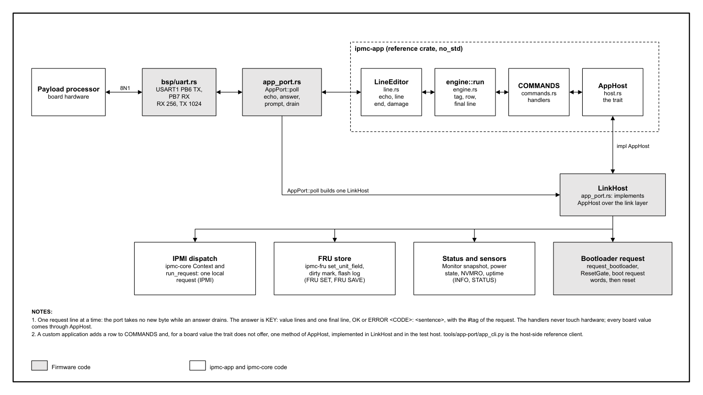

Source: `diagrams/src/ipmc-software.js`, sheet 7.

`ipmc-app` is a reference crate for a customer application (PLAN decision 27): it may repeat code of the
other crates, and a customer application replaces or extends it. The protocol crate never touches
hardware; the firmware gives it the board through the `AppHost` trait.

Wiring and settings (3.3 V logic; the pins are claimed by `bsp/uart.rs` under the owner `app_uart`):

| Item | Value |
|---|---|
| IPMC TX, payload RX | PB6 (USART1, AF7), header CN5-3 (D10) |
| IPMC RX, payload TX | PB7 (USART1, AF7), header CN7-21; input with pull-up |
| Ground | common ground with the payload processor |
| Optional RTS/CTS | `IPMC_APP_UART_FLOW` true: IPMC CTS input on PA11 (CN10-14, with pull-up; open reads "not clear to send") from the payload's RTS, IPMC RTS output on PA12 (CN10-12) to the payload's CTS; false leaves PA11 and PA12 unclaimed |
| Format | `IPMC_APP_UART_BAUD` 115200, 8 data bits, no parity, 1 stop bit |
| Port enable | `IPMC_APP_UART_ENABLE` true; false leaves USART1 off and parks its pins |
| Buffers | receive ring `IPMC_APP_UART_RX_BUF` 256 bytes, transmit ring `IPMC_APP_UART_TX_BUF` 1024 bytes, longest request line `IPMC_APP_LINE_MAX` 128 bytes, `IPMC_APP_BYTES_PER_POLL` 32 bytes per main-loop pass |
| Text | prompt `IPMC_APP_PROMPT` (`APP> `), name `IPMC_APP_UART_NAME` (`APP`) |
| Write access | `IPMC_APP_FRU_WRITE` true; false answers `ERROR WRITE_DISABLED` to `FRU SET` and to an `IPMI` Write FRU Data |

Line protocol in one place (the rules are above): the payload sends one request line ending in CR, LF or
CR LF; a request may start with a tag, `#` and 1 to 8 letters or digits. The IPMC answers zero or more
data lines `KEY: value` and exactly one final line, `OK` or `ERROR <CODE>: <sentence>`, with the tag after
the `OK` or `ERROR` word. The payload skips the lines that start with the prompt, collects the data
lines, and ends the answer at the first line that is `OK`, starts with `OK ` or starts with `ERROR `. The
codes the payload handles are in the error table above, among them `LINE_DAMAGED` (a lost or damaged
byte: send the request again), `CONFIRM` (`BOOTLOADER` while payload power is on) and `NVMRO`.

Worked sessions. Typed text follows `APP> `; the payload sends the tag, the IPMC answers it on the final
line.

Reading the state, then writing the unit fields and waiting until they are in flash (the payload
repeats `FRU SAVE` until it reads `SAVE: done`):

```text
APP> #a1 STATUS
IPMB_ADDRESS: 82h
GA: 1
FRU_STATE: M4 FRU Active
PAYLOAD_POWER: on
HEALTH: ok
NVMRO: deasserted
UPTIME: 0d 00:17:48
OK #a1
APP> #a2 FRU GET BOARD_SERIAL
BOARD_SERIAL: IK-T1-000001
OK #a2
APP> #a3 FRU SET BOARD_SERIAL 00:11:22:33:44:55
BOARD_SERIAL: 00:11:22:33:44:55
OK #a3
APP> #a4 FRU SET MFG_DATE 2026-10-25 08:30
MFG_DATE: 2026-10-25 08:30
OK #a4
APP> #a5 FRU SAVE
SAVE: pending
OK #a5
APP> #a6 FRU SAVE
SAVE: done
OK #a6
```

Refusals carry the tag and no data lines:

```text
APP> #a7 FRU SET BOARD_SERIAL 1234567890123456789012345
ERROR #a7 TOO_LONG: BOARD_SERIAL is at most 24 characters
APP> #a8 BOGUS
ERROR #a8 UNKNOWN: unknown command 'BOGUS'; type HELP or ?
```

An IPMI request run locally (the dispatcher answers as if the Chassis Manager had sent it; nothing goes on
the IPMB):

```text
APP> IPMI 06 01
CC: 00h
DATA: 01 80 00 01 02 09 00 00 00 4B 49 00 00 00 00
COMMAND: App Get Device ID
OK
```

Entering the bootloader to update the runtime (section 16.4). With payload power on the plain command
only warns; after `CONFIRM` the IPMC restarts and the port stays silent until the bootloader or the runtime
prints again:

```text
APP> BOOTLOADER
ERROR CONFIRM: payload power is on and drops at the reset; send BOOTLOADER CONFIRM
APP> BOOTLOADER CONFIRM
BOOTLOADER: restarting
OK
```

The seam for a custom application is the `AppHost` trait (`crates/ipmc-app/src/host.rs`). A host
implements these methods; `LinkHost` in `app_port.rs` is the firmware implementation and `FakeHost` in
`tests.rs` the test one:

| Method | Gives the protocol |
|---|---|
| `version` | the firmware name and version text of `INFO` |
| `status` | `Status`: IPMB address, GA, power state, health, NVMRO, uptime, whether PWR_EN is asserted |
| `fru_state` | the FRU 0 Operational State |
| `unit_field`, `set_unit_field` | one FRU unit field read, or written through the one Write FRU Data save path |
| `ipmi` | one local IPMI request: completion code and data (`IpmiData`), or `AppError` |
| `command_name` | the name of a (NetFn, command) pair for the `COMMAND:` line |
| `save_state` | `SaveState`: `Saved`, `Pending` or `LogOff` |
| `request_bootloader` | asks for a restart into the bootloader |

A custom command is one handler and one row of `COMMANDS` in `ipmc-app/src/commands.rs`, and, for a board
value the trait does not offer, one new `AppHost` method; section 12.4 lists the steps and the tests that
guard a new row. `tools/app-port/app_cli.py` is the reference host-side client: it follows the parsing
rule above, tags every request, keeps in step with the prompt, and exits 0 when every answer is `OK`
(`python tools\app-port\app_cli.py --port COM5 INFO STATUS`; options in `tools/app-port/README.md`).

<div style="page-break-after: always;"></div>

<table style="width:100%; border:none; margin:0; padding:0;">
<tr>
<td style="text-align:left; border:none; padding:0; width:50%;"><strong>CONFIDENTIAL DOCUMENT &#8211; DO NOT DISCLOSE</strong></td>
<td style="text-align:right; border:none; padding:0; width:50%;"><strong>Revision 10-26-2026</strong></td>
</tr>
</table>
<hr style="border:none; border-top:2px solid #000; margin:4px 0 12px 0;">

## 8. Clocking, Reset and Start-Up

### 8.1 Clocks

| Clock | Source | Frequency | Used by | Notes |
|---|---|---:|---|---|
| HSE | ST-LINK MCO into OSC_IN, bypass | 8 MHz | PLL input | HSI 16 MHz (M = 16) when HSE never becomes ready |
| SYSCLK, HCLK | PLL: 8 MHz / 8 x 336 / 4 | 84 MHz | core, DWT cycle counter, SysTick | `IPMC_SYSCLK_HZ`, compile-time check |
| PCLK1 | HCLK / 2 | 42 MHz | I2C1, I2C3 (CR2.FREQ 42), USART2 | APB1 maximum |
| PCLK2 | HCLK | 84 MHz | ADC1 (ADCCLK = PCLK2 / 4 = 21 MHz), USART1 (the application port) | |
| PLLQ | VCO / 7 | 48 MHz | unused | |
| SysTick | HCLK | 1 kHz tick | `millis`, LED pattern | `catch_up` after a flash erase |
| DWT CYCCNT | HCLK | 84 MHz | bit-bang timing, deadlines, erase stall time | started before the FRU log boot |

### 8.2 Reset

The firmware has one reset domain: the MCU reset (power-on, pin, software from `SYS RESET`, from a
pending Cold Reset or from a bootloader request, watchdog flags reported but no watchdog is enabled). A
pending Warm Reset and a pending payload reset are not processor resets; they use the same reset gate. The
commands that set these hand-offs belong to the commercial build (section 7.2: Cold Reset, Warm Reset,
FRU Control). `bsp/reset_cause.rs` reads RCC_CSR once at
start-up, reports the most specific cause in the banner and clears the flags. A HardFault or an
unhandled interrupt records its state in a static, prints one line when the UART is up and parks
in `wfi`; it does not reset, so the fault stays visible on the bench. The panic handler is
`panic-halt`. RAM state starts from its Rust initialisers; the state kept across a reset is the FRU log in
flash and, after a software reset, the request sequence words described below.

<div style="page-break-after: always;"></div>

<table style="width:100%; border:none; margin:0; padding:0;">
<tr>
<td style="text-align:left; border:none; padding:0; width:50%;"><strong>CONFIDENTIAL DOCUMENT &#8211; DO NOT DISCLOSE</strong></td>
<td style="text-align:right; border:none; padding:0; width:50%;"><strong>Revision 10-26-2026</strong></td>
</tr>
</table>
<hr style="border:none; border-top:2px solid #000; margin:4px 0 12px 0;">

#### Cold Reset hand-off

A handler never resets the processor. An extension handler sets `Context::pending_reset` to
`Some(ResetRequest::Cold)` and queues its response as any response; a bootloader request
(`IpmbLink::request_bootloader`, section 16.4) enters the same path. The owner of the processor, the firmware main loop or the emulator,
performs the reset.

1. Each pass `IpmbLink::service_reset` calls `ResetGate::poll(pending, now_ms, egress_empty,
   fru_clean, trace)`. The gate returns true when the egress queue is empty (the response left
   the board or was dropped), the application port has no output left (its buffer and TX ring are
   empty, so a reset asked for on that port finishes its own answer first) and the FRU store holds
   no unsaved change, or when
   `IPMC_RESET_WAIT_MS` has passed since it first saw the request; in the second case one trace
   line says what was still open.
2. While a reset is pending the FRU save runs at once (`service_fru_log`): no persist delay and no
   wait for a quiet bus, because the IPMB is about to go away. The erase waits, up to 250 ms (longer than the T5 limit of 227 ms, `IPMC_URGENT_LINK_WAIT_MS`),
   for the link to hold no accepted request and no untransmitted response, and runs anyway after
   that (one console line says so); the erase itself is bounded (at most 500 ms, covered by
   `IPMC_RESET_WAIT_MS`). A failed attempt returns to the normal delay, so
   a failing flash does not stall every pass until the wait runs out.
3. When the gate says go, one console line goes out and the console and the application port are flushed (each bounded by its flush bound; the application port output normally left already, because the gate waited for it; with CTS held off the gate's `IPMC_RESET_WAIT_MS` runs out and the reset goes ahead).
   `reset_cause::keep_sequence` stores the next request sequence number and the mask of the
   sequence numbers sent inside T9 (`Link::recent_request_seqs`) in four `.uninit` words, which
   start-up code does not touch, the last a check word over the other three. `reset_cause::system_reset` then requests SYSRESETREQ, so the banner after the
   restart reads "software reset".
4. At the next start-up `reset_cause::kept_sequence` returns the stored values after a software
   reset, and zero after any other reset or when the check word does not match. `IpmbLink::take`
   hands them to `Link::with_first_request_seq`, which books the recent numbers as sent at
   start-up, so a request after the restart cannot repeat a sequence number the Event Receiver saw
   inside T9.
5. Everything else restarts as at power-up: link, context, sensors and the extension's state
   (IPMB-B is isolated again until Set IPMB State), and the FRU image loads from the flash log.

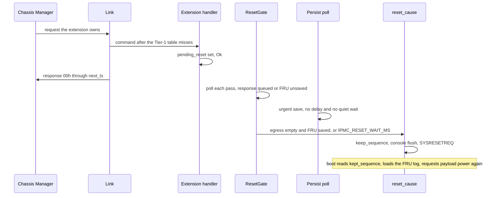

Limitation (owner decision 21, 10-24-2026): on the NUCLEO-F401RE a processor reset is a processor
reset, which releases PWR_EN (PB5) with every GPIO, so the payload loses power for the reset and
boot time. Recommendation 4.1.9-3, that a reset should not change the payload state, is not met on
this board, which has no latch to hold the pin; a target board holds PWR_EN externally. The
emulator models the board.

<div style="page-break-after: always;"></div>

<table style="width:100%; border:none; margin:0; padding:0;">
<tr>
<td style="text-align:left; border:none; padding:0; width:50%;"><strong>CONFIDENTIAL DOCUMENT &#8211; DO NOT DISCLOSE</strong></td>
<td style="text-align:right; border:none; padding:0; width:50%;"><strong>Revision 10-26-2026</strong></td>
</tr>
</table>
<hr style="border:none; border-top:2px solid #000; margin:4px 0 12px 0;">

#### Warm Reset hand-off

A pending Warm Reset restarts the link state without a processor reset, so PWR_EN keeps
its level and the payload keeps its power (the problem of decision 21 does not arise). An extension
handler sets `Context::pending_reset` to `Some(ResetRequest::Warm)` and queues its response;
a pending Cold Reset wins over a Warm Reset request. The same `ResetGate` decides when it runs
(the response has left and an accepted FRU write is saved, or `IPMC_RESET_WAIT_MS`), and the
FRU save runs at once while it is pending. The owner (`IpmbLink::warm_reset`, or the emulator's
`service_reset`) then:

1. builds a new Link with `Link::restarted`: the same configuration and address, the power-up bus
   state (IPMB-A Local Control, IPMB-B isolated until the next Set IPMB State, both buses back at
   100 kHz, Rule 4.1.1-4), empty queues and duplicate cache, and the request sequence state
   carried over so no sequence number is reused inside T9 (the requester is rebuilt with it);
2. keeps a start-up fault of a bus, so a bus that failed at start-up stays disabled;
3. calls `Context::warm_reset`, which installs the new link view and clears every `pending_*`
   hand-off, the Warm Reset request included;
4. calls `Extension::warm_reset`, which forgets the event in flight;
5. prints `Warm Reset: link state re-initialised`; `apply_bus_speeds` returns the drivers to
   100 kHz on the next pass.

Kept: payload power and PWR_EN, the FRU state, the FRU store and its settings byte, the SDR
repository, the self test result, the sensors and the state of the extension that its `warm_reset`
hook keeps. Not kept: the IPMB state (IPMB-B returns to
isolated and both buses to 100 kHz, Rules 4.1.9-2 and 4.1.1-4.3, shown as Link events) and the
duplicate cache, which starts empty after a Warm or a Cold Reset, so a Chassis Manager retry of a
request answered just before the reset runs its handler again.

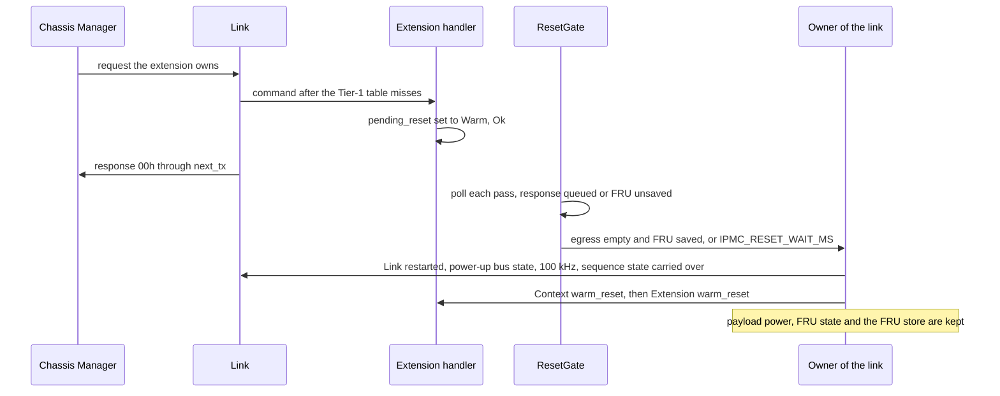

#### Payload reset pulse

A payload reset (Rule 4.1.2-9) resets the payload, not the IPMC, and leaves the FRU state unchanged. An
extension handler sets `Context::pending_payload_reset`; each main-loop pass `Sensing::serve_hand_offs` takes it and
`PayloadResetPulse::pulse_payload_reset` drives PAYLOAD_RST_OUT_N (PA9, open drain, active low)
low for `IPMC_PAYLOAD_RESET_PULSE_MS`, and the same call releases it when the time is up. The pulse
is not blocking: IPMB traffic continues during it. A build whose power group is simulated has no
output and prints that. The emulator models the pulse as one trace line.

### 8.3 Start-up order (`main.rs`)

The runtime, linked at `0x0800_C000`, does not start at a reset by itself: the bootloader in sectors 0-1
starts first, checks the runtime image and starts it with the sequence of section 15.6 (the countdown,
the session and the entry paths are sections 15 and 16). The steps below then run as from a reset; the
runtime clears and reports the reset cause itself.

1. Reset cause (first, before anything can reset again); after a software reset the kept request
   sequence numbers (`kept_sequence`).
2. Clock to 84 MHz; a clock fault is reported later in the banner.
3. `ports::init` takes GPIOA..GPIOC; LED claim; SysTick start; USART2 console (a UART failure
   blinks LD2 at 5 Hz and parks; a pin-claim conflict prints both owners and parks); then, when
   `IPMC_APP_UART_ENABLE` is 1, APP_UART on USART1 (clocked from PCLK2). A failure of the
   application port other than a pin-claim conflict does not stop the board: the console prints
   `APP UART not started: <reason>` after the banner. The evaluation image starts its TIM2
   run-time counter after the UARTs (section 8.4).
4. IPMB pins parked as floating inputs.
5. Sensor hardware for the groups whose source is hardware (ADC1, board GPIO).
6. Strap pins (`ga::init`).
7. DWT cycle counter, then the FRU log boot (`fru_log::FruLog::boot`): checks the store region
   against the linker symbols, loads the newest valid record of sector 2, and erases the sector
   only when it holds damage and no valid record and NVMRO is deasserted. It runs before the I2C
   slaves exist, because an erase stalls the core (typical 250 ms, at most 500 ms).
8. `addr::resolve` on the raw straps; `ipmb_link::start_drivers`: the selected master takes the
   pins and the DWT counter, then, when the address is usable, each fitted bus gets `bring_up`
   (bus recovery when SDA is held low, then the I2C slave). A bus that fails stays disabled with its local status set, and the
   fault tracker restarts it once the lines read idle-high.
9. `IpmbLink::take` builds the static Link (first request sequence number from step 1) and
   dispatch Context (self test runs; a stored image replaces the built one and the self test runs
   on it).
10. Banner (the application port line and the `BOOTLOADER pin:` line included), the
    `APP UART not started` line when it applies, the events setting (`IPMC_EVENTS_AT_BOOT` false
    makes the IPMC send itself Set Event Receiver FFh and print `Events: off from start-up`; a
    build without event messages answers C1h and prints nothing), sensor start (payload power
    requested when `IPMC_POWER_AT_BOOT` is 1 and the power-on check,
    `IpmbLink::power_on_check`, allows it; a refusal prints `Power at boot refused: ...`),
    prompt, main loop. Each pass runs `console.poll` (one console line, or a step of a running
    `DEBUG DUMP`), `console.service_app` (at most one application request line),
    `console.service_sensors`, `console.service_link` and `wfi`.

### 8.4 Evaluation build switch

The evaluation image is a time-limited build of the commercial release build (owner decision 20); the
switch and its mechanism are public code; section 7.2 lists the commands of the commercial build.

- `gen.ps1 build -Eval` or `gen.ps1 flash -Eval` sets `IPMC_EVAL=1` for the runtime and writes
  `ipmc-board-eval.bin` (and `ipmc-nucleo-f401re-eval.hex`, `.elf`); without `-Eval` the script
  passes `IPMC_EVAL=0`, so a build made after an evaluation build carries none of it, and the
  bootloader is always built with `IPMC_EVAL=0`. `-Eval` needs the extension folder.
- `ipmc-defs` accepts `IPMC_EVAL=1` only with the extension built in and the
  release profile, and fails the build otherwise. It sets `cfg(ipmc_eval)`, which the firmware
  crate takes through `dep_cfg.rs`. Every evaluation line sits behind that cfg (`eval.rs`,
  `drivers/eval_timer.rs`, the timer start and the period check in `main.rs`,
  `IpmbLink::stop_for_eval`), so no other image, a Tier-1 or normal release or debug build,
  contains any evaluation code or a flag that could stop the IPMB.
- `drivers/eval_timer.rs` runs TIM2 as a free-running 32-bit up-counter at 10 kHz (0.1 ms
  per tick, 7158 minutes of range), clocked from PCLK1 (twice PCLK1 when the APB1 prescaler is
  not 1, RM0368 section 6.2). It starts after the console and before the banner; a start failure
  stops the image, because it could not end the evaluation. SysTick is not used. The banner of the
  evaluation image carries the line `EVALUATION BUILD: the IPMB stops after N minutes`.
- The period is `IPMC_EVAL_MINUTES` of run time (a define of the extension's `defs_tier23.rs`, section 4). A power cycle starts a
  new period.
- At expiry the main loop calls `stop_for_eval` once and prints one console line. It switches
  both I2C slaves off through the driver's suspend (a healthy bus waits up to the pause time for
  idle, a faulted one is switched off at once), drops what is queued and never calls
  `IpmbLink::service` again, so the whole IPMB, responses and requests, stops. The console and the
  sensor sampling continue, and the FRU save step still runs: a Write FRU Data accepted before the
  stop is saved, and the save never touches the stopped slaves.

<div style="page-break-after: always;"></div>

<table style="width:100%; border:none; margin:0; padding:0;">
<tr>
<td style="text-align:left; border:none; padding:0; width:50%;"><strong>CONFIDENTIAL DOCUMENT &#8211; DO NOT DISCLOSE</strong></td>
<td style="text-align:right; border:none; padding:0; width:50%;"><strong>Revision 10-26-2026</strong></td>
</tr>
</table>
<hr style="border:none; border-top:2px solid #000; margin:4px 0 12px 0;">

## 9. Memory Map and Data Layouts

### 9.1 Flash and RAM (`flash_map.x`, `link.x`, `boot.x`, `drivers/flash.rs`, `flash_regs.rs`)

**Figure 9-1.** Flash map, writers of each region and the boot request (ipmc-software, sheet 5)

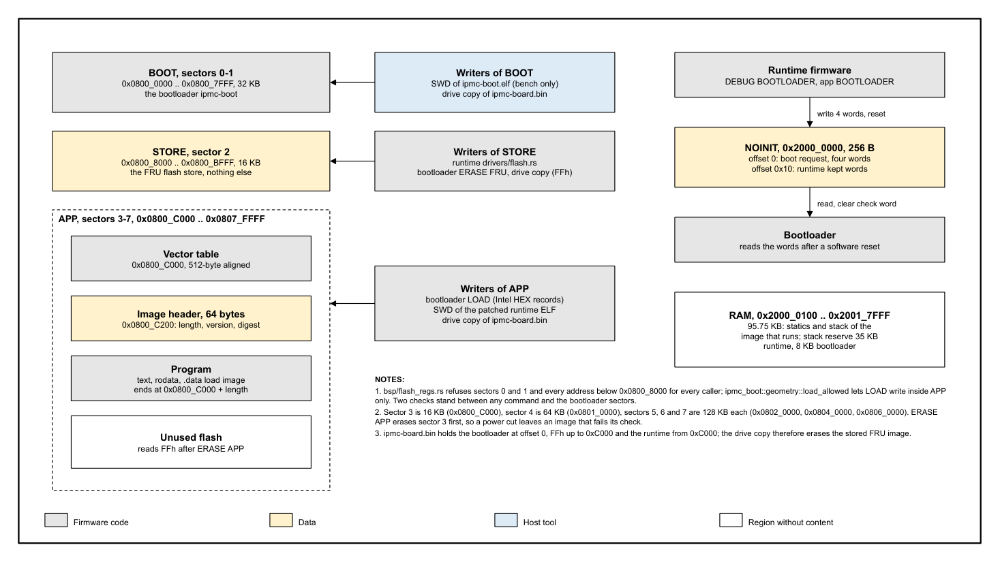

Source: `diagrams/src/ipmc-software.js`, sheet 5.

The STM32F401RE has 512 KB of flash in eight sectors (RM0368 Table 5). `flash_map.x` is the one
place of every address; the runtime script (`link.x`, through `memory.x`) and the bootloader
script (`boot.x`) both include it, and `ipmc_boot::geometry` holds the same numbers as Rust
constants (the test `crates/ipmc-boot/tests/flash_map.rs` parses `flash_map.x` and fails on a
difference):

| Sector | Base | Size | Region | Contents | Written by |
|---:|---:|---:|---|---|---|
| 0, 1 | `0x0800_0000` | 2 x 16 KB | `BOOT` | the bootloader `ipmc-boot`: its vector table, code and constants (32 KB) | SWD or the drive copy, bench only |
| 2 | `0x0800_8000` | 16 KB | `STORE` | the FRU flash store, nothing else | the runtime store driver (sector 2 only); the bootloader erases it on `ERASE FRU` only |
| 3 | `0x0800_C000` | 16 KB | `APP` | the runtime: vector table at `0x0800_C000`, image header at `0x0800_C200`, then `.text`, `.rodata`, the `.data` load image | the bootloader (`LOAD`), SWD, the drive copy |
| 4 | `0x0801_0000` | 64 KB | `APP` | the runtime | as above |
| 5, 6, 7 | `0x0802_0000` | 3 x 128 KB | `APP` | the runtime | as above |

| Region | Base | Size | Contents |
|---|---:|---:|---|
| `NOINIT` | `0x2000_0000` | 256 B | offset 0: the four words of the boot request (`__boot_request`, `bsp/boot_request.rs`); offset 0x10: the runtime `.uninit` (`KEPT`); no start-up code of either image clears it |
| `RAM` | `0x2000_0100` | 95.75 KB | statics and stack of whichever image runs; `_stack_reserve` (35 KB for the runtime, `memory.x`; 8 KB for the bootloader, `boot.x`) must stay free above the statics |
| System memory | `0x1FFF_7A2A`..`0x1FFF_7A2F` | 6 bytes | factory VREFIN_CAL, TS_CAL1, TS_CAL2 (read by `adc.rs`) |

Image header. The runtime links a 64-byte header at `0x0800_C200` (`src/app_header.rs`, the
`.app_header` section) with its length and SHA-256 digest; section 16.1 gives the layout and sections
16.2 and 16.3 the digest and the check.

`link.x` is the script of cortex-m-rt 0.7.7 with these differences: the whole image sits in
`APP` (`.vector_table` at `ORIGIN(APP)`, the 64-byte `.app_header` at `__app_header`, `.text`
after it), `.uninit` sits in `NOINIT` at offset 0x10, `BOOT` and `STORE` receive no output
section, and asserts fail the build when the vector table or the header is not at its address,
the header is not 64 bytes, the vector table reaches into the header, the program starts inside
the header, a section lies below `APP`, the image does not end inside `APP`, or `.uninit` does
not fit `NOINIT`. `boot.x` is the same script for the bootloader: everything in `BOOT`, the RAM
sections in `RAM`, nothing in `NOINIT`, and an assert that the image ends inside the 32 KB `BOOT` region (sectors 0-1).
The store is the one sector the FRU log erases and programs, so an erase never touches the
bootloader or the program. `flash_map.x` exports `__boot_end`, `__app_vectors`, `__app_header`,
`__boot_request`, `__fru_store_start` and `__fru_store_end`, and `link.x` exports
`__program_start`; `Flash::new` (firmware `drivers/flash.rs`) hands the store region, `__boot_end`
and `__app_vectors` to `ipmc_fru::persist::store_region_ok`, which refuses to start the store
unless the region is exactly sector 2 (`STORE_START`, `STORE_LEN`), the bootloader ends before it
and the runtime starts after it. A layout that drifts apart can therefore never erase code.

`gen.ps1 build` makes the images (section 12.1): `ipmc-boot.bin` (the bootloader, at most 32 768
bytes, a warning above 24 576), the runtime ELF with its header patched, `ipmc-nucleo-f401re.hex`
(the file for `LOAD`) and the board image `ipmc-board.bin`: the bootloader at offset 0, FFh up to
`0xC000` (the rest of `BOOT` and all of the store sector), the runtime from there. The objcopy calls use
`--gap-fill 0xFF`, so the gaps read FFh (erased), not 00h. No runtime-only `.bin` is written: a
drive copy programs a `.bin` from `0x0800_0000` and it would land on the bootloader. The ways to
program the board treat the store differently:

| Way | What it writes | The FRU store |
|---|---|---|
| Drive copy of `ipmc-board.bin` to `NOD_F401RE` (`gen.ps1 flash`, `flash -Drive`) | everything: the bootloader, the store as FFh, the runtime | erased (FFh), so the stored FRU image and the unit fields go; the next start-up loads the built image |
| SWD program of the patched runtime ELF (`gen.ps1 flash -Swd`) | the sections of the ELF only: sectors 3 onward | sector 2 is not touched and keeps its records; the bootloader stays |
| SWD program of both ELFs (`gen.ps1 flash -Swd -Bootloader`, bench only) | sectors 0-1 and sectors 3 onward | sector 2 is not touched |

A reflash may erase the whole flash, unit fields included, and the firmware has no guard against
it (owner decision 10-25-2026). A board that holds an image of the earlier layout (the runtime
vector table in sector 0 or at `0x0800_8000`) takes one drive copy of `ipmc-board.bin`.

`link.x` asserts that the RAM from the end of the statics (`.data`, `.bss`; `.uninit` is in `NOINIT`) to the top of RAM
is at least `_stack_reserve`, 35 KB (`IPMC_STACK_RESERVE_BYTES` of `defs.rs`, which `build.rs`
writes to `stack_runtime.x`; the bootloader's `IPMC_BOOT_STACK_RESERVE_BYTES`, 8 KB, goes to
`stack_boot.x`; `memory.x` and `boot.x` include their fragment); the error names `IPMC_LOG_SIZE` and the four UART buffer
defines. The 35 KB come from the release ELF of 10-26-2026 (`arm-none-eabi-objdump -d`: the frame
of each function from its push list and `sub sp`, summed along the longest call chain, indirect
calls followed by hand): start-up 27,408 bytes (`main` 9,864 + `IpmbLink::take` 16,616 +
`Link::with_first_request_seq` 856 + `memcpy` 72), run time 13,584 bytes (`main` 9,864 + the menu
752 + the deepest console handler, `FRU SET` over `IpmbLink::set_unit_field`, 2,968; the
application port paths are shorter), and 544 bytes of interrupt nesting (SysTick 120, I2C event
72, USART 40 and three 104-byte exception frames) on top of either path. The largest, 27,952
bytes, plus a margin of about 25 percent for calls through trait objects, rounds up to 35 KB. The
frames of `main` and `take` do not shrink with `IPMC_LOG_SIZE` (the log lives in the static), so
the check is on the statics. A larger frame (a new local in `main` or `take`, a larger FRU image)
is measured again and `_stack_reserve` changes with it.

The statics of the firmware are the `IpmbLink` (the duplicate cache of 64 entries of 76 bytes,
the capture log of `IPMC_LOG_SIZE` bytes and the frame queues) and the four UART rings
(`IPMC_UART_RX_BUF`, `IPMC_UART_TX_BUF`, `IPMC_APP_UART_RX_BUF`, `IPMC_APP_UART_TX_BUF`), which
live in `.bss` and not in the flash image.

### 9.2 FRU 0 image (512 bytes)

| Offset | Size | Content |
|---:|---:|---|
| 00h | 8 | Common Header: `01 00 00 01 12 28 00 C4` (version 1; Internal Use, Chassis Info 00h; Board at 1 x 8, Product at 12h x 8, MultiRecord at 28h x 8, checksum) |
| 08h | 136 | Board Info Area (length byte 11h): version, length, language, the standard manufacturing date 000000h (3 bytes), manufacturer, product name, serial, part number, FRU file ID, C1h, room for the five text fields (58 bytes of 00h), padding, checksum |
| 90h | 176 | Product Info Area (length byte 16h): version, length, language, manufacturer, name, part/model, version, serial, asset tag, FRU file ID (empty), C1h, room for the seven text fields (104 bytes of 00h), padding, checksum |
| 140h | 14 | MultiRecord area: the VITA 46.11 Alternate Manufacturing Date/Time record (section 6.2): `C0 82 09 <data sum> <header sum> AC 81 00 34 00 20 42 F7 00` for the default date |
| 14Eh | 178 | 00h padding to 200h (`IMAGE_LEN` is 334) |

The area sizes are those of the default strings and `IPMC_FRU_*_MAX` values; an area is always a
multiple of 8 bytes, and a longer string or a larger `_MAX` grows it (the build fails when the
image no longer fits `IPMC_FRU_SIZE`). The room after C1h is the `_MAX` value of each text field
less the length of its default string, summed over the area, so an update of a field up to its
`_MAX` rewrites the field in place and the area keeps its length (section 6.2).

### 9.3 Get Sensor Reading data (bytes after the completion code)

| Sensor | Type | Byte 2 | Byte 3 | Byte 4 |
|---|---|---|---|---|
| 0 FRU State | F0h | 00h | 40h | Current State Mask, bit n for Mn (M0 01h, M1 02h, M4 10h, M6 40h; M5 20h at Tier-3) |
| 1 IPMB Link | F1h | B local control bit 7, B status 6:4, A local control bit 3, A status 2:0 | 40h | link state bit 3 both, 2 only B, 1 only A, 0 none; at Tier-3 bit 4 IPMB-A and bit 5 IPMB-B run at 400 kHz |
| 2 FRU Health | F2h | 00h | 40h | 01h functioning, 02h not functioning |
| 3 FRU Voltage | 02h | 00h | 40h | 01h in range, 02h out of range |
| 4 FRU Temperature | F3h | 00h | 40h | LNC bit 0, LC 1, UNC 3, UC 4, UNR 5 |
| 5 Payload Test Results | F4h | 00h | 60h (unavailable) | 00h |
| 6 Payload Test Status | F5h | 00h | 40h | 01h not in progress |
| 7 Payload Mode (Tier-3) | F7h | NVMRO bit 6, transition status bits 5:4 (00b in progress, 01b complete, 10b failed), previous mode bits 3:0; gDiscrete1 bit 7 reads 0 | 40h | current-mode mask, LS byte (bit n is mode n); a fifth byte holds the MS byte (modes 8..14 in bits 6:0), bit 7 reads 1 |

Status byte (response byte 3) 40h is "scanning enabled"; bit 5 (20h) marks a reading unavailable;
bit 7 is the sensor's event enable (`Context::event_enables`, `sensor::apply_event_enable`): 0 in
the Tier-1 build, so the table shows 40h, and 1 from power-up in a Tier-2/3 build (the byte reads
C0h) until an enable changes. Sensors 2..4 read `00 60 00` before the first sample and while their source cannot be read.
On the bench with only IPMB-A enabled sensor 1 reads `08 40 02`. Sensor 7 exists only at Tier-3
(Get Sensor Reading answers CBh for it below Tier-3 and for any number above 7); it is always
available, and in mode 0 with the transition complete it reads `10 C0 01 80` (status C0h with the
event enable).

<div style="page-break-after: always;"></div>

<table style="width:100%; border:none; margin:0; padding:0;">
<tr>
<td style="text-align:left; border:none; padding:0; width:50%;"><strong>CONFIDENTIAL DOCUMENT &#8211; DO NOT DISCLOSE</strong></td>
<td style="text-align:right; border:none; padding:0; width:50%;"><strong>Revision 10-26-2026</strong></td>
</tr>
</table>
<hr style="border:none; border-top:2px solid #000; margin:4px 0 12px 0;">

### 9.4 FRU flash record (`persist.rs`)

| Offset | Size | Field |
|---:|---:|---|
| 0 | 4 | commit word 55464931h, programmed last |
| 4 | 4 | sequence number, from 1, never 0 or FFFFFFFFh |
| 8 | 2 | image length (= `IPMC_FRU_SIZE`) |
| 10 | 1 | record format version (1) |
| 11 | 1 | Tier-3 non-volatile settings: bit 0 Default-Activation-Locked, bit 1 Commanded-Deactivation-Ignored (Rule 4.1.2-10.2), other bits 0 |
| 12 | 512 | FRU image |
| 524 | 4 | CRC-32 over bytes 4..524 |

A record is 528 bytes (132 words), so the 16 KB store sector holds 31 records (16,368 bytes; 16
bytes at the end stay unused). All fields are little-endian; the length, version and settings
fields share one word, every other field is whole words. Erased flash reads FFh. The save that
finds no free slot erases the sector and writes the record as the first one (section 10.8).

The settings byte is byte 11, the high byte of what the 16-bit version field of an earlier format
held (0001h). A record written before the byte existed therefore reads as settings 00h, and a
record with settings 00h is byte-identical to one of that format: a Tier-1 and a Tier-2 build
never write a non-zero value. A stored byte is masked with 03h when loaded and a saved byte
before it is written. A build from before the byte rejects a record whose settings are not 00h and loads the newest
older record or the built image without a report, so a Tier-3 image that saved a policy bit is not
downgraded in the field without a FRU check.
The byte rides in the record with the image, so one dirty mark and one save rule cover a Write FRU
Data and a policy-bit change; `FRU RESTORE` keeps the byte as it is.

A record from an older image size (another `IPMC_FRU_SIZE`, so another length field and record
length) is not valid for this build: every slot reads invalid and the built image loads. `Persist::boot`
finds no valid record in a sector that is not blank and, with NVMRO deasserted, erases the sector
at once, so the old content is dropped at that boot (`BootReport::erased`, the console boot line); a
flash over SWD, which keeps the store sector, loses it the same way at the first boot. With NVMRO
asserted the boot erases nothing (VITA 46.11 Rec 4.1.10-1): the old records stay in the sector, the
built image runs, and the first save after NVMRO clears erases them. A flash by drive copy erases
the sector before the boot.

### 9.5 Device SDR repository

| Record ID | Type | Content |
|---:|---|---|
| 0000h..0006h | 02h compact sensor | sensors 0..6 in number order: entity A0h (VPX module) instance 60h, scanning on, events off at Tier 1, reading masks per Table 10.2-1, ID strings from `IPMC_SDR_*_NAME`; initialization, capabilities and event masks by Tier (section 9.6) |
| 0007h (Tier-3 only) | 02h compact sensor | sensor 7, Payload Mode: sensor type F7h, event/reading type 6Fh, initialization 03h, capabilities 40h, reading and assertion masks `IPMC_PAYLOAD_MODES`, deassertion mask 0000h, ID string `IPMC_SDR_PAYLOAD_MODE_NAME` |
| 0007h (0008h at Tier-3) | 12h MC device locator | owner = own IPMB address, global initialisation 01b and device capabilities 0Bh at Tier 1 (section 9.6 for Tier 2 and 3), entity A0h instance 60h, ID string "IPMC" |

Get Device SDR Info reports 7 sensors (or 8 records with operation bit 0), and 8 sensors (9
records) at Tier-3; Get Device Locator Record ID returns the locator's record ID, 0007h (0008h at
Tier-3). The locator is always the last record.

### 9.6 Tier-dependent bytes

The Tier rules of `tier.rs` set these bytes; the build reports the Tier of `IPMC_TIER` (1 in the
public build, section 4). A Tier-1 IPMC generates no events (Rule 7-4); a Tier-2 and a Tier-3
IPMC are Event Generators (Rule 7-3); a Tier-3 IPMC is also a SEL Device (Rule 7-8) with per-state
event enables. A Tier-3 IPMC also controls payload power and activation (Rule 4.1.2-10.1, FRU
State M5), has the Payload Mode sensor (sensor 7, Rule 6.1-17) and supports FAST-MODE, 400 kHz
(Rule 4.1.1-4.4).

| Item | Tier 1 | Tier 2 | Tier 3 |
|---|---:|---:|---:|
| Get VSO Capabilities, IPMC identifier byte bits 1:0 (`IPMC_TIER` - 1) | 00b | 01b | 10b |
| Get Device ID byte 7, additional device support | 09h | 29h | 2Dh |
| compact record, sensor initialization | 01h | 03h | 03h |
| compact record, sensor capabilities | 43h | 42h | 40h |
| compact record, assertion and deassertion event masks | 0000h | per sensor, below | per sensor, below |
| locator record, global initialization (bits 1:0) | 01b | 00b | 00b |
| locator record, device capabilities | 0Bh | 2Bh | 2Fh |
| Get Sensor Reading status bit 7 at power-up (all sensors) | 0 | 1 | 1 |
| event generator, SEL device, per-state event enables | no, no, no | yes, no, no | yes, yes, yes |
| activation control (M5), Payload Mode sensor, FAST-MODE | no, no, no | no, no, no | yes, yes, yes |
| sensors, SDR records (Get Device SDR Info) | 7, 8 | 7, 8 | 8, 9 |
| locator record ID (Get Device Locator Record ID) | 0007h | 0007h | 0008h |
| Get VSO Capabilities, IPMB capabilities byte bits 5:4 (maximum frequency) | 00b, 100 kHz | 00b, 100 kHz | 01b, 400 kHz |
| sensor 0 reading mask (FRU State) | 0053h | 0053h | 0073h |
| sensor 1 reading mask (IPMB Link) | 000Fh | 000Fh | 003Fh |
| Set IPMB State speed byte accepts 01b (400 kHz) | no, CCh | no, CCh | yes, on a fitted bus |

Byte 7 of Get Device ID carries the sensor and FRU inventory bits (09h) at every Tier, the Event
Generator bit (bit 5) from Tier 2 and the SEL Device bit (bit 2) at Tier 3. The locator's device
capabilities byte is that value plus the Device SDR bit (02h). Sensor capabilities carry auto
re-arm (bit 6) and the event message control in bits 1:0: 11b none (Tier 1), 10b global disable
only (Tier 2), 00b per state (Tier 3).

Event masks at Tier 2 and 3, assertion and deassertion (`sdr.rs`, LS byte first in the record).
Tier-3 adds M5 to sensor 0, the 400 kHz states (offsets 4 and 5, asserted and deasserted) to
sensor 1, and sensor 7 with one event per supported mode (`IPMC_PAYLOAD_MODES`, here modes 0 and
1):

| Sensor | Tier 2 assertion | Tier 2 deassertion | Tier 3 assertion | Tier 3 deassertion |
|---|---:|---:|---:|---:|
| 0 FRU State | 0053h | 0000h | 0073h | 0000h |
| 1 IPMB Link | 000Fh | 0000h | 003Fh | 0030h |
| 2 FRU Health | 0003h | 0000h | 0003h | 0000h |
| 3 FRU Voltage | 0003h | 0000h | 0003h | 0000h |
| 4 FRU Temperature | 0038h | 0038h | 0038h | 0038h |
| 5 Payload Test Results, 6 Payload Test Status | 0000h | 0000h | 0000h | 0000h |
| 7 Payload Mode | none | none | 0003h | 0000h |

The power-up event enables (`EventEnables::power_up`) take the same masks, so the records and the
enables cannot disagree.

<div style="page-break-after: always;"></div>

<table style="width:100%; border:none; margin:0; padding:0;">
<tr>
<td style="text-align:left; border:none; padding:0; width:50%;"><strong>CONFIDENTIAL DOCUMENT &#8211; DO NOT DISCLOSE</strong></td>
<td style="text-align:right; border:none; padding:0; width:50%;"><strong>Revision 10-26-2026</strong></td>
</tr>
</table>
<hr style="border:none; border-top:2px solid #000; margin:4px 0 12px 0;">

## 10. Data Flow and Protocol

### 10.1 Request path in the firmware

**Figure 10-1.** Firmware request path, receive to transmit (ipmc-software, sheet 2)

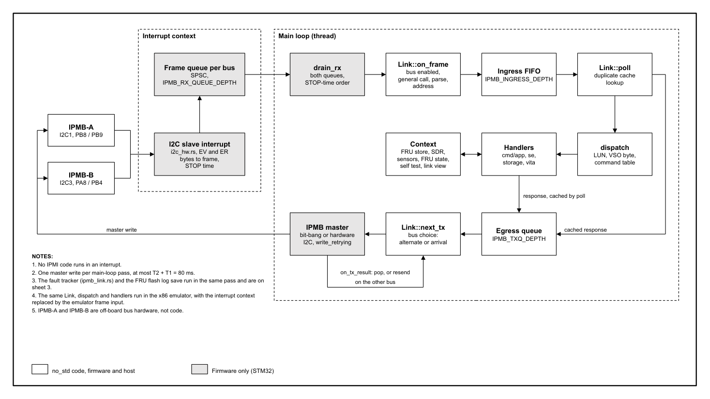

Source: `diagrams/src/ipmc-software.js`, sheet 2.

- On receive, the I2C EV interrupt (`i2c_hw.rs` `on_event`) clears ADDR, starts a frame with
  the matched address byte, appends each data byte, and at STOP posts the frame with the SysTick
  time to that bus's SPSC queue. A frame longer than 33 bytes, an address-only write or a full
  queue is dropped and counted. The ER interrupt counts and clears error flags and drops the
  partial frame, except for ARLO alone (the hardware master lost arbitration), which is counted and
  keeps the reception, because the winner's frame may be addressed to this slave. A read of the slave answers FFh bytes.
- In the main loop, `IpmbLink::service` samples NVMRO, drains both queues in STOP-time order into
  `Link::on_frame` (at most 2 x `IPMB_RX_QUEUE_DEPTH` frames per pass; each frame goes into the
  capture log before the parser sees it), runs `Link::poll`, books
  slave errors on the fault streak, transmits at most one response, clears faulted buses whose
  lines have been idle-high for `IPMB_FAULT_CLEAR_MS`, and runs the FRU log save step.
- On transmit, `Link::next_tx` gives the oldest response and its bus; the master writes it
  (`write_retrying`: free-bus wait, then the transfer, arbitration retries on the same bus inside
  one T2 + T1 budget); the frame and its outcome go into the capture log; `Link::on_tx_result`
  pops the frame on success or moves it to the other bus for a resend.

### 10.2 Link layer (`ipmc-core/src/link.rs`)

`on_frame(bus, frame, now_ms)`:

1. A bus that is disabled or not fitted drops the frame (`BusUnavailable`).
2. A leading 00h (general call) is stripped and the request marked broadcast.
3. `ipmb::parse`; a parse error is counted per kind; a response is offered to the requester and
   kept when it answers the outstanding request (`rx_answers`), else dropped (a Tier-1 IPMC sends
   no requests, so it drops every response).
4. rsSA must be the own address; a broadcast must also be Get Device ID (`NotForUs` otherwise).
5. The request joins the ingress FIFO with its bus and arrival time; a full FIFO drops the new
   frame. Every drop is logged for `poll` to trace; the counters keep the totals.

`poll`: traces the drops, then takes requests oldest first while the egress queue has room. A
request whose `Key` is in the duplicate cache within the window gets the cached response queued
again and runs no handler (`replays` counter). Any other request is dispatched against a private
staging queue; a pending Set IPMB State change is applied; the response is cached and queued with
the arrival bus and time. After the requests, `poll` steps the requester timing (a retransmission
falls due, or the request ends with no response), traces a request that ended, refreshes the link
view in the context and calls `Extension::poll` once.

`next_tx`: a response handed out for the first time gets its bus now. ALTERNATE prefers the bus
other than the latest transmission (resends count); ARRIVAL prefers the request's bus; when the
preferred bus is not enabled the other enabled bus is used. A response whose assigned bus has
since been disabled moves to the other bus. None when neither bus is enabled. A queued response
always goes first; with none queued, a request that is due goes out on the bus other than the one
of its own previous transmission (the other enabled bus when that one is disabled), and the same
frame is handed out until its outcome is reported.

`on_tx_result(bus, ok, now_ms, trace)`: success pops the frame and counts a late response when the
transmission completed more than 227 ms after the request's STOP. Failure counts `tx_fail` and
the streak; when the other bus is enabled and the frame has fewer than `IPMB_TX_RETRIES` resends
it moves there, otherwise it is dropped (`tx_dropped`) and the requester's retry gets the cached
response. A request frame is booked by the requester instead: success starts its T3 wait, a
failure waits at least T6 and retransmits on the other bus when it is enabled (`tx_requests`
counts every request transmission).

Bus state per bus: `fitted`, `mode` (Isolated or Local Control, the Set IPMB State value) and
`status` (local fault, `LocalStatus`). A bus is enabled when it is fitted, in Local Control and
without a local fault.

### 10.3 Sensor data, FRU state and FRU persistence

**Figure 10-2.** Sensor data, FRU state and FRU persistence (ipmc-software, sheet 3)

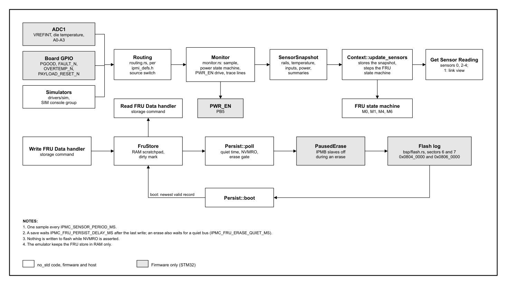

Source: `diagrams/src/ipmc-software.js`, sheet 3.

Once per `IPMC_SENSOR_PERIOD_MS` the `Monitor` reads the inputs, steps the power state machine,
drives PWR_EN, builds a `SensorSnapshot` and prints the change lines. `IpmbLink::feed_sensors`
hands the snapshot to `ext::feed_sensors`, which calls `Context::update_sensors` and then the
extension's `on_sample` hook with the FRU state transition that sample made. `update_sensors`
stores the snapshot for Get Sensor Reading and steps the FRU state machine with the initial
checks, "payload power valid" (power state On, so PGOOD was seen), "payload shut down" (PWR_EN
released and PGOOD read deasserted) and, at Tier-3 only, the standing deactivation request
(`Context::deactivation_requested`).

<div style="page-break-after: always;"></div>

<table style="width:100%; border:none; margin:0; padding:0;">
<tr>
<td style="text-align:left; border:none; padding:0; width:50%;"><strong>CONFIDENTIAL DOCUMENT &#8211; DO NOT DISCLOSE</strong></td>
<td style="text-align:right; border:none; padding:0; width:50%;"><strong>Revision 10-26-2026</strong></td>
</tr>
</table>
<hr style="border:none; border-top:2px solid #000; margin:4px 0 12px 0;">

### 10.4 FRU 0 Operational State machine (`fru_state.rs`)

```mermaid
stateDiagram-v2
    [*] --> M0
    M0 --> M1 : initial checks pass&#10;address parity, SDRs, self test
    M1 --> M4 : payload power valid&#10;PGOOD seen
    M4 --> M6 : payload power lost or off
    M4 --> M5 : deactivation requested&#10;Tier-3 only
    M5 --> M4 : request cleared
    M5 --> M6 : payload power lost or off
    M6 --> M1 : payload shut down&#10;PWR_EN released, PGOOD low
    M1 --> M0 : management power lost
    M4 --> M0 : management power lost
    M5 --> M0 : management power lost
    M6 --> M0 : management power lost
```

One transition per `step`. The state is reported only when Get Sensor Reading polls sensor 0 (a
Tier-1 IPMC sends no events; the extension's `on_sample` hook sees each transition). The order inside `step` is: management power lost (to M0), then the
transition of the current state; from M4 and M5, lost payload power (to M6) is tested before the
deactivation request. Power that returns during M6 does not cancel the deactivation. M5 (FRU
Deactivation Request) is reachable only at Tier-3, where the IPMC controls payload power
(`tier::activation_control`): `Inputs::deactivation_requested` is the Tier-3 handlers' standing
request (Rules 4.1.5.4.3-2 and -6) and is false below Tier-3, so M4 never leaves for M5 there.
M7 is declared by the Chassis Manager, never by the IPMC for its own FRU, so it is not reachable.
A self-test failure after M0 does not leave M1, M4 or M5. Management power is valid by
construction on this board (the IPMC runs from it).

A payload power-on request is refused in M6 (`PowerOnRefused::DeactivationInProgress`) and, when an
extension says so, while the FRU is Activation-Locked
(`PowerOnRefused::ActivationLocked`, from `Extension::power_on_allowed`, Rule 4.1.5.4.2-1).
`ext::check_power_on` is the one check for the boot power-on, the `pending_power` On hand-off
(`Monitor::apply_power_request`) and the console `POWER ON`; the first refusal is returned and
printed with its `name()`.

### 10.5 Payload power state machine (`ipmc-sensors/src/eval/power_fsm.rs`)

```mermaid
stateDiagram-v2
    [*] --> Off
    Off --> PowerOnRequested : power_on&#10;PWR_EN asserted
    PowerOnRequested --> On : PGOOD seen
    PowerOnRequested --> Fault : PGOOD timeout&#10;PWR_EN released
    On --> Fault : PGOOD lost&#10;PWR_EN released
    PowerOnRequested --> Off : power_off
    On --> Off : power_off
    Fault --> Off : power_off or power_clear
```

A fault stays latched until `POWER OFF` or `POWER CLEAR`, and `power_on` is refused while it is
latched. A failed PWR_EN write latches `Fault` (EnableWrite) from any state. PGOOD seen in the
same step as the timeout wins. Console `POWER ON` and a `pending_power` On request check
`ext::check_power_on` first (section 10.4). The start-up request (`IPMC_POWER_AT_BOOT`) runs in
M0, where the FRU machine's check always passes; the extension's activation lock can still keep
the payload off at boot.

<div style="page-break-after: always;"></div>

<table style="width:100%; border:none; margin:0; padding:0;">
<tr>
<td style="text-align:left; border:none; padding:0; width:50%;"><strong>CONFIDENTIAL DOCUMENT &#8211; DO NOT DISCLOSE</strong></td>
<td style="text-align:right; border:none; padding:0; width:50%;"><strong>Revision 10-26-2026</strong></td>
</tr>
</table>
<hr style="border:none; border-top:2px solid #000; margin:4px 0 12px 0;">

### 10.6 Request, response and resend sequences

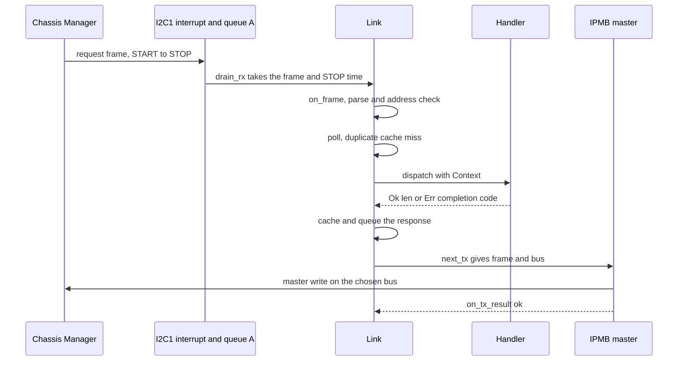

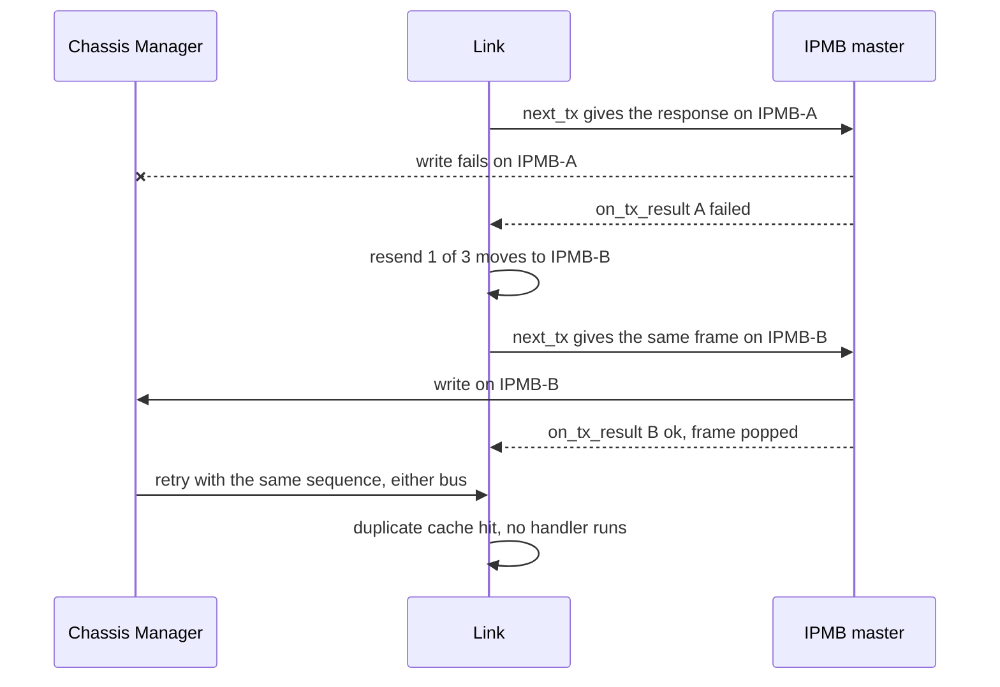

A request this IPMC sends (a build with the extension) keeps one sequence number through its
retries. The first transmission goes out on IPMB-A and is acknowledged, but no response arrives
within `IPMB_REQ_TIMEOUT_MS`; the retry goes on IPMB-B, the bus other than the previous
transmission's, and fails on the wire; after at least T6 (60 ms) the next retry goes on IPMB-A and
the response arrives.

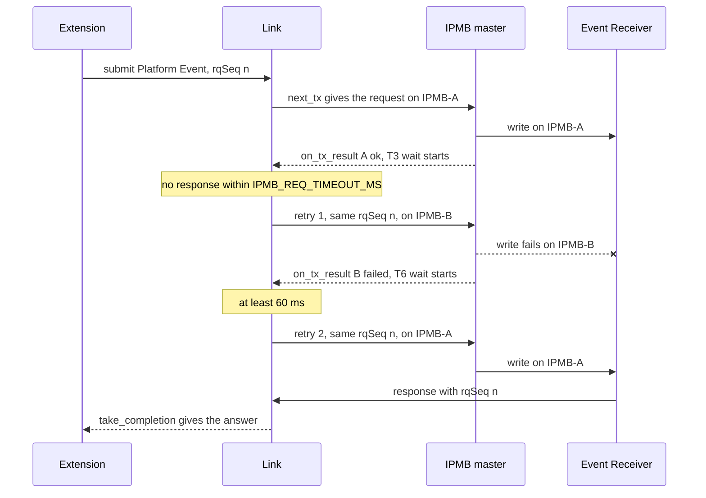

<div style="page-break-after: always;"></div>

<table style="width:100%; border:none; margin:0; padding:0;">
<tr>
<td style="text-align:left; border:none; padding:0; width:50%;"><strong>CONFIDENTIAL DOCUMENT &#8211; DO NOT DISCLOSE</strong></td>
<td style="text-align:right; border:none; padding:0; width:50%;"><strong>Revision 10-26-2026</strong></td>
</tr>
</table>
<hr style="border:none; border-top:2px solid #000; margin:4px 0 12px 0;">

### 10.7 Set IPMB State hand-off

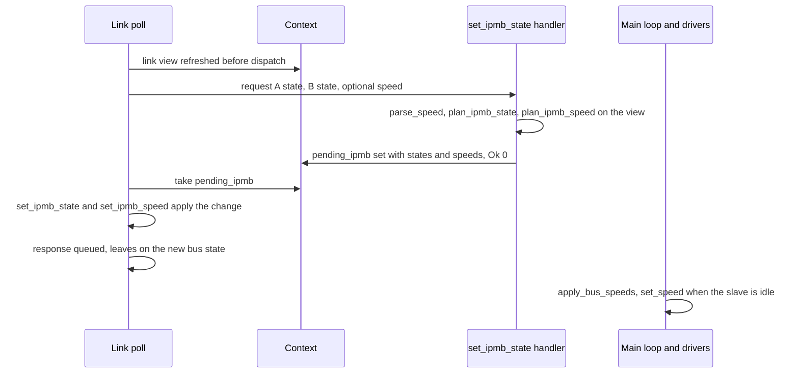

The speed byte is optional. Its bits 1:0 are the IPMB-A speed, bits 3:2 the IPMB-B speed and bits
7:4 are reserved: 00b is STANDARD-MODE, 100 kHz; 01b is FAST-MODE, 400 kHz, accepted only at
Tier-3 (`tier::fast_mode`); 10b, 11b, a non-zero reserved nibble and 01b below Tier-3 answer CCh
(Rule 4.1.1-14). `plan_ipmb_speed` also refuses 400 kHz for a bus that is not fitted (CCh); 100
kHz is always accepted. A request with an absent speed byte changes no speed. A refusal changes
nothing, states included. `Link::poll` applies the state, then the speed, before the response is
queued; the response leaves on the new state, still at the old speed.

The firmware applies the speed between transfers. `IpmbLink::apply_bus_speeds` runs at the end of
`service`, compares each running bus's `bus_state(bus).speed` with the speed applied, and calls
`IpmbMaster::set_speed`. That calls `i2c_hw::set_speed`, which suspends the slave only when it is
idle (a busy or stopped slave returns false and the next pass asks again), loads CCR, TRISE and
F/S for the speed and resumes the slave; the master write uses the new phases from the next frame
on, and one console line `IPMB-A: running at 400 kHz` marks the change. Every restart of the link
starts at STANDARD-MODE (Rule 4.1.1-4.3): at power-up, after a Cold Reset and after a Warm Reset
(`Link::restarted`), and the drivers follow on the next pass. The System IPMB Link sensor and its
FAST-MODE events follow the link state as soon as Set IPMB State is applied; the driver changes
the clock once its slave is idle, so for a pass or two the sensor can show 400 kHz before the
master runs at it. Bus recovery at start-up runs at 100 kHz.

<div style="page-break-after: always;"></div>

<table style="width:100%; border:none; margin:0; padding:0;">
<tr>
<td style="text-align:left; border:none; padding:0; width:50%;"><strong>CONFIDENTIAL DOCUMENT &#8211; DO NOT DISCLOSE</strong></td>
<td style="text-align:right; border:none; padding:0; width:50%;"><strong>Revision 10-26-2026</strong></td>
</tr>
</table>
<hr style="border:none; border-top:2px solid #000; margin:4px 0 12px 0;">

### 10.8 FRU save to the flash log


The store is one sector with 31 slots, so the erase comes once per 31 saves: the save that finds
no free slot erases the sector and writes the newest image as the first record. That erase starts
only when the egress queue is empty and no frame arrived for `IPMC_FRU_ERASE_QUIET_MS`; until then
the image stays safe in RAM. `FRU RESTORE` erases at once when its record needs a sector, without
that quiet gate, but answers `busy` and erases nothing while the link holds a request or a response. `PausedErase` suspends each running slave (a healthy one waits up to
`IPMC_FRU_PAUSE_WAIT_MS` for idle; a faulted one is switched off at once), erases, resumes the
slaves and reports the time the board was silent (a status line on the console and in the capture
log), measured with the DWT counter. After the slaves are off the driver checks both receive queues and the link
(`Link::request_in_flight`: an accepted request not yet answered, or a response not yet
transmitted, on either bus); a frame or a request in that state defers the erase
(`FlashError::Deferred`): the slaves resume, nothing is
printed, the write stays pending with the failure counter unchanged, and the next pass retries;
`systick::catch_up` adds the stalled time to the clock. On the bench the sector erase paused the
IPMB for 198 ms (DS10086 Table 45, x32 programming: typical 250 ms, maximum 500 ms); a request
that arrives in that time is missed and the Chassis Manager retries it. A power cut between
the erase and the end of the first record's programming loses the stored image (section 17). A
failed save keeps the write pending and retries once per delay. A per-unit field written through
the application port takes the same path: `set_unit_field` marks the store dirty and `service`
saves it after the quiet time.

<div style="page-break-after: always;"></div>

<table style="width:100%; border:none; margin:0; padding:0;">
<tr>
<td style="text-align:left; border:none; padding:0; width:50%;"><strong>CONFIDENTIAL DOCUMENT &#8211; DO NOT DISCLOSE</strong></td>
<td style="text-align:right; border:none; padding:0; width:50%;"><strong>Revision 10-26-2026</strong></td>
</tr>
</table>
<hr style="border:none; border-top:2px solid #000; margin:4px 0 12px 0;">

### 10.9 Bit-bang master timing (`drivers/i2c_bitbang.rs`)

```wavedrom
{ "signal": [
  { "name": "SCL",   "wave": "1110101|010101|0111" },
  { "name": "SDA",   "wave": "1101100|110000|0011" },
  {},
  { "name": "phase", "wave": "=.==.=.|=.=.=.|=.=.",
    "data": ["BUF","S","A7","A6","A1","W","ACK","P","BUF"] }
],
  "head": { "text": "Bit-bang write: START, address 82h, ACK, STOP (one slot = 5 us half bit)" },
  "config": { "hscale": 1 }
}
```

One slot is `IPMB_BITBANG_HALF_NS` (5000 ns). The bus is free when both lines have read high for
tBUF (4.7 us) and the slave is idle. START: SDA falls while SCL is high (tHD;STA timed from the
SDA write). Each bit: SDA set while SCL is low, at least tSU;DAT (250 ns) before SCL is released;
SCL released and read back until high (clock stretching, up to `IPMB_STRETCH_TIMEOUT_US`); SDA
sampled; after every released 1 bit a low SDA means another master holds the bus
(`ArbitrationLost`). ACK: SDA released for the ninth clock and sampled low (the slave acknowledges).
STOP: SDA low, SCL released, SDA released. Lines are only ever released or driven low (open-drain
output: latch 1 releases the line, latch 0 drives it low); a pin is never driven high. The SCL period measured with the DWT counter
is 12.0 us (83 kHz), below the 100 kHz limit.

At 400 kHz (FAST-MODE, Tier-3) the two phases differ: SCL low lasts `IPMB_BITBANG_FAST_LOW_NS`
(1400 ns, at least the I2C fast-mode tLOW of 1300 ns) and SCL high `IPMB_BITBANG_FAST_HIGH_NS`
(1000 ns, at least tHIGH of 600 ns). The cycle counts come from `ipmc-defs` `BitPhases`; the low
phase also times the bus-free wait after a STOP (at least 1.3 us in fast mode) and the high phase
the START setup and hold and the STOP setup. The slack above the minimum high time absorbs a slow
rise, and a stretched clock extends the phase so SCL stays high for the minimum after it was seen
high. The SCL period measured with the DWT counter is 6795 ns (about 147 kHz): the two phase
times plus the loop overhead of the pin operations, with SCL low and high both above the fast-mode
minimums. The hardware master runs CCR 35 (F/S = 1, DUTY = 0) and TRISE 13 at PCLK1 = 42 MHz;
its measured SCL period is 2981 ns (about 335 kHz).

Peripheral hand-off: `i2c_hw::suspend` re-checks the slave is idle inside a critical section,
masks the bus's EV and ER interrupts and clears PE, which releases both lines; the pins go to
open-drain GPIO; after the STOP `i2c_hw::resume` restores the alternate function and re-arms the
slave exactly as `init` does. While PE is 0 the slave cannot hear its bus; a frame another master
sends at that moment is lost and recovered by the requester's retry.

### 10.10 Error handling

| Error | Detection | Reporting | Recovery |
|---|---|---|---|
| Bad frame (length, checksum, address bit) | `ipmb::parse` in `on_frame` | `RxErrors` per kind, trace line | dropped; the requester retries |
| Frame on a disabled bus, not for us, response | `on_frame` | `bus_unavailable`, `not_for_us`, `rx_response` | dropped |
| Ingress or egress full | `Fifo::push` | `ingress_full`, `egress_dropped`, `dispatch_errors` | dropped; requester retries |
| Transmit failure (NACK, busy, stretch, stuck line) | `MasterError` from the master | `tx_fail`, per-kind master counters, trace line | resend on the other bus up to `IPMB_TX_RETRIES` |
| Arbitration loss | released SDA reads low, or ARLO | `arb_retries` | same-bus retry up to `IPMB_ARB_RETRIES` within the write budget |
| Persistent bus fault | `IPMB_FAULT_STREAK` consecutive bus-fault errors (stretch timeout, SCL/SDA stuck, bus busy, slave BERR or TIMEOUT) | console `IPMB-A fault: <name>`, IPMB Link sensor local status | bus disabled (Rule 9.3-10); cleared after both lines read high for `IPMB_FAULT_CLEAR_MS`, with the BUSY workaround and a slave re-arm |
| Stuck BUSY flag | both lines high longer than T7 (3 ms) with BUSY set and no frame | `busy-errata-resets` counter | `clear_stuck_busy` (I2C peripheral reset sequence) |
| Bus fails at start-up | `bring_up` (recovery or slave init) | console line, local status | bus disabled; restarted after the lines read idle-high |
| Request without a response (a build with the extension) | `Requester` T3 timeout after each transmission | trace line `request seq .. no response after N transmissions` | retried up to `IPMB_REQ_RETRIES` times with the same sequence number; then the completion is no response and the extension decides |
| Payload power-on refused | `ext::check_power_on`: the FRU is in M6, or the extension reports the FRU Activation-Locked | console line `power on request refused: ...`, `Power at boot refused: ...`, or the refusal text of console `POWER ON` | no power change; allowed again once the FRU is in M1 or activated |
| Pending reset blocked | `ResetGate`: response still queued or FRU write unsaved | trace line after `IPMC_RESET_WAIT_MS` | the reset runs anyway at that time |
| Corrupt FRU image | `selftest::run` | Get Self Test Results 57h with bit 5 | FRU stays in M0 when found at start-up; Write FRU Data or `FRU RESTORE` repairs it |
| Flash program, erase or verify failure | `FlashError` | console `FRU log: save failed: <name>`, `FRU STORE` | write stays pending, retried once per delay |
| Runtime image fails its check at a reset | `header::check` in the bootloader | `Runtime image:` and `Image check:` lines, `Decision: staying in the bootloader: <reason>` | the bootloader waits for `WAKEUP`; an update or `ERASE FRU` and `RUN` recovers (section 16) |
| PGOOD timeout or loss | `power_fsm` | console event line, `POWER STATUS`; FRU Health is bad only while PWR_EN is asserted without PGOOD, so it returns to good once the fault releases PWR_EN | latched until `POWER OFF` or `POWER CLEAR` |
| Pin-claim conflict, UART failure | `ports::claim`, `uart::init` | console line naming both owners, or 5 Hz LED | fail-stop (park); an application port failure other than a pin conflict prints `APP UART not started` and the board runs without it |
| UART receive ring full, overrun, transmit timeout | `uart.rs` `service`, `wait_for_room` | per-port counters in `SYS STATUS` | the byte is dropped (receive) or the bounded wait ends (transmit) |
| UART byte with a framing, noise or parity error | `uart.rs` `service` (SR FE, NF, PE) | `line errors` in `SYS STATUS`, `Port errors:` in the bootloader `INFO` | the byte is queued as received; the line it belongs to fails its own check (an unknown command, a record checksum) |
| Trace line without room in the console transmit ring | `print_line_or_drop` | `tx lines dropped` in `SYS STATUS` | the line is dropped whole and never stalls the IPMB; the capture log still holds it |
| Application answer longer than the transmit ring has room for | `app_port.rs` `drain` | none (the answer is only late) | the output stays in its buffer and leaves as the ring has room; no new request is taken meanwhile, and the main loop never waits |
| Capture log full | `CaptureLog::add` | `overwritten` in `DEBUG STATUS` and in the dump header | the oldest whole records are dropped |

<div style="page-break-after: always;"></div>

<table style="width:100%; border:none; margin:0; padding:0;">
<tr>
<td style="text-align:left; border:none; padding:0; width:50%;"><strong>CONFIDENTIAL DOCUMENT &#8211; DO NOT DISCLOSE</strong></td>
<td style="text-align:right; border:none; padding:0; width:50%;"><strong>Revision 10-26-2026</strong></td>
</tr>
</table>
<hr style="border:none; border-top:2px solid #000; margin:4px 0 12px 0;">

### 10.11 Capture log (`ipmc-log`, `ipmb_link.rs`, `log_cmds.rs`, `debug_cmds.rs`)

The capture log is the field-service record of the IPMB. A person enables it on a target system,
reproduces a fault and mails the dump back; the dump reads the same on the console, in a
spreadsheet and, through `tools/capture/capture2pcap.py`, in Wireshark. The log lives in RAM (one
`ByteRing` of `IPMC_LOG_SIZE` bytes, 8191 usable by default) and is empty after a reset.

What goes in:

- every whole IPMB frame taken from a driver queue, before the parser (so a frame the parser
  rejects is there too), with status `rx`;
- every frame handed to the master, with its outcome: `ok`, or the cause of the failure;
- every frame handed to the link by `DEBUG INJECT`, with status `inject`;
- the trace lines of the link, the dispatcher and the requester, the status lines (FRU log saves,
  bus faults and speed changes, resets), the lines of `DEBUG IPMI` (`console request ...`,
  `console response ...`) and the application port lines (`app request ...`, `app answer ...`).

`IPMC_IPMI_TRACE` false removes the link and dispatcher trace lines at compile time, so they are
absent from the capture log as well as from the console; the frames, the status lines and the
console and application lines stay. `DEBUG TRACE IPMI OFF` stops only the console copy: the log
keeps the lines. `DEBUG TRACE I2C ON` (or `IPMC_I2C_TRACE_AT_BOOT` true) prints one console line per
frame, the same row `DEBUG DUMP TRACE` prints, even while the log is off.

Record layout (little-endian): a 6-byte header, then the payload.

| Byte | Content |
|---:|---|
| 0 | flags: bit 0 kind (0 frame, 1 text), bit 1 bus (0 A, 1 B), bit 2 direction (0 in, 1 out), bits 6:3 status code |
| 1 | payload length: a frame at most `IPMB_MSG_MAX` (32) bytes, a text line at most `IPMC_LOG_TEXT_MAX` (160) |
| 2..5 | `time_ms`, u32, the SysTick time |
| 6.. | the payload: the IPMB frame as it is on the wire, or the line as ASCII |

The status code is 0 received, 1 injected, 2 sent, then 3 + n for a failed transmission with the
cause n: address NACK, data NACK, arbitration lost, bus busy, stretch timeout, line stuck,
unspecified. The record index is not stored: the i-th held record is `total - records + i`. A
record that does not fit drops the oldest whole records first and counts them. A 23-byte frame
takes 29 bytes of the ring.

The DEBUG group (help text as in `console.rs`):

| Command | Help text |
|---|---|
| `DEBUG STATUS` | Debug switches, capture log use, event receiver, duplicate cache |
| `DEBUG LOG {STATE}` | Capture log ON or OFF; no argument shows its state |
| `DEBUG DUMP {FORMAT}` | Print the capture log: CSV (default) or TRACE; any key stops it |
| `DEBUG CLEAR` | Empty the capture log |
| `DEBUG TRACE {WHAT} {STATE}` | Console trace: IPMI (request, link and event lines) or I2C (one line per frame), ON or OFF |
| `DEBUG EVENTS {STATE}` | Event messages ON (receiver 20h) or OFF (receiver FFh) |
| `DEBUG IPMI [NETFN] [CMD] {DATA...}` | Run one IPMI request locally, as from 20h; nothing goes on the bus |
| `DEBUG INJECT [BUS] {BYTES...}` | Hand a whole IPMB frame to the link as if received on bus A or B |
| `DEBUG CACHE {ACTION}` | Duplicate cache: no argument shows the entries, CLEAR empties it |
| `DEBUG BOOTLOADER {CONFIRM}` | Restart into the bootloader; CONFIRM needed while payload power is on |

A local request (`DEBUG IPMI`, the application port `IPMI`, the start-up events-off request) reads the live NVMRO pin first, as the main loop does, so it decides like a bus request.

`DEBUG IPMI` and `DEBUG INJECT` take hex bytes (`06`, `0x06` and `6` are the same). `DEBUG IPMI`
runs the request through the dispatcher (`IpmbLink::local_request`) and prints
`-> CC 00h, 15 bytes: 01 80 ... (App Get Device ID)`. `DEBUG INJECT` hands the frame to the link as
received on bus A or B; the link answers a request it accepts on the bus like any other.

`DEBUG DUMP` prints one header line, the rows and an end line. The header line is

```text
# IPMC capture: ipmc-nucleo-f401re v0.1.0, ipmc-core v0.1.0, IPMB address 82h, Tier 1, uptime 123456 ms, 41 records, 0 overwritten
```

and the end line is `# end of capture`. A dump runs as a job: a few rows per main-loop pass,
while the console transmit ring has room for the longest row, so the main loop never waits for the
wire. It prints the records held when it started; a record the ring overwrote meanwhile is skipped
and counted in `# <n> records overwritten during the dump`.

The CSV format has one header row and one row per record, with the columns

| Column | Content |
|---|---|
| `rec` | the record index since the last clear |
| `time_ms` | the SysTick time of the record |
| `type` | `FRAME` or `TEXT` |
| `bus` | `A` or `B`; empty for text |
| `dir` | `IN` or `OUT`; empty for text |
| `status` | `rx`, `inject`, `ok`, `addr-nack`, `data-nack`, `arb-lost`, `bus-busy`, `stretch`, `line-stuck` or `failed`; empty for text |
| `len` | the frame length in bytes; empty for text |
| `summary` | quoted; for a frame `<src>h-><dest>h <NetFn> <Req or Rsp> <command> seq <n>h` and ` CC <cc>h` for a response, or `unparsed: <error>`; for text the line |
| `bytes` | the frame bytes in hex, upper case, one space apart; empty for text |

```text
rec,time_ms,type,bus,dir,status,len,summary,bytes
12,123456,FRAME,A,IN,rx,7,"20h->82h App Req Get Device ID seq 01h",82 18 66 20 04 01 DB
13,123459,TEXT,,,,,"FN(06h) CMD(01h) Get Device ID -> CC 00h, 15 bytes",
14,123461,FRAME,A,OUT,ok,23,"82h->20h App Rsp Get Device ID seq 01h CC 00h",20 1C C4 82 04 01 00 01 80 00 01 02 09 00 00 00 4B 49 00 00 00 00 58
```

`DEBUG DUMP TRACE` prints the same records as Wireshark-style text rows: `#<index>`, the time in
seconds with milliseconds, `IPMB-A` or `IPMB-B` and the direction, `<src>h -> <dest>h`, the NetFn
name with `Req` or `Rsp` in a 14-character column, the command name in a 22-character column,
the tail (`seq <n>h`, ` CC <cc>h`, and the status word of an injected or failed frame), and after
`| ` the frame bytes. A text record is `#<index>`, the time, `TEXT` and the line.

```text
#12   123.456  IPMB-A  IN   20h -> 82h  App Req       Get Device ID          seq 01h          | 82 18 66 20 04 01 DB
#13   123.459  TEXT    FN(06h) CMD(01h) Get Device ID -> CC 00h, 15 bytes
#14   123.461  IPMB-A  OUT  82h -> 20h  App Rsp       Get Device ID          seq 01h CC 00h   | 20 1C C4 82 04 01 00 01 80 00 01 02 09 00 00 00 4B 49 00 00 00 00 58
```

A command name comes from the Tier-1 table, then from the extension, then from Platform Event, the
one request the IPMC sends; an unknown command prints as `CMD 5Ah`, a NetFn without a name as
`NetFn 3Ah`.

The Wireshark path: save the terminal log of a CSV dump and run
`python -I tools/capture/capture2pcap.py dump.txt -o dump [--csv]`. The tool reads only the lines
between `# IPMC capture:` and `# end of capture` (a log may hold several dumps and other terminal
text) and skips a `TRACE` block. It writes `dump.pcap`, a little-endian pcap with link type 260
(`LINKTYPE_IPMI_HPM_2`): one packet per record, stamped with the record's `time_ms`. Each packet
holds one block of the Wireshark IPMI trace format: byte 0 the block type (0 frame, 2 text line)
in bits 7:4 and the channel (0) in bits 3:0, bytes 1..4 the seconds and bytes 5..6 the
milliseconds, byte 7 the data type 01h (IPMB 1.0), bytes 8..9 the flags (bit 6 IPMB-B, bit 7
direction to the controller, an `IN` frame), byte 10 the length and then the data, the whole IPMB
frame from rsSA or the ASCII line. A failed `OUT` frame is the frame followed by a text packet
`tx failed: <status>`. With `--csv` the rows are also copied to `dump.csv`.

<div style="page-break-after: always;"></div>

<table style="width:100%; border:none; margin:0; padding:0;">
<tr>
<td style="text-align:left; border:none; padding:0; width:50%;"><strong>CONFIDENTIAL DOCUMENT &#8211; DO NOT DISCLOSE</strong></td>
<td style="text-align:right; border:none; padding:0; width:50%;"><strong>Revision 10-26-2026</strong></td>
</tr>
</table>
<hr style="border:none; border-top:2px solid #000; margin:4px 0 12px 0;">

## 11. Software API

### 11.1 Link layer (`ipmc_core::link::Link`)

| API | Inputs | Output | Notes |
|---|---|---|---|
| `Link::new(config, &addr)` | `LinkConfig { b_fitted, tx_policy, requests_allowed }`, `AddrInfo` | `Link` | `const`; power-up bus state; unusable address isolates both buses; `with_first_request_seq` sets the first rqSeq, `next_request_seq` reads it; `restarted(&addr, now_ms)` builds the Link of a Cold or Warm Reset |
| `on_frame(bus, frame, now_ms)` | bus, whole frame (own address or 00h first), STOP time | `Result<(), FrameDrop>` | main loop only; copies at most `IPMB_MSG_MAX` bytes; never traces |
| `poll(ctx, ext, now_ms, trace)` | dispatch `Context`, `&mut dyn Extension`, time, trace sink | requests taken | runs handlers (the extension for a command the table lacks); stops when the egress queue is full; steps the requester and calls `ext.poll` |
| `next_tx()` | | `Option<(Bus, &[u8])>` | response first, else a due request; frame stays handed out until `on_tx_result` |
| `on_tx_result(bus, ok, now_ms, trace)` | outcome of the frame handed out | `Result<(), LinkError>` | `NoTxInFlight`, `TxBusMismatch` change nothing |
| `set_ipmb_state(a, b)` | `Option<BusMode>` per bus | `Result<(), LinkError>` | through `plan_ipmb_state`, all or nothing |
| `set_ipmb_speed(a, b)` | `Option<BusSpeed>` per bus | `Result<(), LinkError>` | through `plan_ipmb_speed`, all or nothing; `BusNotFitted` for 400 kHz on a bus that is not built in |
| `set_local_status(bus, status)` | `LocalStatus` | | the firmware's persistent-fault decision |
| readers | | | `view`, `bus_state`, `counters`, `config`, `own_address`, `evictions`, `late_responses`, `dispatch_errors`, `egress_empty`, `egress_dropped`, `sensor_data` |

### 11.2 Dispatch (`ipmc_core::dispatch`)

```rust
pub type Handler = fn(&mut Context, &Frame, &mut [u8]) -> Result<usize, u8>;
```

`Ok(n)`: n response data bytes written after the completion code. `Err(code)`: that completion
code with no data. For NetFn 2Ch the frame data and the output slice both exclude the VSO byte.

| `Context` field | Owner (only writer) | Read by |
|---|---|---|
| `addr: AddrInfo` | `addr::resolve` at start-up; `nvmro_asserted` by the NVMRO sample | Write FRU Data, Get FRU Address Info, initial checks |
| `sensors: SensorSnapshot` | `update_sensors` | Get Sensor Reading 2..4 |
| `fru: FruStore` | Write FRU Data; `set_fru` at boot and `FRU RESTORE` | Read FRU Data, self test, `Persist::poll` |
| `sdr: SdrRepository` | Reserve Device SDR Repository (reservation) | Get Device SDR, Get Device SDR Info, locator |
| `self_test: SelfTest` | `Context::new`, `set_fru`, Write FRU Data | Get Self Test Results, initial checks |
| `fru_state: FruMachine` | `update_sensors` | Get Sensor Reading 0 |
| `link: LinkView` | `Link::poll` before every dispatch | Get VSO Capabilities, Set IPMB State, Get Sensor Reading 1 |
| `pending_ipmb: Option<PendingIpmbState>` | Set IPMB State handler | `Link::poll` (applies and clears) |
| `event_enables: EventEnables` | `Context::new` (power-up values by Tier); an extension handler | `read_sensor` (status bit 7), the event generator |
| `pending_reset: Option<ResetRequest>` | an extension handler (Cold or Warm Reset) | `ResetGate` owner: the firmware main loop, the emulator (cleared by the reset; `Context::warm_reset` clears it for a Warm Reset) |
| `pending_power: Option<PowerRequest>` | an extension handler (payload power) | the owner of the payload power, through `Monitor::apply_power_request` (On asks `ext::check_power_on`) |
| `pending_payload_reset: bool` | an extension handler (payload reset) | the owner of PAYLOAD_RST_OUT_N: `PayloadResetPulse` (section 8.2) |
| `deactivation_requested: bool` | an extension handler (activation) | `update_sensors`, at Tier-3 only (M4 to M5) |
| `payload_mode: PayloadMode` | an extension handler (payload mode) | `read_sensor` (sensor 7) |
| settings byte, in `fru` (`nv_settings`, `set_nv_settings`) | an extension handler (policy bits), the boot load (`set_fru`) | the extension, `Persist::poll` (saved with the image) |

Other entry points: `Context::new(addr)`, `set_fru(store)`, `initial_checks()`,
`update_sensors(now_ms, &snapshot, trace) -> Option<Transition>`,
`read_sensor(number, &buses, out) -> Result<usize, SensorReadError>` (`read_sensor_at(tier, ..)`
for a given Tier; `out` holds `sensor::READING_LEN_MAX` = 4 bytes), `warm_reset(link_view)`,
`dispatch(ctx, req, arrival, arrival_ms, queue, trace)` (the Tier-1 table and `NoExtension`),
`dispatch_with(table, ext, ctx, ...)` and `build_response_with` (the one frame builder behind
`dispatch_with` and the tests).

### 11.3 Hardware-facing traits

| Trait | Crate | Methods | Implemented by |
|---|---|---|---|
| `FlashLog` | `ipmc-fru::persist` | `sector_len`, `read`, `program` (whole words), `erase`, `millis` | `bsp::flash::Flash`, `PausedErase`, the test flash in `persist/tests.rs` |
| `IpmbMaster` | firmware `bsp::ipmb_master` | `state`, `state_mut`, `write_once`; provided `write`, `pins`, `recover_if_stuck`, `lines_high`, `clear_bus_fault`, `stats`, `speed`, `set_speed` | `BitbangMaster`, `HwMaster` |
| `AnalogSource` | `ipmc-sensors::hal` | `vdda_mv`, `die_temperature_dc`, `rail_mv` | ADC1, simulator, INA226, MCP3208 |
| `DigitalInputs` | `ipmc-sensors::hal` | `level_high` | board GPIO, simulator, PCA9555 |
| `PowerSwitch` | `ipmc-sensors::hal` | `set_enable`, `is_enabled` | board GPIO, simulator, PCA9555 |
| `ResetOutput` | `ipmc-sensors::hal` | `set_reset(asserted)` | board GPIO (PA9, open drain), the test pin of `reset_pulse.rs` |
| `Trace` | `ipmc-core::trace` | `line(fmt::Arguments)` | firmware console, emulator stdout, `NoTrace`, `RecordingTrace` |
| `Extension` | `ipmc-core::ext` | `command`, `poll`, `on_sample`, `warm_reset`, `power_on_allowed` | `NoExtension`; the Tier-2/3 extension through `ipmc_ext::Active` |
| `MenuOutput` | `ipmc-menu` | `write_str` | firmware UART output |
| `AppHost` | `ipmc-app::host` | `version`, `status`, `fru_state`, `unit_field`, `set_unit_field`, `ipmi`, `command_name`, `save_state`, `request_bootloader` | `LinkHost` in the firmware `app_port.rs`, `FakeHost` in the tests |
| `ImageSource` | `ipmc-boot::header` | `read(addr, out)` | `FlashImage` (flash), `SliceImage` (a buffer, `fwimage` and the tests) |
| `FlashOps` | `ipmc-boot::load` | `erase_sector`, `program` (and `read` through `ImageSource`) | `FlashImage` in `src/boot/flash_image.rs`, the RAM model in the tests |
| `BootHw` | `ipmc-boot::session` | `now_ms`, `activity`, `port_counts` (and `FlashOps`) | `FlashImage` in `src/boot/serve.rs`, the test bench |
| `TextOut` | `ipmc-boot::text` | `put(text)` | `PortText` (a UART), `Both`, the string collectors of the tests and `fwimage` |
| `Names` | `ipmc-core::names` | `command(netfn, cmd)` | `CoreNames` (Tier-1 table, extension, sent requests) |

### 11.4 Concurrency model

- Single core, one thread (the main loop) plus interrupts. Interrupt handlers (I2C EV/ER at NVIC
  priority 1 &lt;&lt; 4, above USART1 and USART2 at 2 &lt;&lt; 4, and SysTick) move bytes, stamp times and bump
  counters; the SysTick handler also evaluates the LED pattern and writes PA5. The I2C handlers run above the UART so a slow handler does not stretch SCL past T8.
- Hand-off from interrupt to thread is lock-free: one `heapless::spsc` queue per bus, producer in
  the interrupt, consumer in `ipmb_link.rs`. Driver statics use `Mutex<RefCell<Option<T>>>`
  through `static_slot.rs`, every access inside a short critical section.
- Counters shared between interrupt and thread are single-word atomics with Relaxed ordering.
- `Link`, `Context`, handlers, the console and the trace sink never run in an interrupt. Nothing
  in `ipmc-core` blocks; the blocking calls are the master write (bounded by T2 + T1), a console
  message while the transmit ring is full (86.8 us per byte, bounded per byte; otherwise the
  message goes into the ring and the interrupt sends it), a sensor sample (about 2 ms of polled
  ADC conversions, 23.4 us each), a flash word program (up to 100 us per word) and a flash erase
  (at most 500 ms, IPMB slaves off).
- A flash erase or program stalls every flash access, interrupt handlers included, because code
  runs from the same bank.

<div style="page-break-after: always;"></div>

<table style="width:100%; border:none; margin:0; padding:0;">
<tr>
<td style="text-align:left; border:none; padding:0; width:50%;"><strong>CONFIDENTIAL DOCUMENT &#8211; DO NOT DISCLOSE</strong></td>
<td style="text-align:right; border:none; padding:0; width:50%;"><strong>Revision 10-26-2026</strong></td>
</tr>
</table>
<hr style="border:none; border-top:2px solid #000; margin:4px 0 12px 0;">

## 12. Build, Integration, and Configuration

### 12.1 Toolchain

Rust stable with the GNU host toolchain, targets `thumbv7em-none-eabihf` and
`x86_64-pc-windows-gnu`; `gen.ps1` uses `arm-none-eabi-objcopy` for the images and
`arm-none-eabi-size` for the section sizes. cargo is not on PATH in every shell
(Bash: `export PATH="$HOME/.cargo/bin:$PATH"`). The firmware release profile uses `opt-level = "s"`,
`lto = true`, `codegen-units = 1` and keeps debug information; the bootloader uses the profile `boot`
(`inherits = "release"`, `opt-level = "z"`, `panic = "abort"`).

```bash
# host crates: format, lint, test
cargo fmt --all -- --check
cargo clippy --workspace --all-targets -- -D warnings
cargo test --workspace
# firmware (its own workspace)
powershell -NoProfile -ExecutionPolicy Bypass -File crates/ipmc-nucleo-f401re/gen.ps1 build
powershell -NoProfile -ExecutionPolicy Bypass -File crates/ipmc-nucleo-f401re/gen.ps1 flash
# lint every firmware binary (the runtime and the bootloader)
(cd crates/ipmc-nucleo-f401re && cargo clippy --release -- -D warnings && cargo clippy --profile boot --bin ipmc-boot -- -D warnings)
powershell -NoProfile -ExecutionPolicy Bypass -File crates/ipmc-nucleo-f401re/gen.ps1 console "ipmb stats"
# emulator
cargo run -p ipmc-emu -- replay vectors/sbc_ab.vec --b-fitted 1 --b-enabled 1 --policy alternate --quiet
cargo run -p ipmc-emu -- serve --b-fitted 1
cargo run -p ipmc-emu -- sdr
```

The two build modes (section 4) use the same commands. With the extension folder next to the
repository the build is the commercial release build; `IPMC_TIER23=0` forces the public Tier-1
build and `IPMC_TIER23=1` demands the folder. `gen.ps1 build` sets `IPMC_TIER23` from the folder,
and `gen.ps1 build|flash -Eval` makes the evaluation image (section 8.4). The numbers of the
capture replay (section 13.2) belong to the Tier-1 build.

`gen.ps1 build` makes, in `crates/ipmc-nucleo-f401re/target/thumbv7em-none-eabihf/release`:

1. the bootloader: `cargo build --profile boot --bin ipmc-boot` (always `IPMC_EVAL=0`), then
   `ipmc-boot.bin` (`objcopy -O binary --gap-fill 0xFF`) and `fwimage size`, which fails above
   32 768 bytes and warns above 24 576;
2. the runtime: `cargo build --release --bin ipmc-nucleo-f401re`, then
   `ipmc-nucleo-f401re.app.img` (the bytes from `0x0800_C000`);
3. `fwimage patch` writes the image length and the SHA-256 digest into the header
   (`app_header.bin`), `objcopy --update-section .app_header=...` gives the patched ELF
   `ipmc-nucleo-f401re.elf`, the image is made from it again and `fwimage check` runs the
   bootloader's own image check on it; a mismatch stops the build;
4. `ipmc-nucleo-f401re.hex` (`objcopy -O ihex` of the patched ELF) is the file for `LOAD`;
5. `fwimage combine` writes `ipmc-board.bin`.

Every runtime file carries `-eval` after `gen.ps1 build -Eval`, and every file carries `-field`
after `-Field` (`IPMC_FIELD=1` for both cargo calls: the boot countdown is
`IPMC_BOOT_COUNTDOWN_FIELD`; the two combine as `-eval-field`). `gen.ps1 flash` and `flash -Drive`
copy `ipmc-board.bin` to the `NOD_F401RE` drive and print `Flash OK` only after the copy, the
drive check and the `FAIL.TXT` check pass. `flash -Swd` programs the patched runtime ELF with
OpenOCD (`openocd -f interface/stlink.cfg -f target/stm32f4x.cfg -c "program <ELF> verify" -c reset
-c exit`); `-Swd -Bootloader` programs the bootloader ELF as well. `-Swd` never falls back to the
drive copy, `-Drive` never uses OpenOCD (both together are refused), and a SWD program that starts
and fails is an error. SWD needs the WinUSB driver on the ST-LINK debug interface. The paths leave
the FRU store in different states (section 9.1). `gen.ps1 console <command>` reads a reply until the console has been quiet for
600 ms, up to 60 s and 131072 bytes, so a full `DEBUG DUMP` (about 25 KB, 2.3 s at 115200 baud)
comes back whole.

### 12.2 Changing a tunable

Edit the value in `crates/ipmc-defs/src/defs.rs` and rebuild. A new define is a `///` comment and
one `pub const NAME: T = value;` item there, with the type its consumers need, and, when it has a
range rule, a guard in `ipmc-defs/src/lib.rs`. A value fixed by a specification is not a define: it is a
named constant in the owning module with its rule beside it.

### 12.3 Adding an IPMI command

1. Write the handler in `ipmc-core/src/cmd/<netfn>.rs` with the `Handler` signature; validate the
   request length first (C7h), write only data bytes, return `Err(code)` for refusals.
2. Add one row to `COMMANDS` in `commands.rs`.
3. Run `python -I tools/sync_ipmi_commands.py` so `Documentation/ipmi_commands.md` matches
   (`cargo test` fails until it does).
4. Add a table-driven test in `ipmc-core/tests/tier1_handlers.rs`; check the replay totals still
   read match=44 same_cc=42 cc_diff=134 not_implemented=89 (Tier-1 build; the commercial build has its own
   numbers in the private documents), or state why they change.

### 12.4 Adding an application port command

1. Write the handler in `ipmc-app/src/commands.rs` with the `Handler` signature (arguments, host,
   output): it writes its data lines (`KEY: value`) with `data` and returns `Ok`, or returns
   `Err(Fail::new("CODE", format_args!("sentence")))`; the engine writes the final `OK` or
   `ERROR <CODE>: <sentence>` line and takes back the data lines of a failed handler.
2. Add one row to `COMMANDS`: the syntax string (keywords in capitals, then `[NAME]` required,
   `{NAME}` optional, `{NAME...}` the rest of the line, last), one sentence of help and the
   handler. `HELP` lists the row at once, aligned; the test `the_command_table_is_well_formed`
   rejects a malformed syntax, a required parameter after an optional one, a rest parameter that
   is not last and two rows with the same keywords.
3. A value the host does not offer yet is a new method of `AppHost` (`host.rs`), implemented in
   `LinkHost` (`app_port.rs`) and in `FakeHost` (`tests.rs`); the compiler lists the places that
   miss it.
4. Add one row to `REQUEST_TABLE` in `tests.rs` (the request line and the lines the fake host
   must answer), add the help row to `HELP_TABLE`, and run `cargo test -p ipmc-app`.
5. Run `cargo clippy --workspace --all-targets -- -D warnings` and `python -I tools/dupcheck.py`
   (a handler that repeats another handler's code fails it), and add the row to section 7.6.

### 12.5 Adding a sensor part

Write `drivers/<bus>/<part>.rs` implementing the matching `hal` trait against the embedded-hal 1.0
bus trait, test it against the crate's mock bus, hold it in the router in `routing.rs`, and select
it in `defs.rs` with `Source::I2c` or `Source::Spi`. The firmware build refuses those values
until a bus that is not an IPMB bus is assigned (`sensing.rs` guard).

### 12.6 Gates before handing work back

`cargo fmt`, `cargo clippy -D warnings` and `cargo test` on the workspace; firmware `gen.ps1 build`,
`cargo clippy --release -- -D warnings` and `cargo fmt -- --check` inside
`crates/ipmc-nucleo-f401re`; `sync_ipmi_commands.py --check`; `captured_sdr.py --check`;
`dupcheck.py`; the name check against the local banned-name list; and for link or handler changes
the replay totals above. With the extension folder present, a tenth gate repeats `cargo fmt`,
`cargo clippy` and `cargo test` with `IPMC_TIER23=0` (the public Tier-1 build), runs the replay
totals with `IPMC_TIER23=0` (they belong to the Tier-1 build), checks the extension's library
source with `rustfmt --check --edition 2021`, adds the extension folder as a second path to the
name check, and lints the evaluation code with `IPMC_EVAL=1` in the firmware clippy gate;
`dupcheck.py` scans both repositories by itself.

<div style="page-break-after: always;"></div>

<table style="width:100%; border:none; margin:0; padding:0;">
<tr>
<td style="text-align:left; border:none; padding:0; width:50%;"><strong>CONFIDENTIAL DOCUMENT &#8211; DO NOT DISCLOSE</strong></td>
<td style="text-align:right; border:none; padding:0; width:50%;"><strong>Revision 10-26-2026</strong></td>
</tr>
</table>
<hr style="border:none; border-top:2px solid #000; margin:4px 0 12px 0;">

## 13. Verification

**Figure 13-1.** Build, test and bench setup (ipmc-software, sheet 4)

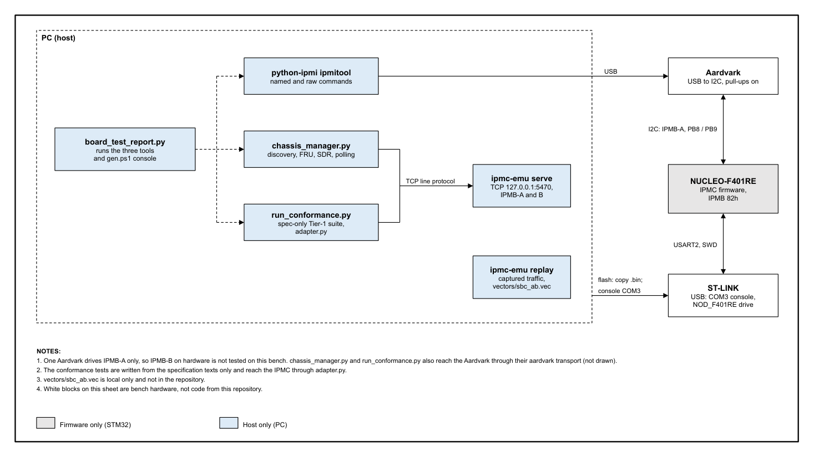

Source: `diagrams/src/ipmc-software.js`, sheet 4.

### 13.1 Host tests (741 tests in the build with the extension, 689 with `IPMC_TIER23=0`, 10-26-2026)

`Documentation/ipmc_test_coverage.md` lists every test case with its result; this section names what each
crate covers.

| Crate | Covers |
|---|---|
| `ipmc-core` | codec, address decode, link layer (bus speed, restarted link, the failure lines of a transmission), requester timing, reset gate, Tier rules, FRU state machine including M5, Payload Mode sensor, speed byte per Tier, event enables, extension hook and the power-on check, duplicate cache, queues, byte ring, names, dispatcher, handlers (`tests/tier1_handlers.rs`), Tier-1 link rules, SDR walk, command document in step (`tests/commands_doc.rs`) |
| `ipmc-app` | line assembler (CR LF, long line, bad byte), every request of the protocol against the test host (`REQUEST_TABLE`), tags, every error code, `WRITE_DISABLED`, the `HELP` listing |
| `ipmc-log` | capture log (records, wrap, drop order, CSV and trace rows, dump cursor and job, header line, cut lines, trace tee, switch lines) |
| `ipmc-sensors` | evaluation, power state machine, routing, monitor and the power-request path, payload reset pulse timing, pin claims, LED level, example drivers against mock buses |
| `ipmc-emu` | vector reader, captured frames decode and re-encode byte-identically, replay runs including the Event Receiver role, Cold and Warm Reset rebuild, the flash copy across a power cycle, serve protocol over TCP, command line |
| `ipmc-fru` | image build, decoder, `verify`, store, the unit field editor (every field, every refusal, a MAC address in a serial), the single-sector flash log including a power cut at every word, the erase of a full sector and the settings byte |
| `ipmc-menu` | line editor, matching, help, table validation |
| `ipmc-defs` | the Tier-2/3 detection rules (`tests/tier23.rs`) and the IPMB timing arithmetic (`i2c_timing.rs`); the guards of `lib.rs` run at compile time. `tools/test_defs.py` tests the Python reader of `defs.rs` |
| `ipmc-ext` | the default `Active` answers nothing for an unowned command; the bridge and `ipmc-defs` agree on the extension |
| `ipmc-boot` | image header (placeholder bytes, patch, every `check` failure, digest range), the decision table row by row, the countdown window, boot request encode and decode, region policy (`load_allowed` at every boundary, erase sectors), Intel HEX parser, `LOAD` (full image, repeated and overlapping records, unaligned head and tail, flash faults), session commands and answers, trace text, `fwimage`, and `tests/flash_map.rs`, which parses `flash_map.x` and fails on a difference from `geometry.rs` |
| `ipmc-wire` | checksum, builder, CRC-32, SHA-256 (FIPS 180-4 vectors, every length 0 to 300, split feeds), hex parser |

The per-crate counts are in the `cargo test --workspace` output. The Chassis Manager request
policy and the Event Receiver have 100 Python unit tests (`tools/chassis-manager/test_cm_link.py`);
`tools/fwupdate/test_fwupdate.py` runs the update tool against a fake bootloader;
`tools/capture/test_capture2pcap.py` checks the pcap blocks (with tshark, when
`C:\Program Files\Wireshark\tshark.exe` exists) and `tools/app-port/test_app_cli.py` checks the
bench client against a fake transport.
Tests are table-driven; `tools/dupcheck.py` fails near-identical test pairs as well as production
pairs.

### 13.2 Capture replay

`ipmc-emu replay` feeds the 309 captured requests of a live Chassis Manager and SBC IPMC (IPMB-A
and IPMB-B on one time base). With IPMB-B fitted and enabled and the alternate policy the result is
match 44, same CC 42, CC differ 134, not implemented 89, every request answered exactly once.
The differences are designed: the capture's IPMC is an earlier-revision controller that answers
commands the 2022 specification makes not applicable to Tier 1 (C1h here), and the Device ID, FRU
and SDR contents are this IPMC's own.

### 13.3 Conformance suite and Chassis Manager

`tools/conformance/` holds one test per testable Tier-1 requirement (157 rows in
`REQUIREMENTS.md`), written from the specification texts only, against `TRANSPORT.md`, by an author
who did not read this code. A failure is fixed in the IPMC or disputed with a specification
citation, never by editing a test. Results on 10-23-2026: emulator 102 PASS, 0 FAIL, 55
NOT-TESTABLE; board 97 PASS, 0 FAIL, 60 NOT-TESTABLE (pins, electrical checks, second bus,
optional features and NVMRO pin control cannot be observed on the one-Aardvark bench). The Chassis
Manager emulator completes discovery, FRU and SDR reads, the locator check and polling on both
targets, and its cross-check against the captured Chassis Manager reports 0 unexpected differences.
The Phase 10 results are in section 13.6.

### 13.4 Board test report

`python tools/board_test_report.py` runs against the board over I2C and writes
`Documentation/board_test_report.md`: environment (7 checks), command line through python-ipmi (27),
Chassis Manager (12), conformance (157 tests and a totals row: 98 PASS with the totals row, 60
NOT-TESTABLE), link health from the console
counters (8) and FRU persistence across a reset with `FRU RESTORE` (8). The 10-23-2026 run on the
release image (81,360 bytes) records 160 PASS, 0 FAIL, 60 NOT-TESTABLE; 950 requests received and 950
responses sent, every master and driver error counter at 0.

### 13.5 Checks not yet run on hardware

The bench wiring of APP_UART uses no handshake (`Documentation/nucleo_f401re_pinout.md`, section 7), so RTS/CTS (`IPMC_APP_UART_FLOW` true) has not run on hardware. Scope measurement of SCL/SDA in both master modes, at 100 kHz and in FAST-MODE (the FAST-MODE periods of section 10.9 are DWT-counter measurements); clock-stretch timeout and stuck-line jumper
tests; arbitration loss with a second master; start-up fault recovery with a line held low; IPMB-B
on hardware, with failover, and FAST-MODE on both buses (needs a second Aardvark, one per IPMB); NVMRO from the
strap pin (the NVMRO-asserted bench cases wait until the pin can be driven; host tests cover them); the BOOTLOADER pin jumper and power cuts during `LOAD`, `ERASE APP` and `ERASE FRU` (`Documentation/ipmc_boot_plan.md`, tests B11 to B15); heartbeat LED by eye; power and fault input jumpers; Broadcast Get Device ID through a
second independent tool. `.claude/PLAN.md` section 7 lists the
procedure and expected result of each.

### 13.6 Phase 10 acceptance (10-24-2026)

| Check | Build | Result |
|---|---|---|
| Tier-1 conformance suite on the emulator | public Tier-1 | 102 PASS, 0 FAIL |
| Tier-2 and Tier-3 behaviour, Chassis Manager checks, evaluation image | commercial release build | section 7.2 and `Documentation/ipmc_test_coverage.md` (section "Tier-2/3 extension") |

### 13.7 Phase 11 bench facts (10-25-2026)

| Item | Result |
|---|---|
| Run-time sector erase of the FRU store | the IPMB was silent for 198 ms (console line `FRU log: erased the store sector at run time (IPMB paused 198 ms)`), against DS10086 Table 45 typical 250 ms and maximum 500 ms for a 16 KB sector at x32 programming; one erase per 60 saves, and only when the bus is quiet |
| python-ipmi request sequence | every request goes out with sequence number 01h, so identical requests inside the duplicate-cache window (`IPMB_DUP_WINDOW_MS`) are answered from the cache, which is the IPMB rule; a bench loop varies the request |
| `gen.ps1 console` reply | read until 600 ms of silence, at most 60 s and 131072 bytes per reply; a full `DEBUG DUMP` (about 25 KB, 2.3 s at 115200 baud) comes back whole |
| Capture log | `IPMC_IPMI_TRACE` false removes the link and dispatcher lines from the log as well as from the console |

### 13.8 Phase 12 bench facts (10-26-2026)

| Item | Result |
|---|---|
| Start-up image check | 172 ms for the 139 456-byte runtime (171 ms for the earlier 138 524-byte image) |
| `SYS RESET` to the runtime banner | 3.18 s in the bench build (3 s countdown), 187 ms in the field build |
| `ERASE APP` | 3.5 s to 3.6 s |
| Full update | about 75 s over APP (USART1) and about 40 s over CLI (USART2), 4 354 records, no record resent |
| Entry commands | `DEBUG BOOTLOADER` and `BOOTLOADER` warn and do not restart while payload power is on; `CONFIRM` restarts |
| Range refusal | records at `0x0800_0000` and `0x0800_8000` answer `ERR RANGE`; the bootloader is intact after a reset |
| Damaged and wrong images | a damaged record checksum answers `ERR CHECKSUM` and the resend `OK`; an image with one changed data byte ends `ERR IMAGE digest mismatch`, the next reset stays in the bootloader, and a correct update recovers |
| `ERASE FRU` and `RUN` | the runtime loads the built FRU image: `no stored image, built image in use` |
| Not run yet | power cuts during `LOAD`, `ERASE APP` and `ERASE FRU`, and the BOOTLOADER pin jumper (owner-deferred bench tests B11 to B15) |

The numbered tests are in `Documentation/ipmc_boot_plan.md`, section 13.3.

<div style="page-break-after: always;"></div>

<table style="width:100%; border:none; margin:0; padding:0;">
<tr>
<td style="text-align:left; border:none; padding:0; width:50%;"><strong>CONFIDENTIAL DOCUMENT &#8211; DO NOT DISCLOSE</strong></td>
<td style="text-align:right; border:none; padding:0; width:50%;"><strong>Revision 10-26-2026</strong></td>
</tr>
</table>
<hr style="border:none; border-top:2px solid #000; margin:4px 0 12px 0;">

## 14. Example Sequences

### 14.1 Bring-up with a stored FRU image

1. Reset; the bootloader starts the runtime (section 8.3); `reset_cause::take` reads RCC_CSR; the clock reaches 84 MHz.
2. Pins claimed, console up, application port up, IPMB pins parked, strap pins read: GA forced
   to 01h, IPMB 82h.
3. `FruLog::boot`: the store region is checked against sector 2 and the sector is scanned; the
   valid record with the highest sequence number is loaded, and nothing is erased.
4. I2C1 slave armed at 7-bit address 41h (OAR1 = 4082h), general call on; I2C3 stays off.
5. `Context::new` builds the image and SDRs, `set_fru` installs the stored image and the self test
   runs on it: banner `Self test: 55h 00h (passed)`.
6. First sensor sample: M0 to M1 (initial checks pass); one step makes one transition, so the next
   sample, one period later, takes M1 to M4 once PGOOD is seen.

### 14.2 Get Sensor Reading of sensor 1

1. Request on IPMB-A: `82 10 6E 20 14 2D 01 9E` (NetFn 04h, sequence 05h, sensor 1).
2. The EV interrupt posts the frame; `on_frame` accepts it; `poll` misses the cache.
3. `run_request`: LUN 0, NetFn 04h; `commands::find` gives `get_sensor_reading`.
4. `Context::read_sensor(1, &link.buses, out)` encodes the link view: `08 40 02`.
5. Response `20 14 CC 82 14 2D 00 08 40 02 F3` queued, `next_tx` picks IPMB-A (the only enabled bus),
   the bit-bang master writes it, `on_tx_result(A, true)` pops it.

### 14.3 Write FRU Data, reset, read back

1. `raw 0x0a 0x12 0x00 0x35 0x00 0x32` writes one serial byte (response `00 01`); the self test reads
   57h until step 2.
2. A second write corrects the board area checksum; the self test returns to 55h 00h.
3. After `IPMC_FRU_PERSIST_DELAY_MS` without another write the save appends a record
   (`FRU log: saved record N at offset M`).
4. `SYS RESET`; boot loads the new record; Read FRU Data returns the written bytes.
5. `FRU RESTORE` saves the built image as a new record; after a reset the original serial returns.

### 14.4 Failover in the emulator

1. `ipmc-emu serve --b-fitted 1`; the Chassis Manager enables IPMB-B with Set IPMB State.
2. The client sends `#bus A down`; the next response handed out on IPMB-A fails
   (`on_tx_result(A, false)`), moves to IPMB-B and is delivered there.
3. Requests the Chassis Manager sends on IPMB-A are lost; it retries on IPMB-B with the same
   sequence number; a retry of an answered request is replayed from the cache.

### 14.5 Capture a failure and open it in Wireshark

1. The log records from start-up (`IPMC_LOG_AT_BOOT` true); `DEBUG LOG ON` starts it otherwise, and
   `DEBUG CLEAR` empties it before a run.
2. Reproduce the problem.
3. Start a terminal log and type `DEBUG DUMP`; the console prints the header line, the CSV rows and
   `# end of capture`. A key press stops a dump early.
4. `python -I tools/capture/capture2pcap.py dump.txt -o dump --csv` writes `dump.pcap` and
   `dump.csv`.
5. Open `dump.pcap` in Wireshark (link type 260). A frame that did not leave the board shows as
   the frame followed by a text packet `tx failed: addr-nack`, naming the cause.

### 14.6 Write the unit fields at the first boot

1. The payload CPU sends `INFO` and reads `PROTOCOL: 2` and the final `OK`, then `FRU FIELDS` for the
   longest value of each field.
2. It sends `FRU SET BOARD_SERIAL 00:11:22:33:44:55`, `FRU SET PRODUCT_SERIAL ...`,
   `FRU SET BOARD_PART ...`, `FRU SET PRODUCT_PART ...`, `FRU SET ASSET_TAG ...` and
   `FRU SET MFG_DATE 2026-10-25 14:30` (or any other of the thirteen fields); each answer's data
   line echoes the value as stored, and the final line is `OK`.
3. After `IPMC_FRU_PERSIST_DELAY_MS` without another write, the FRU log saves the image
   (`FRU log: saved record N at offset M`).
4. The payload CPU repeats `FRU SAVE` until it reads `SAVE: done` and may then remove power.
5. A Chassis Manager's Read FRU Data returns the new values and the self test still reads 55h 00h.

<div style="page-break-after: always;"></div>

<table style="width:100%; border:none; margin:0; padding:0;">
<tr>
<td style="text-align:left; border:none; padding:0; width:50%;"><strong>CONFIDENTIAL DOCUMENT &#8211; DO NOT DISCLOSE</strong></td>
<td style="text-align:right; border:none; padding:0; width:50%;"><strong>Revision 10-26-2026</strong></td>
</tr>
</table>
<hr style="border:none; border-top:2px solid #000; margin:4px 0 12px 0;">

## 15. Bootloader

The bootloader is the program in flash sectors 0 and 1. It runs first after every reset, checks the
runtime firmware and either starts it, counts down for a `WAKEUP`, or stays and serves a command
session on one of the two UARTs (PLAN decisions 31 and 33 to 37). Every decision is the host-tested
`ipmc-boot` crate (`crates/ipmc-boot`, `no_std`, `forbid(unsafe_code)`); the binary `ipmc-boot`
(`crates/ipmc-nucleo-f401re/src/boot/`) is the glue that reads the pins, moves bytes between the UART
rings and the session, programs the flash and performs the jump. The release image is 22 336 bytes
(`.text` 22 272 B and `.data` 40 B) of the 32 768 bytes of sectors 0 and 1;
`Documentation/ipmc_boot_plan.md` is the design of record and gives the open questions and their
answers. Section 16 covers the image header, the digest and the update procedure.

### 15.1 Modules and main functions of `ipmc-boot`

| File | Main functions and types | What they do |
|---|---|---|
| `src/geometry.rs` | `SECTORS`, `Sector`, `Target`, `Target::sectors`, `load_allowed` | the eight sectors of RM0368 Table 5, the BOOT, STORE and APP address constants, the sectors an erase target names in erase order (FRU is sector 2; APP is sectors 3 to 7, sector 3 first), and the one range rule of `LOAD`: every byte inside APP, overflow-safe, length 0 refused; compile-time assertions tie the table and the STORE sector to `ipmc-fru` |
| `src/header.rs` | `placeholder`, `decode`, `check`, `digest`, `patch`, `version_bytes`, `ImageSource`, `SliceImage`, `Report`, `ImageError`, `HeaderField`, `PatchError` | the 64-byte runtime image header: the const bytes the runtime links, the decoder, the one image check (header, vector table, SHA-256), the digest over the hashed range, and the build-time patch that writes length and digest (section 16.1) |
| `src/request.rs` | `encode`, `decode`, `Interface`, `MAGIC`, `CHECK_MAGIC` | the four boot request words that cross a software reset (section 15.4) |
| `src/decision.rs` | `decide`, `Decision`, `Reason`, `Countdown`, `Countdown::step`, `Tick`, `PortId` | the start decision as a pure function of the pin, the request and the image check, and the countdown window as a state machine over elapsed milliseconds |
| `src/trace.rs` | `banner`, `reset_cause`, `pin`, `request`, `runtime_image`, `image_check`, `image_check_full`, `stored_digest`, `decision`, `countdown`, `starting`, `bootloader`, `build`, `port`, `port_errors`, `erased`, `clock_fault`, `digest_or_none` | one writer per line of the start-up trace and of `INFO`; the trace and `INFO` call the same writers, so each text exists once |
| `src/text.rs` | `TextOut`, `put_dec`, `put_hex`, `put_hex_bytes`, `put_addr`, `put_version`, `CRLF` | numbers as text without `core::fmt`, so the image fits sectors 0 and 1 |
| `src/hex.rs` | `parse`, `Record`, `DATA_MAX` | the Intel HEX record parser: form, checksum, type and count, 64 KB wrap; types 00, 01, 04 and 05 |
| `src/error.rs` | `BootError`, `BootError::code`, `put_err`, `put_err_head`, `put_err_word` | every `ERR` code of the session in one enum with the one answer-line writer (section 15.5) |
| `src/load.rs` | `FlashOps`, `erase`, `Loader`, `Loader::record`, `LoadStep` | the flash operations the session needs (`erase_sector`, `program`), the erase of a target's sectors and the `LOAD` state machine: range check, erased check, program, read back and compare |
| `src/commands.rs` | `COMMANDS`, `Cmd`, `Row`, `find`, `words`, `put_help` | the flat command table, the case-insensitive lookup and the help table |
| `src/session.rs` | `Session`, `Session::open`, `line`, `line_too_long`, `line_damaged`, `poll`, `echo`, `BootHw`, `StartRecord`, `Action`, `is_wakeup` | the session state machine: one complete line in, the answer text out, `Run` or `Reset` returned to the caller after it flushed the port |
| `src/bin/fwimage.rs` | `patch`, `check`, `combine`, `size` | the host tool of the build (section 16.2) |

### 15.2 Start-up sequence and decision

Source: `src/boot/main.rs`, `ipmc_boot::decision`, `ipmc_boot::trace`.

```mermaid
stateDiagram-v2
    [*] --> Startup : reset
    Startup --> Run : image valid, pin 0,&#10;no request, countdown 0
    Startup --> Countdown : image valid, pin 0,&#10;no request, countdown N
    Countdown --> Run : N s without WAKEUP
    Countdown --> Session : WAKEUP on one port
    Startup --> Wait : image invalid, pin 1&#10;or request
    Wait --> Session : WAKEUP on one port
    Session --> Session : commands, LOAD
    Session --> Run : RUN, image valid
    Session --> [*] : RESET
    Run --> [*] : restore reset state,&#10;VTOR, MSP, jump
```

The order of `main`:

1. `reset_cause::read` decodes RCC_CSR without clearing it, so the runtime reads and reports the
   cause itself; `clock::init` brings the clock to 84 MHz (a clock fault is reported on a
   `Clock:` line); `ports::init`, the LED and the console UART (USART2, `IPMC_CONSOLE_BAUD`) start.
   A pin claim conflict prints both owners and parks, a console that does not start blinks LD2
   and parks.
2. The first trace lines: banner (`ipmc-boot v<x.y.z> (sectors 0-1)`, with `, field` in a field
   build) and `Reset cause:`.
3. The DWT cycle counter starts (it times the image check), `ga::init` claims the strap pins and the
   BOOTLOADER pin (PC10, input with pull-down), the code waits `IPMC_FWU_PIN_SETTLE_US`
   (100 us) and reads the pin once (`BOOTLOADER pin: 0` or `1 (forced)`).
4. The boot request words at `__boot_request` are read and the check word is cleared; the request
   counts only after a software reset (`Request:`).
5. `header::check` runs on the flash, timed with the cycle counter (`Runtime image:`,
   `Image check:` with the first 16 digest digits, `match` or `MISMATCH`, and the time).
6. `decide` returns the decision (`Decision:`).
7. Start: the `Starting the runtime firmware at 0x0800_C000` line and `start_runtime` (section
   15.6). Countdown: section 15.3. Stay: SysTick and the LD2 wait blink start, APP_UART starts when
   `IPMC_APP_UART_ENABLE` is true, and both ports wait for `WAKEUP` without a time limit.

The decision table (`decide`, tested row by row):

| BOOTLOADER pin | Request | Image check | Decision | Reason text |
|---|---|---|---|---|
| 0 | none | valid, countdown 0 | start the runtime at once; no UART listens | |
| 0 | none | valid, countdown N | countdown | |
| 1 | any | any | stay | `BOOTLOADER pin` |
| 0 | yes | any | stay | `requested` |
| 0 | none | missing | stay | `no image` |
| 0 | none | bad magic, bad header or bad vector table | stay | `bad magic`, `bad header`, `bad vector table` |
| 0 | none | digest mismatch | stay | `digest mismatch` |

The pin row comes before the request row, so the trace names the pin when both apply. A stay never
counts down. The start-up trace goes to the console only; a valid image with no countdown leaves
APP_UART silent, so a payload processor on that port sees no text at a reset. The lines, for a valid
image and a normal power-on:

```text
ipmc-boot v0.1.0 (sectors 0-1)
Reset cause:    power-on
BOOTLOADER pin: 0
Request:        none
Runtime image:  header at 0x0800_C200: found, v0.1.0, 138524 bytes, flags 00h
Image check:    SHA-256 1f3a09c27b54e6d8 match, 171 ms
Decision:       starting the runtime
Starting the runtime firmware at 0x0800_C000
```

`Runtime image:` reads `missing`, `bad magic`, `bad header (<field>)` (`format`, `size`, `vector
address` or `length`) or `bad vector table` when the check stops before the digest, and `Image
check:` then reads `not run`. A stay prints `Decision:       staying in the bootloader: <reason>,
waiting for WAKEUP on CLI or APP` (`CLI` alone with `IPMC_APP_UART_ENABLE` false). The UART names
come from `IPMC_CONSOLE_UART_NAME` and `IPMC_APP_UART_NAME`; a PC port number is never printed.

### 15.3 Boot countdown

`IPMC_BOOT_COUNTDOWN` is 3 s in the bench image (`IPMC_BOOT_COUNTDOWN_BENCH`) and 0 in a field image
(`gen.ps1 build -Field`, `IPMC_BOOT_COUNTDOWN_FIELD`; `cfg(ipmc_field)`, a build guard limits it to
0 to 30). With 0 the valid image starts at once. With N above 0 and a valid image, no pin and no
request (`src/boot/countdown.rs`, `Countdown::step`):

1. SysTick and APP_UART start; both ports print `Send WAKEUP on CLI or APP within N s to stay in
   the bootloader`, CR LF, then the digit N.
2. Each following second adds a space and the next lower digit on the same line (`3 2 1`) on both
   ports; the window is N seconds from the first digit.
3. Both ports listen with one `LineEditor` each, without echo; only a complete line whose one token is
   `WAKEUP` in any letter case counts, and every other line gets no answer. The first such line (the
   console is read first within a pass) ends the countdown with CR LF on both ports, answers `OK` on
   its port, opens the session there and stops the other UART; the console prints
   `Decision:       staying in the bootloader: WAKEUP in countdown`.
4. After N seconds without `WAKEUP` the digits end with CR LF and the start path runs. A `WAKEUP`
   whose line end arrives after the window is not answered.

### 15.4 Boot request

The runtime asks for the bootloader with four words at `__boot_request`, the start of the NOINIT
RAM region (`bsp/boot_request.rs`: `read`, `write`, `clear`; the meaning is `ipmc_boot::request`):

| Word | Content |
|---|---|
| 0 | `MAGIC` B007_5EC7h |
| 1 | the requesting interface: 1 console (`DEBUG BOOTLOADER`), 2 application port (`BOOTLOADER`) |
| 2 | reserved, 0 |
| 3 | check word: words 0 to 2 XOR `CHECK_MAGIC` 5A17_B007h (`ipmc_wire::check_word`) |

The runtime writes the words just before the processor restarts (`IpmbLink::request_bootloader`
asks for a Cold Reset on the one reset path, section 8.2). The bootloader reads them, clears the
check word at once, and accepts them only when the reset was a software reset and the check word
matches (`request::decode`), so a stale RAM pattern after a power-on is refused. The trace names the
interface: `bootloader requested by the runtime firmware (console)` or `(app port)`.

### 15.5 Session

The session is the `Session` state machine over the trait `BootHw` (the flash through `FlashOps`,
`now_ms`, `activity`, `port_counts`). `src/boot/serve.rs` moves bytes between the UART rings, the
`LineEditor` of `ipmc-menu` and the session, and performs the `Run` and `Reset` the session returns.
A line whose one token is `WAKEUP` chooses its port (section 15.3); the other USART is stopped
(`uart::stop`: interrupt masked, RCC reset, clock off, pins back to inputs without a pull) and stays
silent until the next reset. The session has no idle timeout; `RUN`, `RESET` and a power cycle leave it.

In command mode the typed characters are echoed (a backspace as BS SP BS, the line end as CR LF),
the answer follows, then the prompt `IPMC_BOOT_PROMPT` (`BOOT> `). Every command ends with one status
line that starts with `OK` or `ERR`. Keywords are case-insensitive and exact; extra or wrong words
give `ERR ARGS <command>`, an unknown word `ERR UNKNOWN <word>`.

| Command | Answer |
|---|---|
| `WAKEUP` | `OK` |
| `HELP`, `?` | the command table, `OK` |
| `INFO` | the start-up record of this reset (banner, reset cause, pin, request, runtime image, `Image check:` with all 64 digest digits and the time of a fresh check, `Stored digest:`, decision), then `Bootloader:`, `Build:` (`bench` or `field`), `Port:` (name, baud, `8N1 RTS/CTS on` or `off`), `Port errors:` (overrun, line, rx overflow, tx timeout) and `Erased:` (`none`, `FRU`, `APP`, `FRU APP`), `OK` |
| `ERASE APP`, `ERASE FRU` | `Erase sectors 3-7 (runtime firmware)? Type CONFIRM` or `Erase sector 2 (FRU flash store)? Type CONFIRM`, then `OK PENDING` |
| `CONFIRM` | runs the pending erase: `OK ERASED <APP or FRU> <ms> ms`, `ERR FLASH <fault>` or `ERR NVMRO`; with nothing pending `ERR NOTHING_PENDING` |
| `LOAD` | `OK LOAD APP: send records` and record mode; without a completed `ERASE APP` in this session `ERR NOT_ERASED erase APP first` |
| `VERIFY` | `OK VERIFY valid SHA-256 <64 hex> <ms> ms`, or `ERR IMAGE <reason> computed <64 hex or none> stored <64 hex or none>` |
| `RUN` | image check; valid: `OK RUN`, flush, the start sequence; else `ERR IMAGE <reason>` |
| `RESET` | `OK RESET`, flush, SYSRESETREQ |

After `OK PENDING` the next line must be `CONFIRM`; any other line, an empty one included, gives
`ERR CANCELLED` and is not run. `ERASE APP` erases sector 3 first (it holds the vector table and
the header) and then sectors 4 to 7, so a power cut leaves an image that fails its check. An erase or
a program stalls the core; the host sends nothing until the answer. A failed erase clears the
"erased" mark of its target.

Record mode (`Loader::record`): nothing is echoed and no prompt is printed between records. Each line
that starts with `:` is one Intel HEX record and gets `OK` or an `ERR` line, and the loader stays in
record mode after an error, so the host resends. A data record is checked in this order: form,
checksum, type and count, 64 KB wrap, the range (`load_allowed`: every byte inside APP), the
erased check (every target byte reads FFh), the program, and a read back that must equal the
record. An accepted record retriggers the LED activity blink; record 04 sets the upper address
bits, 05 is accepted and ignored. Record 01 runs the image check and answers `OK END <n> records
<b> bytes, image valid` or `ERR IMAGE <reason>`; the prompt returns. A line that does not start
with `:` ends record mode with `ERR ABORTED` and is not run; an empty line is ignored; a line that is
too long gives `ERR LINE_TOO_LONG`; a line in which the port lost or damaged a byte (UART overrun,
RX ring overflow or line error, counted since the previous byte) is dropped with `ERR LINE_DAMAGED
bytes lost or damaged on the port; the line was dropped` and cancels a pending erase (record mode
stays); no line for `IPMC_FWU_LOAD_IDLE_S` (30) seconds gives `ERR TIMEOUT`.

The error codes (`BootError`, one enum for every answer):

| Code | Cause |
|---|---|
| `FORMAT` | a record that is not `:` and an even number of hex digits of at least 10, or a count that does not match its type |
| `CHECKSUM` | the record's zero checksum fails |
| `TYPE` | a record type other than 00, 01, 04, 05 |
| `WRAP` | a data record that crosses a 64 KB segment |
| `RANGE` | a data record outside APP (sectors 3 to 7) |
| `NOT_ERASED` | a target byte is not FFh (a repeated or overlapping record), or `erase APP first` for `LOAD` without an erase |
| `VERIFY` | the programmed bytes do not read back as sent |
| `FLASH <fault>` | the flash controller reported a fault; the fault name follows |
| `NVMRO` | NVMRO is asserted: the register layer refuses every erase and program |
| `LINE_TOO_LONG`, `LINE_DAMAGED` | a line over the editor limit; a line with lost or damaged bytes |
| `ABORTED`, `TIMEOUT` | record mode left by a line that does not start with `:`; no line for `IPMC_FWU_LOAD_IDLE_S` |
| `CANCELLED`, `NOTHING_PENDING` | a line other than `CONFIRM` after `OK PENDING`; `CONFIRM` with no erase armed |
| `IMAGE <reason>` | the image check failed: `missing`, `bad magic`, `bad header`, `bad vector table`, `digest mismatch` |
| `UNKNOWN`, `ARGS` | a word that is no command; a known command with other words than its row |

While the session runs the IPMC holds neither IPMB bus (no service, no answer from 82h) and does not
drive PWR_EN or PAYLOAD_RST_OUT_N; LD2 blinks at `IPMC_FWU_LED_WAIT_CHZ` in command mode and shows the
activity pattern while records load.

### 15.6 Start sequence into the runtime

`src/boot/start.rs` `start_runtime` is the last code the bootloader runs, for every start (after the
checks, after the countdown, after `RUN`). It leaves the processor as a reset leaves it for every part
the bootloader touched, so the runtime start-up of section 8.3 runs unchanged:

1. flush the console, and APP_UART when it is up;
2. mask interrupts and stop SysTick;
3. pulse a reset through RCC on USART1, USART2, PWR and GPIOA to GPIOC, put their clock enables back
   to the reset values, then clear every NVIC enable and pending bit;
4. `clock::restore_reset_state` returns the clock tree to the reset state (a fault there does not stop
   the start; the runtime reports a PLL it finds running as its clock fault);
5. stop the DWT cycle counter;
6. write VTOR with `__app_vectors` (0x0800_C000);
7. load MSP from word 0 of the table, clear CONTROL, unmask interrupts and branch to word 1, the
   reset vector (the one `asm!` of the binary).

The image check has accepted the table before: word 0 is an 8-byte aligned address in RAM above NOINIT
and word 1 an odd address inside the image.

### 15.7 Firmware crate glue (`src/boot/`)

| File | Main functions | What they do |
|---|---|---|
| `main.rs` | `main` | the start-up order of section 15.2 and the dispatch to start, countdown or session |
| `start.rs` | `start_runtime` | the start sequence of section 15.6 |
| `countdown.rs` | `run` | the countdown line and digits on both ports, driven from SysTick through `Countdown::step`; returns the port of a `WAKEUP` or `None` at the end of the window |
| `serve.rs` | `start_ports`, `Editors::wakeup`, `wait_for_wakeup`, `session`, `BootHw for FlashImage` | SysTick, LED and APP_UART start; the two line editors and the `WAKEUP` rule; the stay; the session loop with its lost-byte watch (a loss discards the receive ring and marks the line damaged); `RUN` and `RESET` |
| `flash_image.rs` | `FlashImage` (`ImageSource::read`, `FlashOps::erase_sector`, `program`) | the flash over `FlashRegs`: an unaligned head and tail by bytes, the aligned middle by words in batches of 64 |
| `console.rs` | `Both`, `flush` | text to the console and APP_UART together, and the bounded flush of both |

The bootloader uses these parts of the library `src/bsp/`: `clock` (`init`, `restore_reset_state`),
`reset_cause` (`read`, `system_reset`), `uart` (the one driver of both ports), `led`, `systick`, `ga`
(strap pins and the BOOTLOADER pin), `boot_request`, `cycles` and `flash_regs`. It never touches the IPMB pins,
PWR_EN, PAYLOAD_RST_OUT_N, the ADC, I2C1, I2C3 or the FRU store.

<div style="page-break-after: always;"></div>

<table style="width:100%; border:none; margin:0; padding:0;">
<tr>
<td style="text-align:left; border:none; padding:0; width:50%;"><strong>CONFIDENTIAL DOCUMENT &#8211; DO NOT DISCLOSE</strong></td>
<td style="text-align:right; border:none; padding:0; width:50%;"><strong>Revision 10-26-2026</strong></td>
</tr>
</table>
<hr style="border:none; border-top:2px solid #000; margin:4px 0 12px 0;">

## 16. Firmware Update and Image Integrity

**Figure 16-1.** Firmware update data path and start-up image check (ipmc-software, sheet 6)

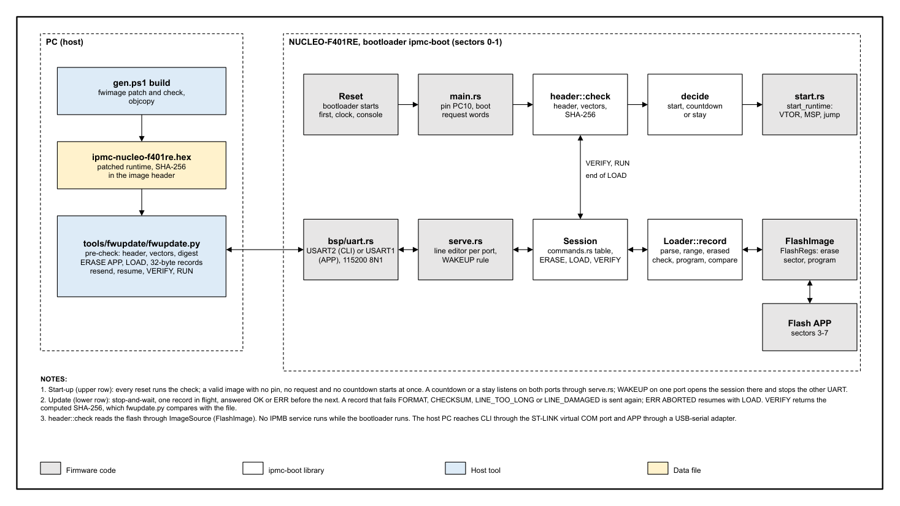

Source: `diagrams/src/ipmc-software.js`, sheet 6.

The runtime firmware in sectors 3 to 7 carries a header with its length and SHA-256 digest. The
bootloader checks it at every reset and before every start, and a host tool replaces the runtime over
a UART with a stop-and-wait Intel HEX load. Nothing in the update path can write sectors 0 and 1.

### 16.1 Image header

At `0x0800_C200`, 64 bytes, little-endian, one fixed address for every build
(`ipmc_boot::header`). The runtime vector table is 101 words and ARMv7-M aligns it to 512 bytes, so it
occupies `0x0800_C000..0x0800_C193` and the header starts at the first address after the aligned table.

| Offset | Size | Field | Value and check |
|---:|---:|---|---|
| 0x00 | 4 | magic | 0x434D_5049, the bytes `IPMC` in memory order; FFFF_FFFFh is an erased flash (`missing`), any other value is `bad magic` |
| 0x04 | 2 | header format | 1 |
| 0x06 | 2 | header size | 64 |
| 0x08 | 4 | image length | bytes from `0x0800_C000`; a multiple of 4; at least 0x240 (vector table area and header) and at most 475 136 (`APP_LEN_MAX`); FFFF_FFFFh in the linked placeholder |
| 0x0C | 4 | firmware version | major, minor, patch, 0 of the runtime crate version (`version_bytes` of `CARGO_PKG_VERSION`) |
| 0x10 | 4 | build flags | bit 0 Tier-2/3 extension built in (`FLAG_TIER23`), bit 1 evaluation build (`FLAG_EVAL`); other bits 0 |
| 0x14 | 4 | vector table address | 0x0800_C000 |
| 0x18 | 8 | reserved | 0 |
| 0x20 | 32 | SHA-256 digest | of the hashed range of section 16.2; FFh in the linked placeholder |

The runtime links the header as one `#[used]` static in the section `.app_header`
(`src/app_header.rs`), built by the const function `header::placeholder(version, flags)`; `link.x`
asserts its address and size. The offsets, the magic and the size exist once, in `ipmc_boot::header`,
and the runtime static, the `fwimage` tool and the bootloader all use them. The runtime reads the
header back for the `Image:` banner line (`app_header::image_line`: version, length, first 16 digest
digits).

### 16.2 Digest and build pipeline

The digest is SHA-256 (FIPS 180-4), computed in software by `ipmc_wire::Sha256` (`new`, `update`,
`finish`; the STM32F401 has no hash peripheral): a rolled 64-round loop over a 16-word circular message
schedule, about 1.2 us per byte at 84 MHz. It proves the bytes in sectors 3 to 7 are the bytes the build
hashed; it is not a signature and does not prove who built them.

Hashed range: `APP_START` to `APP_START + length` without the 32 digest bytes, that is
`0x0800_C000..0x0800_C21F` and then `0x0800_C240..(0x0800_C000 + length)`. Every other header field is
inside the hash, so a changed length, version or flag is a mismatch. The bootloader hashes the length
the header states, not the whole region, so the check time follows the image size; the image is hashed
with `--gap-fill 0xFF`, and a `LOAD` never writes a gap, so the gaps read FFh in flash as in the hash.

`fwimage` (`crates/ipmc-boot/src/bin/fwimage.rs`, exit 0 ok, 1 refused with one reason line, 2 usage):

| Subcommand | Does |
|---|---|
| `fwimage patch <app.img> <header.bin>` | pads the image with FFh to a multiple of 4 bytes, checks the placeholder at offset 0x200 and the vector table words, writes the length and then the digest into the image file in place, and writes the 64 patched header bytes to `header.bin` |
| `fwimage check <app.img>` | runs `header::check`, the bootloader's own image check, on an image |
| `fwimage combine <boot.bin> <app.img> <board.bin>` | writes the board image: the bootloader at offset 0, FFh up to `0xC000`, the runtime from `0xC000` |
| `fwimage size <boot.bin>` | fails above 32 768 bytes and warns above 24 576 |

`gen.ps1 build` (section 12.1) runs them in this order: build the bootloader and `fwimage size`; build
the runtime and cut `ipmc-nucleo-f401re.app.img` (the bytes from `0x0800_C000`); `fwimage patch`;
`objcopy --update-section .app_header=app_header.bin` gives the patched ELF; the image is cut again from
the patched ELF and `fwimage check` runs on it, and a mismatch stops the build; `objcopy -O ihex` of
the patched ELF gives `ipmc-nucleo-f401re.hex`, the file for `LOAD`; `fwimage combine` writes
`ipmc-board.bin`. The images, their writers and what each erases are in section 9.1.

### 16.3 The image check and when it runs

`header::check` is the one function, run by the bootloader at every reset (step 5 of section 15.2),
by `VERIFY`, `RUN`, `INFO` and the end of `LOAD` (record 01), and by `fwimage check` at build time. The
steps, in order, stop at the first failure:

1. Magic: erased flash gives `missing`, another value `bad magic`.
2. Format 1, size 64, vector table address 0x0800_C000, length in range and a multiple of 4; else
   `bad header` with the field named.
3. Vector table: word 0 (initial stack pointer) 8-byte aligned and inside `0x2000_0100..=0x2001_8000`
   (RAM above NOINIT); word 1 (reset vector) odd (Thumb) and, with bit 0 cleared, after the header and
   inside the image; else `bad vector table`.
4. SHA-256 of the hashed range equal to the stored digest; else `digest mismatch`.

A failed check at a reset keeps the bootloader and waits for `WAKEUP`; a failed `RUN` answers `ERR
IMAGE <reason>` and starts nothing.

### 16.4 Entry paths

| Path | How | Result |
|---|---|---|
| Console command | `DEBUG BOOTLOADER {CONFIRM}` | with payload power off, or with `CONFIRM` (any letter case): `Restarting into the bootloader` (and, with power on, `Payload power drops at the reset`), then the request and the reset path. With power on and no `CONFIRM`: `Payload power is on and drops at the reset into the bootloader` and `Send DEBUG BOOTLOADER CONFIRM to restart`, no restart |
| Application port | `BOOTLOADER {CONFIRM}` | `BOOTLOADER: restarting` then `OK`; with power on and no `CONFIRM`: `ERROR CONFIRM: payload power is on and drops at the reset; send BOOTLOADER CONFIRM`, no restart |
| Countdown | `WAKEUP` on CLI or APP inside `IPMC_BOOT_COUNTDOWN` seconds | session on that port (bench image: 3 s; field image: no countdown) |
| BOOTLOADER pin | PC10 at logic 1 at reset | the bootloader stays whatever the image check says; the field entry for a runtime that is valid but does not work |
| Invalid image | the check fails at a reset | the bootloader stays and waits for `WAKEUP` |

The two commands keep no state: the confirmation is the argument of the second command. "Payload power
is on" is the PWR_EN test (`Status::payload_power`, the console's `Sensing::payload_power_on`); the
reset releases PWR_EN on the NUCLEO-F401RE, so the plain command only warns. Both commands call
`IpmbLink::request_bootloader(interface)`, which asks for a Cold Reset on the one reset path
(`service_reset`): the answer has left the port, an accepted FRU write is saved, or
`IPMC_RESET_WAIT_MS` has passed. Just before the processor restarts the four request words are written
(`boot_request::write(request::encode(interface))`) and the bootloader accepts them after the software
reset (section 15.4).

### 16.5 Update procedure

`tools/fwupdate/fwupdate.py` (settings in `fwu_settings.py`, README in `tools/fwupdate/`;
`--port` is required, `--uart cli` or `app` names the port and picks the baud rate):

1. Wake: the tool sends `WAKEUP` every 0.2 s (60 s limit; `--field` has none) until the `BOOT> ` prompt
   arrives. With `--enter app|cli --enter-port COMy` it first opens the runtime port and sends the entry
   command (`--confirm` appends ` CONFIRM`; without it the tool asks on stdin while payload power is on).
2. Pre-check on the PC, refused before anything is sent: every byte inside `0x0800_C000..0x0808_0000`;
   header magic, format, size, length, vector address; vector words 0 and 1; the SHA-256 recomputed with
   `hashlib` equal to the stored digest (`--no-precheck` skips it).
3. `ERASE APP` and `CONFIRM` (up to 20 s for the answer; about 3.5 s measured), then `LOAD`.
4. Records, stop-and-wait: the image is re-chunked into aligned 32-byte records with an 04 record at each
   64 KB boundary, an all-FFh chunk is skipped, and each record is answered before the next goes out
   (`--as-is` sends the file's records). `ERR FORMAT`, `ERR CHECKSUM`, `ERR LINE_TOO_LONG` and `ERR
   LINE_DAMAGED` resend the record, up to 3 times; any other `ERR` stops the run and names the record
   and the answer. `ERR ABORTED` (a damaged leading `:` ended record mode; the erase stays in force and
   every earlier record is programmed) resumes: the tool sends `LOAD`, the last 04 record sent, then the
   refused record, up to 3 resumes per update.
5. The end record answers `OK END <n> records <b> bytes, image valid`; `VERIFY` answers `OK VERIFY valid
   SHA-256 <hex>`, and the tool compares that digest with the digest in the file's header (a difference
   is a refusal; with `--as-is` or a file without a readable header the tool says it did not compare);
   then `RUN` (not with `--no-run` or `--field`).

Exit codes: 0 success, 1 a refusal or an `ERR` answer, 2 usage, 3 a timeout. A port that cannot be
opened is a refusal (`refused: <port>: <message>`). The field procedure fits the jumper PC10 to 3.3 V,
runs `fwupdate.py --port COM5 --field update app.hex`, powers the board, and removes the jumper after
the update.

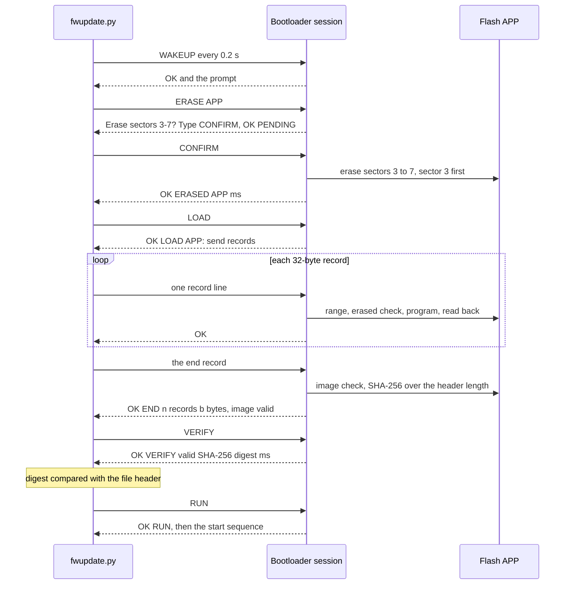

### 16.6 Never bricking

- No bootloader command names sector 0 or 1: the erase targets are sector 2 and sectors 3 to 7, and
  `load_allowed` refuses any record below `0x0800_C000`.
- A second, independent refusal sits in the register layer: `bsp/flash_regs.rs` (`FlashRegs`) refuses
  to erase sectors 0 and 1 and to program any address below `0x0800_8000` (`Err(Range)`), for the
  runtime's store driver and for the bootloader alike; the runtime has no command that erases or
  programs anything but sector 2.
- `ERASE APP` erases sector 3 first, which holds the vector table and the header, so a power cut at any
  point of an update leaves an image that fails the check; the board then stays in the bootloader at
  the next reset and takes the update again.
- The digest covers the stated length, so a truncated or partly written image is a `digest mismatch`
  or a `bad header`, never a start.
- NVMRO asserted refuses every erase and program (`ERR NVMRO`).
- Protection is software only: no sector is write-protected in the option bytes, and neither image
  reconfigures PA13/PA14 (SWD) or sets readout protection. A faulty bootloader image flashed on the
  bench is recovered over SWD or by a drive copy of a good `ipmc-board.bin`.

### 16.7 Measured numbers

Bench measurements of 10-26-2026 (release build, 115200 baud, 84 MHz; `Documentation/ipmc_boot_plan.md`
sections 13.2 and 13.3):

| Quantity | Value |
|---|---|
| Runtime image | 139 456 bytes, 4 354 records (32-byte records; an all-FFh chunk is not sent) |
| Full update over APP (USART1) | about 75 s, no record resent |
| Full update over CLI (USART2) | about 40 s |
| `ERASE APP` (sectors 3 to 7) | 3.5 s to 3.6 s |
| SHA-256 of the image at start-up | 172 ms for 139 456 bytes (171 ms for the earlier 138 524-byte image, the `Image check:` trace line) |
| `SYS RESET` to the runtime banner | 3.18 s in the bench build (3 s countdown); 187 ms in the field build |
| Bootloader image | 22 336 bytes of 32 768 |

<div style="page-break-after: always;"></div>

<table style="width:100%; border:none; margin:0; padding:0;">
<tr>
<td style="text-align:left; border:none; padding:0; width:50%;"><strong>CONFIDENTIAL DOCUMENT &#8211; DO NOT DISCLOSE</strong></td>
<td style="text-align:right; border:none; padding:0; width:50%;"><strong>Revision 10-26-2026</strong></td>
</tr>
</table>
<hr style="border:none; border-top:2px solid #000; margin:4px 0 12px 0;">

## 17. Constraints and Limitations

- **Tier 1 in the public build.** Optional and Tier-2/3 commands answer C1h; there is no event
  generation, no FRU activation control by the Chassis Manager and no subsidiary FRU. The
  commercial release build adds Tier-2 and Tier-3 (section 7.2); its open bench checks are in
  `Documentation/ipmc_test_coverage.md`.
- **FAST-MODE is proven on IPMB-A only.** The one-Aardvark bench has IPMB-A; FAST-MODE on both
  buses waits for the second Aardvark.
- **FAST-MODE rates.** The bit-bang master reaches about 147 kHz in FAST-MODE and the hardware
  master about 335 kHz; both keep the fast-mode minimum low and high times and stay below 400 kHz.
- **A processor reset drops payload power on this board.** The reset releases PWR_EN with every GPIO
  (section 8.2, owner decision 21), so a Cold Reset, a bootloader entry and a firmware update drop the
  payload's power while PWR_EN is asserted; a Warm Reset and a payload reset pulse do not. The entry
  commands warn first and need `CONFIRM`. A target board holds PWR_EN externally.
- **One outstanding request.** The requester sends one request at a time; a second `submit`
  returns `Busy` until the first completes or is cancelled.
- **One master transmission per main-loop pass.** A response burst drains one frame per pass; the
  egress queue holds `IPMB_TXQ_DEPTH` (4) responses, and further requests wait in the ingress FIFO.
- **Bit-bang deafness.** While the bit-bang master transmits, the slave peripheral is off; a frame
  another master sends then is lost and recovered by its retry.
- **Flash erase stall.** An erase stops the core for up to 500 ms (typical 250 ms; 198 ms
  measured); the IPMB slaves are off the bus for that time (the Chassis Manager sees timeouts and
  retries). Erases are rare: the store sector holds 31 records, the erase comes once per 31 saves,
  and only when the bus has been quiet for `IPMC_FRU_ERASE_QUIET_MS`.
- **One-sector FRU store.** The store has no second copy (owner decision 10-25-2026). A power cut
  between the erase of a full sector and the end of the first record's programming loses the
  stored image, and the next start-up loads the built image, unit fields included.
- **Reflash.** A drive copy of `ipmc-board.bin` writes FFh over the store sector and erases the stored
  FRU image; an SWD program of the runtime ELF keeps it (section 9.1). The firmware has no guard against
  either. A UART update (section 16) erases sectors 3 to 7 only and keeps the FRU store.
- **Digest, no signature.** The bootloader proves the image bytes match the digest in their header; it
  does not prove who built them (owner decision, PLAN decision 33). A signature check does not fit the
  32 KB of sectors 0 and 1 with the session.
- **The bootloader is changed on the bench only.** A new bootloader needs SWD or a drive copy; the UART
  `LOAD` refuses sectors 0 to 2. While the bootloader runs the IPMC answers nothing on either IPMB and
  does not drive PWR_EN.
- **No hardware watchdog.** A flash busy flag that never clears, or any other hang, has no automatic
  recovery; the bootloader starts none either, so a runtime watchdog would not run into its session.
- **Console output.** Output goes into a 4096-byte ring that the interrupt sends (356 ms at
  115200 baud). A message waits only while the ring is full (86.8 us per byte); a trace line that
  does not fit is dropped whole and counted, so tracing cannot stall the IPMB. A long listing
  (`DEBUG DUMP`) runs as a paced job and is stopped by a key press.
- **Capture log.** The log lives in RAM and is empty after a reset or power cycle; it holds the
  newest `IPMC_LOG_SIZE` - 1 bytes of records (a 23-byte frame takes 29 bytes). A dump of a full
  log is about 25 KB.
- **Application port.** The IPMC answers one request line per main-loop pass and drops an answer the
  transmit ring cannot take whole. The port has no emulator model: it runs on the board only
  (COM5 on the bench). The six unit fields are the only FRU content it writes; `IPMI` runs
  requests locally and puts nothing on the IPMB. The bench runs without RTS/CTS.
- **Straps forced on the bench.** GA and NVMRO come from `defs.rs`; the pin paths are built but
  not exercised end to end, and the NVMRO electrical polarity is not yet confirmed against VITA 46.0.
- **Manufacturer ID 000000h** (unspecified) until an IANA enterprise number is registered.
- **IPMB-B** is built and tested in the emulator only; the one-Aardvark bench drives IPMB-A.
- **Duplicate window 3000 ms**, not the VITA 5 s sequence expiry: a Chassis Manager that reuses a
  sequence number with identical data inside 3 s gets the cached response.
- **Emulator FRU store is RAM only.** Flash persistence is tested in `ipmc-fru` against a test
  flash and on the board. The emulator keeps a RAM copy of the flash log (`FlashCopy`) across a
  reset and a `#reset` power cycle.
- **No custom registers.** The firmware uses the STM32F401 peripherals through the `stm32f4` PAC;
  each driver names the RM0368 section of every register field it writes (I2C chapter 18, flash
  section 3.5, RCC chapter 6, ADC chapter 11, GPIO chapter 8).
