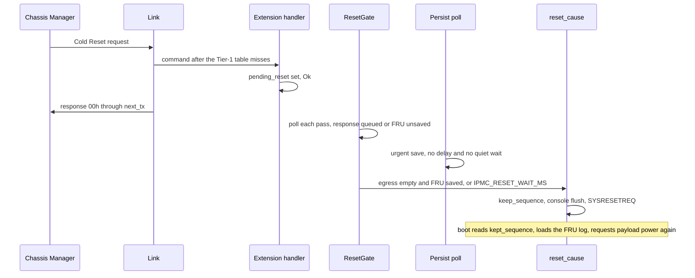
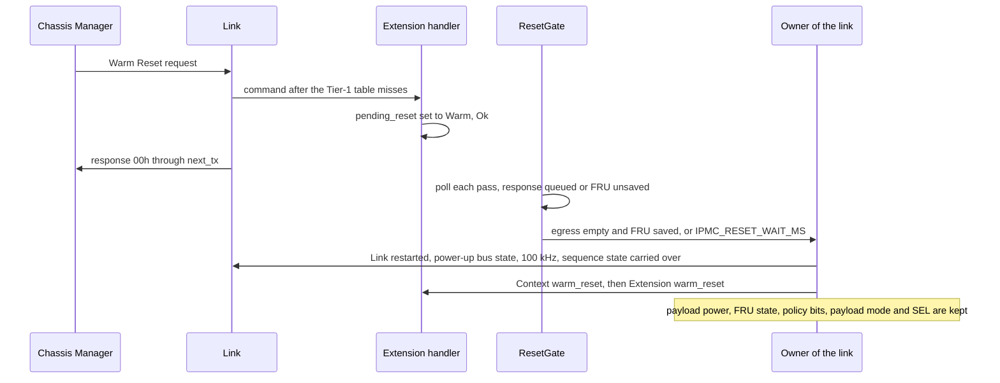
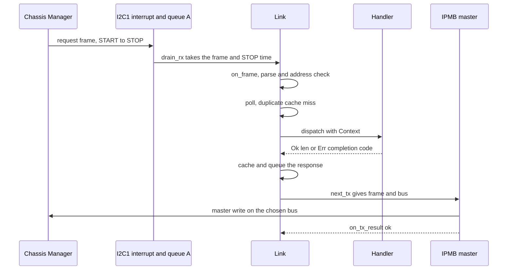
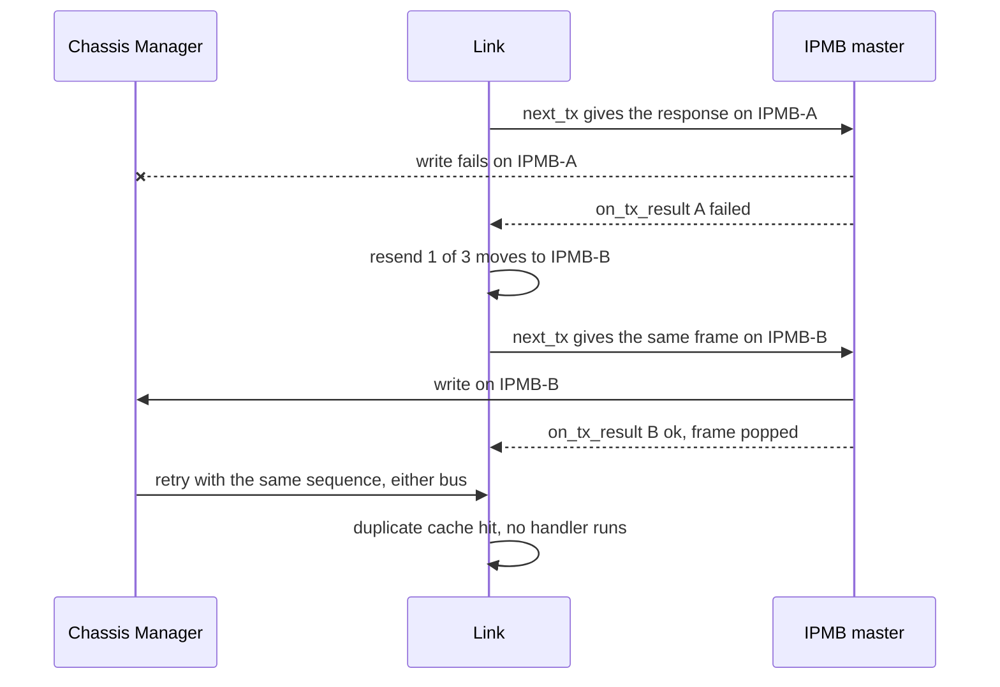
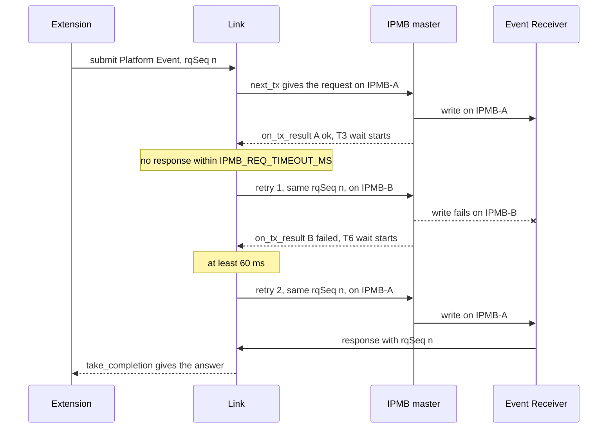
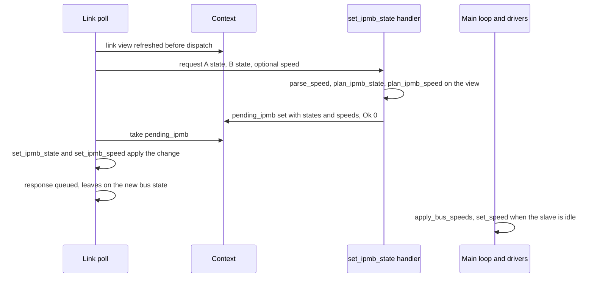

<table style="width:100%; border:none; margin:0; padding:0;">
<tr>
<td style="text-align:left; border:none; padding:0; width:50%;"><strong>CONFIDENTIAL DOCUMENT &#8211; DO NOT DISCLOSE</strong></td>
<td style="text-align:right; border:none; padding:0; width:50%;"><strong>Revision 10-25-2026</strong></td>
</tr>
</table>
<hr style="border:none; border-top:2px solid #000; margin:4px 0 12px 0;">

<div style="height: 8.2in; display: flex; flex-direction: column; justify-content: center; text-align: center;">
<h1 style="border: none;">VITA 46.11 Tier-1 IPMC Software Specification</h1>
<p style="font-size: 16px;">IPMIRustFRU: Rust IPMC firmware for the NUCLEO-F401RE, x86 emulator and bench tools</p>
<p style="font-size: 16px;"><strong>Revision 10-25-2026</strong></p>
</div>

<div style="page-break-after: always;"></div>

<table style="width:100%; border:none; margin:0; padding:0;">
<tr>
<td style="text-align:left; border:none; padding:0; width:50%;"><strong>CONFIDENTIAL DOCUMENT &#8211; DO NOT DISCLOSE</strong></td>
<td style="text-align:right; border:none; padding:0; width:50%;"><strong>Revision 10-25-2026</strong></td>
</tr>
</table>
<hr style="border:none; border-top:2px solid #000; margin:4px 0 12px 0;">

## Quick Start

1. Host tests and the emulator, from the repository root (Rust stable, GNU host):
   `cargo test --workspace`, then
   `cargo run -p ipmc-emu -- replay vectors/sbc_ab.vec --b-fitted 1 --b-enabled 1 --policy alternate --quiet`
   (the capture file is local only; on a fresh clone the capture tests skip with a message).
2. Firmware build and flash (NUCLEO-F401RE on USB):
   `powershell -ExecutionPolicy Bypass -File crates/ipmc-nucleo-f401re/gen.ps1 flash`.
   `flash` programs over SWD when OpenOCD finds the ST-LINK probe and copies the `.bin` to the
   drive otherwise (section 12.1; the two paths treat the FRU store differently, section 9.1).
   The console is COM3 at 115200 8N1; `gen.ps1 console "sys status"` sends one command and prints
   the reply.
3. Bench check with an independent IPMI implementation (Aardvark on IPMB-A, PB8/PB9):
   `tools\python-ipmi\.venv\Scripts\ipmitool.exe -I aardvark -t 0x82 raw 0x06 0x01`
   answers `00 01 80 00 01 02 09 00 00 00 4b 49 00 00 00 00`;
   `python tools/board_test_report.py` runs every bench check and writes
   `Documentation/board_test_report.md`.
4. Capture log and application port: `DEBUG DUMP` on the console prints the IPMB capture log
   (section 10.11); `python -I tools\capture\capture2pcap.py dump.txt -o dump` turns a saved dump
   into a file Wireshark opens. A USB-serial adapter on PB6/PB7 (COM5 on the bench) reaches the
   application port (section 7.6):
   `tools\python-ipmi\.venv\Scripts\python.exe tools\app-port\app_cli.py --port COM5 HELLO STATUS`.

## Table of Contents

1. [Overview](#1-overview)
2. [System Context](#2-system-context)
3. [Requirements](#3-requirements)
4. [Architecture](#4-architecture)
5. [Build-Time Configuration](#5-build-time-configuration)
6. [Module Descriptions](#6-module-descriptions)
7. [Interfaces](#7-interfaces)
8. [Clocking, Reset and Start-Up](#8-clocking-reset-and-start-up)
9. [Memory Map and Data Layouts](#9-memory-map-and-data-layouts)
10. [Data Flow and Protocol](#10-data-flow-and-protocol)
11. [Software API](#11-software-api)
12. [Build, Integration, and Configuration](#12-build-integration-and-configuration)
13. [Verification](#13-verification)
14. [Example Sequences](#14-example-sequences)
15. [Constraints and Limitations](#15-constraints-and-limitations)

The section 10 diagrams are Mermaid state and sequence diagrams and one WaveDrom timing diagram;
the block drawings are the `ipmc-software` drawing set (`diagrams/src/ipmc-software.js`, rendered
to `diagrams/out/png/`).

<div style="page-break-after: always;"></div>

<table style="width:100%; border:none; margin:0; padding:0;">
<tr>
<td style="text-align:left; border:none; padding:0; width:50%;"><strong>CONFIDENTIAL DOCUMENT &#8211; DO NOT DISCLOSE</strong></td>
<td style="text-align:right; border:none; padding:0; width:50%;"><strong>Revision 10-25-2026</strong></td>
</tr>
</table>
<hr style="border:none; border-top:2px solid #000; margin:4px 0 12px 0;">

## 1. Overview

IPMIRustFRU is an Intelligent Platform Management Controller (IPMC) for a VPX plug-in module,
written in Rust to ANSI/VITA 46.11-2022 Tier 1. It runs on an STM32F401RE (NUCLEO-F401RE board),
answers a Chassis Manager over the redundant Intelligent Platform Management Bus (IPMB-A and
IPMB-B, I2C at 100 kHz; 400 kHz FAST-MODE at Tier-3), serves the FRU 0 inventory and the Device SDR repository, reports the
seven mandatory VITA sensors and keeps Write FRU Data in on-chip flash across a reset. The same
IPMI code builds for the PC as an emulator that replays captured Chassis Manager traffic or
serves a live Chassis Manager over TCP. This document explains how the code works, crate by
crate and module by module, for a software engineer who maintains or extends it.

The primary function is a Tier-1 IPMC: the 13 Tier-1 mandatory commands plus Broadcast Get Device
ID, the 7 mandatory sensors, FRU 0 with Common Header, Board Info and Product Info areas,
the FRU 0 Operational State machine (M0, M1, M4, M6; M5 at Tier-3), dual-bus link rules (alternation,
resend on the other bus, Set IPMB State), a startup self test and NVMRO write protection.

The firmware runs on the STM32F401RE with the bit-bang IPMB master (default) or
the hardware I2C master. The x86 emulator offers capture replay (`replay`), real-time TCP serving
(`serve`) and an SDR dump (`sdr`).

The firmware has two serial ports, both interrupt driven. The console (USART2, the ST-LINK
virtual COM port) carries the command line, including the DEBUG group: the IPMB capture log
records every whole frame received and sent and every trace line, and the console dumps it as CSV
or as trace rows for a spreadsheet or Wireshark (section 10.11). The application port (APP_UART,
USART1 on PB6 and PB7) lets a payload CPU on the same board ask for status, run IPMI requests
locally and write the per-unit FRU fields (serial numbers, part numbers, asset tag,
manufacturing date); its protocol is the `ipmc-app` crate (section 7.6).

The public build is the Tier-1 IPMC described here. A commercial release
build adds a private Tier-2/3 extension through the hook interface of section 4 (Build modes
and the Tier-2/3 extension); the commands and behaviour it adds are listed in section 7.2,
each marked "commercial release build". The public build answers those commands C1h. The
commercial release build is Tier-3 by default (`IPMC_TIER` 3).

The public build leaves out Tier-2 and Tier-3 functions (events, payload power control
by the Chassis Manager, FRU activation policy; they belong to the commercial release build),
optional Tier-1 commands (Get Mandatory Sensor Numbers,
FRU Control Capabilities, Get IPMB Link Info, Get FRU Hash, Get Device GUID, Set SEL Time:
all answer C1h), subsidiary FRUs, and IPMI bridging. The built FRU image has no Internal Use
or MultiRecord area; `verify` still checks those areas when a written image contains them.

The code is the authority for every statement here. Where the VITA 46.11-2022 text and the
captured live Chassis Manager disagree, the code follows the specification.

<div style="page-break-after: always;"></div>

<table style="width:100%; border:none; margin:0; padding:0;">
<tr>
<td style="text-align:left; border:none; padding:0; width:50%;"><strong>CONFIDENTIAL DOCUMENT &#8211; DO NOT DISCLOSE</strong></td>
<td style="text-align:right; border:none; padding:0; width:50%;"><strong>Revision 10-25-2026</strong></td>
</tr>
</table>
<hr style="border:none; border-top:2px solid #000; margin:4px 0 12px 0;">

## 2. System Context

- **Target device:** STM32F401RET6 (Cortex-M4F, 512 KB flash, 96 KB RAM) on the NUCLEO-F401RE,
  84 MHz system clock from the 8 MHz ST-LINK MCO clock in HSE bypass.
- **Operating environment:** bare metal, `no_std`, one cooperative main loop plus interrupt
  handlers that move bytes, stamp times and drive the LED (the I2C slaves, the USART1 and USART2
  rings, SysTick).
  No RTOS, no heap.
- **Host build:** `x86_64-pc-windows-gnu` (the same sources build for
  `x86_64-unknown-linux-gnu`); the emulator is a `std` binary.
- **Dependencies:** `cortex-m 0.7.10`, `cortex-m-rt 0.7.7`, `stm32f4 0.16.0` (PAC, feature
  `stm32f401`), `heapless 0.8.0` (SPSC queues), `panic-halt 1.0.0`, `embedded-hal 1.0.0`
  (bus traits of the example external sensor drivers). Every version is an exact `=` requirement.
- **Peers on the IPMB:** a Chassis Manager at 8-bit address 20h (`IPMB_CM_ADDR8`; the captured
  live Chassis Manager uses 10h). The IPMC answers at (40h + GA[4:0]) x 2: slot 1 is 82h.
- **Bench:** an Aardvark I2C host adapter on IPMB-A with its pull-ups on, driven by python-ipmi
  as the Chassis Manager; the ST-LINK USB port carries the console (COM3) and the drag-and-drop
  flash drive (`NOD_F401RE`); a USB-serial adapter (COM5) on PB6 and PB7 carries the application
  port (`tools/app-port/app_cli.py`).
- **Normative documents:** ANSI/VITA 46.11-2022 (local, licensed, not in the repository),
  IPMI v2.0 rev 1.1, IPMI Platform Management FRU Information Storage Definition v1.0 rev 1.3,
  RM0368 (STM32F401 reference manual), DS10086 (datasheet), UM10204 (I2C-bus specification).

| Term | Meaning |
|---|---|
| IPMB | Intelligent Platform Management Bus: I2C with IPMI framing and two checksums |
| rsSA / rqSA | responder / requester slave address, 8-bit form (7-bit address shifted left, R/W bit 0) |
| NetFn | network function; even for a request, odd (request + 1) for its response |
| VSO | VITA Standards Organization; its Group Extension defining-body byte is 03h |
| SDR | Sensor Data Record; the Device SDR repository lives in the IPMC |
| FRU | Field Replaceable Unit; FRU 0 is the module that holds the IPMC |
| GA, GAP | geographic address straps GA[4:0] and their odd-parity strap |
| NVMRO | non-volatile memory read-only strap; asserted, the IPMC writes no non-volatile memory |
| T1..T9, C1 | VITA 46.11 Table 4.1.1-1 timing and retry parameters |
| APP_UART | the application UART (USART1) between the IPMC and the payload CPU |

<div style="page-break-after: always;"></div>

<table style="width:100%; border:none; margin:0; padding:0;">
<tr>
<td style="text-align:left; border:none; padding:0; width:50%;"><strong>CONFIDENTIAL DOCUMENT &#8211; DO NOT DISCLOSE</strong></td>
<td style="text-align:right; border:none; padding:0; width:50%;"><strong>Revision 10-25-2026</strong></td>
</tr>
</table>
<hr style="border:none; border-top:2px solid #000; margin:4px 0 12px 0;">

## 3. Requirements

### Functional requirements

| ID | Requirement | Rule | Where |
|---|---|---|---|
| FR-001 | Answer the Tier-1 mandatory commands of Tables 10.1.1-1 and 10.1.2-1; every other command answers C1h | Rules 4.2-2, 4.1.1-16 | `ipmc-core/src/commands.rs` |
| FR-002 | Answer Broadcast Get Device ID (general-call 00h before the frame) at the own address only | IPMI 20.9 | `link.rs` `on_frame` |
| FR-003 | FRU Device ID other than 0 answers C9h (Get FRU Address Info ignores the ID when a physical address key is given) | Rules 4.2-3, 4.1.1-17 | `cmd/mod.rs` `check_fru_device_id` |
| FR-004 | Power-up bus state: IPMB-A enabled, IPMB-B isolated until Set IPMB State | Rule 4.1.1-4 | `link.rs` `BusPair::power_up` |
| FR-005 | Accept requests on both buses; alternate transmissions between enabled buses | Rules 4.1.1-5, 4.1.1-6 | `link.rs` `choose_tx_bus` |
| FR-006 | Resend a failed transmission on the other bus, at most `IPMB_TX_RETRIES` times | Rule 4.1.1-7 | `link.rs` `on_tx_result` |
| FR-007 | Refuse a Set IPMB State that leaves no bus enabled (CCh) | Rule 4.1.8-3 | `link.rs` `plan_ipmb_state` |
| FR-008 | Bus state changes only by Set IPMB State or a persistent local fault | Rule 9.3-10 | `link.rs`, `ipmb_link.rs` |
| FR-009 | A retried request (same requester, sequence, command and data) is answered from a cache and runs no handler | Obs 4.1.1-6 (a retry keeps its sequence number) | `dupcache.rs` |
| FR-010 | Report sensors 0..6 with the layouts of Tables 10.2.1-1 to 10.2.7-1, and sensor 7 (Payload Mode, Table 10.2.8-1) at Tier-3 | Table 10.2-1 | `sensor.rs`, `dispatch.rs` `read_sensor` |
| FR-011 | FRU 0 holds Common Header, Board Info and Product Info areas; Chassis Info offset 00h | Rules 8.1-2, 8.1-3 | `ipmc-fru/src/records.rs` |
| FR-012 | FRU data readable whatever the payload power | Rule 8-1 | `cmd/storage.rs` |
| FR-013 | Write FRU Data while NVMRO is asserted answers 80h and changes nothing; an application port `SET` answers `ERR NVMRO` and changes nothing; no flash write while NVMRO is asserted | Rules 8-3, 8-5, Rec 4.1.10-1 | `cmd/storage.rs`, `app_port.rs`, `persist.rs`, `bsp/flash.rs` |
| FR-014 | FRU 0 state machine M0 to M1 on the initial checks, M1 to M4 on valid payload power, M4 to M6 on power loss, M6 to M1 on a complete shutdown; at Tier-3 also M4 to M5 on a deactivation request, M5 to M4 when it is cleared and M5 to M6 on power loss | Section 4.1.5, Rules 4.1.5.4.1-2, 4.1.5.4.2-3, 4.1.5.4.3-2, 4.1.5.4.4-2, 4.1.5.4.4-5, 4.1.5.4.5-1 | `fru_state.rs` |
| FR-015 | A payload power-on request in M6 is refused; in the commercial release build it is also refused while the FRU is activation-locked; one check serves the boot power-on, the handler hand-off and the console | Rules 4.1.5.4.5-2, 4.1.5.4.2-1 | `fru_state.rs` `check_power_on`, `ext.rs` `check_power_on` |
| FR-016 | An invalid hardware address (even parity or GA = 0) isolates both buses and keeps the FRU in M0 | Rules 4.1.5.4.1-4, 4.1.5.4.1-5 | `addr.rs`, `link.rs` |
| FR-017 | Startup self test of the FRU image and the SDR chain; 55h 00h or 57h with the failure bits; a failure keeps the FRU in M0; rerun after each accepted Write FRU Data | IPMI Table 20-5, Rule 4.1.5.4.1-9, Rec 8-2 | `selftest.rs` |
| FR-018 | Write FRU Data and an application port `SET` survive a reset (`IPMC_FRU_PERSIST 1`); the FRU store is flash sector 1 alone | owner decisions 10-23-2026 and 10-25-2026 | `persist.rs`, `fru_log.rs`, `memory.x`, `link.x` |
| FR-019 | No IPMC pull-ups on the IPMB lines | Rule 9.2.3-2 | `bsp/ipmb_pins.rs`, `i2c_hw.rs` |
| FR-020 | A (netFn, cmd) the Tier-1 table does not own goes to the extension hook; the Tier-1 build has none and answers C1h | Rules 4.2-2, 4.1.1-16 | `ext.rs`, `dispatch.rs` |
| FR-021 | A Tier-2/3 build sends requests one at a time: a response wait of `IPMB_REQ_TIMEOUT_MS` (T3), up to `IPMB_REQ_RETRIES` retries with the same sequence number, a failed transmission retried on the other bus after T6 (60 ms minimum), T4 between new requests, T9 before a sequence number is reused; a Tier-1 build sends none | Rules 4.1.1-9, 4.1.1-10, 7-4, Table 4.1.1-1 | `requester.rs`, `link.rs` |
| FR-022 | A Cold Reset request restarts the processor once its response has left the egress queue and an accepted FRU write is saved, or after `IPMC_RESET_WAIT_MS` | IPMI v2.0 20.2 | `reset_gate.rs`, `ipmb_link.rs` |
| FR-023 | The optional speed byte of Set IPMB State sets each bus to 100 kHz (00b) or, at Tier-3 on a fitted bus, 400 kHz (01b); every other value, a reserved bit and 400 kHz below Tier-3 answer CCh with no change; every bus starts and restarts at 100 kHz | Rules 4.1.1-4.3, 4.1.1-4.4, 4.1.1-14 | `cmd/vita.rs`, `link.rs` `plan_ipmb_speed` |
| FR-024 | A Warm Reset request (commercial release build) restarts the link state and the requester without a processor reset, once its response has left and an accepted FRU write is saved, or after `IPMC_RESET_WAIT_MS` | IPMI v2.0 20.3 | `reset_gate.rs`, `ipmb_link.rs`, `link.rs` `restarted` |
| FR-025 | A Cold Reset of the payload (commercial release build) holds PAYLOAD_RST_OUT_N (PA9, open drain) low for `IPMC_PAYLOAD_RESET_PULSE_MS` without blocking the main loop; the FRU state does not change | Rule 4.1.2-9 | `reset_pulse.rs`, `sensing.rs` |
| FR-026 | Every whole IPMB frame the IPMC receives (before the parser) or sends (with its outcome) and every trace line goes into a RAM ring of `IPMC_LOG_SIZE` bytes, oldest overwritten first; the console dumps it as CSV or as trace rows | owner, Phase 11 (PLAN, 10-25-2026) | `capture.rs`, `debug_cmds.rs`, `ipmb_link.rs` |
| FR-027 | A payload CPU on APP_UART gets exactly one answer line (`OK ...` or `ERR <CODE> ...`) per request line, with the optional tag echoed; a `SET` of a unit field rewrites that field in place, moves no area and goes to the flash through the Write FRU Data save path | owner, Phase 11 (PLAN, 10-25-2026) | `ipmc-app`, `app_port.rs`, `ipmc-fru/src/unit.rs` |

### Performance requirements

| Item | Target | Notes |
|---|---|---|
| Response time | at most 227 ms (T5) | request STOP to response STOP; `RESPONSE_DEADLINE_MS`, late ones counted |
| One master write | at most T2 + T1 = 80 ms | retries included; `WRITE_BUDGET_NS`; one write per pass |
| Clock stretch | at most 3 ms (T8) | `IPMB_STRETCH_TIMEOUT_US 3000` |
| Bus-free wait | at least 60 ms (T2) | `IPMB_BUS_FREE_TIMEOUT_MS 60`; ends at the write budget |
| One IPMB frame | at most 20 ms (T1) | `ipmb_common.rs` `T1_FRAME_NS` |
| IPMB clock | 100 kHz maximum; 400 kHz maximum in FAST-MODE (Tier-3) | half bit 5000 ns; measured SCL period 12.0 us (83 kHz). FAST-MODE: bit-bang 6795 ns (about 147 kHz), hardware master 2981 ns (about 335 kHz) |
| Flash sector erase | typical 250 ms, at most 500 ms (16 KB sector, x32 programming), core stalled; 198 ms measured on the bench | DS10086 Table 45; IPMB slaves off the bus meanwhile; one erase per 60 saves, and only when the bus is quiet |

### Compliance requirements

ANSI/VITA 46.11-2022 Tier 1, Layer 1 IPMC (VSO revision 22h); IPMI v2.0 rev 1.1 message formats,
completion codes (Table 5-2) and the Group Extension defining-body rule (Table 5-1, section 5.3.1).
The spec-only suite in `tools/conformance/` (section 13) checks the IPMC against those texts.

<div style="page-break-after: always;"></div>

<table style="width:100%; border:none; margin:0; padding:0;">
<tr>
<td style="text-align:left; border:none; padding:0; width:50%;"><strong>CONFIDENTIAL DOCUMENT &#8211; DO NOT DISCLOSE</strong></td>
<td style="text-align:right; border:none; padding:0; width:50%;"><strong>Revision 10-25-2026</strong></td>
</tr>
</table>
<hr style="border:none; border-top:2px solid #000; margin:4px 0 12px 0;">

## 4. Architecture

### Crate structure

**Figure 4-1.** Crate structure and dependencies (ipmc-software, sheet 1)


Source: `diagrams/src/ipmc-software.js`, sheet 1.

The code is a Cargo workspace of nine crates plus the firmware crate, which is its own
workspace (it builds only for `thumbv7em-none-eabihf`). Dependencies point one way: the two
binaries at the top, the IPMI logic in the middle, the configuration reader at the bottom. The
bridge crate `ipmc-ext` sits between the IPMI logic and the two binaries; it is the only place
the private Tier-2/3 extension enters the build.

| Crate | Kind | Holds |
|---|---|---|
| `ipmc-defs` | `no_std` library | the only Rust reader of `ipmi_defs.h` (and of the extension's header when the extension is built in): one `pub const` per define, compile-time guards on every value, the IPMB timing arithmetic (`i2c_timing.rs`) and the one detection of the Tier-2/3 extension (`build.rs`, `tier23_detect.rs`, `dep_cfg.rs`) |
| `ipmc-wire` | `no_std` library | IPMI byte primitives: zero checksum, const record builder, type/length ASCII field, CRC-32, hex-byte parser |
| `ipmc-fru` | `no_std` library | every FRU 0 record (image build, decoder, `verify`), the per-unit field editor (`unit.rs`), the RAM scratchpad (`FruStore`) and the flash store (`persist`) |
| `ipmc-core` | `no_std` library, `forbid(unsafe_code)`, no allocator | every IPMI decision: frame codec, address decode, link layer with the IPMB requester, duplicate cache, queues, byte ring, capture log, command table, dispatcher, extension hook interface, handlers, SDR repository, Tier rules, event enables, sensor encoders, FRU state machine, self test, reset gate, trace hook |
| `ipmc-ext` | `no_std` library, `forbid(unsafe_code)` | the bridge: `ipmc_ext::Active` is `NoExtension` in the Tier-1 build and the extension's state when `ipmc-defs` found it; the firmware and the emulator hold one `Active` |
| `ipmc-sensors` | `no_std` library | sensor and board-I/O HAL: four traits, hardware-free evaluation, drivers (simulation, STM32F401 ADC/GPIO behind feature `stm32f401`, example I2C/SPI parts), board table, sampling monitor, payload reset pulse timing, GPIO pin ownership |
| `ipmc-menu` | `no_std` library, no dependencies besides `ipmc-defs` | the console menu engine (MenuBuilder rules, tiered groups) |
| `ipmc-app` | `no_std` library, `forbid(unsafe_code)`, no allocator | the application port protocol: line assembler, command table `COMMANDS`, handlers, and the `AppHost` trait through which the firmware gives the protocol its view of the board (section 6.8) |
| `ipmc-emu` | host `std` binary and library | the x86 emulator: vector reader, `Emulator`, capture replay (also the Event Receiver), real-time `serve`, SDR dump |
| `ipmc-nucleo-f401re` | firmware binary | start-up, board support (one module per hardware access path), IPMB drivers, UART driver, flash driver, console, the application port transport, composition of the crates above |

### Layering rules

- `ipmc-core` decides; the firmware and the emulator move values. A handler never touches
  hardware; a driver never decides an IPMI response.
- No IPMI code runs in an interrupt. The I2C interrupt posts whole frames to a per-bus
  single-producer single-consumer queue; the main loop runs the link layer and the handlers.
- One owner per hardware resource: `ports` owns GPIOA..GPIOC and hands out pin claims;
  `bsp/i2c_hw.rs` owns I2C1 and I2C3; the bit-bang master owns the IPMB pins only while it
  transmits; `bsp/flash.rs` owns the FLASH registers after clock start-up; `uart.rs` owns
  USART1, USART2 and their pins; `led.rs` owns PA5; `ga.rs` owns the strap pins (GA, GAP, NVMRO
  and the BOOTLOADER pin); `ipmb_link.rs` owns the static Link, the dispatch Context and the
  capture log; `app_port.rs` moves bytes between the APP_UART rings and `ipmc-app` and owns
  nothing else.
- The application protocol never touches hardware: `ipmc-app` asks the board through the
  `AppHost` trait, and the per-unit FRU fields reach the flash through the one path a Chassis
  Manager's Write FRU Data uses (the RAM image, the dirty mark, the save step).
- The dispatcher asks the extension hook only after the Tier-1 table has no row for a command, so
  a Tier-1 command cannot be replaced. Nothing specific to a Tier-2/3 command, event or hook is
  written in this repository: board support, processor functions (reset, flash, timers, the I2C
  speed) and the link layer, the IPMB requester included, live here; the Tier-2/3 commands, hooks and sensor
  events live in the extension.
- One implementation of each function, judged by behaviour (`tools/dupcheck.py` is a gate): one
  checksum, one frame parser and encoder, one GA decode, one sensor-read function, one record
  builder, one retry loop shared by both master methods.
- One file for every tunable value: `ipmi_defs.h` (section 5). Values fixed by a specification
  or datasheet stay in the module that owns them, with the rule cited beside each.

### Key design choices

- The link layer (`ipmc-core/src/link.rs`) is a pure state machine: frames go in with the STOP
  time, responses come out with the bus to use, results come back. The same object runs in the firmware
  and the emulator, so the dual-bus rules are tested on the PC against 309 captured exchanges.
- The bit-bang master (`bsp/i2c_bitbang.rs`) drives the slave's own pins. The I2C peripheral stays
  a slave; for a transmission it is switched off, the same pins are driven open-drain as GPIO,
  then the peripheral is switched back on. This follows the earlier PIC32 controller and avoids
  the STM32 I2C master state machine; the hardware master stays available behind
  `IPMB_MASTER_MODE`.
- The response bus is chosen at first transmission (`Link::next_tx`), not at queue time, so
  alternation follows the frames really handed to a driver, resends included.
- The duplicate cache (`dupcache.rs`) is keyed by the exact request, so a retry runs no handler and a
  retried Write FRU Data or Set IPMB State takes effect once.
- Set IPMB State uses a hand-off (`PendingIpmbState`). The handler cannot reach the Link; it
  validates against a read-only view and leaves the change for `Link::poll`, which applies it
  before the response is queued.
- The FRU flash store (`ipmc-fru/src/persist.rs`) is an append-only log in one sector (flash
  sector 1, 16 KB, 60 records of 272 bytes) with a commit word programmed last and a CRC-32 per
  record; the highest sequence number wins at boot, and a power cut at any word of an append
  leaves the previous record loadable. The save that finds the sector full erases it and writes
  the newest image first (owner decision 10-25-2026, no second copy): a power cut between that
  erase and that write loses the stored image, and the next start-up loads the built image.
- The capture log (`ipmc-core/src/capture.rs`) is one byte ring of whole records. Every trace
  sink the firmware hands to the core is a `LoggedTrace`, which records the line and prints it on
  the console unless the IPMI console trace is off (section 10.11).
- Both UART ports run one driver (`bsp/uart.rs`) with a receive and a transmit ring each; a
  write never waits for the wire, and a line that does not fit the transmit ring is dropped and
  counted (section 6.6).
- Configuration is checked at compile time (`ipmc-defs`). A malformed or out-of-range define fails the
  build with its line number or the guard that names it.
- The requester (`requester.rs`) sits in the link layer. The request sequence number, response
  matching and the resend timing sit beside the response path of `Link`, so one `next_tx` hands
  out both and responses keep priority over requests. The extension decides what to send and
  when; a Tier-1 build never sends a request (Rule 7-4).
- A processor reset uses a hand-off (`reset_gate.rs`). A handler asks for a Cold Reset through
  `Context::pending_reset`; the owner of the processor performs it when the gate says nothing is
  lost (section 8.2).
- Processor and payload services use a hand-off (`dispatch.rs`). A handler never switches
  payload power, pulses the payload reset output or restarts the link; it leaves a request in the
  `Context` (`pending_power`, `pending_payload_reset`, `pending_reset`) and the owner of that
  resource performs it (section 6.3, section 8.2).
- The tier rules live in one place (`tier.rs`). Get Device ID, the Device SDR records, the event
  enables, the FRU state machine, the sensor count and the IPMB speed derive their
  Tier-dependent behaviour from six rules (section 9.6).

<div style="page-break-after: always;"></div>

<table style="width:100%; border:none; margin:0; padding:0;">
<tr>
<td style="text-align:left; border:none; padding:0; width:50%;"><strong>CONFIDENTIAL DOCUMENT &#8211; DO NOT DISCLOSE</strong></td>
<td style="text-align:right; border:none; padding:0; width:50%;"><strong>Revision 10-25-2026</strong></td>
</tr>
</table>
<hr style="border:none; border-top:2px solid #000; margin:4px 0 12px 0;">

### Build modes and the Tier-2/3 extension

One source tree builds two kinds of image. The public build is the Tier-1 IPMC of this document.
The commercial release build adds the Tier-2/3 extension, which lives in a private sibling folder
named `IPMIRustFRU_Tier23`; this repository holds only the hook interface, the bridge and the
detection. The public Tier-1 build answers every Tier-2/3 command C1h (section 7.2).

| Build | Selected by | `IPMC_TIER` | `ipmc_ext::Active` |
|---|---|---:|---|
| Public Tier-1 | sibling folder absent, or `IPMC_TIER23=0` | 1 | `NoExtension` |
| Commercial release, Tier-2 | folder present, its header sets `IPMC_TIER` 2 | 2 | the extension |
| Commercial release, Tier-3 (the default) | its header sets `IPMC_TIER` 3 | 3 | the extension |
| Evaluation (section 8.4) | `IPMC_EVAL=1` with the extension, release profile | as the commercial build | the extension |

`crates/ipmc-defs/build.rs` is the one detection point; its rules are pure functions in
`tier23_detect.rs`, tested by `tests/tier23.rs`.

| `IPMC_TIER23` | Result |
|---|---|
| unset | on when both marker files exist (the extension's header `ipmi_defs_tier23.h` and its library source), off when neither exists; exactly one present fails the build ("half a Tier23 checkout") |
| `0` | off, whatever exists: the public Tier-1 build |
| `1` | on; a missing marker file fails the build and names it |
| any other value | fails the build |

- Defines: off uses `ipmi_defs.h` plus `IPMC_TIER` = 1 in the generated file; on, the extension's
  header is parsed by the same parser and merged; a name in both headers fails the build, and so
  does `IPMC_TIER` in `ipmi_defs.h` or missing from the extension's header. The guards of the
  extension's defines are mounted from the extension folder.
- `ipmc-defs` publishes the decision. It declares `links = "ipmc_defs"` and prints
  `cargo:tier23=1` or `0` (and `cargo:eval=1` or `0`); cargo hands these to each direct dependent
  as `DEP_IPMC_DEFS_TIER23` and `DEP_IPMC_DEFS_EVAL`. `build.rs` also sets `cfg(tier23)` for
  `ipmc-defs` itself and exports `ipmc_defs::TIER23_BUILT`.
- The dependents share one build-script step. `ipmc-ext` and the firmware crate include
  `crates/ipmc-defs/dep_cfg.rs` and call `cfg_from_defs(key, cfg, path)`, which turns the
  published value into `cfg(tier23)` or `cfg(ipmc_eval)`. They read no file and no other
  variable, so they cannot disagree with `ipmc-defs`.
- With `cfg(tier23)`, `ipmc-ext` mounts the extension's sources through a relative
  `#[path]` and `Active` is the extension's state type; otherwise `Active` is `NoExtension`. A
  compile-time assertion requires a build without the extension to report `IPMC_TIER` 1.
- The build script cannot watch a folder that is missing, so after adding
  it to a tree already built without it, run `cargo clean -p ipmc-defs`. `gen.ps1 build` sets
  `IPMC_TIER23` from the folder.
- `IPMC_EVAL` is unset or 0 (off) or 1 (on); `IPMC_EVAL=1` without the
  extension, or outside the release profile, fails the build. On, it prints a build warning with
  the length and sets `cfg(ipmc_eval)`.

The hook interface is `ipmc_core::ext::Extension`, five methods with a default for the last four.

| Method | Called | Purpose |
|---|---|---|
| `command(ctx, req, out)` | by the dispatcher, after the Tier-1 table has no row for (netFn, cmd) and the LUN and VSO checks passed | answers a command the extension owns with its name and a `Handler`-style result; `None` gives C1h. For NetFn 2Ch the request data and `out` exclude the VSO byte, as for a `Handler` |
| `poll(ctx, requester, now_ms, trace)` | once per `Link::poll`, after the queued requests are answered and `ctx.link` is refreshed | the extension sends its requests through the `Requester` |
| `on_sample(ctx, transition, now_ms, trace)` | once per sensor sample, after `Context::update_sensors` stored the snapshot and stepped the FRU state machine | `transition` is the FRU state change that sample made, if any |
| `warm_reset()` | once, after the owner applied a Warm Reset (`Context::warm_reset` ran) | the extension re-initialises its volatile state (a request in flight, its event timers) and keeps what a Warm Reset keeps (section 8.2) |
| `power_on_allowed(ctx)` | by `ext::check_power_on`, after the FRU state machine's own check passed | whether payload power may come on now; the default allows it, so the Tier-1 build is unchanged, and a Tier-3 extension answers false while the FRU is activation-locked (Rule 4.1.5.4.2-1) |

`NoExtension` answers nothing and takes the defaults of the hooks. `ext::feed_sensors(ctx, ext, now_ms,
snapshot, trace)` is the one sensor-sample entry of the firmware and the emulator: it calls
`update_sensors`, then `on_sample` with the transition, and returns the transition.
`ext::check_power_on(ctx, ext)` is the one combined power-on check: `FruMachine::check_power_on`
first (`PowerOnRefused::DeactivationInProgress` in M6), then `power_on_allowed`
(`PowerOnRefused::ActivationLocked`); the first refusal is returned. The boot power-on, the
`pending_power` On hand-off and the console `POWER ON` all call it.

<div style="page-break-after: always;"></div>

<table style="width:100%; border:none; margin:0; padding:0;">
<tr>
<td style="text-align:left; border:none; padding:0; width:50%;"><strong>CONFIDENTIAL DOCUMENT &#8211; DO NOT DISCLOSE</strong></td>
<td style="text-align:right; border:none; padding:0; width:50%;"><strong>Revision 10-25-2026</strong></td>
</tr>
</table>
<hr style="border:none; border-top:2px solid #000; margin:4px 0 12px 0;">

## 5. Build-Time Configuration

`ipmi_defs.h` at the repository root is the single build configuration. It keeps C `#define`
syntax: plain `#define NAME <integer>` lines (a signed value carries the tag `[i32]` as the first
token of its trailing comment) and `#define NAME "text"` lines (one printable-ASCII literal, no
escapes). `crates/ipmc-defs/build.rs` parses it with `defs_parser.rs` into
`$OUT_DIR/ipmi_defs.rs`; every crate reads a value as `ipmc_defs::NAME`. Any other line form
fails the build with `path:line: reason`, and `ipmc-defs/src/lib.rs` holds more than 100
compile-time guards (written out, and from the FRU-string, SDR-name and rail guard macros) that
tie values to their rules (for example `IPMB_STRETCH_TIMEOUT_US` at most 3000, the T8 limit; `IPMC_FRU_SIZE` a
multiple of 8; every FRU string at most 63 bytes). `types.rs` fixes each define to the type its
consumers expect, so a wrong `[i32]` tag fails the build.

Prefixes: `IPMB_` for bus values, `IPMC_` for controller and application values. The tables
below group the defines; the header itself carries the rule beside each line.

### Bench and test switches

The block at the top of `ipmi_defs.h` holds the switches to check before a system build (PLAN 3.7
decision 24).

| Define | Default | Meaning |
|---|---:|---|
| `IPMC_EVENTS_AT_BOOT` | 0 | Tier-2/3 event generator only, no effect in a Tier-1 build. 0 (bench): at start-up the IPMC sends itself Set Event Receiver FFh, so no Platform Event is retried toward a Chassis Manager that never acknowledges, and the console prints `Events: off from start-up`. 1 (system build): event messages go to the Event Receiver 20h from power-up (Rule 7-5). `DEBUG EVENTS ON` or `OFF` changes it at run time. The firmware start-up reads it; the emulator and the conformance runs are unchanged |
| `IPMC_LOG_AT_BOOT` | 1 | the capture log records from start-up; `DEBUG LOG ON` or `OFF` changes it at run time |
| `IPMC_I2C_TRACE_AT_BOOT` | 0 | one console line per IPMB frame in and out from start-up; `DEBUG TRACE I2C ON` or `OFF` changes it at run time |

### IPMB link and drivers

| Define | Default | Meaning |
|---|---:|---|
| `IPMB_MASTER_MODE` | `IPMB_MASTER_BITBANG` (1) | master method of both buses; `IPMB_MASTER_HW` (0) selects the hardware I2C master |
| `IPMB_BUS_A_ENABLE` | 1 | IPMB-A built in; must be 1 (Rule 4.1.1-1) |
| `IPMB_BUS_B_ENABLE` | 0 | IPMB-B built in; 0 on the one-Aardvark bench (Get VSO Capabilities then reports one interface) |
| `IPMB_I2C_HZ` | 100000 | IPMB clock, STANDARD-MODE |
| `IPMB_I2C_FAST_HZ` | 400000 | IPMB FAST-MODE clock (Rule 4.1.1-4.4; Tier-3, entered with the Set IPMB State speed byte); fixed at 400000, the hardware master derives its CCR and TRISE from it (RM0368 18.6.8, 18.6.9) |
| `IPMB_MSG_MAX` | 32 | whole frame, rsSA to the second checksum |
| `IPMB_TX_POLICY` | `IPMB_TX_ALTERNATE` (0) | response bus: alternate (Rule 4.1.1-6) or `IPMB_TX_ARRIVAL` (1), the request's bus |
| `IPMB_CM_ADDR8` | 20h | Chassis Manager address; only guarded, no code reads it (responses go to each request's rqSA) |
| `IPMB_DUP_CACHE` | 64 | duplicate-cache entries (8..=64) |
| `IPMB_DUP_WINDOW_MS` | 3000 | retry window: covers 11 attempts of 250 ms, below the 3.846 s sequence reuse of the captured Chassis Manager |
| `IPMB_TX_RETRIES` | 3 | resends of one response on the other bus (3..=10, C1) |
| `IPMB_REQ_TIMEOUT_MS` | 250 | wait for the response to a request this IPMC sent, before a retry (60..=250; T3max, Rule 4.1.1-9; T6 spaces the retries) |
| `IPMB_REQ_RETRIES` | 10 | retries of a request after its first transmission (3..=10; C1max, Rule 4.1.1-10): 11 transmissions x 250 ms = 2.75 s, inside the T9 expiry of 5 s |
| `IPMB_REQ_GAP_MS` | 5 | least time from one new request to the next (at least 5; T4, Table 4.1.1-1) |
| `IPMC_RESET_WAIT_MS` | 3000 | longest wait before a pending Cold Reset runs anyway (1..=5000): the response leaving the egress queue, one flash sector erase (at most 500 ms) and the FRU write fit inside it |
| `IPMC_PAYLOAD_RESET_PULSE_MS` | 100 | time PAYLOAD_RST_OUT_N (PA9) is held low by a Cold Reset of the payload (1..=1000; Rule 4.1.2-9) |
| `IPMB_INGRESS_DEPTH` | 8 | received requests held for `Link::poll` (1..=32) |
| `IPMB_TXQ_DEPTH` | 4 | response frames in the egress queue |
| `IPMB_RX_QUEUE_DEPTH` | 4 | frames one bus interrupt can post before the main loop drains them (2..=16) |
| `IPMB_BITBANG_HALF_NS` | 5000 | bit-bang half bit |
| `IPMB_BITBANG_FAST_LOW_NS` | 1400 | bit-bang SCL low time in FAST-MODE (1300..=100000; the I2C fast-mode tLOW minimum is 1300 ns) |
| `IPMB_BITBANG_FAST_HIGH_NS` | 1000 | bit-bang SCL high time in FAST-MODE (600..=100000; the I2C fast-mode tHIGH minimum is 600 ns) |
| `IPMB_STRETCH_TIMEOUT_US` | 3000 | longest stretched SCL (T8) |
| `IPMB_BUS_FREE_TIMEOUT_MS` | 60 | T2 share of the master write budget (T2 + T1); the free-bus wait ends at that budget |
| `IPMB_ARB_RETRIES` | 3 | same-bus retries after arbitration loss (0..=10) |
| `IPMB_FAULT_STREAK` | 8 | consecutive bus-fault errors before a bus is marked faulted (2..=64) |
| `IPMB_FAULT_CLEAR_MS` | 1000 | both lines idle-high this long before a fault clears |
| `IPMC_IPMI_TRACE` | 1 | one trace line per dispatched request, and the link and event lines (failed transmissions, resends, requests sent). 0 removes the link and dispatcher lines at compile time, so they are absent from the capture log as well as from the console; the status lines stay (FRU log saves, bus faults, bus speed changes, resets, and the FRU state change line) |
| `IPMC_LOG_SIZE` | 8192 | capture log ring, bytes (1024..=65536, a power of two); the usable size is one byte less, because the ring keeps a slot empty |
| `IPMC_LOG_TEXT_MAX` | 160 | longest trace line the log keeps, bytes (32..=200); a longer line is cut and ends in `...` |

### Straps, identity and FRU

| Define | Default | Meaning |
|---|---:|---|
| `IPMB_GA_SOURCE` | `IPMB_STRAP_FORCED` | GA from this file (bare Nucleo, no straps wired) or `IPMB_STRAP_FROM_PINS` |
| `IPMB_GA_FORCED` | 01h | slot 1, hardware address 41h, IPMB 82h; GAP generated for odd parity |
| `IPMB_NVMRO_SOURCE`, `IPMB_NVMRO_FORCED` | forced, 0 | NVMRO deasserted (writes allowed) |
| `IPMC_DEVICE_ID`, `IPMC_DEVICE_REVISION`, `IPMC_DEVICE_PROVIDES_SDRS` | 01h, 0, 1 | Get Device ID byte 2, byte 3 bits 3:0, byte 3 bit 7 |
| `IPMC_IPMI_VERSION` | 02h | IPMI 2.0 (least significant digit in bits 7:4) |
| `IPMC_SUPPORT_*` | sensor 1, FRU inventory 1, others 0 | Get Device ID byte 7 |
| `IPMC_MANUFACTURER_ID` | 000000h | unspecified until an IANA enterprise number is registered |
| `IPMC_PRODUCT_ID` | 494Bh | product ID |
| `IPMC_FRU_BOARD_*`, `IPMC_FRU_PRODUCT_*`, `IPMC_FRU_FILE_ID`, `IPMC_FRU_ASSET_TAG` | strings | FRU board and product area fields |
| `IPMC_FRU_MFG_MINUTES` | 16204320 | board manufacturing date, minutes since 1996-01-01 (10-23-2026) |
| `IPMC_FRU_SIZE` | 256 | FRU inventory area size |
| `IPMC_FRU_PERSIST` | 1 | Write FRU Data and the application port survive reset (the flash store, sector 1 alone, 16 KB); 0 keeps the FRU in RAM and a reset restores the built image |
| `IPMC_FRU_BOARD_SERIAL_MAX`, `IPMC_FRU_BOARD_PART_MAX`, `IPMC_FRU_PRODUCT_PART_MAX`, `IPMC_FRU_PRODUCT_SERIAL_MAX`, `IPMC_FRU_ASSET_TAG_MAX` | 24 each | room the built areas reserve for each per-unit text field, bytes, whatever the default string's length (the serial numbers 17..=63, so that a MAC address text fits; the others 2..=63). An update up to this length rewrites its field in place and no area moves |
| `IPMC_FRU_PERSIST_DELAY_MS` | 1000 | quiet time after the last write before a save |
| `IPMC_FRU_SCAN_CHUNK` | 64 | bytes per read when the log checks a range for erased flash (a multiple of 4, 16..=272; the buffer lives on the stack) |
| `IPMC_FRU_ERASE_QUIET_MS` | 500 | run-time erase waits for an empty egress queue and this long without a received frame |
| `IPMC_FRU_PAUSE_WAIT_MS` | 40 | longest wait for an IPMB slave to go idle before an erase |
| `IPMC_PAYLOAD_MODES` | 3 | payload operational modes this payload supports, bit n = mode n (modes 0..=14, bit 0 set, bit 15 clear): 3 is modes 0 and 1. The Payload Mode sensor SDR record (sensor 7, Tier-3) carries it as its reading and assertion masks, and the commercial release build answers it in Get Payload Mode Capabilities (Table 10.2.8-1) |
| `IPMC_SDR_*_NAME` | strings | SDR ID strings, 2..=16 bytes (locator at most 6); `IPMC_SDR_PAYLOAD_MODE_NAME` names sensor 7 (Tier-3 only) |

### Console, clock, LED, sensors and emulator

| Define | Default | Meaning |
|---|---:|---|
| `IPMC_CONSOLE_BAUD` | 115200 | console UART, 8N1 (`gen.ps1` reads the same line) |
| `IPMC_CONSOLE_BYTES_PER_POLL` | 16 | console bytes per main-loop pass; at most one command line per pass |
| `IPMC_UART_RX_BUF` | 256 | console receive ring, bytes; a power of two, one slot stays empty, and the usable bytes (size - 1) cover `IPMC_MENU_LINE_MAX` |
| `IPMC_UART_TX_BUF` | 4096 | console transmit ring, bytes, a power of two; 4096 bytes are 356 ms at 115200 baud |
| `IPMC_APP_UART_ENABLE` | 1 | the application port APP_UART (USART1) runs; 0 leaves USART1 off and parks its pins |
| `IPMC_APP_UART_BAUD` | 115200 | application port baud rate, 8N1 |
| `IPMC_APP_UART_FLOW` | 0 | 1 = RTS/CTS hardware handshake on PA12/PA11; 0 = TX and RX only, and PA11/PA12 stay unclaimed |
| `IPMC_APP_UART_RX_BUF`, `IPMC_APP_UART_TX_BUF` | 256, 1024 | application port rings, bytes, powers of two; the receive ring holds at least one line (`IPMC_APP_LINE_MAX` + 2) |
| `IPMC_APP_LINE_MAX` | 128 | longest application port request line, bytes (16..=`IPMC_APP_UART_RX_BUF` - 3) |
| `IPMC_APP_BYTES_PER_POLL` | 32 | most application port bytes one main-loop pass takes |
| `IPMC_APP_FRU_WRITE` | 1 | the application port may `SET` the unit fields; 0 allows `GET` only and `SET` answers `ERR WRITE_DISABLED` |
| `IPMC_MENU_LINE_MAX`, `IPMC_MENU_TOKENS_MAX` | 128, 40 | console line and token limits |
| `IPMC_FRU_DUMP_BYTES_PER_LINE` | 16 | bytes on one line of `FRU DUMP` (1..=16) |
| `IPMC_FW_NAME`, `IPMC_CONSOLE_PROMPT` | `ipmc-nucleo-f401re`, `ipmc` | firmware name of the banner, `SYS VERSION` and the application `HELLO` answer; root prompt text |
| `IPMC_HSE_HZ`, `IPMC_SYSCLK_HZ` | 8000000, 84000000 | clock input and system clock (PLL values checked at compile time) |
| `IPMC_LED_*`, `IPMC_FAULT_BLINK_CHZ` | 1 Hz heartbeat, 10 Hz activity, 5 Hz fault | LD2 patterns (centihertz) |
| `IPMC_ADC_INTERNAL_SOURCE` | `IPMC_SRC_HW` | VDDA and die temperature from ADC1 |
| `IPMC_ADC_EXTERNAL_SOURCE` | `IPMC_SRC_SIM` | rails A0..A3 simulated (unwired on the bench) |
| `IPMC_FAULT_SOURCE`, `IPMC_POWER_SOURCE` | `IPMC_SRC_HW` | fault inputs and PWR_EN on the pins |
| `IPMC_POWER_AT_BOOT` | 1 | request payload power at start-up |
| `IPMC_PGOOD_TIMEOUT_MS` | 1000 | longest wait for PGOOD after PWR_EN |
| `IPMC_SENSOR_PERIOD_MS` | 1000 | sensor sample period |
| `IPMC_ADC_AVERAGE` | 8 | conversions averaged per ADC read |
| `IPMC_SENSOR_TRACE` | `IPMC_TRACE_EVENTS` | sensor console lines at start-up |
| `IPMC_RAIL0..4_*`, `IPMC_RAIL_NONCRIT_PCT`, `IPMC_RAIL_CRIT_PCT` | 5 rails, 5 %, 10 % | rail names, nominal mV, dividers, windows; rail 4 is `+3.3V_AUX` (3300 mV, divider 2:1, A3 on PB0) |
| `IPMC_TEMP_*_C` | LNC 0, LC -10, UNC 70, UC 85, UNR 100 | temperature thresholds |
| `IPMC_SIM_*` | 25 C, every input pin high | simulator start values: PGOOD asserted, FAULT_N, OVERTEMP_N and PAYLOAD_RESET_N deasserted |
| `IPMC_EMU_PORT`, `IPMC_EMU_SERVE_POLL_MS`, `IPMC_EMU_TX_DONE_DELAY_MS` | 5470, 1, 1 | emulator TCP port, step period, transmit time |
| `IPMC_EMU_VECTOR_LINE_MAX`, `IPMC_EMU_REPORT_LINES_MAX`, `IPMC_EMU_ERROR_ECHO_MAX` | 512, 8, 80 | emulator line and report limits |

The four request and reset defines in the IPMB table are read by the link layer, the reset gate
and the requester in every build; a Tier-1 build compiles them and sends no request. The
FAST-MODE and payload defines are read in every build as well; the timing in `ipmc-defs`
`i2c_timing.rs` is used only after a Set IPMB State with a 400 kHz speed byte (Tier-3), and the
reset pulse and payload mode values only by the Tier-3 handlers and the Payload Mode sensor
record.

### Tier-2/3 header

A build with the extension reads a second header, `ipmi_defs_tier23.h`, from the extension
folder, with the same syntax and parser as `ipmi_defs.h` (section 4, Build modes and the Tier-2/3
extension). The public code reads two names from it:

| Define | Meaning |
|---|---|
| `IPMC_TIER` | the Tier the IPMC reports, 1..=3 (Get VSO Capabilities, Get Device ID, the SDR records, `LinkConfig::requests_allowed`); 1 when the extension is not built. `ipmi_defs.h` itself never defines it |
| `IPMC_EVAL_MINUTES` | evaluation length in minutes, read by the evaluation image only (section 8.4); the firmware build checks 1..=7158 |

The header also carries the SEL size (`IPMC_SEL_ENTRIES`, the number of 16-byte SEL records the
Tier-3 SEL holds in RAM, section 7.2), which only the commercial release build reads. The header's
other defines belong to the extension. `IPMC_TIER` is 3 in the commercial release build. A name
defined in both headers fails the build, and the public `ipmi_defs.h` names no Tier-2/3
feature.

Pin assignments are not in `ipmi_defs.h`: they live in the owning board-support module
(`bsp/ipmb_pins.rs`, `bsp/ga.rs`, `bsp/board_pins.rs`, `bsp/uart.rs`) and in
`Documentation/nucleo_f401re_pinout.md`. Python bench-tool settings live in
`tools/chassis-manager/cm_settings.py`; only values the IPMC and a tool must agree on (such as
`IPMC_EMU_PORT`) are read by the tools from `ipmi_defs.h`.

<div style="page-break-after: always;"></div>

<table style="width:100%; border:none; margin:0; padding:0;">
<tr>
<td style="text-align:left; border:none; padding:0; width:50%;"><strong>CONFIDENTIAL DOCUMENT &#8211; DO NOT DISCLOSE</strong></td>
<td style="text-align:right; border:none; padding:0; width:50%;"><strong>Revision 10-25-2026</strong></td>
</tr>
</table>
<hr style="border:none; border-top:2px solid #000; margin:4px 0 12px 0;">

## 6. Module Descriptions

Each module file opens with a comment that states its purpose, its owner rules and the
specification tables it implements; the paragraphs below summarise them and say how the modules
connect.

### 6.1 `ipmc-defs`, `ipmc-wire`

`crates/ipmc-defs/` (`build.rs`, `defs_parser.rs`, `src/lib.rs`, `src/types.rs`, `src/i2c_timing.rs`)

`build.rs` reads `ipmi_defs.h` (or the file named by the `IPMI_DEFS_H` environment variable, to build
against another header) and writes one constant per define. It is also the one detection point
of the Tier-2/3 extension (section 4, Build modes and the Tier-2/3 extension): it reads
`IPMC_TIER23` and `IPMC_EVAL`, checks the extension's marker files, merges the extension's header
when present and publishes the decision. `tier23_detect.rs` holds the pure rules (`parse_mode`,
`decide`, `merge`, `tier_of`, `parse_eval`, `check_eval`); `dep_cfg.rs` is the build-script step
`ipmc-ext` and the firmware crate share.
The parser accepts integers in decimal or `0x` hex, references to earlier defines, `[i32]`-tagged
signed values and string literals, and rejects everything else. `lib.rs` re-exports the
constants and holds the cross-checks; `types.rs` fixes types and boolean ranges.

`i2c_timing.rs` is the IPMB timing arithmetic, hardware-free and host-tested, shared by the
bit-bang master, the hardware master and the bus-free waits. `cycles_for(ns, core_hz)` converts a
time to core cycles, rounding up. `BitPhases::standard` and `BitPhases::fast` give the bit-bang
SCL low and high phases in cycles (100 kHz: `IPMB_BITBANG_HALF_NS` each; 400 kHz:
`IPMB_BITBANG_FAST_LOW_NS` and `IPMB_BITBANG_FAST_HIGH_NS`) with the slack above the minimum high
time (4.0 us standard mode, 0.6 us fast mode, I2C-bus specification Table 5). `hw_ccr(pclk1,
fast)` is the hardware master's CCR divisor (standard mode ceil(PCLK1 / (2 x 100000)); fast mode
with F/S = 1 and DUTY = 0 ceil(PCLK1 / (3 x 400000)), RM0368 18.6.8) and `hw_trise(freq_mhz,
fast)` its TRISE value (FREQ + 1 for 1000 ns; FREQ x 300 ns + 1 for 300 ns, RM0368 18.6.9). At
PCLK1 = 42 MHz the divisors are 210 and 35 and TRISE is 43 and 13.

`crates/ipmc-wire/src/lib.rs`

The byte primitives shared by frames, FRU and SDR records and the tools: `zero_checksum` (the
two's-complement checksum of IPMB frames and FRU areas, IPMI 13.8 and FRU spec sections 8, 11,
12), `Builder<N>` (a `const` byte-record builder: the FRU image is built at compile time; the SDR
records are built by `SdrRepository::new` with the resolved address when `Context::new` runs), `Builder::push_type_length_ascii` (the IPMI type/length field, 8-bit ASCII),
`crc32` (IEEE 802.3, used by the FRU flash record) and `hex_byte` (the one hex-token parser of the
emulator and tools).

### 6.2 `ipmc-fru`: FRU records, unit fields, scratchpad and flash store

`crates/ipmc-fru/src/records.rs`

Builds the 256-byte FRU 0 image at compile time from the `IPMC_FRU_*` strings: the 8-byte Common
Header (version 1, Internal Use 00h, Chassis Info 00h, Board Info at offset 01h = byte 8,
Product Info at offset 0Eh = byte 112 (70h), MultiRecord 00h, checksum F0h), the Board Info Area
(104 bytes: language, manufacturing date, manufacturer, product name, serial, part number, FRU
file ID, C1h end marker, room for the unit fields, padding, checksum) and the Product Info Area
(120 bytes: language, manufacturer, name, part or model number, version, serial, asset tag, an
empty file ID, C1h, room, padding, checksum), 232 bytes in all (`IMAGE_LEN`), then 00h padding to
`IPMC_FRU_SIZE`. The room is a run of 00h bytes after the C1h marker that FRU Information
Storage Definition section 10 allows up to the area length: each unit field reserves its
`IPMC_FRU_*_MAX` bytes whatever the default string's length. A string the area cannot hold or an
image larger than the area fails the build. The decoder
(`common_header`, `area`, `Area::fields`) and `verify` check a possibly rewritten image: header
version and checksum, area versions, lengths, zero checksums and end-of-fields markers.

`crates/ipmc-fru/src/unit.rs`

The per-unit field editor (section 7.6 gives the protocol that calls it). `UnitField` names the
six fields: `BOARD_SERIAL`, `BOARD_PART`, `MFG_DATE`, `PRODUCT_PART`, `PRODUCT_SERIAL`,
`ASSET_TAG`; `max_len` is the room `IPMC_FRU_*_MAX` reserves (16 characters for the date text).
`FruStore::set_unit_field` decodes the area, writes its fields back in the same order with the one
field replaced, then C1h, 00h up to the area's old length and the zero checksum, so the area
length never changes and no other area moves. The rewritten image is built beside the old one,
passes `verify`, and only then replaces it. The date is the text `YYYY-MM-DD HH:MM` (UTC); the image holds
minutes since 1996-01-01 00:00 in 3 bytes, least significant byte first. A refusal leaves the image
as it was: `FieldError` has `TooLong`, `BadLength` (a text of one byte is reserved by the type/length
rule), `NotAscii`, `NoRoom` (an image a Chassis Manager wrote may have no spare room), `Nvmro`
(the firmware checks the pin, the store cannot see it), `BadDate`, `AreaMissing` and `Corrupt`.
`write_unit_field` prints a field as stored.

`crates/ipmc-fru/src/store.rs`

`FruStore` is the RAM scratchpad behind Read FRU Data and Write FRU Data: `read(offset, count)`,
`contains`, `write(offset, data)` (sets a dirty mark), `take_dirty`, `bytes` and `image`. It holds
the built image (`new`) or an image loaded from flash (`from_image`). No other crate holds FRU
bytes. It also holds the Tier-3 non-volatile settings byte (bit 0 Default-Activation-Locked, bit 1
Commanded-Deactivation-Ignored, Rule 4.1.2-10.2): `nv_settings`, `load_nv_settings` (from the
flash log, not dirty) and `set_nv_settings` (masked with `NV_SETTINGS_MASK`; a change sets the
dirty mark, so the flash log saves it as it saves a Write FRU Data). The byte is 00h at power-up
and stays 00h in a Tier-1 and Tier-2 build.

`crates/ipmc-fru/src/persist.rs` (tests in `persist/tests.rs`)

The FRU store is one flash sector (sector 1, 16 KB, `STORE_START` and `STORE_LEN`) behind the
`FlashLog` trait (`sector_len`, `read`, `program`, `erase`, `millis`). `Persist::boot` scans the
sector and loads the valid record with the highest sequence number; it erases nothing when it
finds one, because the sector holds the only copy. A sector that is not blank and holds no valid
record (damage only, nothing lost) is erased at boot unless NVMRO is asserted. `Persist::poll` is
the save policy (dirty mark, quiet time, NVMRO, erase gate); `Persist::save` appends one record of
the image and the settings byte, and when no slot is free it erases the sector and writes the
record as the first one; `Persist::restore` writes the built image as a new record at once
(console `FRU RESTORE`; the settings byte stays as it is). `store_region_ok` checks the linker's
store region against the sector the log erases (section 9.1). Section 9.4 gives the record format
and section 10.8 the save flow. The tests cut power at every word of a record and check the
previous record still wins; the erase of a full sector is the one operation that can lose the
image.

### 6.3 `ipmc-core`: IPMI logic

`crates/ipmc-core/src/ipmb.rs` - frame codec. `parse` checks length (7..=32 bytes), the header
checksum, the address bytes (bit 0 clear), the response minimum and the data checksum, and returns
a `Frame` (header, completion code for a response, data borrowed from the input). It rejects and
never clamps; each failure is an `IpmbError` variant. `encode_request`, `encode_response` and
`response_header_for` build frames with both checksums. A message is a response when its NetFn is
odd.

`crates/ipmc-core/src/addr.rs` - geographic address. `resolve(raw_pins)` applies
`IPMB_GA_SOURCE` and `IPMB_NVMRO_SOURCE` to the raw strap word (bit n = level of PC(n)): GA[4:0]
are logic 1 when grounded, the hardware address is 40h + GA, the IPMB address twice that, parity
must be odd over GA0..GA4 and GAP, and GA 0 is invalid. A forced GA gets a generated GAP.
`AddrInfo::usable` is the one decision the link layer and the FRU initial checks read.
`nvmro_asserted(raw)` is the one NVMRO rule, shared by start-up and run-time sampling.

`crates/ipmc-core/src/link.rs` - the dual-bus link layer (section 10.2). `Link` holds the bus
states, per-bus counters, the ingress FIFO, a drop log, the duplicate cache, the egress queue and
the bus of the latest transmission. Its main-loop API is `on_frame`, `poll`, `next_tx`,
`on_tx_result` (section 11.1). A driver reports each transmission as a `TxOutcome`: `Sent`, or
`Failed(TxFault)` with the cause the master saw (address NACK, data NACK, arbitration lost, bus
busy, stretch timeout, line stuck, unspecified). A failure prints one line that names the
destination, the sequence number and the cause, for example `IPMB-A response to 20h seq 01h not
delivered, address 20h not acknowledged: no device answers at 20h; resend 1 of 3 on IPMB-B`, and a
response given up on says `dropped after N resends`; a request the requester sends prints
`sent`, `retry n of 10` or `not delivered` lines of the same form. `IPMC_IPMI_TRACE` 0 removes
these lines at compile time. `plan_ipmb_state` is the one rule of Set IPMB State. `BusPair`
power-up: IPMB-A Local Control, IPMB-B isolated, both isolated when the address is unusable. `Link`
also owns the `Requester`: `on_frame` offers each valid response to it, `next_tx` hands out a
response first and a due request only when the egress queue is empty, `on_tx_result` books a
request transmission, and `poll` steps the requester timing, traces a request that ended and calls
`Extension::poll` once. `LinkConfig::requests_allowed` is `IPMC_TIER >= 2`; a Tier-1 image does not
reach the requester code. `with_first_request_seq`, `next_request_seq` and
`recent_request_seqs` carry the request sequence number and the sequence numbers sent inside T9
across a processor reset. `Link::restarted(addr, now_ms)` is the one rebuild of a link for a
Cold or Warm Reset: the same configuration and address, the power-up bus state, empty queues and
caches, and the request sequence state of the old link carried over. Each `BusState` also holds a
`BusSpeed` (`Standard` 100 kHz or `Fast` 400 kHz, power-up `Standard`, Rule 4.1.1-4.3);
`plan_ipmb_speed` is the one rule of the speed byte (FAST-MODE on a bus that is not fitted is
refused with `BusNotFitted`; STANDARD-MODE is always accepted) and `Link::set_ipmb_speed` applies
it. `plan_ipmb_state` and `plan_ipmb_speed` share one loop, `plan_per_bus`. The driver owner
reads `bus_state(bus).speed` and applies it between transfers (section 10.7).

`crates/ipmc-core/src/requester.rs` - the IPMB requester, the one request this IPMC sends at a
time. A Tier-1 IPMC sends none (Rule 7-4); a Tier-2/3 IPMC is an Event Generator (Rule 7-3) and
its extension calls `submit(&Request, now_ms)`, which builds the frame (rqSA own address, rqLUN 0,
next 6-bit rqSeq) and returns the sequence number. The module holds the request state only; it
never touches a bus. The `Link` hands the frame to a driver and reports the outcome and the
responses it receives. `Phase` runs Idle, Due, Sending, Backoff, Waiting, Cancelling and Done.

| Rule | Value | Where |
|---|---|---|
| response wait, T3 | `IPMB_REQ_TIMEOUT_MS` (250 ms) from the end of a successful transmission | Rule 4.1.1-9 |
| retries | `IPMB_REQ_RETRIES` (10): 11 transmissions, the same sequence number each time | Rule 4.1.1-10, Observation 4.1.1-6 |
| failed transmission, T6 | `T6_MIN_MS` (60 ms) after a failed transmission the retry goes out on the other bus, when it is enabled and a transmission is left; otherwise the wait for a response starts and the same bus is tried at the next timeout | Table 4.1.1-1, Rule 4.1.1-7 |
| retry bus | the bus other than the one of the request's own previous transmission, the other enabled bus when that one is disabled | Rule 4.1.1-6 |
| new requests, T4 | `IPMB_REQ_GAP_MS` (5 ms) from the end of the previous request's first transmission | Table 4.1.1-1 |
| sequence reuse, T9 | `SEQ_EXPIRY_MS` (5 s) after a sequence number's latest transmission; a blocked next sequence number is skipped to the next free one, in order, wrapping | Table 4.1.1-1 |
| priority | a queued response always goes out before a request | link layer |

`submit` refuses with `NotAllowed` (Tier-1 build), `Busy` (a request or an untaken completion
exists), `TooSoon` (T4), `SeqNotExpired` (all 64 sequence numbers were sent less than T9 ago) or
`TooLong` (the frame does not fit or a header field is out of range), and a refused call changes
nothing. A response matches when destination, source, NetFn + 1,
command, sequence number and both LUNs equal the request's. The request ends with an `Answer`
(completion code and data) or `NoResponse` after the last transmission; `take_completion` returns
it once. `cancel` drops the request and any untaken completion, lets a frame already on the wire
finish its one transmission and keeps the sequence number used for T9; the extension calls it when
the request lost its purpose. `Requester::new(allowed, first_seq)` starts the sequence count at
`first_seq` and `with_recent_seqs` books the sequence numbers the previous run sent inside T9, so
a Cold Reset continues the count and no number is reused before its T9 (section 8.2).

`crates/ipmc-core/src/reset_gate.rs` - `ResetGate`, the one decision when a pending processor
reset runs. `poll(pending, now_ms, egress_empty, fru_clean, trace)` returns true when the egress
queue is empty (the response left or was dropped) and the FRU store holds no unsaved change, or
when `IPMC_RESET_WAIT_MS` has passed since the request was first seen; the second case prints one
trace line naming what was still open. With no reset pending it forgets the first-seen time.

`crates/ipmc-core/src/tier.rs` - the Tier rules, each a `const fn` of a tier argument so a test
checks all three Tiers while the build runs at one: `event_generator` (Tier 2 and 3, Rule 7-3),
`sel_device` (Tier 3, Rule 7-8), `per_state_event_enables` (Tier 3), `activation_control` (Tier
3: the IPMC controls payload power and uses M5, Rules 4.1.2-10.1 and 4.1.5.4.3-2),
`payload_mode_sensor` (Tier 3: sensor 7, Rule 6.1-17) and `fast_mode` (Tier 3: 400 kHz, Rule
4.1.1-4.4). The constants `EVENT_GENERATOR`, `SEL_DEVICE`, `PER_STATE_EVENT_ENABLES`,
`ACTIVATION_CONTROL`, `PAYLOAD_MODE_SENSOR` and `FAST_MODE` apply them to `IPMC_TIER`.

`crates/ipmc-core/src/event_enable.rs` - `EventEnables`, one `SensorEvents` (events on or off,
assertion mask, deassertion mask) per sensor of the Tier, 0..=6 and sensor 7 at Tier-3
(`sdr::sensor_count`). The power-up values come from the SDR event masks (`sdr::event_masks`), so
the records and the enables cannot disagree: all off with zero masks at Tier 1, all on with the
record masks at Tier 2 and 3. Get Sensor Reading reads status
bit 7 from it; the Tier-2/3 code writes it.

`crates/ipmc-core/src/ext.rs` - the `Extension` trait (the hooks `command`, `poll`, `on_sample`,
`warm_reset` and `power_on_allowed`), `NoExtension`, `feed_sensors` and `check_power_on` (section
4, Build modes and the Tier-2/3 extension).

`crates/ipmc-core/src/dupcache.rs` - `DupCache` keeps the response frame of every answered
request for `IPMB_DUP_WINDOW_MS` under a `Key` of requester address, sequence number, NetFn,
command, requester LUN, responder LUN and the exact request data. When every entry is live the
oldest is evicted and counted. Time is a wrapping millisecond counter.

`crates/ipmc-core/src/queue.rs` - `Fifo<T, N>`, a fixed-capacity FIFO that rejects and counts on
full and never overwrites, and `EgressQueue`, the response frames with their arrival bus,
arrival time, assigned bus and resend count. The ingress FIFO and the drop log use `Fifo` too.
`Bus` (A or B) with `other()` lives here.

`crates/ipmc-core/src/commands.rs` - the command table `COMMANDS`, one row per command:
`cmd(netfn, cmd, name, spec, handler)`. Adding a command is adding one row (section 12.3);
`find` is a linear scan over 13 rows. `tools/sync_ipmi_commands.py` keeps
`Documentation/ipmi_commands.md` in step with this table, and a test fails while they disagree.

`crates/ipmc-core/src/dispatch.rs` - `Context` (section 11.2), the completion codes (`cc`), and
the dispatcher. `run_request` answers C2h for a destination LUN other than 0 before any lookup;
for NetFn 2Ch it echoes the request's defining-body byte as response data byte 0 on every path,
answers C7h with no data for an empty request and C1h for a defining body other than 03h, and
hands the handler the data after the VSO byte. `build_response_with` checks the output buffer
before any handler runs; `dispatch_with` reserves an egress slot first, so a response that
cannot be queued never causes a handler side effect. `run_command` looks the command up in the
table; a (netFn, cmd) with no row goes to `Extension::command`, and only a miss there answers C1h.
`Context` carries the Tier-2/3 hand-offs and state, each written by one owner (section 11.2):
`pending_reset` (`Some(ResetRequest::Cold)` or `Some(ResetRequest::Warm)`, set by a handler and
applied by the owner of the processor, section 8.2; `Context::warm_reset` clears the Context
part of a Warm Reset), `pending_power` (a `PowerRequest`, On or Off, for the owner of the payload
power), `pending_payload_reset` (a pulse request for the payload reset output),
`deactivation_requested` (a Tier-3 standing request that `update_sensors` feeds to the FRU state
machine, M4 to M5, only where `tier::activation_control`), `payload_mode` (the state of sensor 7,
power-up mode 0 complete; `PayloadMode` in `sensor.rs`), `event_enables`, and the settings byte
accessors `nv_settings` and `set_nv_settings` over `FruStore`. `trace_request` writes one line per request,
`FN(06h) CMD(01h) Get Device ID -> CC 00h, 15 bytes`, when `IPMC_IPMI_TRACE` is 1 and returns at once
when it is 0. `Context::read_sensor` is the one function
that maps a sensor number to its encoder, used by Get Sensor Reading and the console.

`crates/ipmc-core/src/cmd/` - handlers, one file per NetFn: `app.rs` (Get Device ID, Get Self
Test Results), `se.rs` (Get Device SDR Info, Reserve Device SDR Repository, Get Device SDR, Get
Sensor Reading), `storage.rs` (Get FRU Inventory Area Info, Read FRU Data, Write FRU Data),
`vita.rs` (Get VSO Capabilities, Set IPMB State, Get Device Locator Record ID, Get FRU Address
Info). Get VSO Capabilities builds the IPMB capabilities byte from the Tier and the fitted
buses (`ipmb_capabilities`: bits 5:4 the maximum frequency, 00b 100 kHz, 01b 400 kHz at Tier-3;
bits 1:0 the interface count minus one). Set IPMB State parses the optional speed byte per Tier
(`parse_speed`) and checks it with `plan_ipmb_speed`, as section 10.7 describes. `mod.rs` holds `require_no_data` and `check_fru_device_id`. A handler writes only its
data bytes into the slice it is given and returns `Ok(len)` or `Err(completion code)`.

`crates/ipmc-core/src/identity.rs` - `DEVICE_IDENTITY`, assembled from `ipmc_defs` values; the
firmware revision comes from the crate version (0.1), and a guard ties
`IPMC_FRU_PRODUCT_VERSION` to the same major.minor. No literal identity value lives here.
`additional_support(tier)` builds Get Device ID byte 7 from the `IPMC_SUPPORT_*` defines and the
Tier rules (section 9.6).

`crates/ipmc-core/src/sdr.rs` - `SdrRepository`: eight records (nine at Tier-3) built once from
the `IPMC_SDR_*_NAME` strings and the IPMB address, record IDs 0..=7 (0..=8 at Tier-3, section
9.5), the reservation counter (`reserve`, `reservation_valid`), `resolve` (0000h first, FFFFh
last), `next_id`, `describe` and `locator_record_id` (7; 8 at Tier-3). `sensor_count(tier)` is 7,
or 8 with the Payload Mode sensor (sensor 7) at Tier-3, and `record_count(tier)` one more; the
tables are sized for the most (`SENSOR_COUNT_MAX`, `RECORD_COUNT_MAX`) and the records after the
locator stay unused below Tier-3. At Tier-3 the FRU State record adds M5 and the IPMB Link
record adds the 400 kHz states (section 9.6). The file header lists every place the records differ
from the captured live IPMC and why. Sensor initialization, sensor capabilities, the event masks
and the locator's global initialization and device capabilities follow the Tier (section 9.6).

`crates/ipmc-core/src/sensor.rs` - the sensor numbers and types of Table 10.2-1, the
`SensorSnapshot` that `ipmc-sensors` fills, and one encoder per reading layout: `encode_summary`
(FRU Health, FRU Voltage), `encode_temperature`, `encode_link`, `encode_fru_state`,
`encode_payload_test_results` (unavailable: no payload test runs) and
`encode_payload_test_status` (not in progress), and at Tier-3 `encode_payload_mode` (sensor 7,
four bytes) over `PayloadMode` (current mode, previous mode, `TransitionStatus`; modes 0..=14).
`encode_link` sets the 400 kHz bits 4 and 5 of the link state from `LinkBus::fast`.
`apply_event_enable` is the one place that writes status bit 7. `LocalStatus` is the 3-bit IPMB local status of Table 10.2.2-1.

`crates/ipmc-core/src/fru_state.rs` - `FruMachine`, pure: `step(now_ms, inputs)` makes at most one
transition and returns it; `check_power_on` refuses in M6. The states are M0, M1, M4, M5 and M6;
M5 (FRU Deactivation Request) is reachable only at Tier-3 (`State::reachable_at`), through
`Inputs::deactivation_requested`, which is false below Tier-3. `PowerOnRefused` names the two
refusals (`DeactivationInProgress`, `ActivationLocked`). Section 10.4 has the diagram.

`crates/ipmc-core/src/selftest.rs` - `run(fru, sdr)`: `ipmc_fru::verify` on the image and a walk
of the SDR chain (each record exists, carries the ID used to reach it, has a matching length
byte, the walk ends at FFFFh after `record_count` records). Result 55h 00h, or 57h with bit 5
(FRU), bit 6 (SDR chain) or bit 3 (SDR empty).

`crates/ipmc-core/src/trace.rs` - the one `Trace` trait (`line(format_args!(..))`), implemented by
the firmware console, the emulator's stdout sink, `NoTrace` and `RecordingTrace` (tests).

`crates/ipmc-core/src/ring.rs` - `ByteRing<N>`, the one byte FIFO of the project: N a power of two,
N - 1 bytes usable (one slot stays empty), no allocator, every index masked and every slice access
checked. The capture log stores its records in it and the firmware's UART driver keeps its
receive and transmit queues in it.

`crates/ipmc-core/src/capture.rs` - the capture log (section 10.11). `CaptureLog<N>` is a
`ByteRing` of whole records, `DefaultLog` the size of `IPMC_LOG_SIZE`; `frame` adds a whole IPMB
frame with its bus, direction and `FrameStatus` (`Received`, `Injected`, `Sent` or
`Failed(TxFault)`), `text` adds a trace line cut at `IPMC_LOG_TEXT_MAX`, and a record that does not
fit drops the oldest whole records first. `Record` and `Kind` hand a held record out; the
printers `CsvHeader`, `CsvRow` and `TraceRow` are `Display` types, the same ones the live I2C
trace uses. `Names` and `CoreNames` give a command its name (the Tier-1 table, then the
extension, then Platform Event, the one request the IPMC sends). `DumpCursor` walks the records
held when a dump starts, a few rows per main-loop pass, and counts a record the ring overwrote
meanwhile. `CaptureTrace` is the `Trace` that records every line and forwards it to the console
when asked; `format_cut` and `Bounded` format a line into a stack buffer and cut it with `...`.

### 6.4 `ipmc-sensors`: sensors and board I/O

`crates/ipmc-sensors/src/board_sensors.rs` is the place to start: it lists every value the board
measures and how each Tier-1 reading is built. FRU Voltage is good when every rail of the board
table is inside its non-critical window; FRU Temperature carries the threshold flags of the die temperature;
FRU Health is bad on FAULT_N, OVERTEMP_N, PWR_EN without PGOOD, a critical rail or a temperature
at or above UC.

| Layer | Files | Holds |
|---|---|---|
| Interfaces | `hal/analog.rs`, `hal/digital.rs`, `hal/power.rs` | `AnalogSource`, `DigitalInputs`, `PowerSwitch`, `ResetOutput` (the payload reset output), the shared `SourceError` |
| Evaluation | `eval/rail.rs`, `eval/temperature.rs`, `eval/faults.rs`, `eval/power_fsm.rs`, `eval/led.rs` | rail windows, calibration arithmetic (VREFIN_CAL, TS_CAL1, TS_CAL2), input assertion bitmap, PWR_EN/PGOOD state machine, LED level as a pure function of time |
| Drivers | `drivers/sim/`, `drivers/stm32f401/` (feature), `drivers/i2c/` (INA226, PCA9555), `drivers/spi/` (MCP3208) | trait implementations; the external parts are host-tested examples with no bus assigned |
| Routing | `routing.rs` | per source switch, the on-chip driver or the simulator |
| Sampling | `monitor.rs`, `trace.rs`, `reset_pulse.rs` | one sample: inputs, power state machine, PWR_EN drive, snapshot, change lines; `Monitor::apply_power_request` carries out a handler's `PowerRequest`; `PayloadResetPulse` times one payload reset pulse |
| Pin ownership | `pin_claims.rs`, `drivers/stm32f401/ports.rs` | one owner per pin; a second claim fails naming both owners |

`Monitor::apply_power_request(request, power_on_check, now_ms, io, trace)` is the one path from
`Context::pending_power` to the PWR_EN drive, for the firmware main loop and the emulator. On
asks the result of `ext::check_power_on` first (M6 or an activation lock): a refusal powers
nothing and prints one line; Off is never refused.

`PayloadResetPulse` (`reset_pulse.rs`, hardware-free) times one pulse on the payload reset output
(Rule 4.1.2-9). The owner calls `pulse_payload_reset(out, now_ms, ms)` when a handler set
`Context::pending_payload_reset`, which asserts the output through `ResetOutput::set_reset`, and
`service(out, now_ms)` on every main-loop pass, which releases it when the time is up (wrapping
compare). Nothing waits, so no handler and no loop pass is held for the pulse; a second request
restarts the time; a failed release is tried again on the next call. The STM32F401 driver
(`drivers/stm32f401/gpio.rs`) claims PA9 with the other board I/O as an open-drain output,
released (high impedance) before the pin becomes an output, so the payload sees no pulse at
start-up.

`unsafe` is allowed only in `drivers/stm32f401/`; without the feature the crate builds on the host
with the simulators and forbids `unsafe`.

### 6.5 `ipmc-menu`: console engine

`crates/ipmc-menu/src/` (`menu.rs`, `line.rs`, `args.rs`, `syntax.rs`; user documentation in
`MenuDocumentation.md`). `LineEditor::push_byte` turns received bytes into echo, erase,
line-complete and line-too-long events; `Menu::process_line` matches a line against the group
tables (keywords case-insensitive and exact, `[REQUIRED]` and `{OPTIONAL}` parameters, optional
last, and as the last token a `{NAME...}` that takes every remaining word, as in `DEBUG IPMI
[NETFN] [CMD] {DATA...}`), prints help in fixed columns for `HELP` and `?`, and calls the handler
with the caller's context and an `Args` view. A line holds at most `IPMC_MENU_LINE_MAX` (128)
bytes and `IPMC_MENU_TOKENS_MAX` (40) tokens. `Menu::validate_tables` is a `const fn`; `console.rs` calls it in a
compile-time assertion, so a bad syntax string in the firmware tables fails the build.

### 6.6 `ipmc-nucleo-f401re`: firmware

| File | Role |
|---|---|
| `src/main.rs` | start-up order (section 8.3) and the main loop: `console.poll`, `console.service_app`, `console.service_sensors`, `console.service_link`, `wfi` (the evaluation image also checks the evaluation period) |
| `src/ipmb_link.rs` | owns the static `Link`, the dispatch `Context`, the `ipmc_ext::Active` extension, the `ResetGate`, the frame-queue consumers, the master, the fault trackers and the FRU log; `service` is the IPMB main-loop step (section 10.2) and ends with `service_reset` and `apply_bus_speeds`; `service_fru_log` saves at once while a Cold or Warm Reset is pending; `warm_reset` rebuilds the link (section 8.2); `power_on_check` and `take_hand_offs` give the sensing owner the payload power and payload reset requests of the handlers with the power-on check; `feed_sensors` calls `ext::feed_sensors`; owns the capture log: `LoggedTrace` (the trace sink that records every line and prints it unless the IPMI console trace is off), `record_frame` (every frame taken from a driver queue before the parser, and every frame handed to the master with its outcome), `status` (a line that prints whatever the console switch says), `local_request` and `inject` (the paths of `DEBUG IPMI` and `DEBUG INJECT`), `set_unit_field`; `IPMB STATS` and `IPMB STATE` commands; `stop_for_eval` (evaluation image only) |
| `src/fru_log.rs` | the boot load of the FRU log before the I2C drivers start; owns `Flash` and `Persist` |
| `src/sensing.rs` | builds the sensor backends from the source switches, owns the `Monitor` and the `PayloadResetPulse`; `serve_hand_offs` (power requests through `apply_power_request`, the payload reset pulse and its release, every main-loop pass); `start` requests payload power at boot when the power-on check allows; `SENSORS`, `POWER`, `SIM` commands |
| `src/console.rs` | command tables (eight groups, section 7.3) and the `SYS`, `LED`, `IPMB` handlers on the `ipmc-menu` engine; banner; `SYS STATUS` with the failure counters of both UARTs; `poll_dump`, which continues a running `DEBUG DUMP` one main-loop pass at a time; `service_app` |
| `src/debug_cmds.rs` | the `DEBUG` group (section 10.11): `STATUS`, `LOG`, `DUMP` (the `DumpJob` that prints rows while the console transmit ring has room for the longest one), `CLEAR`, `TRACE`, `EVENTS`, `IPMI`, `INJECT`, `CACHE`; `events_off_at_boot`; `local`, the function behind `DEBUG IPMI` and the application port `IPMI` command |
| `src/app_port.rs` | the transport of the application port (section 7.6): `AppPort::poll` takes bytes from the APP_UART receive ring, feeds the `ipmc-app` line assembler and writes the answer; `LinkHost`, the `AppHost` implementation over the link layer; the count of dropped answers |
| `src/data_cmds.rs` | `FRU SHOW`, `FRU DUMP`, `FRU STORE`, `FRU RESTORE`, `SENSORS SDR` |
| `src/bsp/clock.rs` | HSE bypass (HSI fallback) to 84 MHz, PLL M 8 / N 336 / P 4 / Q 7, compile-time check of the PLL against `IPMC_SYSCLK_HZ` |
| `src/bsp/i2c_hw.rs` | I2C1 and I2C3: slave interrupts (EV and ER), the per-bus frame queues, `suspend`/`resume` for the bit-bang master, `set_speed` (CCR, TRISE and F/S for 100 or 400 kHz while the slave is idle), `HwMaster`, `clear_stuck_busy`, driver counters |
| `src/bsp/i2c_bitbang.rs` | `BitbangMaster`: START, bits, ACK, STOP on open-drain GPIO with DWT timing at the phases of the bus speed (`BitPhases`), clock-stretch read-back, arbitration check, bus recovery (9 clocks and a STOP, always at 100 kHz) |
| `src/bsp/ipmb_master.rs` | the `IpmbMaster` trait (with `speed` and `set_speed`), `MasterError`, counters, `SelectedMaster` chosen at compile time by `IPMB_MASTER_MODE` |
| `src/bsp/ipmb_common.rs` | DWT cycle counter, `Deadline`, `wait_for`, `wait_bus_free` (tBUF, slave idle, stuck-BUSY signature), `write_retrying` (arbitration retries inside one T2 + T1 budget) |
| `src/bsp/ipmb_pins.rs` | claims PB8, PB9, PA8, PB4 and parks them as floating inputs (PB4 resets with a pull-up that would load IPMB-B SDA) |
| `src/bsp/flash.rs` | word program, sector erase and reads of the store (sector 1) behind `FlashLog`; at start-up compares the linker symbols with the sector (`store_region_ok`) and refuses to start the store unless the region is exactly sector 1, the vector table ends before it and the program starts after it; refuses erase and program while NVMRO is asserted |
| `memory.x`, `link.x` | the flash regions VECTORS, STORE and FLASH and the section placement (section 9.1); `link.x` is cortex-m-rt's script with the three added asserts |
| `src/bsp/ga.rs` | strap pins PC0..PC6 with pull-ups, raw level read, live NVMRO sample; PC10 BOOTLOADER (input, pull-down, owner `boot_pin`, printed in the banner and `SYS STATUS`) |
| `src/bsp/systick.rs` | 1 ms tick, `millis`, `seconds`, `catch_up` (adds the time the core stalled on a flash erase, measured with the DWT counter) |
| `src/bsp/uart.rs` | the one UART driver of both ports (`Port::Console` on USART2, PA2/PA3; `Port::App` on USART1, PB6/PB7 and optional PA11/PA12), interrupt driven in both directions; described below the table |
| `src/bsp/led.rs` | LD2 on PA5: heartbeat, 10 Hz activity window after each IPMB frame, manual modes, fault blink |
| `src/bsp/board_pins.rs` | ADC channels and GPIO pins of the sensor signals, the payload reset output (PA9) and the PAYLOAD_RESET_N input (PA6) |
| `src/bsp/reset_cause.rs` | reset-cause decode; `system_reset` (AIRCR SYSRESETREQ, so the next banner reads "software reset"); `keep_sequence` and `kept_sequence`: four `.uninit` words, untouched by start-up code, that carry the next request sequence number and the mask of the sequence numbers sent inside T9 across a software reset, with a check word, read back only after a software reset |
| `src/bsp/fault.rs`, `static_slot.rs` | fail-stop handlers that record and park; the one `Mutex<RefCell<Option<T>>>` access pattern |
| `src/bsp/eval_timer.rs`, `src/eval.rs` | evaluation image only (`cfg(ipmc_eval)`): the TIM2 run-time counter and the evaluation period check (section 8.4) |

The UART driver (`bsp/uart.rs`) runs one code path for both ports; a `Port` value selects the
peripheral, the pins, the ring sizes and the baud rate. Each port has a receive and a transmit
`ByteRing`. One interrupt body (`service`) moves a received byte into the receive ring and sends
the next byte of the transmit ring; the main loop reads with `getc` and writes with `write`, which
copies as much as the ring takes and never waits. `print` (the `out!` macro) writes a whole
console message and waits only while the ring is full; `print_line_or_drop` writes a trace line
and its CR LF whole when the ring has room for all of it, and otherwise drops it and counts it
(`tx_lines_dropped`), so a trace line never stalls the IPMB. `flush` waits, bounded, until the
last byte has left; it runs before a reset and before the fault park. Every wait polls the same
`service` body, so it also ends where the interrupt cannot run (a HardFault). Receive overflow,
overrun, transmit timeout and dropped lines are counted per port and printed by `SYS STATUS`. The
interrupts run at NVIC priority 2 << 4, below the I2C slaves (1 << 4), so a burst of UART bytes
never delays an IPMB byte. With `IPMC_APP_UART_FLOW` 1 the driver enables RTS/CTS in the
peripheral (CTSE and RTSE, RM0368 19.3.14) and leaves a byte in the data register when the
receive ring is full, so RTS stays deasserted until `getc` makes room; PA11 reads "not clear to send" when it is open.

### 6.7 `ipmc-emu`: x86 emulator

| File | Role |
|---|---|
| `src/emulator.rs` | `Emulator`: `addr::resolve`, `Link::new`, `Context::new` and a `Monitor` over the simulators, built as the firmware builds them; `rx`, `poll`, `next_tx`, `tx_done` mirror the driver calls |
| `src/vectors.rs` | the one reader of the vector format (`vectors/sbc_ab.vec`: time, bus tag, hex bytes) |
| `src/replay.rs` | feeds each captured request at its capture time, reports each response 1 ms later, compares with the captured response: Match, SameCC, CCDiff, NotImpl, Unans, NoCap, NoBus |
| `src/serve.rs` | `Board`, the emulator in real time behind the TCP line protocol (section 7.4); one client at a time; a new client or `#reset` starts a fresh board |
| `src/trace.rs`, `src/main.rs` | stdout trace sink and hex formatter; command line `replay`, `serve`, `sdr`, `help` |

The emulator holds one `ipmc_ext::Active` extension (`Emulator::with_extension` replaces it for a
test) and calls `ext::feed_sensors` for each sample. A pending Cold or Warm Reset runs through the
same `ResetGate` as the firmware. Both rebuild the link with `restart_link` (`Link::restarted`
plus IPMB-B enabled when configured), so the request sequence counter continues from the old
link. A Cold Reset also rebuilds the `Context`, extension, sensor board and payload power as at a
boot and restores the FRU store from the flash copy; a Warm Reset calls `Context::warm_reset` and
`Extension::warm_reset` and keeps everything else, payload power included. The flash copy
(`FlashCopy`: the FRU image and the settings byte) is a RAM image the emulator updates where the
firmware saves (at once while a reset is pending), so an accepted Write FRU Data or a settings
change survives the reset. `Emulator::flash` returns it (completing a pending save first, as a
clean power cycle does) and `Emulator::new_with_flash` starts a board from it, so a power cycle
of the emulator keeps the flash log; the boot power-on asks the power-on check with the stored
settings, so a stored default activation lock keeps the payload off. `follow_payload_supply`
makes PGOOD follow PWR_EN while `IPMC_SIM_PGOOD_HIGH` is 1 (with 0 PGOOD stays low, so the PGOOD
timeout path stays reachable), so a deactivation ends in the complete shutdown that takes the FRU from
M6 to M1 (the simulated inputs alone hold PGOOD at its configured level for ever);
`service_hand_offs` applies `pending_power` through `apply_power_request` and models the payload
reset pulse by one trace line `payload reset pulse <ms> ms`. `replay` also plays the Event Receiver role of the captured Chassis Manager: a request the
IPMC sends to 20h is answered one step later, 00h for a Platform Event and C1h for anything else,
and counted in the summary line (`ipmc_requests`, `events`). Without the extension no request is
sent and the counts are 0. The emulator otherwise keeps the FRU store in RAM only (no flash log
driver) and simulates every sensor group.

### 6.8 `ipmc-app`: application port protocol

`crates/ipmc-app/src/` (`lib.rs`, `commands.rs`, `host.rs`, `line.rs`, `tests.rs`; the module
comment of `lib.rs` is the protocol description and the recipe for a new command)

The crate is `no_std` and `forbid(unsafe_code)`; it never touches hardware. A request line travels
`UART byte -> LineAssembler::push -> respond -> answer -> COMMANDS row -> handler -> AppHost`:

| File | Holds |
|---|---|
| `line.rs` | `LineAssembler<N>` collects bytes into lines at CR or LF (an empty line is not a request; a CR LF pair yields one line) and reports a line longer than `N` or holding a byte other than printable ASCII once, at its end, and drops the bytes; `AnswerBuf<N>`, the fixed buffer an answer is formatted into |
| `commands.rs` | `COMMANDS`, one `AppCommand` row (keyword, argument summary, one sentence of help, handler) per command; `answer` (strips the optional tag, matches the keyword ignoring case, calls the handler); `respond` (answers what `push` returned, including the `LINE_TOO_LONG` and `ARGS` answers for a lost line); the handlers, each of which writes nothing until it knows whether the answer is `OK` or `ERR` |
| `host.rs` | the `AppHost` trait, the one door to the board: `version`, `status`, `fru_state`, `unit_field`, `set_unit_field`, `ipmi`, `save_state`; and the plain types it passes (`Status`, `SaveState`, `AppError`, `IpmiData`) |
| `tests.rs` | `REQUEST_TABLE`, one row per request line with the answer line the test host must produce; the test host (`FakeHost`) is an `AppHost` over a plain `FruStore` |

The firmware implements `AppHost` as `LinkHost` in `app_port.rs`, over the IPMB link layer: the
dispatch `Context` (addresses, FRU image, FRU state, latest sensor snapshot), the flash log status,
the live NVMRO pin and the SysTick time. A handler returns without waiting for hardware and never
runs in an interrupt. Section 7.6 gives the lines the port accepts and answers.

### 6.9 Tools

| Path | Role |
|---|---|
| `tools/trace2vec.py` | merges the two logic-analyser I2C exports (IPMB-A and IPMB-B, one time base) into `vectors/sbc_ab.vec` with bus tags, redacted |
| `tools/sync_ipmi_commands.py` | rewrites the implemented column of `Documentation/ipmi_commands.md` from `COMMANDS`; `--check` for the gate |
| `tools/captured_sdr.py` | decodes the 40 captured SDRs next to ours into `Documentation/captured_sdr.md` (local only) |
| `tools/dupcheck.py` | scores every pair of Rust function bodies with identifiers normalised; fails on a production pair at or above 0.85 or a test pair at or above 0.92 |
| `tools/capture/` | `capture2pcap.py` turns a saved `DEBUG DUMP` into a pcap file (LINKTYPE 260) and a CSV file (section 10.11); `test_capture2pcap.py` |
| `tools/app-port/` | `app_cli.py`, the bench client of the application port (section 7.6): tagged requests from the command line or an interactive prompt on COM5, exit status 0 when every answer is `OK`; `app_settings.py` (port, answer timeout, tag form); `test_app_cli.py` with a fake transport |
| `tools/python-ipmi/` | venv with python-ipmi and pyaardvark; `README.md` is the Tier-1 command-line reference |
| `tools/chassis-manager/` | VITA 46.11 Chassis Manager on python-ipmi: `cm_link.py` (requester rules: T3 250 ms, retries with the same sequence, alternation, per-target IPMB-B), `cm_commands.py`, `chassis_manager.py`, `crosscheck.py` (compares a run with the captured Chassis Manager, every difference tagged), `ipmc_emu_interface.py` (TCP transport), `cm_settings.py` (tool settings), `cm_events.py` (the Chassis Manager as Event Receiver: answers each Platform Event request and records its decoded fields), `test_cm_link.py` |
| `tools/chassis-manager/` options for events | `--cm-tier 1\|2` (2: Event Receiver, answers a Platform Event with 00h; 1: not an Event Receiver, answers C1h), `--withhold-events N` (the first N Platform Event frames get no answer, retries count, so a run shows the IPMC retrying with the same sequence number), `--set-event-receiver` (sends Set Event Receiver to each IPMC found after discovery; a Tier-1 IPMC answers C1h, which is not an error), `--cold-reset-at-s T` (sends Cold Reset once to each IPMC found, T seconds into the polling) |
| `tools/conformance/` | spec-only Tier-1 suite: `TRANSPORT.md` (its only interface), `adapter.py` (maps it onto the Aardvark or the emulator), `run_conformance.py`, eight `tests_*.py` files, `REQUIREMENTS.md` |
| `tools/board_test_report.py` | runs the command line, Chassis Manager, conformance, link-health and FRU persistence checks against the board and writes `Documentation/board_test_report.md` |

<div style="page-break-after: always;"></div>

<table style="width:100%; border:none; margin:0; padding:0;">
<tr>
<td style="text-align:left; border:none; padding:0; width:50%;"><strong>CONFIDENTIAL DOCUMENT &#8211; DO NOT DISCLOSE</strong></td>
<td style="text-align:right; border:none; padding:0; width:50%;"><strong>Revision 10-25-2026</strong></td>
</tr>
</table>
<hr style="border:none; border-top:2px solid #000; margin:4px 0 12px 0;">

## 7. Interfaces

### 7.1 IPMB frame format

All addresses are 8-bit (the 7-bit I2C address shifted left, bit 0 clear); byte 0 is the
destination as it appears in the I2C address phase. The I2C slave interrupt prepends the matched
address byte (own address, or 00h for a general call) to the bytes it receives, so the link layer
always sees a whole frame.

| Byte | Request | Response |
|---:|---|---|
| 0 | rsSA | rqSA |
| 1 | NetFn &lt;&lt; 2 &#124; rsLUN | (NetFn + 1) &lt;&lt; 2 &#124; rqLUN |
| 2 | chk1: bytes 0..2 sum to 0 mod 256 | chk1 |
| 3 | rqSA | rsSA |
| 4 | rqSeq &lt;&lt; 2 &#124; rqLUN | rqSeq &lt;&lt; 2 &#124; rsLUN |
| 5 | command | command |
| 6.. | request data | completion code, then response data |
| last | chk2: bytes 3..n-1 sum to 0 mod 256 | chk2 |

A request is 7 to 32 bytes, a response 8 to 32 (`IPMB_MSG_MAX`). For NetFn 2Ch/2Dh the first data
byte is the defining body, 03h for VSO; "byte 3" of a VITA response table is response data byte
0 after the VSO byte.

### 7.2 Command set

| NetFn | Cmd | Command | Request data | Response data (after CC) | Notes |
|---|---|---|---|---|---|
| 06h | 01h | Get Device ID | none | 15 bytes from `DEVICE_IDENTITY` | also the broadcast form |
| 06h | 04h | Get Self Test Results | none | 55h 00h, or 57h and failure bits | |
| 04h | 20h | Get Device SDR Info | none or operation | count, flags 01h | 07h sensors, or 08h records with bit 0 set; 08h sensors and 09h records at Tier-3 |
| 04h | 21h | Get Device SDR | reservation, record ID, offset, count | next ID, bytes | C5h for a non-zero offset without the current reservation; CBh no record; C9h range; CAh too large |
| 04h | 22h | Reserve Device SDR Repository | none | reservation ID | each call returns a new non-zero ID |
| 04h | 2Dh | Get Sensor Reading | sensor number | reading, status, state | CBh for a number above 6 (above 7 at Tier-3, section 9.3) |
| 0Ah | 10h | Get FRU Inventory Area Info | FRU ID | 00h 01h 00h | 256 bytes, byte access |
| 0Ah | 11h | Read FRU Data | FRU ID, offset, count | count, bytes | C9h count 0 or range; CAh too large for one frame |
| 0Ah | 12h | Write FRU Data | FRU ID, offset, bytes | count written | 80h while NVMRO is asserted; reruns the self test; saved to flash after the quiet time |
| 2Ch | 00h | Get VSO Capabilities | VSO | 03h, 00h, IPMB capabilities, 00h, 22h, 00h, 00h | IPMB capabilities 00h (one interface) or 01h (two), 100 kHz; 10h or 11h at Tier-3, 400 kHz (section 9.6) |
| 2Ch | 09h | Set IPMB State | VSO, A state, B state, optional speed | 03h | CCh for an unsupported link ID, speed, unfitted bus or both buses isolated (section 10.7) |
| 2Ch | 0Dh | Get Device Locator Record ID | VSO, FRU ID | 03h 07h 00h | record 0008h (03h 08h 00h) at Tier-3 |
| 2Ch | 40h | Get FRU Address Info | VSO, then none, FRU ID, or FRU ID, key type, site, site type | 03h, HW address, IPMB address, FFh, 00h, site, 00h | CCh key type other than 03h; D3h another site |

Common completion codes: C1h unknown command (and every Tier-1 not-applicable command), C2h a
destination LUN other than 0, C7h a wrong request length, C9h a FRU ID other than 0 (except the physical-address form of Get FRU
Address Info, which ignores the ID). Reservation IDs, record IDs and FRU offsets are two bytes, LS
byte first; a Get Device SDR count of FFh reads the rest of the record; a Set IPMB State bus byte is
00h (isolate), 01h (Local Control) or FFh (no change). The optional speed byte holds the IPMB-A
speed in bits 1:0 and the IPMB-B speed in bits 3:2: 00b is 100 kHz and 01b is 400 kHz at Tier-3
on a fitted bus; every other value, a non-zero bits 7:4 and 400 kHz below Tier-3 answer CCh with
no change (section 10.7).

#### Tier-2/3 commands (commercial release build)

The commercial release build adds the commands below; the public Tier-1 build answers each of
them C1h. "From" is the Tier that makes the command mandatory for an IPMC (Tables 10.1.1-1 and
10.1.2-1); the codes match `Documentation/ipmi_commands.md`. Tier-3 is built and is the default of
the commercial release build (`IPMC_TIER` 3). Deviation: a Tier-3 build runs with IPMB-A only on
this bench (the owner's recorded deviation from Rule 4.1.1-1.1, and from Rule 4.1.1-4.4 on
IPMB-B), and Get VSO Capabilities then reports one interface (Rule 4.1.1-3). A Tier-3 IPMC needs
both buses, so the dual-bus Tier-3 build waits for the second Aardvark (section 13.5).

| NetFn | Cmd | Command | From | Notes |
|---|---|---|---|---|
| 06h | 02h | Cold Reset | Tier-2 | answers 00h, then the processor restarts (section 8.2) |
| 04h | 00h | Set Event Receiver | Tier-2 | sets the Event Receiver address, the Chassis Manager; FFh disables event generation |
| 04h | 01h | Get Event Receiver | Tier-2 | returns the address set |
| 04h | 02h | Platform Event | Tier-2 | sent by this IPMC to the Event Receiver (Rule 7-3); a Platform Event request received here answers C1h, the IPMC is not an Event Receiver |
| 2Ch | 1Eh | FRU Control Capabilities | Tier-2 | answers 00h at Tier-2 and 11h at Tier-3 (bit 4 Set FRU Activation, bit 0 cold reset) |
| 06h | 03h | Warm Reset | Tier-3 | answers 00h; no processor reset, the link state restarts and payload power stays (section 8.2) |
| 06h | 2Fh | Get BMC Global Enables | Tier-3 | answers 08h (System Event Logging on, no System Interface bits) |
| 04h | 28h | Set Sensor Event Enable | Tier-3 | per-state event enables of sensors 0 to 7; the scanning bit is accepted and ignored (scanning is always on); enable bits the SDR record does not support stay clear; a sensor with no record answers CBh |
| 04h | 29h | Get Sensor Event Enable | Tier-3 | returns the enables Set Sensor Event Enable writes |
| 0Ah | 40h | Get SEL Info | Tier-3 | the SEL holds `IPMC_SEL_ENTRIES` (64) records of 16 bytes in RAM; the operation-support byte states that it does not survive a power cycle or a Cold Reset |
| 0Ah | 42h | Reserve SEL | Tier-3 | |
| 0Ah | 43h | Get SEL Entry | Tier-3 | |
| 0Ah | 47h | Clear SEL | Tier-3 | |
| 0Ah | 48h | Get SEL Time | Tier-3 | time counts seconds from start-up plus the Set SEL Time offset |
| 0Ah | 49h | Set SEL Time | Tier-3 | |
| 2Ch | 04h | FRU Control | Tier-3 | Cold Reset option 00h only (resettable payload): a pulse on PAYLOAD_RST_OUT_N (PA9), FRU state unchanged, in M4 or M5 (section 8.2); the other options answer CCh |
| 2Ch | 0Ah | Set FRU State Policy Bits | Tier-3 | Default-Activation-Locked and Commanded-Deactivation-Ignored; kept in the flash log (section 9.4) |
| 2Ch | 0Bh | Get FRU State Policy Bits | Tier-3 | returns the policy bits |
| 2Ch | 0Ch | Set FRU Activation | Tier-3 | activates or deactivates the FRU (payload power and M5); Activate in M0 answers D5h, Deactivate in M1 answers 00h and does nothing |
| 2Ch | 44h | Get Mandatory Sensor Numbers | Tier-3 | |
| 2Ch | 45h | Get FRU Hash | Tier-3 | CRC-32 over the FRU image, recomputed at start-up and after each accepted Write FRU Data |
| 2Ch | 46h | Get Payload Mode Capabilities | Tier-3 | answers `IPMC_PAYLOAD_MODES`: modes 0 (normal) and 1 |
| 2Ch | 47h | Set Payload Mode | Tier-3 | modes 0 and 1, held by the IPMC (no payload signal); the change completes at once (sensor 7 reads transition complete) |

Externally visible behaviour of the commercial release build:

- The Tier is reported in Get VSO Capabilities (identifier bits 1:0 = `IPMC_TIER` - 1), Get Device
  ID byte 7 (09h, 29h, 2Dh) and the SDR records; section 9.6 lists every byte that changes.
- A Tier-2/3 IPMC is an Event Generator. It sends Platform Event requests (NetFn 04h, command
  02h) to the Event Receiver set by Set Event Receiver, for a state change of FRU State, System
  IPMB Link, FRU Health, FRU Voltage and FRU Temperature (sensors 0 to 4), and at Tier-3 for the
  400 kHz states of System IPMB Link (offsets 4 and 5) and for Payload Mode (sensor 7). The
  Payload Test sensors never change on this module and send nothing. Set Event Receiver FFh stops event
  generation; the sensors keep their state and the active events (at Tier-3 the 400 kHz Link states and the
  current payload mode as well) are sent again at the next Set Event Receiver (Rule 4.1.6-1). A C1h answer from the receiver stops events until the next Set
  Event Receiver.
- Every event goes out through the requester (section 6.3): a response wait of 250 ms, up to 10
  retries with the same sequence number (11 transmissions), a failed transmission retried on the
  other bus after at least 60 ms, 5 ms between new requests, and a sequence number held out of use
  for 5 s. An event that gets no answer after the last transmission is dropped, except a FRU State
  event, which is sent again at a period set in the extension's header until the receiver answers
  00h or the state changes (Rule 4.1.5.2-4).
- The FRU State event carries cause 3h (programmatic action) for a change made by a Chassis
  Manager command or by the policy-bit automation (Rule 4.1.5.2-5), 0h (normal) for a change that
  follows the initial checks and payload power, and 6h for a power-failure change (Rules
  4.1.5.2-6 and 4.1.5.2-7).
- At Tier-3 the FRU State event cause is 1h for a change commanded by Set FRU Activation, 3h for
  a change made by the policy-bit automation (Rule 4.1.5.2-5), 6h for a power failure (it wins
  over both) and 0h otherwise.
- At Tier-3 payload power follows the FRU activation policy. The Default-Activation-Locked policy
  bit, kept in the flash log, makes the FRU Activation-Locked at M0 to M1 (Rule 4.1.5.4.1-11); the
  default is clear, so the FRU activates by itself as at Tier-1 and Tier-2. While the FRU is
  Activation-Locked every payload power-on is refused (the boot power-on, a Set FRU Activation
  hand-off, the console `POWER ON`), as it is in M6 (section 10.4).
- At Tier-3 every event its sensor's enables allow is added once to the SEL, whether or not an
  Event Receiver is set; an event the enables turn off is neither sent nor logged, so a Chassis
  Manager that turns event messages off with Set Sensor Event Enable also leaves the SEL empty.
  The events sent again to a new Event Receiver are not logged again.
- Set FRU Activation answers before the owner applies the payload power request. If the power
  controller then refuses it (a latched fault, a failed PWR_EN write), the console prints one line
  and the FRU stays in M1 with no M4 event; the Chassis Manager sees the FRU State sensor unchanged.
- Event messages are enabled for sensors 0 to 6 at power-up (the SDR event masks, section 9.6),
  and for sensor 7 at Tier-3; Get Sensor Reading reports that in status bit 7.

### 7.3 Console

COM3, 115200 8N1 (`IPMC_CONSOLE_BAUD`), prompt `ipmc`. `HELP` or `?` lists the groups;
`<GROUP> HELP` lists a group; a command is typed in full from the top level (`SENSORS SHOW`) or
after entering its group, and `UP` or `..` leaves the group. A line holds at most 128 bytes and 40
tokens. A syntax token in `[ ]` is required, in `{ }` optional, and a last `{NAME...}` takes every
remaining word; `crates/ipmc-menu/MenuDocumentation.md` has the command reference with the help
text of every command.

| Group | Commands |
|---|---|
| top level | `STATUS` (= `SYS STATUS`), `RESET` (= `SYS RESET`) |
| `SYS` | `STATUS`, `RESET`, `VERSION` |
| `LED` | `ON`, `OFF`, `BLINK [HZ]`, `AUTO`, `STATUS` |
| `IPMB` | `ADDR`, `STATS`, `STATE` |
| `SENSORS` | `SHOW`, `SDR`, `TRACE {LEVEL}` |
| `POWER` | `ON`, `OFF`, `CLEAR`, `STATUS` |
| `FRU` | `SHOW`, `DUMP {OFFSET} {COUNT}`, `STORE`, `RESTORE` |
| `SIM` | `RAIL {N} {MV}`, `TEMP {DC}`, `FAULT {NAME} {STATE}`, `SHOW` |
| `DEBUG` | `STATUS`, `LOG {STATE}`, `DUMP {FORMAT}`, `CLEAR`, `TRACE {WHAT} {STATE}`, `EVENTS {STATE}`, `IPMI [NETFN] [CMD] {DATA...}`, `INJECT [BUS] {BYTES...}`, `CACHE {ACTION}` |

The DEBUG group switches and reads the capture log, runs a request locally and injects a frame
(section 10.11). `DEBUG DUMP` is a job: it prints a header line, then rows on the following
main-loop passes while the console transmit ring has room for the longest row, then
`# end of capture`; any received byte except a line feed stops it with `# dump stopped`, and a
new command line waits until it ends.

The banner after reset prints the firmware and core versions, build profile, reset cause,
clocks, geographic address with its source, IPMB address, the application port line (`App port:
USART1 115200 8N1, RTS/CTS off`, or `App port:     off`), the `BOOTLOADER pin:` line and the
self-test result (`Self test:    55h 00h (passed)`). With `IPMC_EVENTS_AT_BOOT` 0 in a build that
sends events, the line `Events: off from start-up` follows. `SYS STATUS` adds the failure counters
of both UARTs (receive overflow, transmit timeout, overrun, trace lines dropped, free transmit
bytes) and the count of application port answers dropped.

### 7.4 Emulator TCP line protocol (`ipmc-emu serve`)

ASCII, one message per line, at most `IPMC_EMU_VECTOR_LINE_MAX` characters, on 127.0.0.1 port
`IPMC_EMU_PORT` (5470).

| Direction | Line | Meaning |
|---|---|---|
| client to emulator | `A <hex bytes>` / `B <hex bytes>` | a frame written on that bus; first byte the 8-bit destination (00h for a broadcast) |
| client to emulator | `#bus A down` / `#bus A up` (and B) | break or repair a bus: frames are lost and the IPMC's transmissions on it fail |
| client to emulator | `#reset` | power-cycle the board (fresh board, both buses up, clock restarts; the flash log keeps its content, so a saved FRU write and the policy bits survive) |
| client to emulator | `#quit` | end the session |
| emulator to client | `A <hex>` / `B <hex>` | a frame the IPMC transmits |
| emulator to client | `#ready <hex>` | at connect and after `#reset`: the IPMC's own address |
| emulator to client | `# <text>` | a trace line (with `--trace`) |
| emulator to client | `#error <line>: <reason>` | a rejected client line; the session continues |

### 7.5 Pins

| Signal | Pin | Header | Owner | Direction |
|---|---|---|---|---|
| IPMB-A SCL / SDA | PB8 / PB9 (I2C1, AF4) | D15 / D14 | `ipmb_pins.rs`, `i2c_hw.rs` | open-drain, no pull-up |
| IPMB-B SCL / SDA | PA8 (I2C3, AF4) / PB4 (I2C3, AF9) | D7 / D5 | `ipmb_pins.rs`, `i2c_hw.rs` | open-drain, no pull-up; parked when not fitted |
| GA0..GA4, GAP, NVMRO | PC0..PC4, PC5, PC6 | morpho | `ga.rs` | input, pull-up |
| Console TX / RX | PA2 / PA3 (USART2, AF7) | ST-LINK VCP | `uart.rs` | |
| APP_UART TX / RX | PB6 / PB7 (USART1, AF7) | CN5-3 (D10) / CN7-21 | `uart.rs` (claim "app_uart") | TX output; RX input, pull-up |
| APP_UART CTS / RTS | PA11 / PA12 (USART1, AF7) | CN10-14 / CN10-12 | `uart.rs` | claimed only with `IPMC_APP_UART_FLOW` 1; CTS input with pull-up (an open CTS reads "not clear to send"), RTS output |
| BOOTLOADER | PC10 | CN7-1 | `ga.rs` (claim "boot_pin") | input, pull-down; logic 1 at reset keeps the bootloader (Phase 12); read for the banner and `SYS STATUS` |
| LD2 | PA5 | D13 | `led.rs` | output, high = on |
| Rails 1..4 | PA0, PA1, PA4, PB0 (ADC1 ch 0, 1, 4, 8) | A0..A3 | `adc.rs` (claim "adc") | analog |
| PWR_EN | PB5 | D4 | `gpio.rs` (claim "board_io") | output, active high |
| PAYLOAD_RST_OUT_N | PA9 | D8 | `gpio.rs` (claim "board_io") | output, open drain, active low, released (high impedance) at start-up; held low `IPMC_PAYLOAD_RESET_PULSE_MS` by a Cold Reset of the payload (commercial release build) |
| PGOOD | PB10 | D6 | `gpio.rs` | input, active high, pull-up |
| FAULT_N | PA10 | D2 | `gpio.rs` | input, active low, pull-up |
| OVERTEMP_N | PC7 | D9 | `gpio.rs` | input, active low, pull-up |
| PAYLOAD_RESET_N | PA6 | D12 | `gpio.rs` | input, active low, pull-up |

`Documentation/nucleo_f401re_pinout.md` is the full pin table for people; a pin change edits the
owning module and that table together.

### 7.6 Application port protocol (`ipmc-app`)

The application port connects the payload CPU on the same board to the IPMC over APP_UART
(USART1, PB6 TX, PB7 RX, `IPMC_APP_UART_BAUD` 115200, 8N1; RTS/CTS on PA12/PA11 with
`IPMC_APP_UART_FLOW` 1). The protocol is plain ASCII text:

- One request per line, ended by CR LF or LF, at most `IPMC_APP_LINE_MAX` (128) bytes. A byte
  other than printable ASCII (20h..7Eh) or a tab makes the line a `BadChar` line.
- Every request line gets exactly one answer line, ended by CR LF, that starts with `OK` or
  `ERR <CODE>`. A line that cannot be a request still gets its answer: `ERR LINE_TOO_LONG max=128`
  for a long line, `ERR ARGS only printable ASCII is accepted` for a bad byte.
- Commands are not case sensitive. A request may start with a tag, `#` and 1 to 8 letters or
  digits; the answer starts with the same tag and a space, so a payload CPU with several requests
  in flight can match answers to requests. A bad tag is answered `ERR ARGS` without a tag.
- The IPMC answers at most one request line per main-loop pass, so a payload CPU that sends many
  requests cannot hold the IPMB service off. An answer that does not fit the transmit ring is
  dropped whole and counted (`SYS STATUS`, `DEBUG STATUS`); the payload CPU asks again.
- Every request line and every answer line goes into the capture log as `app request <line>` and
  `app answer <line>` (section 10.11).

| Command | Arguments | Answer | Help text |
|---|---|---|---|
| `HELP` | `[keyword]` | `OK HELP HELP HELLO STATUS FRU GET SET FIELDS IPMI SAVE`; with a keyword, `OK HELP <keyword> <args> - <help>` | list the commands, or describe one |
| `HELLO` | none | `OK IPMC-APP <protocol version> <firmware name> v<version> tier=<n>` | firmware name, version, Tier and protocol version |
| `STATUS` | none | `OK STATUS ipmb=<addr>h ga=<n> fru=M<n> power=<state> health=<state> nvmro=<0 or 1> uptime_s=<n>` | IPMB address, GA, FRU state, power, health, NVMRO, uptime |
| `FRU` | `STATE` | `OK FRU M<n> <state name>` | the Operational State of FRU 0 (M0, M1, M4, M5, M6) |
| `GET` | `<field>` | `OK <FIELD> <value>`; an empty field prints nothing after the name | read a per-unit FRU field as stored |
| `SET` | `<field> [value]` | `OK <FIELD> <value>` with the value as stored now; no value clears a text field | write a per-unit FRU field; no value clears it |
| `FIELDS` | none | `OK FIELDS <FIELD>=<max> ...` | the per-unit FRU fields and the longest value of each |
| `IPMI` | `<netfn> <cmd> [data...]` | `OK IPMI CC=<cc> DATA=<hex bytes>` | run an IPMI request locally; hex bytes; nothing goes on the IPMB |
| `SAVE` | none | `OK SAVED` | OK once the FRU image is in the flash log |

`HELP` lists the table `COMMANDS`, so the table is the one description of what the port accepts.
`HELLO` reports protocol version 1 (`PROTOCOL_VERSION`); a change that breaks an existing request
or answer raises it, a new command does not. In `STATUS`, power is `on`, `off` or `fault`, health is `ok` or `fault`, and `power=off` also covers a power-on that
still waits for PGOOD; `health=fault` covers a bad reading and a missing one (before the first
sample). `IPMI` takes every number as a hex byte (`06`, `0x06` and `6` are the same) and runs the
request through the dispatcher as if the Chassis Manager had sent it, the same function as
`DEBUG IPMI`; a completion code other than 00h is still an `OK` answer, because the request ran.

The unit fields (`FIELDS`; `max` is the room `IPMC_FRU_*_MAX` reserves, 24 by default):

| Field | FRU area | Longest value |
|---|---|---:|
| `BOARD_SERIAL` | Board Info, serial number | 24 |
| `BOARD_PART` | Board Info, part number | 24 |
| `MFG_DATE` | Board Info, manufacturing date and time, written as `YYYY-MM-DD HH:MM` (UTC, from 1996-01-01) | 16 |
| `PRODUCT_PART` | Product Info, part or model number | 24 |
| `PRODUCT_SERIAL` | Product Info, serial number | 24 |
| `ASSET_TAG` | Product Info, asset tag | 24 |

`SET` writes the RAM image through `IpmbLink::set_unit_field`, the editor of section 6.2, then
reruns the self test; the dirty mark and the quiet time of `IPMC_FRU_PERSIST_DELAY_MS` carry the
change to the flash, as for a Write FRU Data from the Chassis Manager. The text of a field is the
rest of the line after the one space that follows the field name, so spaces inside the value stay.
Error answers:

| Answer | Cause |
|---|---|
| `ERR UNKNOWN <word>` | no command of that name |
| `ERR ARGS <text>` | missing or extra arguments, an unknown field, a bad tag, a bad hex byte, an empty request, a bad byte in the line |
| `ERR LINE_TOO_LONG max=<n>` | the line is longer than `IPMC_APP_LINE_MAX` |
| `ERR TOO_LONG max=<n>` | the value is longer than the field holds |
| `ERR BAD_LENGTH`, `ERR NOT_ASCII` | a text of one byte (a type/length field holds 0 or at least 2 bytes); a value that is not printable ASCII |
| `ERR NO_ROOM` | the rewritten fields do not fit the area (an image a Chassis Manager wrote may have no spare room) |
| `ERR NVMRO` | the NVMRO pin is asserted; nothing is written |
| `ERR BAD_DATE` | the date text is malformed or out of range |
| `ERR FRU_IMAGE <name>` | the area is missing or damaged, or the rewritten image would fail `verify` |
| `ERR WRITE_DISABLED` | `IPMC_APP_FRU_WRITE` is 0 |
| `ERR IPMI_FAILED <why>` | the request did not run: `TOO_LONG` (more data than one frame holds) or `DISPATCH` (a NetFn that is odd or above 3Eh) |
| `ERR PENDING a save is waiting` | `SAVE` while a change waits for its flash save |
| `ERR LOG_OFF` | `SAVE` with the flash log off (`IPMC_FRU_PERSIST` 0 or the store did not start) |
| `ERR ANSWER_TOO_LONG` | the answer did not fit the answer buffer (`ANSWER_MAX` 256 bytes) |

A refused `SET` leaves the FRU image as it was. A payload CPU that wrote unit data repeats `SAVE`
until it reads `OK SAVED` before it removes power.

A worked exchange (`>` is the request, `<` the answer; public Tier-1 build, GA 1):

```text
> HELLO
< OK IPMC-APP 1 ipmc-nucleo-f401re v0.1.0 tier=1
> STATUS
< OK STATUS ipmb=82h ga=1 fru=M4 power=on health=ok nvmro=0 uptime_s=342
> #a7 SET BOARD_SERIAL 00:11:22:33:44:55
< #a7 OK BOARD_SERIAL 00:11:22:33:44:55
> SET MFG_DATE 2026-10-25 14:30
< OK MFG_DATE 2026-10-25 14:30
> SET BOARD_SERIAL 0123456789012345678901234
< ERR TOO_LONG max=24
> SAVE
< ERR PENDING a save is waiting
> SAVE
< OK SAVED
> IPMI 06 01
< OK IPMI CC=00 DATA=01 80 00 01 02 09 00 00 00 4B 49 00 00 00 00
```

The second `SAVE` comes after the quiet time. The bench client `tools/app-port/app_cli.py` tags
each request (`#t0001 STATUS`) and skips an answer with another tag.

<div style="page-break-after: always;"></div>

<table style="width:100%; border:none; margin:0; padding:0;">
<tr>
<td style="text-align:left; border:none; padding:0; width:50%;"><strong>CONFIDENTIAL DOCUMENT &#8211; DO NOT DISCLOSE</strong></td>
<td style="text-align:right; border:none; padding:0; width:50%;"><strong>Revision 10-25-2026</strong></td>
</tr>
</table>
<hr style="border:none; border-top:2px solid #000; margin:4px 0 12px 0;">

## 8. Clocking, Reset and Start-Up

### 8.1 Clocks

| Clock | Source | Frequency | Used by | Notes |
|---|---|---:|---|---|
| HSE | ST-LINK MCO into OSC_IN, bypass | 8 MHz | PLL input | HSI 16 MHz (M = 16) when HSE never becomes ready |
| SYSCLK, HCLK | PLL: 8 MHz / 8 x 336 / 4 | 84 MHz | core, DWT cycle counter, SysTick | `IPMC_SYSCLK_HZ`, compile-time check |
| PCLK1 | HCLK / 2 | 42 MHz | I2C1, I2C3 (CR2.FREQ 42), USART2 | APB1 maximum |
| PCLK2 | HCLK | 84 MHz | ADC1 (ADCCLK = PCLK2 / 4 = 21 MHz), USART1 (the application port) | |
| PLLQ | VCO / 7 | 48 MHz | unused | |
| SysTick | HCLK | 1 kHz tick | `millis`, LED pattern | `catch_up` after a flash erase |
| DWT CYCCNT | HCLK | 84 MHz | bit-bang timing, deadlines, erase stall time | started before the FRU log boot |

### 8.2 Reset

The firmware has one reset domain: the MCU reset (power-on, pin, software from `SYS RESET` or
from a Cold Reset, watchdog flags reported but no watchdog is enabled). A Warm Reset and the
Cold Reset of the payload (commercial release build) are not processor resets; both follow the
Cold Reset path below. `bsp/reset_cause.rs` reads RCC_CSR once at
start-up, reports the most specific cause in the banner and clears the flags. A HardFault or an
unhandled interrupt records its state in a static, prints one line when the UART is up and parks
in `wfi`; it does not reset, so the fault stays visible on the bench. The panic handler is
`panic-halt`. RAM state starts from its Rust initialisers; the state kept across a reset is the FRU log in
flash and, after a software reset, the request sequence words described below.

<div style="page-break-after: always;"></div>

<table style="width:100%; border:none; margin:0; padding:0;">
<tr>
<td style="text-align:left; border:none; padding:0; width:50%;"><strong>CONFIDENTIAL DOCUMENT &#8211; DO NOT DISCLOSE</strong></td>
<td style="text-align:right; border:none; padding:0; width:50%;"><strong>Revision 10-25-2026</strong></td>
</tr>
</table>
<hr style="border:none; border-top:2px solid #000; margin:4px 0 12px 0;">

#### Cold Reset path (commercial release build)

A handler never resets the processor. The Cold Reset handler of the extension validates the
request and sets `Context::pending_reset` to `Some(ResetRequest::Cold)`; the response (00h) is
queued as any response. The owner of the processor, the firmware main loop or the emulator,
performs the reset.

1. Each pass `IpmbLink::service_reset` calls `ResetGate::poll(pending, now_ms, egress_empty,
   fru_clean, trace)`. The gate returns true when the egress queue is empty (the response left
   the board or was dropped) and the FRU store holds no unsaved change, or when
   `IPMC_RESET_WAIT_MS` has passed since it first saw the request; in the second case one trace
   line says what was still open.
2. While a reset is pending the FRU save runs at once (`service_fru_log`): no persist delay and no
   wait for a quiet bus, because the IPMB is about to go away. The erase it may need is bounded
   (at most 500 ms, covered by `IPMC_RESET_WAIT_MS`). A failed attempt returns to the normal delay, so
   a failing flash does not stall every pass until the wait runs out.
3. When the gate says go, one console line goes out and the console is flushed.
   `reset_cause::keep_sequence` stores the next request sequence number and the mask of the
   sequence numbers sent inside T9 (`Link::recent_request_seqs`) in four `.uninit` words, which
   start-up code does not touch, the last a check word over the other three. `reset_cause::system_reset` then requests SYSRESETREQ, so the banner after the
   restart reads "software reset".
4. At the next start-up `reset_cause::kept_sequence` returns the stored values after a software
   reset, and zero after any other reset or when the check word does not match. `IpmbLink::take`
   hands them to `Link::with_first_request_seq`, which books the recent numbers as sent at
   start-up, so a request after the restart cannot repeat a sequence number the Event Receiver saw
   inside T9.
5. Everything else restarts as at power-up: link, context, sensors and the extension's state
   (IPMB-B is isolated again until Set IPMB State), and the FRU image loads from the flash log.



Limitation (owner decision 21, 10-24-2026): on the NUCLEO-F401RE a Cold Reset is a processor
reset, which releases PWR_EN (PB5) with every GPIO, so the payload loses power for the reset and
boot time. Recommendation 4.1.9-3, that a reset should not change the payload state, is not met on
this board, which has no latch to hold the pin; a target board holds PWR_EN externally. The
emulator models the board.

<div style="page-break-after: always;"></div>

<table style="width:100%; border:none; margin:0; padding:0;">
<tr>
<td style="text-align:left; border:none; padding:0; width:50%;"><strong>CONFIDENTIAL DOCUMENT &#8211; DO NOT DISCLOSE</strong></td>
<td style="text-align:right; border:none; padding:0; width:50%;"><strong>Revision 10-25-2026</strong></td>
</tr>
</table>
<hr style="border:none; border-top:2px solid #000; margin:4px 0 12px 0;">

#### Warm Reset (commercial release build)

A Warm Reset (06h/03h, Tier-3) restarts the link state without a processor reset, so PWR_EN keeps
its level and the payload keeps its power (the problem of decision 21 does not arise). The
handler sets `Context::pending_reset` to `Some(ResetRequest::Warm)` and queues the 00h response;
a pending Cold Reset wins over a Warm Reset request. The same `ResetGate` decides when it runs
(the response has left and an accepted FRU write is saved, or `IPMC_RESET_WAIT_MS`), and the
FRU save runs at once while it is pending. The owner (`IpmbLink::warm_reset`, or the emulator's
`service_reset`) then:

1. builds a new Link with `Link::restarted`: the same configuration and address, the power-up bus
   state (IPMB-A Local Control, IPMB-B isolated until the next Set IPMB State, both buses back at
   100 kHz, Rule 4.1.1-4), empty queues and duplicate cache, and the request sequence state
   carried over so no sequence number is reused inside T9 (the requester is rebuilt with it);
2. keeps a start-up fault of a bus, so a bus that failed at start-up stays disabled;
3. calls `Context::warm_reset`, which installs the new link view and clears every `pending_*`
   hand-off, the Warm Reset request included;
4. calls `Extension::warm_reset`, which forgets the event in flight;
5. prints `Warm Reset: link state re-initialised`; `apply_bus_speeds` returns the drivers to
   100 kHz on the next pass.

Kept: payload power and PWR_EN, the FRU state, the FRU store and its settings byte (the policy
bits), the SDR repository, the self test result, the sensors, the payload mode, the SEL, the
Event Receiver address and the event enables. Not kept: the IPMB state (IPMB-B returns to
isolated and both buses to 100 kHz, Rules 4.1.9-2 and 4.1.1-4.3, shown as Link events) and the
duplicate cache, which starts empty after a Warm or a Cold Reset, so a Chassis Manager retry of a
request answered just before the reset runs its handler again.



#### Cold Reset of the payload (commercial release build)

FRU Control option 00h (Cold Reset, Tier-3) resets the payload, not the IPMC (Rule 4.1.2-9). It is
accepted in M4 or M5 and leaves the FRU state unchanged. The handler sets
`Context::pending_payload_reset`; each main-loop pass `Sensing::serve_hand_offs` takes it and
`PayloadResetPulse::pulse_payload_reset` drives PAYLOAD_RST_OUT_N (PA9, open drain, active low)
low for `IPMC_PAYLOAD_RESET_PULSE_MS`, and the same call releases it when the time is up. The pulse
is not blocking: IPMB traffic continues during it. A build whose power group is simulated has no
output and prints that; FRU Control still answers 00h. The emulator models the pulse as one trace line.

### 8.3 Start-up order (`main.rs`)

1. Reset cause (first, before anything can reset again); after a software reset the kept request
   sequence numbers (`kept_sequence`).
2. Clock to 84 MHz; a clock fault is reported later in the banner.
3. `ports::init` takes GPIOA..GPIOC; LED claim; SysTick start; USART2 console (a UART failure
   blinks LD2 at 5 Hz and parks; a pin-claim conflict prints both owners and parks); then, when
   `IPMC_APP_UART_ENABLE` is 1, APP_UART on USART1 (clocked from PCLK2). A failure of the
   application port other than a pin-claim conflict does not stop the board: the console prints
   `APP_UART not started: <reason>` after the banner. The evaluation image starts its TIM2
   run-time counter after the UARTs (section 8.4).
4. IPMB pins parked as floating inputs.
5. Sensor hardware for the groups whose source is hardware (ADC1, board GPIO).
6. Strap pins (`ga::init`).
7. DWT cycle counter, then the FRU log boot (`fru_log::FruLog::boot`): checks the store region
   against the linker symbols, loads the newest valid record of sector 1, and erases the sector
   only when it holds damage and no valid record and NVMRO is deasserted. It runs before the I2C
   slaves exist, because an erase stalls the core (typical 250 ms, at most 500 ms).
8. `addr::resolve` on the raw straps; `ipmb_link::start_drivers`: the selected master takes the
   pins and the DWT counter, then, when the address is usable, each fitted bus gets `bring_up`
   (bus recovery when SDA is held low, then the I2C slave). A bus that fails stays disabled with its local status set, and the
   fault tracker restarts it once the lines read idle-high.
9. `IpmbLink::take` builds the static Link (first request sequence number from step 1) and
   dispatch Context (self test runs; a stored image replaces the built one and the self test runs
   on it).
10. Banner (the application port line and the `BOOTLOADER pin:` line included), the
    `APP_UART not started` line when it applies, the events setting (`IPMC_EVENTS_AT_BOOT` 0
    makes the IPMC send itself Set Event Receiver FFh and print `Events: off from start-up`; a
    build without event messages answers C1h and prints nothing), sensor start (payload power
    requested when `IPMC_POWER_AT_BOOT` is 1 and the power-on check,
    `IpmbLink::power_on_check`, allows it; a refusal prints `Power at boot refused: ...`),
    prompt, main loop. Each pass runs `console.poll` (one console line, or a step of a running
    `DEBUG DUMP`), `console.service_app` (at most one application request line),
    `console.service_sensors`, `console.service_link` and `wfi`.

### 8.4 Evaluation build (commercial release build)

The evaluation image is a time-limited build of the commercial release build (owner decision 20).

- `gen.ps1 build -Eval` or `gen.ps1 flash -Eval` sets `IPMC_EVAL=1` and writes
  `ipmc-nucleo-f401re-eval.bin`; without `-Eval` the script passes `IPMC_EVAL=0`, so a build made
  after an evaluation build carries none of it. `-Eval` needs the extension folder.
- `ipmc-defs` accepts `IPMC_EVAL=1` only with the extension built in and the
  release profile, and fails the build otherwise. It sets `cfg(ipmc_eval)`, which the firmware
  crate takes through `dep_cfg.rs`. Every evaluation line sits behind that cfg (`eval.rs`,
  `bsp/eval_timer.rs`, the timer start and the period check in `main.rs`,
  `IpmbLink::stop_for_eval`), so no other image, a Tier-1 or normal release or debug build,
  contains any evaluation code or a flag that could stop the IPMB.
- `bsp/eval_timer.rs` runs TIM2 as a free-running 32-bit up-counter at 10 kHz (0.1 ms
  per tick, 7158 minutes of range), clocked from PCLK1 (twice PCLK1 when the APB1 prescaler is
  not 1, RM0368 section 6.2). It starts after the console and before the banner; a start failure
  stops the image, because it could not end the evaluation. SysTick is not used. The banner of the
  evaluation image carries the line `EVALUATION BUILD: the IPMB stops after N minutes`.
- The period is `IPMC_EVAL_MINUTES` of run time (section 5, Tier-2/3 header). A power cycle starts a
  new period.
- At expiry the main loop calls `stop_for_eval` once and prints one console line. It switches
  both I2C slaves off through the driver's suspend (a healthy bus waits up to the pause time for
  idle, a faulted one is switched off at once), drops what is queued and never calls
  `IpmbLink::service` again, so the whole IPMB, responses and requests, stops. The console and the
  sensor sampling continue, and the FRU save step still runs: a Write FRU Data accepted before the
  stop is saved, and the save never touches the stopped slaves.

<div style="page-break-after: always;"></div>

<table style="width:100%; border:none; margin:0; padding:0;">
<tr>
<td style="text-align:left; border:none; padding:0; width:50%;"><strong>CONFIDENTIAL DOCUMENT &#8211; DO NOT DISCLOSE</strong></td>
<td style="text-align:right; border:none; padding:0; width:50%;"><strong>Revision 10-25-2026</strong></td>
</tr>
</table>
<hr style="border:none; border-top:2px solid #000; margin:4px 0 12px 0;">

## 9. Memory Map and Data Layouts

### 9.1 Flash and RAM (`memory.x`, `link.x`, `bsp/flash.rs`)

The STM32F401RE has 512 KB of flash in eight sectors (RM0368 Table 5). `memory.x` names three
regions and `link.x` places the sections:

| Sector | Base | Size | Region | Contents |
|---:|---:|---:|---|---|
| 0 | `0x0800_0000` | 16 KB | `VECTORS` | the vector table, nothing else |
| 1 | `0x0800_4000` | 16 KB | `STORE` | the FRU flash store, nothing else |
| 2, 3 | `0x0800_8000` | 2 x 16 KB | `FLASH` | program: `.text`, `.rodata`, the `.data` load image |
| 4 | `0x0801_0000` | 64 KB | `FLASH` | program |
| 5, 6, 7 | `0x0802_0000` | 3 x 128 KB | `FLASH` | program |

| Region | Base | Size | Contents |
|---|---:|---:|---|
| `RAM` | `0x2000_0000` | 96 KB | statics and stack |
| System memory | `0x1FFF_7A2A`..`0x1FFF_7A2F` | 6 bytes | factory VREFIN_CAL, TS_CAL1, TS_CAL2 (read by `adc.rs`) |

`link.x` is the script of cortex-m-rt 0.7.7 with these differences: the vector table sits in
`VECTORS`, every other flash output section sits in `FLASH` (480 KB, sectors 2 to 7), `STORE`
receives no output section, and three asserts fail the build when the vector table does not fit
`VECTORS`, when the three regions overlap or are out of order, or when a section lands in
`STORE`. The store is the one sector the FRU log erases and programs, so an erase never touches
the vector table or the program. `memory.x` exports `__fru_store_start` and `__fru_store_end`,
and `link.x` exports `__vectors_end` and `__program_start`; `Flash::new` hands them to
`ipmc_fru::persist::store_region_ok`, which refuses to start the store unless the region is
exactly sector 1 (`STORE_START`, `STORE_LEN`), the vector table ends before it and the program
starts after it. A layout that drifts apart can therefore never erase code. `arm-none-eabi-size`
in `gen.ps1 build` prints the section sizes of the image.

`gen.ps1` makes the `.bin` with `objcopy --gap-fill 0xFF`: the image spans the vector sector, the
store sector and the program, and the gap over the store reads FFh (erased), not 00h. The two
ways to program the board treat the store differently:

| Way | What it writes | The FRU store |
|---|---|---|
| Drive copy to `NOD_F401RE` (`gen.ps1 flash -Drive`, or when OpenOCD is absent) | the whole `.bin`, sector 0 through the program | erased (FFh), so the stored FRU image and the unit fields go; the next start-up loads the built image |
| SWD program of the ELF (`gen.ps1 flash -Swd`, or when OpenOCD finds the probe) | the loadable sections only (`program <ELF> verify reset exit`) | sector 1 is not touched and keeps its records |

A reflash may erase the whole flash, unit fields included, and the firmware has no guard against
it (owner decision 10-25-2026).

The statics of the firmware are the `IpmbLink` (the duplicate cache of 64 entries of 76 bytes,
the capture log of `IPMC_LOG_SIZE` bytes and the frame queues) and the four UART rings
(`IPMC_UART_RX_BUF`, `IPMC_UART_TX_BUF`, `IPMC_APP_UART_RX_BUF`, `IPMC_APP_UART_TX_BUF`), which
live in `.bss` and not in the flash image.

### 9.2 FRU 0 image (256 bytes)

| Offset | Size | Content |
|---:|---:|---|
| 00h | 8 | Common Header: `01 00 00 01 0E 00 00 F0` (version 1; Internal Use, Chassis Info, MultiRecord 00h; Board at 1 x 8, Product at 0Eh x 8, checksum) |
| 08h | 104 | Board Info Area (length byte 0Dh): version, length, language, manufacturing date (3 bytes LE minutes), manufacturer, product name, serial, part number, FRU file ID, C1h, room for the serial and part number (00h), padding, checksum |
| 70h | 120 | Product Info Area (length byte 0Fh): version, length, language, manufacturer, name, part/model, version, serial, asset tag, FRU file ID (empty), C1h, room for the part number, serial and asset tag (00h), padding, checksum |
| E8h | 24 | 00h padding to 100h (`IMAGE_LEN` is 232) |

The area sizes are those of the default strings and `IPMC_FRU_*_MAX` values; an area is always a
multiple of 8 bytes, and a longer string or a larger `_MAX` grows it (the build fails when the
image no longer fits `IPMC_FRU_SIZE`). The room after C1h is the `_MAX` value of each unit field
less the length of its default string, so an update of a field up to its `_MAX` rewrites the
field in place and the area keeps its length (section 6.2).

### 9.3 Get Sensor Reading data (bytes after the completion code)

| Sensor | Type | Byte 2 | Byte 3 | Byte 4 |
|---|---|---|---|---|
| 0 FRU State | F0h | 00h | 40h | Current State Mask, bit n for Mn (M0 01h, M1 02h, M4 10h, M6 40h; M5 20h at Tier-3) |
| 1 IPMB Link | F1h | B local control bit 7, B status 6:4, A local control bit 3, A status 2:0 | 40h | link state bit 3 both, 2 only B, 1 only A, 0 none; at Tier-3 bit 4 IPMB-A and bit 5 IPMB-B run at 400 kHz |
| 2 FRU Health | F2h | 00h | 40h | 01h functioning, 02h not functioning |
| 3 FRU Voltage | 02h | 00h | 40h | 01h in range, 02h out of range |
| 4 FRU Temperature | F3h | 00h | 40h | LNC bit 0, LC 1, UNC 3, UC 4, UNR 5 |
| 5 Payload Test Results | F4h | 00h | 60h (unavailable) | 00h |
| 6 Payload Test Status | F5h | 00h | 40h | 01h not in progress |
| 7 Payload Mode (Tier-3) | F7h | NVMRO bit 6, transition status bits 5:4 (00b in progress, 01b complete, 10b failed), previous mode bits 3:0; gDiscrete1 bit 7 reads 0 | 40h | current-mode mask, LS byte (bit n is mode n); a fifth byte holds the MS byte (modes 8..14 in bits 6:0), bit 7 reads 1 |

Status byte (response byte 3) 40h is "scanning enabled"; bit 5 (20h) marks a reading unavailable;
bit 7 is the sensor's event enable (`Context::event_enables`, `sensor::apply_event_enable`): 0 in
the Tier-1 build, so the table shows 40h, and 1 from power-up in a Tier-2/3 build (the byte reads
C0h) until the enable changes. Sensors 2..4 read `00 60 00` before the first sample and while their source cannot be read.
On the bench with only IPMB-A enabled sensor 1 reads `08 40 02`. Sensor 7 exists only at Tier-3
(Get Sensor Reading answers CBh for it below Tier-3 and for any number above 7); it is always
available, and in mode 0 with the transition complete it reads `10 C0 01 80` (status C0h with the
event enable). Set Payload Mode, in the commercial release build, is its only writer.

<div style="page-break-after: always;"></div>

<table style="width:100%; border:none; margin:0; padding:0;">
<tr>
<td style="text-align:left; border:none; padding:0; width:50%;"><strong>CONFIDENTIAL DOCUMENT &#8211; DO NOT DISCLOSE</strong></td>
<td style="text-align:right; border:none; padding:0; width:50%;"><strong>Revision 10-25-2026</strong></td>
</tr>
</table>
<hr style="border:none; border-top:2px solid #000; margin:4px 0 12px 0;">

### 9.4 FRU flash record (`persist.rs`)

| Offset | Size | Field |
|---:|---:|---|
| 0 | 4 | commit word 55464931h, programmed last |
| 4 | 4 | sequence number, from 1, never 0 or FFFFFFFFh |
| 8 | 2 | image length (= `IPMC_FRU_SIZE`) |
| 10 | 1 | record format version (1) |
| 11 | 1 | Tier-3 non-volatile settings: bit 0 Default-Activation-Locked, bit 1 Commanded-Deactivation-Ignored (Rule 4.1.2-10.2), other bits 0 |
| 12 | 256 | FRU image |
| 268 | 4 | CRC-32 over bytes 4..268 |

A record is 272 bytes (68 words), so the 16 KB store sector holds 60 records (16,320 bytes; 64
bytes at the end stay unused). All fields are little-endian; the length, version and settings
fields share one word, every other field is whole words. Erased flash reads FFh. The save that
finds no free slot erases the sector and writes the record as the first one (section 10.8).

The settings byte is byte 11, the high byte of what the 16-bit version field of an earlier format
held (0001h). A record written before the byte existed therefore reads as settings 00h, and a
record with settings 00h is byte-identical to one of that format: a Tier-1 and a Tier-2 build
never write a non-zero value. A stored byte is masked with 03h when loaded and a saved byte
before it is written. A build from before the byte rejects a record whose settings are not 00h and loads the newest
older record or the built image without a report, so a Tier-3 image that saved a policy bit is not
downgraded in the field without a FRU check.
The byte rides in the record with the image, so one dirty mark and one save rule cover a Write FRU
Data and a policy-bit change; `FRU RESTORE` keeps the byte as it is.

### 9.5 Device SDR repository

| Record ID | Type | Content |
|---:|---|---|
| 0000h..0006h | 02h compact sensor | sensors 0..6 in number order: entity A0h (VPX module) instance 60h, scanning on, events off at Tier 1, reading masks per Table 10.2-1, ID strings from `IPMC_SDR_*_NAME`; initialization, capabilities and event masks by Tier (section 9.6) |
| 0007h (Tier-3 only) | 02h compact sensor | sensor 7, Payload Mode: sensor type F7h, event/reading type 6Fh, initialization 03h, capabilities 40h, reading and assertion masks `IPMC_PAYLOAD_MODES`, deassertion mask 0000h, ID string `IPMC_SDR_PAYLOAD_MODE_NAME` |
| 0007h (0008h at Tier-3) | 12h MC device locator | owner = own IPMB address, global initialisation 01b and device capabilities 0Bh at Tier 1 (section 9.6 for Tier 2 and 3), entity A0h instance 60h, ID string "IPMC" |

Get Device SDR Info reports 7 sensors (or 8 records with operation bit 0), and 8 sensors (9
records) at Tier-3; Get Device Locator Record ID returns the locator's record ID, 0007h (0008h at
Tier-3). The locator is always the last record.

### 9.6 Tier-dependent bytes

The Tier rules of `tier.rs` set these bytes; the build reports the Tier of `IPMC_TIER` (1 in the
public build, section 4). A Tier-1 IPMC generates no events (Rule 7-4); a Tier-2 and a Tier-3
IPMC are Event Generators (Rule 7-3); a Tier-3 IPMC is also a SEL Device (Rule 7-8) with per-state
event enables. A Tier-3 IPMC also controls payload power and activation (Rule 4.1.2-10.1, FRU
State M5), has the Payload Mode sensor (sensor 7, Rule 6.1-17) and supports FAST-MODE, 400 kHz
(Rule 4.1.1-4.4).

| Item | Tier 1 | Tier 2 | Tier 3 |
|---|---:|---:|---:|
| Get VSO Capabilities, IPMC identifier byte bits 1:0 (`IPMC_TIER` - 1) | 00b | 01b | 10b |
| Get Device ID byte 7, additional device support | 09h | 29h | 2Dh |
| compact record, sensor initialization | 01h | 03h | 03h |
| compact record, sensor capabilities | 43h | 42h | 40h |
| compact record, assertion and deassertion event masks | 0000h | per sensor, below | per sensor, below |
| locator record, global initialization (bits 1:0) | 01b | 00b | 00b |
| locator record, device capabilities | 0Bh | 2Bh | 2Fh |
| Get Sensor Reading status bit 7 at power-up (all sensors) | 0 | 1 | 1 |
| event generator, SEL device, per-state event enables | no, no, no | yes, no, no | yes, yes, yes |
| activation control (M5), Payload Mode sensor, FAST-MODE | no, no, no | no, no, no | yes, yes, yes |
| sensors, SDR records (Get Device SDR Info) | 7, 8 | 7, 8 | 8, 9 |
| locator record ID (Get Device Locator Record ID) | 0007h | 0007h | 0008h |
| Get VSO Capabilities, IPMB capabilities byte bits 5:4 (maximum frequency) | 00b, 100 kHz | 00b, 100 kHz | 01b, 400 kHz |
| sensor 0 reading mask (FRU State) | 0053h | 0053h | 0073h |
| sensor 1 reading mask (IPMB Link) | 000Fh | 000Fh | 003Fh |
| FRU Control Capabilities (2Ch/1Eh, commercial release build) | C1h | 00h | 11h |
| Set IPMB State speed byte accepts 01b (400 kHz) | no, CCh | no, CCh | yes, on a fitted bus |

Byte 7 of Get Device ID carries the sensor and FRU inventory bits (09h) at every Tier, the Event
Generator bit (bit 5) from Tier 2 and the SEL Device bit (bit 2) at Tier 3. The locator's device
capabilities byte is that value plus the Device SDR bit (02h). Sensor capabilities carry auto
re-arm (bit 6) and the event message control in bits 1:0: 11b none (Tier 1), 10b global disable
only (Tier 2), 00b per state (Tier 3).

Event masks at Tier 2 and 3, assertion and deassertion (`sdr.rs`, LS byte first in the record).
Tier-3 adds M5 to sensor 0, the 400 kHz states (offsets 4 and 5, asserted and deasserted) to
sensor 1, and sensor 7 with one event per supported mode (`IPMC_PAYLOAD_MODES`, here modes 0 and
1):

| Sensor | Tier 2 assertion | Tier 2 deassertion | Tier 3 assertion | Tier 3 deassertion |
|---|---:|---:|---:|---:|
| 0 FRU State | 0053h | 0000h | 0073h | 0000h |
| 1 IPMB Link | 000Fh | 0000h | 003Fh | 0030h |
| 2 FRU Health | 0003h | 0000h | 0003h | 0000h |
| 3 FRU Voltage | 0003h | 0000h | 0003h | 0000h |
| 4 FRU Temperature | 0038h | 0038h | 0038h | 0038h |
| 5 Payload Test Results, 6 Payload Test Status | 0000h | 0000h | 0000h | 0000h |
| 7 Payload Mode | none | none | 0003h | 0000h |

The power-up event enables (`EventEnables::power_up`) take the same masks, so the records and the
enables cannot disagree.

<div style="page-break-after: always;"></div>

<table style="width:100%; border:none; margin:0; padding:0;">
<tr>
<td style="text-align:left; border:none; padding:0; width:50%;"><strong>CONFIDENTIAL DOCUMENT &#8211; DO NOT DISCLOSE</strong></td>
<td style="text-align:right; border:none; padding:0; width:50%;"><strong>Revision 10-25-2026</strong></td>
</tr>
</table>
<hr style="border:none; border-top:2px solid #000; margin:4px 0 12px 0;">

## 10. Data Flow and Protocol

### 10.1 Request path in the firmware

**Figure 10-1.** Firmware request path, receive to transmit (ipmc-software, sheet 2)


Source: `diagrams/src/ipmc-software.js`, sheet 2.

- On receive, the I2C EV interrupt (`i2c_hw.rs` `on_event`) clears ADDR, starts a frame with
  the matched address byte, appends each data byte, and at STOP posts the frame with the SysTick
  time to that bus's SPSC queue. A frame longer than 33 bytes, an address-only write or a full
  queue is dropped and counted. The ER interrupt counts and clears error flags and drops the
  partial frame, except for ARLO alone (the hardware master lost arbitration), which is counted and
  keeps the reception, because the winner's frame may be addressed to this slave. A read of the slave answers FFh bytes.
- In the main loop, `IpmbLink::service` samples NVMRO, drains both queues in STOP-time order into
  `Link::on_frame` (at most 2 x `IPMB_RX_QUEUE_DEPTH` frames per pass; each frame goes into the
  capture log before the parser sees it), runs `Link::poll`, books
  slave errors on the fault streak, transmits at most one response, clears faulted buses whose
  lines have been idle-high for `IPMB_FAULT_CLEAR_MS`, and runs the FRU log save step.
- On transmit, `Link::next_tx` gives the oldest response and its bus; the master writes it
  (`write_retrying`: free-bus wait, then the transfer, arbitration retries on the same bus inside
  one T2 + T1 budget); the frame and its outcome go into the capture log; `Link::on_tx_result`
  pops the frame on success or moves it to the other bus for a resend.

### 10.2 Link layer (`ipmc-core/src/link.rs`)

`on_frame(bus, frame, now_ms)`:

1. A bus that is disabled or not fitted drops the frame (`BusUnavailable`).
2. A leading 00h (general call) is stripped and the request marked broadcast.
3. `ipmb::parse`; a parse error is counted per kind; a response is offered to the requester and
   kept when it answers the outstanding request (`rx_answers`), else dropped (a Tier-1 IPMC sends
   no requests, so it drops every response).
4. rsSA must be the own address; a broadcast must also be Get Device ID (`NotForUs` otherwise).
5. The request joins the ingress FIFO with its bus and arrival time; a full FIFO drops the new
   frame. Every drop is logged for `poll` to trace; the counters keep the totals.

`poll`: traces the drops, then takes requests oldest first while the egress queue has room. A
request whose `Key` is in the duplicate cache within the window gets the cached response queued
again and runs no handler (`replays` counter). Any other request is dispatched against a private
staging queue; a pending Set IPMB State change is applied; the response is cached and queued with
the arrival bus and time. After the requests, `poll` steps the requester timing (a retransmission
falls due, or the request ends with no response), traces a request that ended, refreshes the link
view in the context and calls `Extension::poll` once.

`next_tx`: a response handed out for the first time gets its bus now. ALTERNATE prefers the bus
other than the latest transmission (resends count); ARRIVAL prefers the request's bus; when the
preferred bus is not enabled the other enabled bus is used. A response whose assigned bus has
since been disabled moves to the other bus. None when neither bus is enabled. A queued response
always goes first; with none queued, a request that is due goes out on the bus other than the one
of its own previous transmission (the other enabled bus when that one is disabled), and the same
frame is handed out until its outcome is reported.

`on_tx_result(bus, ok, now_ms, trace)`: success pops the frame and counts a late response when the
transmission completed more than 227 ms after the request's STOP. Failure counts `tx_fail` and
the streak; when the other bus is enabled and the frame has fewer than `IPMB_TX_RETRIES` resends
it moves there, otherwise it is dropped (`tx_dropped`) and the requester's retry gets the cached
response. A request frame is booked by the requester instead: success starts its T3 wait, a
failure waits at least T6 and retransmits on the other bus when it is enabled (`tx_requests`
counts every request transmission).

Bus state per bus: `fitted`, `mode` (Isolated or Local Control, the Set IPMB State value) and
`status` (local fault, `LocalStatus`). A bus is enabled when it is fitted, in Local Control and
without a local fault.

### 10.3 Sensor data, FRU state and FRU persistence

**Figure 10-2.** Sensor data, FRU state and FRU persistence (ipmc-software, sheet 3)


Source: `diagrams/src/ipmc-software.js`, sheet 3.

Once per `IPMC_SENSOR_PERIOD_MS` the `Monitor` reads the inputs, steps the power state machine,
drives PWR_EN, builds a `SensorSnapshot` and prints the change lines. `IpmbLink::feed_sensors`
hands the snapshot to `ext::feed_sensors`, which calls `Context::update_sensors` and then the
extension's `on_sample` hook with the FRU state transition that sample made. `update_sensors`
stores the snapshot for Get Sensor Reading and steps the FRU state machine with the initial
checks, "payload power valid" (power state On, so PGOOD was seen), "payload shut down" (PWR_EN
released and PGOOD read deasserted) and, at Tier-3 only, the standing deactivation request
(`Context::deactivation_requested`).

<div style="page-break-after: always;"></div>

<table style="width:100%; border:none; margin:0; padding:0;">
<tr>
<td style="text-align:left; border:none; padding:0; width:50%;"><strong>CONFIDENTIAL DOCUMENT &#8211; DO NOT DISCLOSE</strong></td>
<td style="text-align:right; border:none; padding:0; width:50%;"><strong>Revision 10-25-2026</strong></td>
</tr>
</table>
<hr style="border:none; border-top:2px solid #000; margin:4px 0 12px 0;">

### 10.4 FRU 0 Operational State machine (`fru_state.rs`)

```mermaid
stateDiagram-v2
    [*] --> M0
    M0 --> M1 : initial checks pass&#10;address parity, SDRs, self test
    M1 --> M4 : payload power valid&#10;PGOOD seen
    M4 --> M6 : payload power lost or off
    M4 --> M5 : deactivation requested&#10;Tier-3 only
    M5 --> M4 : request cleared
    M5 --> M6 : payload power lost or off
    M6 --> M1 : payload shut down&#10;PWR_EN released, PGOOD low
    M1 --> M0 : management power lost
    M4 --> M0 : management power lost
    M5 --> M0 : management power lost
    M6 --> M0 : management power lost
```



One transition per `step`. The state is reported only when Get Sensor Reading polls sensor 0 (a
Tier-1 IPMC sends no events; the commercial release build also sends each change as a Platform
Event, section 7.2). The order inside `step` is: management power lost (to M0), then the
transition of the current state; from M4 and M5, lost payload power (to M6) is tested before the
deactivation request. Power that returns during M6 does not cancel the deactivation. M5 (FRU
Deactivation Request) is reachable only at Tier-3, where the IPMC controls payload power
(`tier::activation_control`): `Inputs::deactivation_requested` is the Tier-3 handlers' standing
request (Rules 4.1.5.4.3-2 and -6) and is false below Tier-3, so M4 never leaves for M5 there.
M7 is declared by the Chassis Manager, never by the IPMC for its own FRU, so it is not reachable.
A self-test failure after M0 does not leave M1, M4 or M5. Management power is valid by
construction on this board (the IPMC runs from it).

A payload power-on request is refused in M6 (`PowerOnRefused::DeactivationInProgress`) and, in the
commercial release build, while the FRU is Activation-Locked
(`PowerOnRefused::ActivationLocked`, from `Extension::power_on_allowed`, Rule 4.1.5.4.2-1).
`ext::check_power_on` is the one check for the boot power-on, the `pending_power` On hand-off
(`Monitor::apply_power_request`) and the console `POWER ON`; the first refusal is returned and
printed with its `name()`.

### 10.5 Payload power state machine (`ipmc-sensors/src/eval/power_fsm.rs`)

```mermaid
stateDiagram-v2
    [*] --> Off
    Off --> PowerOnRequested : power_on&#10;PWR_EN asserted
    PowerOnRequested --> On : PGOOD seen
    PowerOnRequested --> Fault : PGOOD timeout&#10;PWR_EN released
    On --> Fault : PGOOD lost&#10;PWR_EN released
    PowerOnRequested --> Off : power_off
    On --> Off : power_off
    Fault --> Off : power_off or power_clear
```



A fault stays latched until `POWER OFF` or `POWER CLEAR`, and `power_on` is refused while it is
latched. A failed PWR_EN write latches `Fault` (EnableWrite) from any state. PGOOD seen in the
same step as the timeout wins. Console `POWER ON` and a `pending_power` On request check
`ext::check_power_on` first (section 10.4). The start-up request (`IPMC_POWER_AT_BOOT`) runs in
M0, where the FRU machine's check always passes; the extension's activation lock can still keep
the payload off at boot.

<div style="page-break-after: always;"></div>

<table style="width:100%; border:none; margin:0; padding:0;">
<tr>
<td style="text-align:left; border:none; padding:0; width:50%;"><strong>CONFIDENTIAL DOCUMENT &#8211; DO NOT DISCLOSE</strong></td>
<td style="text-align:right; border:none; padding:0; width:50%;"><strong>Revision 10-25-2026</strong></td>
</tr>
</table>
<hr style="border:none; border-top:2px solid #000; margin:4px 0 12px 0;">

### 10.6 Request, response and resend sequences





A request this IPMC sends (commercial release build) keeps one sequence number through its
retries. The first transmission goes out on IPMB-A and is acknowledged, but no response arrives
within `IPMB_REQ_TIMEOUT_MS`; the retry goes on IPMB-B, the bus other than the previous
transmission's, and fails on the wire; after at least T6 (60 ms) the next retry goes on IPMB-A and
the response arrives.



<div style="page-break-after: always;"></div>

<table style="width:100%; border:none; margin:0; padding:0;">
<tr>
<td style="text-align:left; border:none; padding:0; width:50%;"><strong>CONFIDENTIAL DOCUMENT &#8211; DO NOT DISCLOSE</strong></td>
<td style="text-align:right; border:none; padding:0; width:50%;"><strong>Revision 10-25-2026</strong></td>
</tr>
</table>
<hr style="border:none; border-top:2px solid #000; margin:4px 0 12px 0;">

### 10.7 Set IPMB State hand-off



The speed byte is optional. Its bits 1:0 are the IPMB-A speed, bits 3:2 the IPMB-B speed and bits
7:4 are reserved: 00b is STANDARD-MODE, 100 kHz; 01b is FAST-MODE, 400 kHz, accepted only at
Tier-3 (`tier::fast_mode`); 10b, 11b, a non-zero reserved nibble and 01b below Tier-3 answer CCh
(Rule 4.1.1-14). `plan_ipmb_speed` also refuses 400 kHz for a bus that is not fitted (CCh); 100
kHz is always accepted. A request with an absent speed byte changes no speed. A refusal changes
nothing, states included. `Link::poll` applies the state, then the speed, before the response is
queued; the response leaves on the new state, still at the old speed.

The firmware applies the speed between transfers. `IpmbLink::apply_bus_speeds` runs at the end of
`service`, compares each running bus's `bus_state(bus).speed` with the speed applied, and calls
`IpmbMaster::set_speed`. That calls `i2c_hw::set_speed`, which suspends the slave only when it is
idle (a busy or stopped slave returns false and the next pass asks again), loads CCR, TRISE and
F/S for the speed and resumes the slave; the master write uses the new phases from the next frame
on, and one console line `IPMB-A: running at 400 kHz` marks the change. Every restart of the link
starts at STANDARD-MODE (Rule 4.1.1-4.3): at power-up, after a Cold Reset and after a Warm Reset
(`Link::restarted`), and the drivers follow on the next pass. The System IPMB Link sensor and its
FAST-MODE events follow the link state as soon as Set IPMB State is applied; the driver changes
the clock once its slave is idle, so for a pass or two the sensor can show 400 kHz before the
master runs at it. Bus recovery at start-up runs at 100 kHz.

<div style="page-break-after: always;"></div>

<table style="width:100%; border:none; margin:0; padding:0;">
<tr>
<td style="text-align:left; border:none; padding:0; width:50%;"><strong>CONFIDENTIAL DOCUMENT &#8211; DO NOT DISCLOSE</strong></td>
<td style="text-align:right; border:none; padding:0; width:50%;"><strong>Revision 10-25-2026</strong></td>
</tr>
</table>
<hr style="border:none; border-top:2px solid #000; margin:4px 0 12px 0;">

### 10.8 FRU save to the flash log


The store is one sector with 60 slots, so the erase comes once per 60 saves: the save that finds
no free slot erases the sector and writes the newest image as the first record. That erase starts
only when the egress queue is empty and no frame arrived for `IPMC_FRU_ERASE_QUIET_MS`; until then
the image stays safe in RAM. `FRU RESTORE` erases at once when its record needs a sector, without
that quiet gate. `PausedErase` suspends each running slave (a healthy one waits up to
`IPMC_FRU_PAUSE_WAIT_MS` for idle; a faulted one is switched off at once), erases, resumes the
slaves and prints the time the board was silent, measured with the DWT counter;
`systick::catch_up` adds the stalled time to the clock. On the bench the sector erase paused the
IPMB for 198 ms (DS10086 Table 45, x32 programming: typical 250 ms, maximum 500 ms); a request
that arrives in that time is missed and the Chassis Manager retries it. A power cut between
the erase and the end of the first record's programming loses the stored image (section 15). A
failed save keeps the write pending and retries once per delay. A per-unit field written through
the application port takes the same path: `set_unit_field` marks the store dirty and `service`
saves it after the quiet time.

<div style="page-break-after: always;"></div>

<table style="width:100%; border:none; margin:0; padding:0;">
<tr>
<td style="text-align:left; border:none; padding:0; width:50%;"><strong>CONFIDENTIAL DOCUMENT &#8211; DO NOT DISCLOSE</strong></td>
<td style="text-align:right; border:none; padding:0; width:50%;"><strong>Revision 10-25-2026</strong></td>
</tr>
</table>
<hr style="border:none; border-top:2px solid #000; margin:4px 0 12px 0;">

### 10.9 Bit-bang master timing (`bsp/i2c_bitbang.rs`)

```wavedrom
{ "signal": [
  { "name": "SCL",   "wave": "1110101|010101|0111" },
  { "name": "SDA",   "wave": "1101100|110000|0011" },
  {},
  { "name": "phase", "wave": "=.==.=.|=.=.=.|=.=.",
    "data": ["BUF","S","A7","A6","A1","W","ACK","P","BUF"] }
],
  "head": { "text": "Bit-bang write: START, address 82h, ACK, STOP (one slot = 5 us half bit)" },
  "config": { "hscale": 1 }
}
```

One slot is `IPMB_BITBANG_HALF_NS` (5000 ns). The bus is free when both lines have read high for
tBUF (4.7 us) and the slave is idle. START: SDA falls while SCL is high (tHD;STA timed from the
SDA write). Each bit: SDA set while SCL is low, at least tSU;DAT (250 ns) before SCL is released;
SCL released and read back until high (clock stretching, up to `IPMB_STRETCH_TIMEOUT_US`); SDA
sampled; after every released 1 bit a low SDA means another master holds the bus
(`ArbitrationLost`). ACK: SDA released for the ninth clock and sampled low (the slave acknowledges).
STOP: SDA low, SCL released, SDA released. Lines are only ever released or driven low (open-drain
output: latch 1 releases the line, latch 0 drives it low); a pin is never driven high. The SCL period measured with the DWT counter
is 12.0 us (83 kHz), below the 100 kHz limit.

At 400 kHz (FAST-MODE, Tier-3) the two phases differ: SCL low lasts `IPMB_BITBANG_FAST_LOW_NS`
(1400 ns, at least the I2C fast-mode tLOW of 1300 ns) and SCL high `IPMB_BITBANG_FAST_HIGH_NS`
(1000 ns, at least tHIGH of 600 ns). The cycle counts come from `ipmc-defs` `BitPhases`; the low
phase also times the bus-free wait after a STOP (at least 1.3 us in fast mode) and the high phase
the START setup and hold and the STOP setup. The slack above the minimum high time absorbs a slow
rise, and a stretched clock extends the phase so SCL stays high for the minimum after it was seen
high. The SCL period measured with the DWT counter is 6795 ns (about 147 kHz): the two phase
times plus the loop overhead of the pin operations, with SCL low and high both above the fast-mode
minimums. The hardware master runs CCR 35 (F/S = 1, DUTY = 0) and TRISE 13 at PCLK1 = 42 MHz;
its measured SCL period is 2981 ns (about 335 kHz).

Peripheral hand-off: `i2c_hw::suspend` re-checks the slave is idle inside a critical section,
masks the bus's EV and ER interrupts and clears PE, which releases both lines; the pins go to
open-drain GPIO; after the STOP `i2c_hw::resume` restores the alternate function and re-arms the
slave exactly as `init` does. While PE is 0 the slave cannot hear its bus; a frame another master
sends at that moment is lost and recovered by the requester's retry.

### 10.10 Error handling

| Error | Detection | Reporting | Recovery |
|---|---|---|---|
| Bad frame (length, checksum, address bit) | `ipmb::parse` in `on_frame` | `RxErrors` per kind, trace line | dropped; the requester retries |
| Frame on a disabled bus, not for us, response | `on_frame` | `bus_unavailable`, `not_for_us`, `rx_response` | dropped |
| Ingress or egress full | `Fifo::push` | `ingress_full`, `egress_dropped`, `dispatch_errors` | dropped; requester retries |
| Transmit failure (NACK, busy, stretch, stuck line) | `MasterError` from the master | `tx_fail`, per-kind master counters, trace line | resend on the other bus up to `IPMB_TX_RETRIES` |
| Arbitration loss | released SDA reads low, or ARLO | `arb_retries` | same-bus retry up to `IPMB_ARB_RETRIES` within the write budget |
| Persistent bus fault | `IPMB_FAULT_STREAK` consecutive bus-fault errors (stretch timeout, SCL/SDA stuck, bus busy, slave BERR or TIMEOUT) | console `IPMB-A fault: <name>`, IPMB Link sensor local status | bus disabled (Rule 9.3-10); cleared after both lines read high for `IPMB_FAULT_CLEAR_MS`, with the BUSY workaround and a slave re-arm |
| Stuck BUSY flag | both lines high longer than T7 (3 ms) with BUSY set and no frame | `busy-errata-resets` counter | `clear_stuck_busy` (I2C peripheral reset sequence) |
| Bus fails at start-up | `bring_up` (recovery or slave init) | console line, local status | bus disabled; restarted after the lines read idle-high |
| Request without a response (commercial release build) | `Requester` T3 timeout after each transmission | trace line `request seq .. no response after N transmissions` | retried up to `IPMB_REQ_RETRIES` times with the same sequence number; then the completion is no response and the extension decides |
| Payload power-on refused | `ext::check_power_on`: the FRU is in M6, or the extension reports the FRU Activation-Locked (commercial release build) | console line `power on request refused: ...`, `Power at boot refused: ...`, or the refusal text of console `POWER ON` | no power change; allowed again once the FRU is in M1 or activated |
| Cold or Warm Reset blocked (commercial release build) | `ResetGate`: response still queued or FRU write unsaved | trace line after `IPMC_RESET_WAIT_MS` | the reset runs anyway at that time |
| Corrupt FRU image | `selftest::run` | Get Self Test Results 57h with bit 5 | FRU stays in M0 when found at start-up; Write FRU Data or `FRU RESTORE` repairs it |
| Flash program, erase or verify failure | `FlashError` | console `FRU log: save failed: <name>`, `FRU STORE` | write stays pending, retried once per delay |
| PGOOD timeout or loss | `power_fsm` | console event line, `POWER STATUS`; FRU Health is bad only while PWR_EN is asserted without PGOOD, so it returns to good once the fault releases PWR_EN | latched until `POWER OFF` or `POWER CLEAR` |
| Pin-claim conflict, UART failure | `ports::claim`, `uart::init` | console line naming both owners, or 5 Hz LED | fail-stop (park); an application port failure other than a pin conflict prints `APP_UART not started` and the board runs without it |
| UART receive ring full, overrun, transmit timeout | `uart.rs` `service`, `wait_for_room` | per-port counters in `SYS STATUS` | the byte is dropped (receive) or the bounded wait ends (transmit) |
| Trace line without room in the console transmit ring | `print_line_or_drop` | `tx lines dropped` in `SYS STATUS` | the line is dropped whole and never stalls the IPMB; the capture log still holds it |
| Application answer without room in the transmit ring | `app_port.rs` `send` | `dropped` in `SYS STATUS`, `answers dropped` in `DEBUG STATUS` | the answer is dropped whole; the payload CPU asks again |
| Capture log full | `CaptureLog::add` | `overwritten` in `DEBUG STATUS` and in the dump header | the oldest whole records are dropped |

<div style="page-break-after: always;"></div>

<table style="width:100%; border:none; margin:0; padding:0;">
<tr>
<td style="text-align:left; border:none; padding:0; width:50%;"><strong>CONFIDENTIAL DOCUMENT &#8211; DO NOT DISCLOSE</strong></td>
<td style="text-align:right; border:none; padding:0; width:50%;"><strong>Revision 10-25-2026</strong></td>
</tr>
</table>
<hr style="border:none; border-top:2px solid #000; margin:4px 0 12px 0;">

### 10.11 Capture log (`capture.rs`, `ipmb_link.rs`, `debug_cmds.rs`)

The capture log is the field-service record of the IPMB. A person enables it on a target system,
reproduces a fault and mails the dump back; the dump reads the same on the console, in a
spreadsheet and, through `tools/capture/capture2pcap.py`, in Wireshark. The log lives in RAM (one
`ByteRing` of `IPMC_LOG_SIZE` bytes, 8191 usable by default) and is empty after a reset.

What goes in:

- every whole IPMB frame taken from a driver queue, before the parser (so a frame the parser
  rejects is there too), with status `rx`;
- every frame handed to the master, with its outcome: `ok`, or the cause of the failure;
- every frame handed to the link by `DEBUG INJECT`, with status `inject`;
- the trace lines of the link, the dispatcher and the requester, the status lines (FRU log saves,
  bus faults and speed changes, resets), the lines of `DEBUG IPMI` (`console request ...`,
  `console response ...`) and the application port lines (`app request ...`, `app answer ...`).

`IPMC_IPMI_TRACE` 0 removes the link and dispatcher trace lines at compile time, so they are
absent from the capture log as well as from the console; the frames, the status lines and the
console and application lines stay. `DEBUG TRACE IPMI OFF` stops only the console copy: the log
keeps the lines. `DEBUG TRACE I2C ON` (or `IPMC_I2C_TRACE_AT_BOOT` 1) prints one console line per
frame, the same row `DEBUG DUMP TRACE` prints, even while the log is off.

Record layout (little-endian): a 6-byte header, then the payload.

| Byte | Content |
|---:|---|
| 0 | flags: bit 0 kind (0 frame, 1 text), bit 1 bus (0 A, 1 B), bit 2 direction (0 in, 1 out), bits 6:3 status code |
| 1 | payload length: a frame at most `IPMB_MSG_MAX` (32) bytes, a text line at most `IPMC_LOG_TEXT_MAX` (160) |
| 2..5 | `time_ms`, u32, the SysTick time |
| 6.. | the payload: the IPMB frame as it is on the wire, or the line as ASCII |

The status code is 0 received, 1 injected, 2 sent, then 3 + n for a failed transmission with the
cause n: address NACK, data NACK, arbitration lost, bus busy, stretch timeout, line stuck,
unspecified. The record index is not stored: the i-th held record is `total - records + i`. A
record that does not fit drops the oldest whole records first and counts them. A 23-byte frame
takes 29 bytes of the ring.

The DEBUG group (help text as in `console.rs`):

| Command | Help text |
|---|---|
| `DEBUG STATUS` | Debug switches, capture log use, event receiver, duplicate cache |
| `DEBUG LOG {STATE}` | Capture log ON or OFF; no argument shows its state |
| `DEBUG DUMP {FORMAT}` | Print the capture log: CSV (default) or TRACE; any key stops it |
| `DEBUG CLEAR` | Empty the capture log |
| `DEBUG TRACE {WHAT} {STATE}` | Console trace: IPMI (request, link and event lines) or I2C (one line per frame), ON or OFF |
| `DEBUG EVENTS {STATE}` | Event messages ON (receiver 20h) or OFF (receiver FFh) |
| `DEBUG IPMI [NETFN] [CMD] {DATA...}` | Run one IPMI request locally, as from 20h; nothing goes on the bus |
| `DEBUG INJECT [BUS] {BYTES...}` | Hand a whole IPMB frame to the link as if received on bus A or B |
| `DEBUG CACHE {ACTION}` | Duplicate cache: no argument shows the entries, CLEAR empties it |

`DEBUG IPMI` and `DEBUG INJECT` take hex bytes (`06`, `0x06` and `6` are the same). `DEBUG IPMI`
runs the request through the dispatcher (`IpmbLink::local_request`) and prints
`-> CC 00h, 15 bytes: 01 80 ... (App Get Device ID)`. `DEBUG INJECT` hands the frame to the link as
received on bus A or B; the link answers a request it accepts on the bus like any other.

`DEBUG DUMP` prints one header line, the rows and an end line. The header line is

```text
# IPMC capture: ipmc-nucleo-f401re v0.1.0, ipmc-core v0.1.0, IPMB address 82h, Tier 1, uptime 123456 ms, 41 records, 0 overwritten
```

and the end line is `# end of capture`. A dump runs as a job: a few rows per main-loop pass,
while the console transmit ring has room for the longest row, so the main loop never waits for the
wire. It prints the records held when it started; a record the ring overwrote meanwhile is skipped
and counted in `# <n> records overwritten during the dump`.

The CSV format has one header row and one row per record, with the columns

| Column | Content |
|---|---|
| `rec` | the record index since the last clear |
| `time_ms` | the SysTick time of the record |
| `type` | `FRAME` or `TEXT` |
| `bus` | `A` or `B`; empty for text |
| `dir` | `IN` or `OUT`; empty for text |
| `status` | `rx`, `inject`, `ok`, `addr-nack`, `data-nack`, `arb-lost`, `bus-busy`, `stretch`, `line-stuck` or `failed`; empty for text |
| `len` | the frame length in bytes; empty for text |
| `summary` | quoted; for a frame `<src>h-><dest>h <NetFn> <Req or Rsp> <command> seq <n>h` and ` CC <cc>h` for a response, or `unparsed: <error>`; for text the line |
| `bytes` | the frame bytes in hex, upper case, one space apart; empty for text |

```text
rec,time_ms,type,bus,dir,status,len,summary,bytes
12,123456,FRAME,A,IN,rx,7,"20h->82h App Req Get Device ID seq 01h",82 18 66 20 04 01 DB
13,123459,TEXT,,,,,"FN(06h) CMD(01h) Get Device ID -> CC 00h, 15 bytes",
14,123461,FRAME,A,OUT,ok,23,"82h->20h App Rsp Get Device ID seq 01h CC 00h",20 1C C4 82 04 01 00 01 80 00 01 02 09 00 00 00 4B 49 00 00 00 00 58
```

`DEBUG DUMP TRACE` prints the same records as Wireshark-style text rows: `#<index>`, the time in
seconds with milliseconds, `IPMB-A` or `IPMB-B` and the direction, `<src>h -> <dest>h`, the NetFn
name with `Req` or `Rsp` in a 14-character column, the command name in a 22-character column,
the tail (`seq <n>h`, ` CC <cc>h`, and the status word of an injected or failed frame), and after
`| ` the frame bytes. A text record is `#<index>`, the time, `TEXT` and the line.

```text
#12   123.456  IPMB-A  IN   20h -> 82h  App Req       Get Device ID          seq 01h          | 82 18 66 20 04 01 DB
#13   123.459  TEXT    FN(06h) CMD(01h) Get Device ID -> CC 00h, 15 bytes
#14   123.461  IPMB-A  OUT  82h -> 20h  App Rsp       Get Device ID          seq 01h CC 00h   | 20 1C C4 82 04 01 00 01 80 00 01 02 09 00 00 00 4B 49 00 00 00 00 58
```

A command name comes from the Tier-1 table, then from the extension, then from Platform Event, the
one request the IPMC sends; an unknown command prints as `CMD 5Ah`, a NetFn without a name as
`NetFn 3Ah`.

The Wireshark path: save the terminal log of a CSV dump and run
`python -I tools/capture/capture2pcap.py dump.txt -o dump [--csv]`. The tool reads only the lines
between `# IPMC capture:` and `# end of capture` (a log may hold several dumps and other terminal
text) and skips a `TRACE` block. It writes `dump.pcap`, a little-endian pcap with link type 260
(`LINKTYPE_IPMI_HPM_2`): one packet per record, stamped with the record's `time_ms`. Each packet
holds one block of the Wireshark IPMI trace format: byte 0 the block type (0 frame, 2 text line)
in bits 7:4 and the channel (0) in bits 3:0, bytes 1..4 the seconds and bytes 5..6 the
milliseconds, byte 7 the data type 01h (IPMB 1.0), bytes 8..9 the flags (bit 6 IPMB-B, bit 7
direction to the controller, an `IN` frame), byte 10 the length and then the data, the whole IPMB
frame from rsSA or the ASCII line. A failed `OUT` frame is the frame followed by a text packet
`tx failed: <status>`. With `--csv` the rows are also copied to `dump.csv`.

<div style="page-break-after: always;"></div>

<table style="width:100%; border:none; margin:0; padding:0;">
<tr>
<td style="text-align:left; border:none; padding:0; width:50%;"><strong>CONFIDENTIAL DOCUMENT &#8211; DO NOT DISCLOSE</strong></td>
<td style="text-align:right; border:none; padding:0; width:50%;"><strong>Revision 10-25-2026</strong></td>
</tr>
</table>
<hr style="border:none; border-top:2px solid #000; margin:4px 0 12px 0;">

## 11. Software API

### 11.1 Link layer (`ipmc_core::link::Link`)

| API | Inputs | Output | Notes |
|---|---|---|---|
| `Link::new(config, &addr)` | `LinkConfig { b_fitted, tx_policy, requests_allowed }`, `AddrInfo` | `Link` | `const`; power-up bus state; unusable address isolates both buses; `with_first_request_seq` sets the first rqSeq, `next_request_seq` reads it; `restarted(&addr, now_ms)` builds the Link of a Cold or Warm Reset |
| `on_frame(bus, frame, now_ms)` | bus, whole frame (own address or 00h first), STOP time | `Result<(), FrameDrop>` | main loop only; copies at most `IPMB_MSG_MAX` bytes; never traces |
| `poll(ctx, ext, now_ms, trace)` | dispatch `Context`, `&mut dyn Extension`, time, trace sink | requests taken | runs handlers (the extension for a command the table lacks); stops when the egress queue is full; steps the requester and calls `ext.poll` |
| `next_tx()` | | `Option<(Bus, &[u8])>` | response first, else a due request; frame stays handed out until `on_tx_result` |
| `on_tx_result(bus, ok, now_ms, trace)` | outcome of the frame handed out | `Result<(), LinkError>` | `NoTxInFlight`, `TxBusMismatch` change nothing |
| `set_ipmb_state(a, b)` | `Option<BusMode>` per bus | `Result<(), LinkError>` | through `plan_ipmb_state`, all or nothing |
| `set_ipmb_speed(a, b)` | `Option<BusSpeed>` per bus | `Result<(), LinkError>` | through `plan_ipmb_speed`, all or nothing; `BusNotFitted` for 400 kHz on a bus that is not built in |
| `set_local_status(bus, status)` | `LocalStatus` | | the firmware's persistent-fault decision |
| readers | | | `view`, `bus_state`, `counters`, `config`, `own_address`, `evictions`, `late_responses`, `dispatch_errors`, `egress_empty`, `egress_dropped`, `sensor_data` |

### 11.2 Dispatch (`ipmc_core::dispatch`)

```rust
pub type Handler = fn(&mut Context, &Frame, &mut [u8]) -> Result<usize, u8>;
```

`Ok(n)`: n response data bytes written after the completion code. `Err(code)`: that completion
code with no data. For NetFn 2Ch the frame data and the output slice both exclude the VSO byte.

| `Context` field | Owner (only writer) | Read by |
|---|---|---|
| `addr: AddrInfo` | `addr::resolve` at start-up; `nvmro_asserted` by the NVMRO sample | Write FRU Data, Get FRU Address Info, initial checks |
| `sensors: SensorSnapshot` | `update_sensors` | Get Sensor Reading 2..4 |
| `fru: FruStore` | Write FRU Data; `set_fru` at boot and `FRU RESTORE` | Read FRU Data, self test, `Persist::poll` |
| `sdr: SdrRepository` | Reserve Device SDR Repository (reservation) | Get Device SDR, Get Device SDR Info, locator |
| `self_test: SelfTest` | `Context::new`, `set_fru`, Write FRU Data | Get Self Test Results, initial checks |
| `fru_state: FruMachine` | `update_sensors` | Get Sensor Reading 0 |
| `link: LinkView` | `Link::poll` before every dispatch | Get VSO Capabilities, Set IPMB State, Get Sensor Reading 1 |
| `pending_ipmb: Option<PendingIpmbState>` | Set IPMB State handler | `Link::poll` (applies and clears) |
| `event_enables: EventEnables` | `Context::new` (power-up values by Tier); the Tier-3 Set Sensor Event Enable handler | `read_sensor` (status bit 7), the event generator |
| `pending_reset: Option<ResetRequest>` | the Cold Reset and Warm Reset handlers (extension) | `ResetGate` owner: the firmware main loop, the emulator (cleared by the reset; `Context::warm_reset` clears it for a Warm Reset) |
| `pending_power: Option<PowerRequest>` | the Tier-3 Set FRU Activation handler (extension) | the owner of the payload power, through `Monitor::apply_power_request` (On asks `ext::check_power_on`) |
| `pending_payload_reset: bool` | the Tier-3 FRU Control Cold Reset handler (extension) | the owner of PAYLOAD_RST_OUT_N: `PayloadResetPulse` (section 8.2) |
| `deactivation_requested: bool` | the Tier-3 activation handlers (extension) | `update_sensors`, at Tier-3 only (M4 to M5) |
| `payload_mode: PayloadMode` | the Tier-3 Set Payload Mode handler (extension) | `read_sensor` (sensor 7) |
| settings byte, in `fru` (`nv_settings`, `set_nv_settings`) | the Tier-3 Set FRU State Policy Bits handler (extension), the boot load (`set_fru`) | the extension, `Persist::poll` (saved with the image) |

Other entry points: `Context::new(addr)`, `set_fru(store)`, `initial_checks()`,
`update_sensors(now_ms, &snapshot, trace) -> Option<Transition>`,
`read_sensor(number, &buses, out) -> Result<usize, SensorReadError>` (`read_sensor_at(tier, ..)`
for a given Tier; `out` holds `sensor::READING_LEN_MAX` = 4 bytes), `warm_reset(link_view)`,
`dispatch(ctx, req, arrival, arrival_ms, queue, trace)` (the Tier-1 table and `NoExtension`),
`dispatch_with(table, ext, ctx, ...)` and `build_response_with` (the one frame builder behind
`dispatch_with` and the tests).

### 11.3 Hardware-facing traits

| Trait | Crate | Methods | Implemented by |
|---|---|---|---|
| `FlashLog` | `ipmc-fru::persist` | `sector_len`, `read`, `program` (whole words), `erase`, `millis` | `bsp::flash::Flash`, `PausedErase`, the test flash in `persist/tests.rs` |
| `IpmbMaster` | firmware `bsp::ipmb_master` | `state`, `state_mut`, `write_once`; provided `write`, `pins`, `recover_if_stuck`, `lines_high`, `clear_bus_fault`, `stats`, `speed`, `set_speed` | `BitbangMaster`, `HwMaster` |
| `AnalogSource` | `ipmc-sensors::hal` | `vdda_mv`, `die_temperature_dc`, `rail_mv` | ADC1, simulator, INA226, MCP3208 |
| `DigitalInputs` | `ipmc-sensors::hal` | `level_high` | board GPIO, simulator, PCA9555 |
| `PowerSwitch` | `ipmc-sensors::hal` | `set_enable`, `is_enabled` | board GPIO, simulator, PCA9555 |
| `ResetOutput` | `ipmc-sensors::hal` | `set_reset(asserted)` | board GPIO (PA9, open drain), the test pin of `reset_pulse.rs` |
| `Trace` | `ipmc-core::trace` | `line(fmt::Arguments)` | firmware console, emulator stdout, `NoTrace`, `RecordingTrace` |
| `Extension` | `ipmc-core::ext` | `command`, `poll`, `on_sample`, `warm_reset`, `power_on_allowed` | `NoExtension`; the Tier-2/3 extension through `ipmc_ext::Active` |
| `MenuOutput` | `ipmc-menu` | `write_str` | firmware UART output |
| `AppHost` | `ipmc-app::host` | `version`, `status`, `fru_state`, `unit_field`, `set_unit_field`, `ipmi`, `save_state` | `LinkHost` in the firmware `app_port.rs`, `FakeHost` in the tests |
| `Names` | `ipmc-core::capture` | `command(netfn, cmd)` | `CoreNames` (Tier-1 table, extension, sent requests) |

### 11.4 Concurrency model

- Single core, one thread (the main loop) plus interrupts. Interrupt handlers (I2C EV/ER at NVIC
  priority 1 &lt;&lt; 4, above USART1 and USART2 at 2 &lt;&lt; 4, and SysTick) move bytes, stamp times and bump
  counters; the SysTick handler also evaluates the LED pattern and writes PA5. The I2C handlers run above the UART so a slow handler does not stretch SCL past T8.
- Hand-off from interrupt to thread is lock-free: one `heapless::spsc` queue per bus, producer in
  the interrupt, consumer in `ipmb_link.rs`. Driver statics use `Mutex<RefCell<Option<T>>>`
  through `static_slot.rs`, every access inside a short critical section.
- Counters shared between interrupt and thread are single-word atomics with Relaxed ordering.
- `Link`, `Context`, handlers, the console and the trace sink never run in an interrupt. Nothing
  in `ipmc-core` blocks; the blocking calls are the master write (bounded by T2 + T1), a console
  message while the transmit ring is full (86.8 us per byte, bounded per byte; otherwise the
  message goes into the ring and the interrupt sends it), a sensor sample (about 2 ms of polled
  ADC conversions, 23.4 us each), a flash word program (up to 100 us per word) and a flash erase
  (at most 500 ms, IPMB slaves off).
- A flash erase or program stalls every flash access, interrupt handlers included, because code
  runs from the same bank.

<div style="page-break-after: always;"></div>

<table style="width:100%; border:none; margin:0; padding:0;">
<tr>
<td style="text-align:left; border:none; padding:0; width:50%;"><strong>CONFIDENTIAL DOCUMENT &#8211; DO NOT DISCLOSE</strong></td>
<td style="text-align:right; border:none; padding:0; width:50%;"><strong>Revision 10-25-2026</strong></td>
</tr>
</table>
<hr style="border:none; border-top:2px solid #000; margin:4px 0 12px 0;">

## 12. Build, Integration, and Configuration

### 12.1 Toolchain

Rust stable with the GNU host toolchain, targets `thumbv7em-none-eabihf` and
`x86_64-pc-windows-gnu`; `gen.ps1` uses `arm-none-eabi-objcopy` for the `.bin` and
`arm-none-eabi-size` for the section sizes. cargo is not on PATH in every shell
(Bash: `export PATH="$HOME/.cargo/bin:$PATH"`). The firmware release profile uses `opt-level = "s"`,
`lto = true`, `codegen-units = 1` and keeps debug information.

```bash
# host crates: format, lint, test
cargo fmt --all -- --check
cargo clippy --workspace --all-targets -- -D warnings
cargo test --workspace
# firmware (its own workspace)
powershell -NoProfile -ExecutionPolicy Bypass -File crates/ipmc-nucleo-f401re/gen.ps1 build
powershell -NoProfile -ExecutionPolicy Bypass -File crates/ipmc-nucleo-f401re/gen.ps1 flash
powershell -NoProfile -ExecutionPolicy Bypass -File crates/ipmc-nucleo-f401re/gen.ps1 console "ipmb stats"
# emulator
cargo run -p ipmc-emu -- replay vectors/sbc_ab.vec --b-fitted 1 --b-enabled 1 --policy alternate --quiet
cargo run -p ipmc-emu -- serve --b-fitted 1
cargo run -p ipmc-emu -- sdr
```

The two build modes (section 4) use the same commands. With the extension folder next to the
repository the build is the commercial release build; `IPMC_TIER23=0` forces the public Tier-1
build and `IPMC_TIER23=1` demands the folder. `gen.ps1 build` sets `IPMC_TIER23` from the folder,
and `gen.ps1 build|flash -Eval` makes the evaluation image (section 8.4). The numbers of the
capture replay (section 13.2) belong to the Tier-1 build.

`gen.ps1 flash` takes SWD when OpenOCD is installed and finds the ST-LINK probe
(`openocd -f interface/stlink.cfg -f target/stm32f4x.cfg -c "program <release ELF> verify reset
exit"`) and says which path it took. It copies the `.bin` to the `NOD_F401RE` drive when OpenOCD
is absent or reports no probe, and prints `Flash OK` only after the copy, the drive check and the
`FAIL.TXT` check pass. `-Swd` and `-Drive` force a path (both together are refused; `-Swd` never
falls back), and a SWD program that starts and fails is an error, never a silent fallback. SWD
needs the WinUSB driver on the ST-LINK debug interface. The two paths leave the FRU store in
different states (section 9.1). `gen.ps1 console <command>` waits 3000 ms and reads at most 8192
bytes of reply, which cuts a full `DEBUG DUMP` (about 25 KB, 2.3 s at 115200 baud); read a long
dump with a terminal log.

### 12.2 Changing a tunable

Edit the define in `ipmi_defs.h` and rebuild; `ipmc-defs` reruns `build.rs` whenever the header
changes. A new define also gets its type line in `ipmc-defs/src/types.rs` and, when it has a range
rule, a guard in `ipmc-defs/src/lib.rs`. A value fixed by a specification is not a define: it is a
named constant in the owning module with its rule beside it.

### 12.3 Adding an IPMI command

1. Write the handler in `ipmc-core/src/cmd/<netfn>.rs` with the `Handler` signature; validate the
   request length first (C7h), write only data bytes, return `Err(code)` for refusals.
2. Add one row to `COMMANDS` in `commands.rs`.
3. Run `python -I tools/sync_ipmi_commands.py` so `Documentation/ipmi_commands.md` matches
   (`cargo test` fails until it does).
4. Add a table-driven test in `ipmc-core/tests/tier1_handlers.rs`; check the replay totals still
   read match=46 same_cc=40 cc_diff=134 not_implemented=89, or state why they change.

### 12.4 Adding an application port command

1. Write the handler in `ipmc-app/src/commands.rs` with the `Handler` signature (request, host,
   output): it writes one line, `OK ...` or `ERR <CODE> <text>`, and nothing before it knows which.
2. Add one row to `COMMANDS`: the keyword in capitals, the argument summary, one sentence of help
   and the handler. `HELP` lists the row at once.
3. A value the host does not offer yet is a new method of `AppHost` (`host.rs`), implemented in
   `LinkHost` (`app_port.rs`) and in `FakeHost` (`tests.rs`); the compiler lists the places that
   miss it.
4. Add one row to `REQUEST_TABLE` in `tests.rs` (the request line and the answer the fake host must
   produce) and run `cargo test -p ipmc-app`.
5. Run `cargo clippy --workspace --all-targets -- -D warnings` and `python -I tools/dupcheck.py`
   (a handler that repeats another handler's code fails it), and add the row to section 7.6.

### 12.5 Adding a sensor part

Write `drivers/<bus>/<part>.rs` implementing the matching `hal` trait against the embedded-hal 1.0
bus trait, test it against the crate's mock bus, hold it in the router in `routing.rs`, and select
it in `ipmi_defs.h` with `IPMC_SRC_I2C` or `IPMC_SRC_SPI`. The firmware build refuses those values
until a bus that is not an IPMB bus is assigned (`sensing.rs` guard).

### 12.6 Gates before handing work back

`cargo fmt`, `cargo clippy -D warnings` and `cargo test` on the workspace; firmware `gen.ps1 build`,
`cargo clippy --release -- -D warnings` and `cargo fmt -- --check` inside
`crates/ipmc-nucleo-f401re`; `sync_ipmi_commands.py --check`; `captured_sdr.py --check`;
`dupcheck.py`; the name check against the local banned-name list; and for link or handler changes
the replay totals above. With the extension folder present, a tenth gate repeats `cargo fmt`,
`cargo clippy` and `cargo test` with `IPMC_TIER23=0` (the public Tier-1 build), runs the replay
totals with `IPMC_TIER23=0` (they belong to the Tier-1 build), checks the extension's library
source with `rustfmt --check --edition 2021`, adds the extension folder as a second path to the
name check, and lints the evaluation code with `IPMC_EVAL=1` in the firmware clippy gate;
`dupcheck.py` scans both repositories by itself.

<div style="page-break-after: always;"></div>

<table style="width:100%; border:none; margin:0; padding:0;">
<tr>
<td style="text-align:left; border:none; padding:0; width:50%;"><strong>CONFIDENTIAL DOCUMENT &#8211; DO NOT DISCLOSE</strong></td>
<td style="text-align:right; border:none; padding:0; width:50%;"><strong>Revision 10-25-2026</strong></td>
</tr>
</table>
<hr style="border:none; border-top:2px solid #000; margin:4px 0 12px 0;">

## 13. Verification

**Figure 13-1.** Build, test and bench setup (ipmc-software, sheet 4)


Source: `diagrams/src/ipmc-software.js`, sheet 4.

### 13.1 Host tests (585 in the public build, `cargo test --workspace` with `IPMC_TIER23=0`, 10-25-2026)

| Crate | Covers |
|---|---|
| `ipmc-core` | codec, address decode, link layer (bus speed, restarted link, the failure lines of a transmission), requester timing, reset gate, Tier rules, FRU state machine including M5, Payload Mode sensor, speed byte per Tier, event enables, extension hook and the power-on check, duplicate cache, queues, byte ring, capture log (records, wrap, drop order, CSV and trace rows, dump cursor, cut lines), dispatcher, handlers (`tests/tier1_handlers.rs`), Tier-1 link rules, SDR walk, command document in step (`tests/commands_doc.rs`) |
| `ipmc-app` | line assembler (CR LF, long line, bad byte), every request of the protocol against the test host (`REQUEST_TABLE`), tags, every error code, `WRITE_DISABLED`, the `HELP` listing |
| `ipmc-sensors` | evaluation, power state machine, routing, monitor and the power-request path, payload reset pulse timing, pin claims, LED level, example drivers against mock buses |
| `ipmc-emu` | vector reader, captured frames decode and re-encode byte-identically, replay runs including the Event Receiver role, Cold and Warm Reset rebuild, the flash copy across a power cycle, serve protocol over TCP, command line |
| `ipmc-fru` | image build, decoder, `verify`, store, the unit field editor (every field, every refusal, a MAC address in a serial), the single-sector flash log including a power cut at every word, the erase of a full sector and the settings byte |
| `ipmc-menu` | line editor, matching, help, table validation |
| `ipmc-defs` | parser rules (every malformed line form is rejected with its line number), the Tier-2/3 detection rules (`tests/tier23.rs`) and the IPMB timing arithmetic (`i2c_timing.rs`) |
| `ipmc-ext` | the default `Active` answers nothing for an unowned command; the bridge and `ipmc-defs` agree on the extension |
| `ipmc-wire` | checksum, builder, CRC-32, hex parser |

The per-crate counts are in the `cargo test --workspace` output. The Chassis Manager request
policy and the Event Receiver have 100 Python unit tests (`tools/chassis-manager/test_cm_link.py`);
`tools/capture/test_capture2pcap.py` checks the pcap blocks (with tshark, when
`C:\Program Files\Wireshark\tshark.exe` exists) and `tools/app-port/test_app_cli.py` checks the
bench client against a fake transport.
Tests are table-driven; `tools/dupcheck.py` fails near-identical test pairs as well as production
pairs.

### 13.2 Capture replay

`ipmc-emu replay` feeds the 309 captured requests of a live Chassis Manager and SBC IPMC (IPMB-A
and IPMB-B on one time base). With IPMB-B fitted and enabled and the alternate policy the result is
match 46, same CC 40, CC differ 134, not implemented 89, every request answered exactly once.
The differences are designed: the capture's IPMC is an earlier-revision controller that answers
commands the 2022 specification makes not applicable to Tier 1 (C1h here), and the Device ID, FRU
and SDR contents are this IPMC's own.

### 13.3 Conformance suite and Chassis Manager

`tools/conformance/` holds one test per testable Tier-1 requirement (157 rows in
`REQUIREMENTS.md`), written from the specification texts only, against `TRANSPORT.md`, by an author
who did not read this code. A failure is fixed in the IPMC or disputed with a specification
citation, never by editing a test. Results on 10-23-2026: emulator 102 PASS, 0 FAIL, 55
NOT-TESTABLE; board 97 PASS, 0 FAIL, 60 NOT-TESTABLE (pins, electrical checks, second bus,
optional features and NVMRO pin control cannot be observed on the one-Aardvark bench). The Chassis
Manager emulator completes discovery, FRU and SDR reads, the locator check and polling on both
targets, and its cross-check against the captured Chassis Manager reports 0 unexpected differences.
The Phase 10 results are in section 13.6.

### 13.4 Board test report

`python tools/board_test_report.py` runs against the board over I2C and writes
`Documentation/board_test_report.md`: environment (7 checks), command line through python-ipmi (27),
Chassis Manager (12), conformance (157 tests and a totals row: 98 PASS with the totals row, 60
NOT-TESTABLE), link health from the console
counters (8) and FRU persistence across a reset with `FRU RESTORE` (8). The 10-23-2026 run on the
release image (81,360 bytes) records 160 PASS, 0 FAIL, 60 NOT-TESTABLE; 950 requests received and 950
responses sent, every master and driver error counter at 0.

### 13.5 Checks not yet run on hardware

The bench wiring of APP_UART uses no handshake (`Documentation/nucleo_f401re_pinout.md`, section 7), so RTS/CTS (`IPMC_APP_UART_FLOW` 1) has not run on hardware. Scope measurement of SCL/SDA in both master modes, at 100 kHz and in FAST-MODE (the FAST-MODE periods of section 10.9 are DWT-counter measurements); clock-stretch timeout and stuck-line jumper
tests; arbitration loss with a second master; start-up fault recovery with a line held low; IPMB-B
on hardware, with events and failover and the Tier-3 rules for two buses, FAST-MODE on both buses (needs a second Aardvark, one per IPMB); the Tier-3 activation cases that need PGOOD to follow PWR_EN (a jumper from PWR_EN, PB5, to PGOOD, PB10; the emulator models it); NVMRO from the
strap pin; heartbeat LED by eye; power and fault input jumpers; Broadcast Get Device ID through a
second independent tool. `.claude/PLAN.md` section 7 lists the
procedure and expected result of each.

### 13.6 Phase 10 acceptance (10-24-2026)

| Check | Build | Result |
|---|---|---|
| Tier-1 conformance suite on the emulator | public Tier-1 | 102 PASS, 0 FAIL |
| Chassis Manager on the board: events, withheld answers and a Cold Reset | commercial release build | 14 of 14 checks pass |
| Tier-2 behaviour (section 7.2) | commercial release build | accepted on the emulator and the board |
| Tier-3 behaviour (section 7.2) | commercial release build | accepted on the emulator; on the board every case the one-Aardvark bench can reach (IPMB-A only) |
| Tier-3 by hand on the board | commercial release build | FAST-MODE on IPMB-A answers at 400 kHz (bit-bang SCL period 6795 ns, hardware master 2981 ns); FRU Control Cold Reset 00h; Set Payload Mode 1; Warm Reset keeps the payload mode, the SEL and the FRU state without a processor reset |
| Evaluation image with a 1-minute period | commercial release build, `-Eval` | answers until 52 s, IPMB stopped at 59.7 s; the normal image has no evaluation code (equal `.text`, no evaluation symbols or strings) |

### 13.7 Phase 11 bench facts (10-25-2026)

| Item | Result |
|---|---|
| Run-time sector erase of the FRU store | the IPMB was silent for 198 ms (console line `FRU log: erased the store sector at run time (IPMB paused 198 ms)`), against DS10086 Table 45 typical 250 ms and maximum 500 ms for a 16 KB sector at x32 programming; one erase per 60 saves, and only when the bus is quiet |
| python-ipmi request sequence | every request goes out with sequence number 01h, so identical requests inside the duplicate-cache window (`IPMB_DUP_WINDOW_MS`) are answered from the cache, which is the IPMB rule; a bench loop varies the request |
| `gen.ps1 console` reply | 3000 ms and 8192 bytes per reply; a full `DEBUG DUMP` (about 25 KB, 2.3 s at 115200 baud) is cut, so the dump is read with a terminal log |
| Capture log | `IPMC_IPMI_TRACE` 0 removes the link and dispatcher lines from the log as well as from the console |

<div style="page-break-after: always;"></div>

<table style="width:100%; border:none; margin:0; padding:0;">
<tr>
<td style="text-align:left; border:none; padding:0; width:50%;"><strong>CONFIDENTIAL DOCUMENT &#8211; DO NOT DISCLOSE</strong></td>
<td style="text-align:right; border:none; padding:0; width:50%;"><strong>Revision 10-25-2026</strong></td>
</tr>
</table>
<hr style="border:none; border-top:2px solid #000; margin:4px 0 12px 0;">

## 14. Example Sequences

### 14.1 Bring-up with a stored FRU image

1. Reset; `reset_cause::take` reads RCC_CSR; the clock reaches 84 MHz.
2. Pins claimed, console up, application port up, IPMB pins parked, strap pins read: GA forced
   to 01h, IPMB 82h.
3. `FruLog::boot`: the store region is checked against sector 1 and the sector is scanned; the
   valid record with the highest sequence number is loaded, and nothing is erased.
4. I2C1 slave armed at 7-bit address 41h (OAR1 = 4082h), general call on; I2C3 stays off.
5. `Context::new` builds the image and SDRs, `set_fru` installs the stored image and the self test
   runs on it: banner `Self test: 55h 00h (passed)`.
6. First sensor sample: M0 to M1 (initial checks pass); one step makes one transition, so the next
   sample, one period later, takes M1 to M4 once PGOOD is seen.

### 14.2 Get Sensor Reading of sensor 1

1. Request on IPMB-A: `82 10 6E 20 14 2D 01 9E` (NetFn 04h, sequence 05h, sensor 1).
2. The EV interrupt posts the frame; `on_frame` accepts it; `poll` misses the cache.
3. `run_request`: LUN 0, NetFn 04h; `commands::find` gives `get_sensor_reading`.
4. `Context::read_sensor(1, &link.buses, out)` encodes the link view: `08 40 02`.
5. Response `20 14 CC 82 14 2D 00 08 40 02 F3` queued, `next_tx` picks IPMB-A (the only enabled bus),
   the bit-bang master writes it, `on_tx_result(A, true)` pops it.

### 14.3 Write FRU Data, reset, read back

1. `raw 0x0a 0x12 0x00 0x35 0x00 0x32` writes one serial byte (response `00 01`); the self test reads
   57h until step 2.
2. A second write corrects the board area checksum; the self test returns to 55h 00h.
3. After `IPMC_FRU_PERSIST_DELAY_MS` without another write the save appends a record
   (`FRU log: saved record N at offset M`).
4. `SYS RESET`; boot loads the new record; Read FRU Data returns the written bytes.
5. `FRU RESTORE` saves the built image as a new record; after a reset the original serial returns.

### 14.4 Failover in the emulator

1. `ipmc-emu serve --b-fitted 1`; the Chassis Manager enables IPMB-B with Set IPMB State.
2. The client sends `#bus A down`; the next response handed out on IPMB-A fails
   (`on_tx_result(A, false)`), moves to IPMB-B and is delivered there.
3. Requests the Chassis Manager sends on IPMB-A are lost; it retries on IPMB-B with the same
   sequence number; a retry of an answered request is replayed from the cache.

### 14.5 Capture a failure and open it in Wireshark

1. The log records from start-up (`IPMC_LOG_AT_BOOT` 1); `DEBUG LOG ON` starts it otherwise, and
   `DEBUG CLEAR` empties it before a run.
2. Reproduce the problem.
3. Start a terminal log and type `DEBUG DUMP`; the console prints the header line, the CSV rows and
   `# end of capture`. A key press stops a dump early.
4. `python -I tools/capture/capture2pcap.py dump.txt -o dump --csv` writes `dump.pcap` and
   `dump.csv`.
5. Open `dump.pcap` in Wireshark (link type 260). A frame that did not leave the board shows as
   the frame followed by a text packet `tx failed: addr-nack`, naming the cause.

### 14.6 Write the unit fields at the first boot

1. The payload CPU sends `HELLO` and reads `OK IPMC-APP 1 ...`, then `FIELDS` for the longest value
   of each field.
2. It sends `SET BOARD_SERIAL 00:11:22:33:44:55`, `SET PRODUCT_SERIAL ...`, `SET BOARD_PART ...`,
   `SET PRODUCT_PART ...`, `SET ASSET_TAG ...` and `SET MFG_DATE 2026-10-25 14:30`; each answer
   echoes the value as stored.
3. After `IPMC_FRU_PERSIST_DELAY_MS` without another write, the FRU log saves the image
   (`FRU log: saved record N at offset M`).
4. The payload CPU repeats `SAVE` until it reads `OK SAVED` and may then remove power.
5. A Chassis Manager's Read FRU Data returns the new values and the self test still reads 55h 00h.

<div style="page-break-after: always;"></div>

<table style="width:100%; border:none; margin:0; padding:0;">
<tr>
<td style="text-align:left; border:none; padding:0; width:50%;"><strong>CONFIDENTIAL DOCUMENT &#8211; DO NOT DISCLOSE</strong></td>
<td style="text-align:right; border:none; padding:0; width:50%;"><strong>Revision 10-25-2026</strong></td>
</tr>
</table>
<hr style="border:none; border-top:2px solid #000; margin:4px 0 12px 0;">

## 15. Constraints and Limitations

- **Tier 1 in the public build.** Optional and Tier-2/3 commands answer C1h; there is no event
  generation, no FRU activation control by the Chassis Manager and no subsidiary FRU. The
  commercial release build adds Tier-2 and Tier-3 (section 7.2), Tier-3 by default.
- **Tier-3 runs on IPMB-A only on this bench.** Rule 4.1.1-1.1 asks a Tier-3 IPMC for both buses;
  the one-Aardvark bench has IPMB-A, so a Tier-3 build with `IPMB_BUS_B_ENABLE 0` is an owner
  deviation. FAST-MODE is proven on IPMB-A only; the dual-bus Tier-3 build waits for the second
  Aardvark.
- **FAST-MODE rates.** The bit-bang master reaches about 147 kHz in FAST-MODE and the hardware
  master about 335 kHz; both keep the fast-mode minimum low and high times and stay below 400 kHz.
- **SEL in RAM.** The Tier-3 SEL (`IPMC_SEL_ENTRIES` records) does not survive a power cycle or a
  Cold Reset; a Warm Reset keeps it. A full SEL stops logging and sets the overflow flag.
- **Cold Reset drops payload power on this board.** The reset releases PWR_EN with every GPIO
  (section 8.2, owner decision 21). A Warm Reset and the Cold Reset of the payload do not. The
  Activation-Locked bit is volatile: after a Cold Reset it takes the value of
  Default-Activation-Locked again (Rule 4.1.5.4.1-11), so a FRU deactivated by Set FRU Activation
  powers its payload again after the restart unless Default-Activation-Locked is set.
- **One outstanding request.** The requester sends one request at a time; a second `submit`
  returns `Busy` until the first completes or is cancelled.
- **One master transmission per main-loop pass.** A response burst drains one frame per pass; the
  egress queue holds `IPMB_TXQ_DEPTH` (4) responses, and further requests wait in the ingress FIFO.
- **Bit-bang deafness.** While the bit-bang master transmits, the slave peripheral is off; a frame
  another master sends then is lost and recovered by its retry.
- **Flash erase stall.** An erase stops the core for up to 500 ms (typical 250 ms; 198 ms
  measured); the IPMB slaves are off the bus for that time (the Chassis Manager sees timeouts and
  retries). Erases are rare: the store sector holds 60 records, the erase comes once per 60 saves,
  and only when the bus has been quiet for `IPMC_FRU_ERASE_QUIET_MS`.
- **One-sector FRU store.** The store has no second copy (owner decision 10-25-2026). A power cut
  between the erase of a full sector and the end of the first record's programming loses the
  stored image, and the next start-up loads the built image, unit fields included.
- **Reflash.** A drive copy of the `.bin` writes FFh over the store sector and erases the stored
  FRU image; an SWD program of the ELF keeps it (section 9.1). The firmware has no guard against
  either.
- **No hardware watchdog.** A flash busy flag that never clears, or any other hang, has no automatic
  recovery.
- **Console output.** Output goes into a 4096-byte ring that the interrupt sends (356 ms at
  115200 baud). A message waits only while the ring is full (86.8 us per byte); a trace line that
  does not fit is dropped whole and counted, so tracing cannot stall the IPMB. A long listing
  (`DEBUG DUMP`) runs as a paced job and is stopped by a key press.
- **Capture log.** The log lives in RAM and is empty after a reset or power cycle; it holds the
  newest `IPMC_LOG_SIZE` - 1 bytes of records (a 23-byte frame takes 29 bytes). A dump of a full
  log is about 25 KB, longer than one `gen.ps1 console` reply.
- **Application port.** The IPMC answers one request line per main-loop pass and drops an answer the
  transmit ring cannot take whole. The port has no emulator model: it runs on the board only
  (COM5 on the bench). The six unit fields are the only FRU content it writes; `IPMI` runs
  requests locally and puts nothing on the IPMB. The bench runs without RTS/CTS.
- **Straps forced on the bench.** GA and NVMRO come from `ipmi_defs.h`; the pin paths are built but
  not exercised end to end, and the NVMRO electrical polarity is not yet confirmed against VITA 46.0.
- **Manufacturer ID 000000h** (unspecified) until an IANA enterprise number is registered.
- **IPMB-B** is built and tested in the emulator only; the one-Aardvark bench drives IPMB-A.
- **Duplicate window 3000 ms**, not the VITA 5 s sequence expiry: a Chassis Manager that reuses a
  sequence number with identical data inside 3 s gets the cached response.
- **Emulator FRU store is RAM only.** Flash persistence is tested in `ipmc-fru` against a test
  flash and on the board. The emulator keeps a RAM copy of the flash log (`FlashCopy`) across a
  reset and a `#reset` power cycle.
- **No custom registers.** The firmware uses the STM32F401 peripherals through the `stm32f4` PAC;
  each driver names the RM0368 section of every register field it writes (I2C chapter 18, flash
  section 3.5, RCC chapter 6, ADC chapter 11, GPIO chapter 8).
