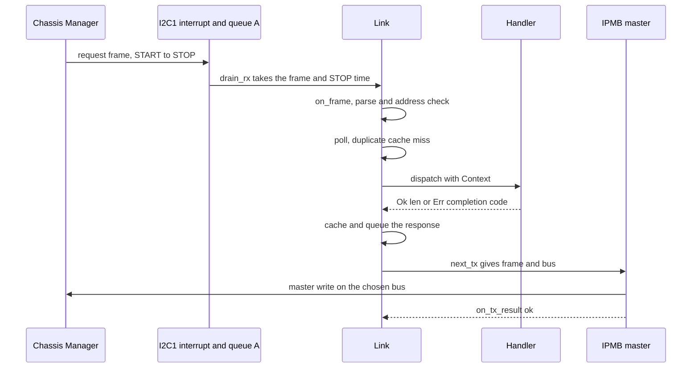
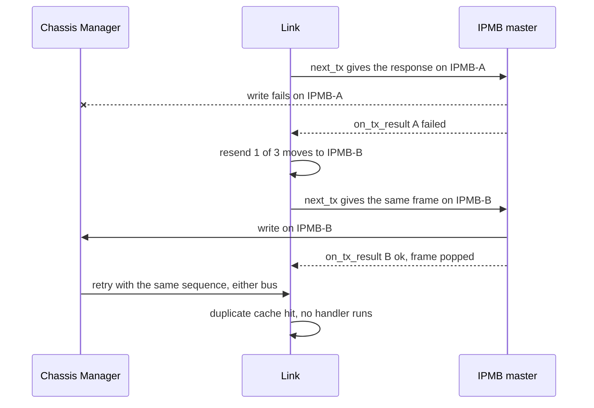
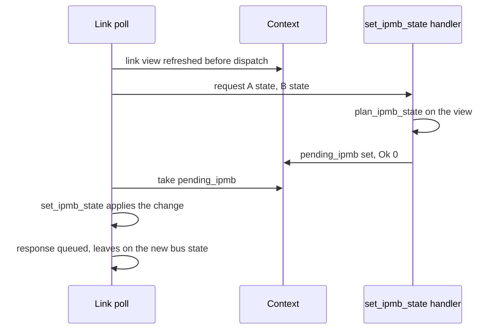
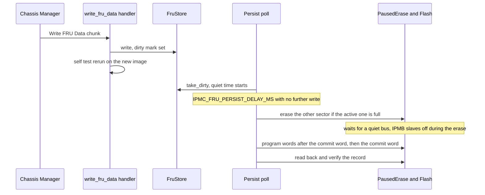

<table style="width:100%; border:none; margin:0; padding:0;">
<tr>
<td style="text-align:left; border:none; padding:0; width:50%;"><strong>CONFIDENTIAL DOCUMENT &#8211; DO NOT DISCLOSE</strong></td>
<td style="text-align:right; border:none; padding:0; width:50%;"><strong>Revision 10-23-2026</strong></td>
</tr>
</table>
<hr style="border:none; border-top:2px solid #000; margin:4px 0 12px 0;">

<div style="height: 8.2in; display: flex; flex-direction: column; justify-content: center; text-align: center;">
<h1 style="border: none;">VITA 46.11 Tier-1 IPMC Software Specification</h1>
<p style="font-size: 16px;">IPMIRustFRU: Rust IPMC firmware for the NUCLEO-F401RE, x86 emulator and bench tools</p>
<p style="font-size: 16px;"><strong>Revision 10-23-2026</strong></p>
</div>

<div style="page-break-after: always;"></div>

<table style="width:100%; border:none; margin:0; padding:0;">
<tr>
<td style="text-align:left; border:none; padding:0; width:50%;"><strong>CONFIDENTIAL DOCUMENT &#8211; DO NOT DISCLOSE</strong></td>
<td style="text-align:right; border:none; padding:0; width:50%;"><strong>Revision 10-23-2026</strong></td>
</tr>
</table>
<hr style="border:none; border-top:2px solid #000; margin:4px 0 12px 0;">

## Quick Start

1. Host tests and the emulator, from the repository root (Rust stable, GNU host):
   `cargo test --workspace`, then
   `cargo run -p ipmc-emu -- replay vectors/sbc_ab.vec --b-fitted 1 --b-enabled 1 --policy alternate --quiet`
   (the capture file is local only; on a fresh clone the capture tests skip with a message).
2. Firmware build and flash (NUCLEO-F401RE on USB):
   `powershell -ExecutionPolicy Bypass -File crates/ipmc-nucleo-f401re/gen.ps1 flash`.
   The console is COM3 at 115200 8N1; `gen.ps1 console "sys status"` sends one command and prints
   the reply.
3. Bench check with an independent IPMI implementation (Aardvark on IPMB-A, PB8/PB9):
   `tools\python-ipmi\.venv\Scripts\ipmitool.exe -I aardvark -t 0x82 raw 0x06 0x01`
   answers `00 01 80 00 01 02 09 00 00 00 4b 49 00 00 00 00`;
   `python tools/board_test_report.py` runs every bench check and writes
   `Documentation/board_test_report.md`.

## Table of Contents

1. [Overview](#1-overview)
2. [System Context](#2-system-context)
3. [Requirements](#3-requirements)
4. [Architecture](#4-architecture)
5. [Build-Time Configuration](#5-build-time-configuration)
6. [Module Descriptions](#6-module-descriptions)
7. [Interfaces](#7-interfaces)
8. [Clocking, Reset and Start-Up](#8-clocking-reset-and-start-up)
9. [Memory Map and Data Layouts](#9-memory-map-and-data-layouts)
10. [Data Flow and Protocol](#10-data-flow-and-protocol)
11. [Software API](#11-software-api)
12. [Build, Integration, and Configuration](#12-build-integration-and-configuration)
13. [Verification](#13-verification)
14. [Example Sequences](#14-example-sequences)
15. [Constraints and Limitations](#15-constraints-and-limitations)

The section 10 diagrams are Mermaid state and sequence diagrams and one WaveDrom timing diagram;
the block drawings are the `ipmc-software` drawing set (`diagrams/src/ipmc-software.js`, rendered
to `diagrams/out/png/`).

<div style="page-break-after: always;"></div>

<table style="width:100%; border:none; margin:0; padding:0;">
<tr>
<td style="text-align:left; border:none; padding:0; width:50%;"><strong>CONFIDENTIAL DOCUMENT &#8211; DO NOT DISCLOSE</strong></td>
<td style="text-align:right; border:none; padding:0; width:50%;"><strong>Revision 10-23-2026</strong></td>
</tr>
</table>
<hr style="border:none; border-top:2px solid #000; margin:4px 0 12px 0;">

## 1. Overview

IPMIRustFRU is an Intelligent Platform Management Controller (IPMC) for a VPX plug-in module,
written in Rust to ANSI/VITA 46.11-2022 Tier 1. It runs on an STM32F401RE (NUCLEO-F401RE board),
answers a Chassis Manager over the redundant Intelligent Platform Management Bus (IPMB-A and
IPMB-B, I2C at 100 kHz), serves the FRU 0 inventory and the Device SDR repository, reports the
seven mandatory VITA sensors and keeps Write FRU Data in on-chip flash across a reset. The same
IPMI code builds for the PC as an emulator that replays captured Chassis Manager traffic or
serves a live Chassis Manager over TCP. This document explains how the code works, crate by
crate and module by module, for a software engineer who maintains or extends it.

- **Primary function:** Tier-1 IPMC: the 13 Tier-1 mandatory commands plus Broadcast Get Device
  ID, the 7 mandatory sensors, FRU 0 with Common Header, Board Info and Product Info areas,
  the FRU 0 Operational State machine (M0, M1, M4, M6), dual-bus link rules (alternation,
  resend on the other bus, Set IPMB State), a startup self test and NVMRO write protection.
- **Supported modes:** firmware on the STM32F401RE with the bit-bang IPMB master (default) or
  the hardware I2C master; x86 emulator with capture replay (`replay`), real-time TCP serving
  (`serve`) and an SDR dump (`sdr`).
- **Non-goals:** Tier-2 and Tier-3 functions (events, payload power control by the Chassis
  Manager, FRU activation policy), optional Tier-1 commands (Get Mandatory Sensor Numbers,
  FRU Control Capabilities, Get IPMB Link Info, Get FRU Hash, Get Device GUID, Set SEL Time:
  all answer C1h), subsidiary FRUs, and IPMI bridging. The built FRU image has no Internal Use
  or MultiRecord area; `verify` still checks those areas when a written image contains them.

The source of truth for every statement here is the code. Where the VITA 46.11-2022 text and the
captured live Chassis Manager disagree, the code follows the specification.

<div style="page-break-after: always;"></div>

<table style="width:100%; border:none; margin:0; padding:0;">
<tr>
<td style="text-align:left; border:none; padding:0; width:50%;"><strong>CONFIDENTIAL DOCUMENT &#8211; DO NOT DISCLOSE</strong></td>
<td style="text-align:right; border:none; padding:0; width:50%;"><strong>Revision 10-23-2026</strong></td>
</tr>
</table>
<hr style="border:none; border-top:2px solid #000; margin:4px 0 12px 0;">

## 2. System Context

- **Target device:** STM32F401RET6 (Cortex-M4F, 512 KB flash, 96 KB RAM) on the NUCLEO-F401RE,
  84 MHz system clock from the 8 MHz ST-LINK MCO clock in HSE bypass.
- **Operating environment:** bare metal, `no_std`, one cooperative main loop plus interrupt
  handlers that move bytes, stamp times and drive the LED (I2C slave, USART2 receive, SysTick).
  No RTOS, no heap.
- **Host build:** `x86_64-pc-windows-gnu` (the same sources build for
  `x86_64-unknown-linux-gnu`); the emulator is a `std` binary.
- **Dependencies:** `cortex-m 0.7.10`, `cortex-m-rt 0.7.7`, `stm32f4 0.16.0` (PAC, feature
  `stm32f401`), `heapless 0.8.0` (SPSC queues), `panic-halt 1.0.0`, `embedded-hal 1.0.0`
  (bus traits of the example external sensor drivers). Every version is an exact `=` requirement.
- **Peers on the IPMB:** a Chassis Manager at 8-bit address 20h (`IPMB_CM_ADDR8`; the captured
  live Chassis Manager uses 10h). The IPMC answers at (40h + GA[4:0]) x 2: slot 1 is 82h.
- **Bench:** an Aardvark I2C host adapter on IPMB-A with its pull-ups on, driven by python-ipmi
  as the Chassis Manager; the ST-LINK USB port carries the console (COM3) and the drag-and-drop
  flash drive (`NOD_F401RE`).
- **Normative documents:** ANSI/VITA 46.11-2022 (local, licensed, not in the repository),
  IPMI v2.0 rev 1.1, IPMI Platform Management FRU Information Storage Definition v1.0 rev 1.3,
  RM0368 (STM32F401 reference manual), DS10086 (datasheet), UM10204 (I2C-bus specification).

| Term | Meaning |
|---|---|
| IPMB | Intelligent Platform Management Bus: I2C with IPMI framing and two checksums |
| rsSA / rqSA | responder / requester slave address, 8-bit form (7-bit address shifted left, R/W bit 0) |
| NetFn | network function; even for a request, odd (request + 1) for its response |
| VSO | VITA Standards Organization; its Group Extension defining-body byte is 03h |
| SDR | Sensor Data Record; the Device SDR repository lives in the IPMC |
| FRU | Field Replaceable Unit; FRU 0 is the module that holds the IPMC |
| GA, GAP | geographic address straps GA[4:0] and their odd-parity strap |
| NVMRO | non-volatile memory read-only strap; asserted, the IPMC writes no non-volatile memory |
| T1..T9, C1 | VITA 46.11 Table 4.1.1-1 timing and retry parameters |

<div style="page-break-after: always;"></div>

<table style="width:100%; border:none; margin:0; padding:0;">
<tr>
<td style="text-align:left; border:none; padding:0; width:50%;"><strong>CONFIDENTIAL DOCUMENT &#8211; DO NOT DISCLOSE</strong></td>
<td style="text-align:right; border:none; padding:0; width:50%;"><strong>Revision 10-23-2026</strong></td>
</tr>
</table>
<hr style="border:none; border-top:2px solid #000; margin:4px 0 12px 0;">

## 3. Requirements

### Functional requirements

| ID | Requirement | Rule | Where |
|---|---|---|---|
| FR-001 | Answer the Tier-1 mandatory commands of Tables 10.1.1-1 and 10.1.2-1; every other command answers C1h | Rules 4.2-2, 4.1.1-16 | `ipmc-core/src/commands.rs` |
| FR-002 | Answer Broadcast Get Device ID (general-call 00h before the frame) at the own address only | IPMI 20.9 | `link.rs` `on_frame` |
| FR-003 | FRU Device ID other than 0 answers C9h (Get FRU Address Info ignores the ID when a physical address key is given) | Rules 4.2-3, 4.1.1-17 | `cmd/mod.rs` `check_fru_device_id` |
| FR-004 | Power-up bus state: IPMB-A enabled, IPMB-B isolated until Set IPMB State | Rule 4.1.1-4 | `link.rs` `BusPair::power_up` |
| FR-005 | Accept requests on both buses; alternate transmissions between enabled buses | Rules 4.1.1-5, 4.1.1-6 | `link.rs` `choose_tx_bus` |
| FR-006 | Resend a failed transmission on the other bus, at most `IPMB_TX_RETRIES` times | Rule 4.1.1-7 | `link.rs` `on_tx_result` |
| FR-007 | Refuse a Set IPMB State that leaves no bus enabled (CCh) | Rule 4.1.8-3 | `link.rs` `plan_ipmb_state` |
| FR-008 | Bus state changes only by Set IPMB State or a persistent local fault | Rule 9.3-10 | `link.rs`, `ipmb_link.rs` |
| FR-009 | A retried request (same requester, sequence, command and data) is answered from a cache and runs no handler | Obs 4.1.1-6 (a retry keeps its sequence number) | `dupcache.rs` |
| FR-010 | Report sensors 0..6 with the layouts of Tables 10.2.1-1 to 10.2.7-1 | Table 10.2-1 | `sensor.rs`, `dispatch.rs` `read_sensor` |
| FR-011 | FRU 0 holds Common Header, Board Info and Product Info areas; Chassis Info offset 00h | Rules 8.1-2, 8.1-3 | `ipmc-fru/src/records.rs` |
| FR-012 | FRU data readable whatever the payload power | Rule 8-1 | `cmd/storage.rs` |
| FR-013 | Write FRU Data while NVMRO is asserted answers 80h and changes nothing; no flash write while NVMRO is asserted | Rules 8-3, 8-5, Rec 4.1.10-1 | `cmd/storage.rs`, `persist.rs`, `bsp/flash.rs` |
| FR-014 | FRU 0 state machine M0 to M1 on the initial checks, M1 to M4 on valid payload power, M4 to M6 on power loss, M6 to M1 on a complete shutdown | Section 4.1.5, Rules 4.1.5.4.1-2, 4.1.5.4.2-3, 4.1.5.4.5-1 | `fru_state.rs` |
| FR-015 | A payload power-on request in M6 is refused | Rule 4.1.5.4.5-2 | `fru_state.rs` `check_power_on` |
| FR-016 | An invalid hardware address (even parity or GA = 0) isolates both buses and keeps the FRU in M0 | Rules 4.1.5.4.1-4, 4.1.5.4.1-5 | `addr.rs`, `link.rs` |
| FR-017 | Startup self test of the FRU image and the SDR chain; 55h 00h or 57h with the failure bits; a failure keeps the FRU in M0; rerun after each accepted Write FRU Data | IPMI Table 20-5, Rule 4.1.5.4.1-9, Rec 8-2 | `selftest.rs` |
| FR-018 | Write FRU Data survives a reset (`IPMC_FRU_PERSIST 1`) | owner decision | `persist.rs`, `fru_log.rs` |
| FR-019 | No IPMC pull-ups on the IPMB lines | Rule 9.2.3-2 | `bsp/ipmb_pins.rs`, `i2c_hw.rs` |

### Performance requirements

| Item | Target | Notes |
|---|---|---|
| Response time | at most 227 ms (T5) | request STOP to response STOP; `RESPONSE_DEADLINE_MS`, late ones counted |
| One master write | at most T2 + T1 = 80 ms | retries included; `WRITE_BUDGET_NS`; one write per pass |
| Clock stretch | at most 3 ms (T8) | `IPMB_STRETCH_TIMEOUT_US 3000` |
| Bus-free wait | at least 60 ms (T2) | `IPMB_BUS_FREE_TIMEOUT_MS 60`; ends at the write budget |
| One IPMB frame | at most 20 ms (T1) | `ipmb_common.rs` `T1_FRAME_NS` |
| IPMB clock | 100 kHz maximum | half bit 5000 ns; measured SCL period 12.0 us (83 kHz) |
| Flash sector erase | up to 2 s, core stalled | DS10086 Table 45; IPMB slaves off the bus meanwhile |

### Compliance requirements

ANSI/VITA 46.11-2022 Tier 1, Layer 1 IPMC (VSO revision 22h); IPMI v2.0 rev 1.1 message formats,
completion codes (Table 5-2) and the Group Extension defining-body rule (Table 5-1, section 5.3.1).
The spec-only suite in `tools/conformance/` (section 13) checks the IPMC against those texts.

<div style="page-break-after: always;"></div>

<table style="width:100%; border:none; margin:0; padding:0;">
<tr>
<td style="text-align:left; border:none; padding:0; width:50%;"><strong>CONFIDENTIAL DOCUMENT &#8211; DO NOT DISCLOSE</strong></td>
<td style="text-align:right; border:none; padding:0; width:50%;"><strong>Revision 10-23-2026</strong></td>
</tr>
</table>
<hr style="border:none; border-top:2px solid #000; margin:4px 0 12px 0;">

## 4. Architecture

### Crate structure

**Figure 4-1.** Crate structure and dependencies (ipmc-software, sheet 1)


Source: `diagrams/src/ipmc-software.js`, sheet 1.

The code is a Cargo workspace of seven crates plus the firmware crate, which is its own
workspace (it builds only for `thumbv7em-none-eabihf`). Dependencies point one way: the two
binaries at the top, the IPMI logic in the middle, the configuration reader at the bottom.

| Crate | Kind | Holds |
|---|---|---|
| `ipmc-defs` | `no_std` library | the only Rust reader of `ipmi_defs.h`: one `pub const` per define, compile-time guards on every value |
| `ipmc-wire` | `no_std` library | IPMI byte primitives: zero checksum, const record builder, type/length ASCII field, CRC-32, hex-byte parser |
| `ipmc-fru` | `no_std` library | every FRU 0 record (image build, decoder, `verify`), the RAM scratchpad (`FruStore`) and the flash log (`persist`) |
| `ipmc-core` | `no_std` library, `forbid(unsafe_code)`, no allocator | every IPMI decision: frame codec, address decode, link layer, duplicate cache, queues, command table, dispatcher, handlers, SDR repository, sensor encoders, FRU state machine, self test, trace hook |
| `ipmc-sensors` | `no_std` library | sensor and board-I/O HAL: three traits, hardware-free evaluation, drivers (simulation, STM32F401 ADC/GPIO behind feature `stm32f401`, example I2C/SPI parts), board table, sampling monitor, GPIO pin ownership |
| `ipmc-menu` | `no_std` library, no dependencies besides `ipmc-defs` | the console menu engine (MenuBuilder rules, tiered groups) |
| `ipmc-emu` | host `std` binary and library | the x86 emulator: vector reader, `Emulator`, capture replay, real-time `serve`, SDR dump |
| `ipmc-nucleo-f401re` | firmware binary | start-up, board support (one module per hardware access path), IPMB drivers, flash driver, console, composition of the crates above |

### Layering rules

- `ipmc-core` decides; the firmware and the emulator move values. A handler never touches
  hardware; a driver never decides an IPMI response.
- No IPMI code runs in an interrupt. The I2C interrupt posts whole frames to a per-bus
  single-producer single-consumer queue; the main loop runs the link layer and the handlers.
- One owner per hardware resource: `ports` owns GPIOA..GPIOC and hands out pin claims;
  `bsp/i2c_hw.rs` owns I2C1 and I2C3; the bit-bang master owns the IPMB pins only while it
  transmits; `bsp/flash.rs` owns the FLASH registers after clock start-up; `uart.rs` owns
  USART2; `led.rs` owns PA5; `ga.rs` owns the strap pins; `ipmb_link.rs` owns the static Link
  and dispatch Context.
- One implementation of each function, judged by behaviour (`tools/dupcheck.py` is a gate): one
  checksum, one frame parser and encoder, one GA decode, one sensor-read function, one record
  builder, one retry loop shared by both master methods.
- One file for every tunable value: `ipmi_defs.h` (section 5). Values fixed by a specification
  or datasheet stay in the module that owns them, with the rule cited beside each.

### Key design choices

- **Link layer as a pure state machine** (`ipmc-core/src/link.rs`): frames in with the STOP
  time, responses out with the bus to use, results back. The same object runs in the firmware
  and the emulator, so the dual-bus rules are tested on the PC against 309 captured exchanges.
- **Bit-bang master on the slave's own pins** (`bsp/i2c_bitbang.rs`): the I2C peripheral stays
  a slave; for a transmission it is switched off, the same pins are driven open-drain as GPIO,
  then the peripheral is switched back on. This follows the earlier PIC32 controller and avoids
  the STM32 I2C master state machine; the hardware master stays available behind
  `IPMB_MASTER_MODE`.
- **Response bus chosen at first transmission** (`Link::next_tx`), not at queue time, so
  alternation follows the frames really handed to a driver, resends included.
- **Duplicate cache keyed by the exact request** (`dupcache.rs`): a retry runs no handler, so a
  retried Write FRU Data or Set IPMB State takes effect once.
- **Set IPMB State hand-off** (`PendingIpmbState`): the handler cannot reach the Link; it
  validates against a read-only view and leaves the change for `Link::poll`, which applies it
  before the response is queued.
- **Append-only FRU flash log** (`ipmc-fru/src/persist.rs`): two sectors, records with a commit
  word programmed last and a CRC-32, highest sequence number wins at boot; a power cut at any
  word leaves the previous image loadable.
- **Compile-time configuration** (`ipmc-defs`): a malformed or out-of-range define fails the
  build with its line number or the guard that names it.

<div style="page-break-after: always;"></div>

<table style="width:100%; border:none; margin:0; padding:0;">
<tr>
<td style="text-align:left; border:none; padding:0; width:50%;"><strong>CONFIDENTIAL DOCUMENT &#8211; DO NOT DISCLOSE</strong></td>
<td style="text-align:right; border:none; padding:0; width:50%;"><strong>Revision 10-23-2026</strong></td>
</tr>
</table>
<hr style="border:none; border-top:2px solid #000; margin:4px 0 12px 0;">

## 5. Build-Time Configuration

`ipmi_defs.h` at the repository root is the single build configuration. It keeps C `#define`
syntax: plain `#define NAME <integer>` lines (a signed value carries the tag `[i32]` as the first
token of its trailing comment) and `#define NAME "text"` lines (one printable-ASCII literal, no
escapes). `crates/ipmc-defs/build.rs` parses it with `defs_parser.rs` into
`$OUT_DIR/ipmi_defs.rs`; every crate reads a value as `ipmc_defs::NAME`. Any other line form
fails the build with `path:line: reason`, and `ipmc-defs/src/lib.rs` holds 104 compile-time
guards (81 written out, 23 from the FRU-string, SDR-name and rail guard macros) that tie values to
their rules (for example `IPMB_STRETCH_TIMEOUT_US` at most 3000, the T8 limit; `IPMC_FRU_SIZE` a
multiple of 8; every FRU string at most 63 bytes). `types.rs` fixes each define to the type its
consumers expect, so a wrong `[i32]` tag fails the build.

Prefixes: `IPMB_` for bus values, `IPMC_` for controller and application values. The tables
below group the defines; the header itself carries the rule beside each line.

### IPMB link and drivers

| Define | Default | Meaning |
|---|---:|---|
| `IPMB_MASTER_MODE` | `IPMB_MASTER_BITBANG` (1) | master method of both buses; `IPMB_MASTER_HW` (0) selects the hardware I2C master |
| `IPMB_BUS_A_ENABLE` | 1 | IPMB-A built in; must be 1 (Rule 4.1.1-1) |
| `IPMB_BUS_B_ENABLE` | 0 | IPMB-B built in; 0 on the one-Aardvark bench (Get VSO Capabilities then reports one interface) |
| `IPMB_I2C_HZ` | 100000 | IPMB clock |
| `IPMB_MSG_MAX` | 32 | whole frame, rsSA to the second checksum |
| `IPMB_TX_POLICY` | `IPMB_TX_ALTERNATE` (0) | response bus: alternate (Rule 4.1.1-6) or `IPMB_TX_ARRIVAL` (1), the request's bus |
| `IPMB_CM_ADDR8` | 20h | Chassis Manager address; only guarded, no code reads it (responses go to each request's rqSA) |
| `IPMB_DUP_CACHE` | 64 | duplicate-cache entries (8..=64) |
| `IPMB_DUP_WINDOW_MS` | 3000 | retry window: covers 11 attempts of 250 ms, below the 3.846 s sequence reuse of the captured Chassis Manager |
| `IPMB_TX_RETRIES` | 3 | resends of one response on the other bus (3..=10, C1) |
| `IPMB_INGRESS_DEPTH` | 8 | received requests held for `Link::poll` (1..=32) |
| `IPMB_TXQ_DEPTH` | 4 | response frames in the egress queue |
| `IPMB_RX_QUEUE_DEPTH` | 4 | frames one bus interrupt can post before the main loop drains them (2..=16) |
| `IPMB_BITBANG_HALF_NS` | 5000 | bit-bang half bit |
| `IPMB_STRETCH_TIMEOUT_US` | 3000 | longest stretched SCL (T8) |
| `IPMB_BUS_FREE_TIMEOUT_MS` | 60 | T2 share of the master write budget (T2 + T1); the free-bus wait ends at that budget |
| `IPMB_ARB_RETRIES` | 3 | same-bus retries after arbitration loss (0..=10) |
| `IPMB_FAULT_STREAK` | 8 | consecutive bus-fault errors before a bus is marked faulted (2..=64) |
| `IPMB_FAULT_CLEAR_MS` | 1000 | both lines idle-high this long before a fault clears |
| `IPMC_IPMI_TRACE` | 1 | one console line per dispatched request |

### Straps, identity and FRU

| Define | Default | Meaning |
|---|---:|---|
| `IPMB_GA_SOURCE` | `IPMB_STRAP_FORCED` | GA from this file (bare Nucleo, no straps wired) or `IPMB_STRAP_FROM_PINS` |
| `IPMB_GA_FORCED` | 01h | slot 1, hardware address 41h, IPMB 82h; GAP generated for odd parity |
| `IPMB_NVMRO_SOURCE`, `IPMB_NVMRO_FORCED` | forced, 0 | NVMRO deasserted (writes allowed) |
| `IPMC_DEVICE_ID`, `IPMC_DEVICE_REVISION`, `IPMC_DEVICE_PROVIDES_SDRS` | 01h, 0, 1 | Get Device ID byte 2, byte 3 bits 3:0, byte 3 bit 7 |
| `IPMC_IPMI_VERSION` | 02h | IPMI 2.0 (least significant digit in bits 7:4) |
| `IPMC_SUPPORT_*` | sensor 1, FRU inventory 1, others 0 | Get Device ID byte 7 |
| `IPMC_MANUFACTURER_ID` | 000000h | unspecified until an IANA enterprise number is registered |
| `IPMC_PRODUCT_ID` | 494Bh | product ID |
| `IPMC_FRU_BOARD_*`, `IPMC_FRU_PRODUCT_*`, `IPMC_FRU_FILE_ID`, `IPMC_FRU_ASSET_TAG` | strings | FRU board and product area fields |
| `IPMC_FRU_MFG_MINUTES` | 16204320 | board manufacturing date, minutes since 1996-01-01 (10-23-2026) |
| `IPMC_FRU_SIZE` | 256 | FRU inventory area size |
| `IPMC_FRU_PERSIST` | 1 | Write FRU Data survives reset (flash log) |
| `IPMC_FRU_PERSIST_DELAY_MS` | 1000 | quiet time after the last write before a save |
| `IPMC_FRU_SCAN_CHUNK` | 64 | bytes per read when the log checks a range for erased flash |
| `IPMC_FRU_ERASE_QUIET_MS` | 500 | run-time erase waits for an empty egress queue and this long without a received frame |
| `IPMC_FRU_PAUSE_WAIT_MS` | 40 | longest wait for an IPMB slave to go idle before an erase |
| `IPMC_SDR_*_NAME` | strings | SDR ID strings, 2..=16 bytes (locator at most 6) |

### Console, clock, LED, sensors and emulator

| Define | Default | Meaning |
|---|---:|---|
| `IPMC_CONSOLE_BAUD` | 115200 | console UART, 8N1 (`gen.ps1` reads the same line) |
| `IPMC_CONSOLE_BYTES_PER_POLL` | 16 | console bytes per main-loop pass; at most one command line per pass |
| `IPMC_UART_RX_BUF` | 128 | console receive ring |
| `IPMC_MENU_LINE_MAX`, `IPMC_MENU_TOKENS_MAX` | 80, 8 | console line and token limits |
| `IPMC_HSE_HZ`, `IPMC_SYSCLK_HZ` | 8000000, 84000000 | clock input and system clock (PLL values checked at compile time) |
| `IPMC_LED_*`, `IPMC_FAULT_BLINK_CHZ` | 1 Hz heartbeat, 10 Hz activity, 5 Hz fault | LD2 patterns (centihertz) |
| `IPMC_ADC_INTERNAL_SOURCE` | `IPMC_SRC_HW` | VDDA and die temperature from ADC1 |
| `IPMC_ADC_EXTERNAL_SOURCE` | `IPMC_SRC_SIM` | rails A0..A3 simulated (unwired on the bench) |
| `IPMC_FAULT_SOURCE`, `IPMC_POWER_SOURCE` | `IPMC_SRC_HW` | fault inputs and PWR_EN on the pins |
| `IPMC_POWER_AT_BOOT` | 1 | request payload power at start-up |
| `IPMC_PGOOD_TIMEOUT_MS` | 1000 | longest wait for PGOOD after PWR_EN |
| `IPMC_SENSOR_PERIOD_MS` | 1000 | sensor sample period |
| `IPMC_ADC_AVERAGE` | 8 | conversions averaged per ADC read |
| `IPMC_SENSOR_TRACE` | `IPMC_TRACE_EVENTS` | sensor console lines at start-up |
| `IPMC_RAIL0..4_*`, `IPMC_RAIL_NONCRIT_PCT`, `IPMC_RAIL_CRIT_PCT` | 5 rails, 5 %, 10 % | rail names, nominal mV, dividers, windows |
| `IPMC_TEMP_*_C` | LNC 0, LC -10, UNC 70, UC 85, UNR 100 | temperature thresholds |
| `IPMC_SIM_*` | 25 C, every input pin high | simulator start values: PGOOD asserted, FAULT_N, OVERTEMP_N and PAYLOAD_RESET_N deasserted |
| `IPMC_EMU_PORT`, `IPMC_EMU_SERVE_POLL_MS`, `IPMC_EMU_TX_DONE_DELAY_MS` | 5470, 1, 1 | emulator TCP port, step period, transmit time |
| `IPMC_EMU_VECTOR_LINE_MAX`, `IPMC_EMU_REPORT_LINES_MAX`, `IPMC_EMU_ERROR_ECHO_MAX` | 512, 8, 80 | emulator line and report limits |

Pin assignments are not in `ipmi_defs.h`: they live in the owning board-support module
(`bsp/ipmb_pins.rs`, `bsp/ga.rs`, `bsp/board_pins.rs`) and in
`Documentation/nucleo_f401re_pinout.md`. Python bench-tool settings live in
`tools/chassis-manager/cm_settings.py`; only values the IPMC and a tool must agree on (such as
`IPMC_EMU_PORT`) are read by the tools from `ipmi_defs.h`.

<div style="page-break-after: always;"></div>

<table style="width:100%; border:none; margin:0; padding:0;">
<tr>
<td style="text-align:left; border:none; padding:0; width:50%;"><strong>CONFIDENTIAL DOCUMENT &#8211; DO NOT DISCLOSE</strong></td>
<td style="text-align:right; border:none; padding:0; width:50%;"><strong>Revision 10-23-2026</strong></td>
</tr>
</table>
<hr style="border:none; border-top:2px solid #000; margin:4px 0 12px 0;">

## 6. Module Descriptions

Each module file opens with a comment that states its purpose, its owner rules and the
specification tables it implements; the paragraphs below summarise them and say how the modules
connect.

### 6.1 `ipmc-defs`, `ipmc-wire`

`crates/ipmc-defs/` (`build.rs`, `defs_parser.rs`, `src/lib.rs`, `src/types.rs`)

`build.rs` reads `ipmi_defs.h` (or the file named by the `IPMI_DEFS_H` environment variable, to build
against another header) and writes one constant per define.
The parser accepts integers in decimal or `0x` hex, references to earlier defines, `[i32]`-tagged
signed values and string literals, and rejects everything else. `lib.rs` re-exports the
constants and holds the cross-checks; `types.rs` fixes types and boolean ranges.

`crates/ipmc-wire/src/lib.rs`

The byte primitives shared by frames, FRU and SDR records and the tools: `zero_checksum` (the
two's-complement checksum of IPMB frames and FRU areas, IPMI 13.8 and FRU spec sections 8, 11,
12), `Builder<N>` (a `const` byte-record builder: the FRU image is built at compile time; the SDR
records are built by `SdrRepository::new` with the resolved address when `Context::new` runs), `Builder::push_type_length_ascii` (the IPMI type/length field, 8-bit ASCII),
`crc32` (IEEE 802.3, used by the FRU flash record) and `hex_byte` (the one hex-token parser of the
emulator and tools).

### 6.2 `ipmc-fru`: FRU records, scratchpad and flash log

`crates/ipmc-fru/src/records.rs`

Builds the 256-byte FRU 0 image at compile time from the `IPMC_FRU_*` strings: the 8-byte Common
Header (version 1, Internal Use 00h, Chassis Info 00h, Board Info at offset 01h = byte 8,
Product Info at offset 0Bh = byte 88, MultiRecord 00h), the Board Info Area (language,
manufacturing date, manufacturer, product name, serial, part number, FRU file ID, C1h end
marker, padding, checksum) and the Product Info Area, then 00h padding to `IPMC_FRU_SIZE`. A
string the area cannot hold or an image larger than the area fails the build. The decoder
(`common_header`, `area`, `Area::fields`) and `verify` check a possibly rewritten image: header
version and checksum, area versions, lengths, zero checksums and end-of-fields markers.

`crates/ipmc-fru/src/store.rs`

`FruStore` is the RAM scratchpad behind Read FRU Data and Write FRU Data: `read(offset, count)`,
`contains`, `write(offset, data)` (sets a dirty mark), `take_dirty`, `bytes` and `image`. It holds
the built image (`new`) or an image loaded from flash (`from_image`). No other crate holds FRU
bytes.

`crates/ipmc-fru/src/persist.rs` (tests in `persist/tests.rs`)

The FRU log on two equal flash sectors behind the `FlashLog` trait (`sector_len`, `read`,
`program`, `erase`, `millis`). `Persist::boot` scans both sectors and loads the valid record with
the highest sequence number; `Persist::poll` is the save policy (dirty mark, quiet time, NVMRO,
erase gate); `Persist::save` appends one record; `Persist::restore` writes the built image as a
new record at once (console `FRU RESTORE`). Section 9.4 gives the record format and section 10.8
the save flow. The tests cut power at every word of a record and check the previous record still
wins.

### 6.3 `ipmc-core`: IPMI logic

`crates/ipmc-core/src/ipmb.rs` - frame codec. `parse` checks length (7..=32 bytes), the header
checksum, the address bytes (bit 0 clear), the response minimum and the data checksum, and returns
a `Frame` (header, completion code for a response, data borrowed from the input). It rejects and
never clamps; each failure is an `IpmbError` variant. `encode_request`, `encode_response` and
`response_header_for` build frames with both checksums. A message is a response when its NetFn is
odd.

`crates/ipmc-core/src/addr.rs` - geographic address. `resolve(raw_pins)` applies
`IPMB_GA_SOURCE` and `IPMB_NVMRO_SOURCE` to the raw strap word (bit n = level of PC(n)): GA[4:0]
are logic 1 when grounded, the hardware address is 40h + GA, the IPMB address twice that, parity
must be odd over GA0..GA4 and GAP, and GA 0 is invalid. A forced GA gets a generated GAP.
`AddrInfo::usable` is the one decision the link layer and the FRU initial checks read.
`nvmro_asserted(raw)` is the one NVMRO rule, shared by start-up and run-time sampling.

`crates/ipmc-core/src/link.rs` - the dual-bus link layer (section 10.2). `Link` holds the bus
states, per-bus counters, the ingress FIFO, a drop log, the duplicate cache, the egress queue and
the bus of the latest transmission. Its main-loop API is `on_frame`, `poll`, `next_tx`,
`on_tx_result` (section 11.1). `plan_ipmb_state` is the one rule of Set IPMB State. `BusPair`
power-up: IPMB-A Local Control, IPMB-B isolated, both isolated when the address is unusable.

`crates/ipmc-core/src/dupcache.rs` - `DupCache` keeps the response frame of every answered
request for `IPMB_DUP_WINDOW_MS` under a `Key` of requester address, sequence number, NetFn,
command, requester LUN, responder LUN and the exact request data. When every entry is live the
oldest is evicted and counted. Time is a wrapping millisecond counter.

`crates/ipmc-core/src/queue.rs` - `Fifo<T, N>`, a fixed-capacity FIFO that rejects and counts on
full and never overwrites, and `EgressQueue`, the response frames with their arrival bus,
arrival time, assigned bus and resend count. The ingress FIFO and the drop log use `Fifo` too.
`Bus` (A or B) with `other()` lives here.

`crates/ipmc-core/src/commands.rs` - the command table `COMMANDS`, one row per command:
`cmd(netfn, cmd, name, spec, handler)`. Adding a command is adding one row (section 12.3);
`find` is a linear scan over 13 rows. `tools/sync_ipmi_commands.py` keeps
`Documentation/ipmi_commands.md` in step with this table, and a test fails while they disagree.

`crates/ipmc-core/src/dispatch.rs` - `Context` (section 11.2), the completion codes (`cc`), and
the dispatcher. `run_request` answers C2h for a destination LUN other than 0 before any lookup;
for NetFn 2Ch it echoes the request's defining-body byte as response data byte 0 on every path,
answers C7h with no data for an empty request and C1h for a defining body other than 03h, and
hands the handler the data after the VSO byte. `build_response_with` checks the output buffer
before any handler runs; `dispatch_with` reserves an egress slot first, so a response that
cannot be queued never causes a handler side effect. `trace_request` writes one line per request,
`FN(06h) CMD(01h) Get Device ID -> CC 00h, 15 bytes`. `Context::read_sensor` is the one function
that maps a sensor number to its encoder, used by Get Sensor Reading and the console.

`crates/ipmc-core/src/cmd/` - handlers, one file per NetFn: `app.rs` (Get Device ID, Get Self
Test Results), `se.rs` (Get Device SDR Info, Reserve Device SDR Repository, Get Device SDR, Get
Sensor Reading), `storage.rs` (Get FRU Inventory Area Info, Read FRU Data, Write FRU Data),
`vita.rs` (Get VSO Capabilities, Set IPMB State, Get Device Locator Record ID, Get FRU Address
Info). `mod.rs` holds `require_no_data` and `check_fru_device_id`. A handler writes only its
data bytes into the slice it is given and returns `Ok(len)` or `Err(completion code)`.

`crates/ipmc-core/src/identity.rs` - `DEVICE_IDENTITY`, assembled from `ipmc_defs` values; the
firmware revision comes from the crate version (0.1), and a guard ties
`IPMC_FRU_PRODUCT_VERSION` to the same major.minor. No literal identity value lives here.

`crates/ipmc-core/src/sdr.rs` - `SdrRepository`: eight records built once from the
`IPMC_SDR_*_NAME` strings and the IPMB address, record IDs 0..=7 (section 9.5), the reservation
counter (`reserve`, `reservation_valid`), `resolve` (0000h first, FFFFh last), `next_id`,
`describe` and `locator_record_id` (7). The file header lists every place the records differ
from the captured live IPMC and why.

`crates/ipmc-core/src/sensor.rs` - the sensor numbers and types of Table 10.2-1, the
`SensorSnapshot` that `ipmc-sensors` fills, and one encoder per reading layout: `encode_summary`
(FRU Health, FRU Voltage), `encode_temperature`, `encode_link`, `encode_fru_state`,
`encode_payload_test_results` (unavailable: no payload test runs) and
`encode_payload_test_status` (not in progress). `LocalStatus` is the 3-bit IPMB local status of
Table 10.2.2-1.

`crates/ipmc-core/src/fru_state.rs` - `FruMachine`, pure: `step(now_ms, inputs)` makes at most one
transition and returns it; `check_power_on` refuses in M6. Section 10.4 has the diagram.

`crates/ipmc-core/src/selftest.rs` - `run(fru, sdr)`: `ipmc_fru::verify` on the image and a walk
of the SDR chain (each record exists, carries the ID used to reach it, has a matching length
byte, the walk ends at FFFFh after `record_count` records). Result 55h 00h, or 57h with bit 5
(FRU), bit 6 (SDR chain) or bit 3 (SDR empty).

`crates/ipmc-core/src/trace.rs` - the one `Trace` trait (`line(format_args!(..))`), implemented by
the firmware console, the emulator's stdout sink, `NoTrace` and `RecordingTrace` (tests).

### 6.4 `ipmc-sensors`: sensors and board I/O

`crates/ipmc-sensors/src/board_sensors.rs` is the place to start: it lists every value the board
measures and how each Tier-1 reading is built. FRU Voltage is good when every rail of the board
table is inside its non-critical window; FRU Temperature carries the threshold flags of the die temperature;
FRU Health is bad on FAULT_N, OVERTEMP_N, PWR_EN without PGOOD, a critical rail or a temperature
at or above UC.

| Layer | Files | Holds |
|---|---|---|
| Interfaces | `hal/analog.rs`, `hal/digital.rs`, `hal/power.rs` | `AnalogSource`, `DigitalInputs`, `PowerSwitch`, the shared `SourceError` |
| Evaluation | `eval/rail.rs`, `eval/temperature.rs`, `eval/faults.rs`, `eval/power_fsm.rs`, `eval/led.rs` | rail windows, calibration arithmetic (VREFIN_CAL, TS_CAL1, TS_CAL2), input assertion bitmap, PWR_EN/PGOOD state machine, LED level as a pure function of time |
| Drivers | `drivers/sim/`, `drivers/stm32f401/` (feature), `drivers/i2c/` (INA226, PCA9555), `drivers/spi/` (MCP3208) | trait implementations; the external parts are host-tested examples with no bus assigned |
| Routing | `routing.rs` | per source switch, the on-chip driver or the simulator |
| Sampling | `monitor.rs`, `trace.rs` | one sample: inputs, power state machine, PWR_EN drive, snapshot, change lines |
| Pin ownership | `pin_claims.rs`, `drivers/stm32f401/ports.rs` | one owner per pin; a second claim fails naming both owners |

`unsafe` is allowed only in `drivers/stm32f401/`; without the feature the crate builds on the host
with the simulators and forbids `unsafe`.

### 6.5 `ipmc-menu`: console engine

`crates/ipmc-menu/src/` (`menu.rs`, `line.rs`, `args.rs`, `syntax.rs`; user documentation in
`MenuDocumentation.md`). `LineEditor::push_byte` turns received bytes into echo, erase,
line-complete and line-too-long events; `Menu::process_line` matches a line against the group
tables (keywords case-insensitive and exact, `[REQUIRED]` and `{OPTIONAL}` parameters, optional
last), prints help in fixed columns for `HELP` and `?`, and calls the handler with the caller's
context and an `Args` view. `Menu::validate_tables` is a `const fn`; `console.rs` calls it in a
compile-time assertion, so a bad syntax string in the firmware tables fails the build.

### 6.6 `ipmc-nucleo-f401re`: firmware

| File | Role |
|---|---|
| `src/main.rs` | start-up order (section 8.3) and the main loop: `console.poll`, `console.service_sensors`, `console.service_link`, `wfi` |
| `src/ipmb_link.rs` | owns the static `Link`, the dispatch `Context`, the frame-queue consumers, the master, the fault trackers and the FRU log; `service` is the IPMB main-loop step (section 10.2); `IPMB STATS` and `IPMB STATE` commands |
| `src/fru_log.rs` | the boot load of the FRU log before the I2C drivers start; owns `Flash` and `Persist` |
| `src/sensing.rs` | builds the sensor backends from the source switches, owns the `Monitor`; `SENSORS`, `POWER`, `SIM` commands |
| `src/console.rs` | command tables and the `SYS`, `LED`, `IPMB` handlers on the `ipmc-menu` engine; banner |
| `src/data_cmds.rs` | `FRU SHOW`, `FRU DUMP`, `FRU STORE`, `FRU RESTORE`, `SENSORS SDR` |
| `src/bsp/clock.rs` | HSE bypass (HSI fallback) to 84 MHz, PLL M 8 / N 336 / P 4 / Q 7, compile-time check of the PLL against `IPMC_SYSCLK_HZ` |
| `src/bsp/i2c_hw.rs` | I2C1 and I2C3: slave interrupts (EV and ER), the per-bus frame queues, `suspend`/`resume` for the bit-bang master, `HwMaster`, `clear_stuck_busy`, driver counters |
| `src/bsp/i2c_bitbang.rs` | `BitbangMaster`: START, bits, ACK, STOP on open-drain GPIO with DWT timing, clock-stretch read-back, arbitration check, bus recovery (9 clocks and a STOP) |
| `src/bsp/ipmb_master.rs` | the `IpmbMaster` trait, `MasterError`, counters, `SelectedMaster` chosen at compile time by `IPMB_MASTER_MODE` |
| `src/bsp/ipmb_common.rs` | DWT cycle counter, `Deadline`, `wait_for`, `wait_bus_free` (tBUF, slave idle, stuck-BUSY signature), `write_retrying` (arbitration retries inside one T2 + T1 budget) |
| `src/bsp/ipmb_pins.rs` | claims PB8, PB9, PA8, PB4 and parks them as floating inputs (PB4 resets with a pull-up that would load IPMB-B SDA) |
| `src/bsp/flash.rs` | word program, sector erase and reads of sectors 6 and 7 behind `FlashLog`; refuses to start when the linked image reaches the log; refuses erase and program while NVMRO is asserted |
| `src/bsp/ga.rs` | strap pins PC0..PC6 with pull-ups, raw level read, live NVMRO sample |
| `src/bsp/systick.rs` | 1 ms tick, `millis`, `seconds`, `catch_up` (adds the time the core stalled on a flash erase, measured with the DWT counter) |
| `src/bsp/uart.rs` | USART2 console on PA2/PA3: interrupt-driven receive ring, blocking bounded transmit, failure counters |
| `src/bsp/led.rs` | LD2 on PA5: heartbeat, 10 Hz activity window after each IPMB frame, manual modes, fault blink |
| `src/bsp/board_pins.rs` | ADC channels and GPIO pins of the sensor signals |
| `src/bsp/fault.rs`, `reset_cause.rs`, `static_slot.rs` | fail-stop handlers that record and park; reset-cause decode; the one `Mutex<RefCell<Option<T>>>` access pattern |

### 6.7 `ipmc-emu`: x86 emulator

| File | Role |
|---|---|
| `src/emulator.rs` | `Emulator`: `addr::resolve`, `Link::new`, `Context::new` and a `Monitor` over the simulators, built as the firmware builds them; `rx`, `poll`, `next_tx`, `tx_done` mirror the driver calls |
| `src/vectors.rs` | the one reader of the vector format (`vectors/sbc_ab.vec`: time, bus tag, hex bytes) |
| `src/replay.rs` | feeds each captured request at its capture time, reports each response 1 ms later, compares with the captured response: Match, SameCC, CCDiff, NotImpl, Unans, NoCap, NoBus |
| `src/serve.rs` | `Board`, the emulator in real time behind the TCP line protocol (section 7.4); one client at a time; a new client or `#reset` starts a fresh board |
| `src/trace.rs`, `src/main.rs` | stdout trace sink and hex formatter; command line `replay`, `serve`, `sdr`, `help` |

The emulator keeps the FRU store in RAM only (no flash log) and simulates every sensor group.

### 6.8 Tools

| Path | Role |
|---|---|
| `tools/trace2vec.py` | merges the two logic-analyser I2C exports (IPMB-A and IPMB-B, one time base) into `vectors/sbc_ab.vec` with bus tags, redacted |
| `tools/sync_ipmi_commands.py` | rewrites the implemented column of `Documentation/ipmi_commands.md` from `COMMANDS`; `--check` for the gate |
| `tools/captured_sdr.py` | decodes the 40 captured SDRs next to ours into `Documentation/captured_sdr.md` (local only) |
| `tools/dupcheck.py` | scores every pair of Rust function bodies with identifiers normalised; fails on a production pair at or above 0.85 or a test pair at or above 0.92 |
| `tools/python-ipmi/` | venv with python-ipmi and pyaardvark; `README.md` is the Tier-1 command-line reference |
| `tools/chassis-manager/` | VITA 46.11 Chassis Manager on python-ipmi: `cm_link.py` (requester rules: T3 250 ms, retries with the same sequence, alternation, per-target IPMB-B), `cm_commands.py`, `chassis_manager.py`, `crosscheck.py` (compares a run with the captured Chassis Manager, every difference tagged), `ipmc_emu_interface.py` (TCP transport), `cm_settings.py` (tool settings), `test_cm_link.py` |
| `tools/conformance/` | spec-only Tier-1 suite: `TRANSPORT.md` (its only interface), `adapter.py` (maps it onto the Aardvark or the emulator), `run_conformance.py`, eight `tests_*.py` files, `REQUIREMENTS.md` |
| `tools/board_test_report.py` | runs the command line, Chassis Manager, conformance, link-health and FRU persistence checks against the board and writes `Documentation/board_test_report.md` |

<div style="page-break-after: always;"></div>

<table style="width:100%; border:none; margin:0; padding:0;">
<tr>
<td style="text-align:left; border:none; padding:0; width:50%;"><strong>CONFIDENTIAL DOCUMENT &#8211; DO NOT DISCLOSE</strong></td>
<td style="text-align:right; border:none; padding:0; width:50%;"><strong>Revision 10-23-2026</strong></td>
</tr>
</table>
<hr style="border:none; border-top:2px solid #000; margin:4px 0 12px 0;">

## 7. Interfaces

### 7.1 IPMB frame format

All addresses are 8-bit (the 7-bit I2C address shifted left, bit 0 clear); byte 0 is the
destination as it appears in the I2C address phase. The I2C slave interrupt prepends the matched
address byte (own address, or 00h for a general call) to the bytes it receives, so the link layer
always sees a whole frame.

| Byte | Request | Response |
|---:|---|---|
| 0 | rsSA | rqSA |
| 1 | NetFn &lt;&lt; 2 &#124; rsLUN | (NetFn + 1) &lt;&lt; 2 &#124; rqLUN |
| 2 | chk1: bytes 0..2 sum to 0 mod 256 | chk1 |
| 3 | rqSA | rsSA |
| 4 | rqSeq &lt;&lt; 2 &#124; rqLUN | rqSeq &lt;&lt; 2 &#124; rsLUN |
| 5 | command | command |
| 6.. | request data | completion code, then response data |
| last | chk2: bytes 3..n-1 sum to 0 mod 256 | chk2 |

A request is 7 to 32 bytes, a response 8 to 32 (`IPMB_MSG_MAX`). For NetFn 2Ch/2Dh the first data
byte is the defining body, 03h for VSO; "byte 3" of a VITA response table is response data byte
0 after the VSO byte.

### 7.2 Command set

| NetFn | Cmd | Command | Request data | Response data (after CC) | Notes |
|---|---|---|---|---|---|
| 06h | 01h | Get Device ID | none | 15 bytes from `DEVICE_IDENTITY` | also the broadcast form |
| 06h | 04h | Get Self Test Results | none | 55h 00h, or 57h and failure bits | |
| 04h | 20h | Get Device SDR Info | none or operation | count, flags 01h | 07h sensors, or 08h records with bit 0 set |
| 04h | 21h | Get Device SDR | reservation, record ID, offset, count | next ID, bytes | C5h for a non-zero offset without the current reservation; CBh no record; C9h range; CAh too large |
| 04h | 22h | Reserve Device SDR Repository | none | reservation ID | each call returns a new non-zero ID |
| 04h | 2Dh | Get Sensor Reading | sensor number | reading, status, state | CBh for a number above 6 |
| 0Ah | 10h | Get FRU Inventory Area Info | FRU ID | 00h 01h 00h | 256 bytes, byte access |
| 0Ah | 11h | Read FRU Data | FRU ID, offset, count | count, bytes | C9h count 0 or range; CAh too large for one frame |
| 0Ah | 12h | Write FRU Data | FRU ID, offset, bytes | count written | 80h while NVMRO is asserted; reruns the self test; saved to flash after the quiet time |
| 2Ch | 00h | Get VSO Capabilities | VSO | 03h, 00h, IPMB capabilities, 00h, 22h, 00h, 00h | IPMB capabilities 00h (one interface) or 01h (two), 100 kHz |
| 2Ch | 09h | Set IPMB State | VSO, A state, B state, optional speed | 03h | CCh for an unsupported link ID, speed, unfitted bus or both buses isolated |
| 2Ch | 0Dh | Get Device Locator Record ID | VSO, FRU ID | 03h 07h 00h | |
| 2Ch | 40h | Get FRU Address Info | VSO, then none, FRU ID, or FRU ID, key type, site, site type | 03h, HW address, IPMB address, FFh, 00h, site, 00h | CCh key type other than 03h; D3h another site |

Common completion codes: C1h unknown command (and every Tier-1 not-applicable command), C2h a
destination LUN other than 0, C7h a wrong request length, C9h a FRU ID other than 0 (except the physical-address form of Get FRU
Address Info, which ignores the ID). Reservation IDs, record IDs and FRU offsets are two bytes, LS
byte first; a Get Device SDR count of FFh reads the rest of the record; a Set IPMB State bus byte is
00h (isolate), 01h (Local Control) or FFh (no change), and the optional speed byte must be 00h.

### 7.3 Console

COM3, 115200 8N1 (`IPMC_CONSOLE_BAUD`), prompt `ipmc`. `HELP` or `?` lists the groups;
`<GROUP> HELP` lists a group; a command is typed in full from the top level (`SENSORS SHOW`) or
after entering its group, and `UP` or `..` leaves the group.

| Group | Commands |
|---|---|
| top level | `STATUS` (= `SYS STATUS`), `RESET` (= `SYS RESET`) |
| `SYS` | `STATUS`, `RESET`, `VERSION` |
| `LED` | `ON`, `OFF`, `BLINK [HZ]`, `AUTO`, `STATUS` |
| `IPMB` | `ADDR`, `STATS`, `STATE` |
| `SENSORS` | `SHOW`, `SDR`, `TRACE {LEVEL}` |
| `POWER` | `ON`, `OFF`, `CLEAR`, `STATUS` |
| `FRU` | `SHOW`, `DUMP {OFFSET} {COUNT}`, `STORE`, `RESTORE` |
| `SIM` | `RAIL {N} {MV}`, `TEMP {DC}`, `FAULT {NAME} {STATE}`, `SHOW` |

The banner after reset prints the firmware and core versions, build profile, reset cause,
clocks, geographic address with its source, IPMB address and the self-test result
(`Self test:    55h 00h (passed)`).

### 7.4 Emulator TCP line protocol (`ipmc-emu serve`)

ASCII, one message per line, at most `IPMC_EMU_VECTOR_LINE_MAX` characters, on 127.0.0.1 port
`IPMC_EMU_PORT` (5470).

| Direction | Line | Meaning |
|---|---|---|
| client to emulator | `A <hex bytes>` / `B <hex bytes>` | a frame written on that bus; first byte the 8-bit destination (00h for a broadcast) |
| client to emulator | `#bus A down` / `#bus A up` (and B) | break or repair a bus: frames are lost and the IPMC's transmissions on it fail |
| client to emulator | `#reset` | power-cycle the board (fresh board, both buses up, clock restarts) |
| client to emulator | `#quit` | end the session |
| emulator to client | `A <hex>` / `B <hex>` | a frame the IPMC transmits |
| emulator to client | `#ready <hex>` | at connect and after `#reset`: the IPMC's own address |
| emulator to client | `# <text>` | a trace line (with `--trace`) |
| emulator to client | `#error <line>: <reason>` | a rejected client line; the session continues |

### 7.5 Pins

| Signal | Pin | Header | Owner | Direction |
|---|---|---|---|---|
| IPMB-A SCL / SDA | PB8 / PB9 (I2C1, AF4) | D15 / D14 | `ipmb_pins.rs`, `i2c_hw.rs` | open-drain, no pull-up |
| IPMB-B SCL / SDA | PA8 (I2C3, AF4) / PB4 (I2C3, AF9) | D7 / D5 | `ipmb_pins.rs`, `i2c_hw.rs` | open-drain, no pull-up; parked when not fitted |
| GA0..GA4, GAP, NVMRO | PC0..PC4, PC5, PC6 | morpho | `ga.rs` | input, pull-up |
| Console TX / RX | PA2 / PA3 (USART2, AF7) | ST-LINK VCP | `uart.rs` | |
| LD2 | PA5 | D13 | `led.rs` | output, high = on |
| Rails 1..4 | PA0, PA1, PA4, PB0 (ADC1 ch 0, 1, 4, 8) | A0..A3 | `adc.rs` (claim "adc") | analog |
| PWR_EN | PB5 | D4 | `gpio.rs` (claim "board_io") | output, active high |
| PGOOD | PB10 | D6 | `gpio.rs` | input, active high, pull-up |
| FAULT_N | PA10 | D2 | `gpio.rs` | input, active low, pull-up |
| OVERTEMP_N | PC7 | D9 | `gpio.rs` | input, active low, pull-up |
| PAYLOAD_RESET_N | PB6 | D10 | `gpio.rs` | input, active low, pull-up |

`Documentation/nucleo_f401re_pinout.md` is the full pin table for people; a pin change edits the
owning module and that table together.

<div style="page-break-after: always;"></div>

<table style="width:100%; border:none; margin:0; padding:0;">
<tr>
<td style="text-align:left; border:none; padding:0; width:50%;"><strong>CONFIDENTIAL DOCUMENT &#8211; DO NOT DISCLOSE</strong></td>
<td style="text-align:right; border:none; padding:0; width:50%;"><strong>Revision 10-23-2026</strong></td>
</tr>
</table>
<hr style="border:none; border-top:2px solid #000; margin:4px 0 12px 0;">

## 8. Clocking, Reset and Start-Up

### 8.1 Clocks

| Clock | Source | Frequency | Used by | Notes |
|---|---|---:|---|---|
| HSE | ST-LINK MCO into OSC_IN, bypass | 8 MHz | PLL input | HSI 16 MHz (M = 16) when HSE never becomes ready |
| SYSCLK, HCLK | PLL: 8 MHz / 8 x 336 / 4 | 84 MHz | core, DWT cycle counter, SysTick | `IPMC_SYSCLK_HZ`, compile-time check |
| PCLK1 | HCLK / 2 | 42 MHz | I2C1, I2C3 (CR2.FREQ 42), USART2 | APB1 maximum |
| PCLK2 | HCLK | 84 MHz | ADC1 (ADCCLK = PCLK2 / 4 = 21 MHz) | |
| PLLQ | VCO / 7 | 48 MHz | unused | |
| SysTick | HCLK | 1 kHz tick | `millis`, LED pattern | `catch_up` after a flash erase |
| DWT CYCCNT | HCLK | 84 MHz | bit-bang timing, deadlines, erase stall time | started before the FRU log boot |

### 8.2 Reset

The firmware has one reset domain: the MCU reset (power-on, pin, software from `SYS RESET`,
watchdog flags reported but no watchdog is enabled). `bsp/reset_cause.rs` reads RCC_CSR once at
start-up, reports the most specific cause in the banner and clears the flags. A HardFault or an
unhandled interrupt records its state in a static, prints one line when the UART is up and parks
in `wfi`; it does not reset, so the fault stays visible on the bench. The panic handler is
`panic-halt`. RAM state starts from its Rust initialisers; there is no state kept across reset
except the FRU log in flash.

### 8.3 Start-up order (`main.rs`)

1. Reset cause (first, before anything can reset again).
2. Clock to 84 MHz; a clock fault is reported later in the banner.
3. `ports::init` takes GPIOA..GPIOC; LED claim; SysTick start; USART2 console (a UART failure
   blinks LD2 at 5 Hz and parks; a pin-claim conflict prints both owners and parks).
4. IPMB pins parked as floating inputs.
5. Sensor hardware for the groups whose source is hardware (ADC1, board GPIO).
6. Strap pins (`ga::init`).
7. DWT cycle counter, then the FRU log boot (`fru_log::FruLog::boot`): loads the newest stored
   image and erases a stale sector when due and NVMRO is deasserted. It runs before the I2C
   slaves exist, because an erase stalls the core for up to 2 s.
8. `addr::resolve` on the raw straps; `ipmb_link::start_drivers`: the selected master takes the
   pins and the DWT counter, then, when the address is usable, each fitted bus gets `bring_up`
   (bus recovery when SDA is held low, then the I2C slave). A bus that fails stays disabled with its local status set, and the
   fault tracker restarts it once the lines read idle-high.
9. `IpmbLink::take` builds the static Link and dispatch Context (self test runs; a stored image
   replaces the built one and the self test runs on it).
10. Banner, sensor start (payload power requested when `IPMC_POWER_AT_BOOT`), prompt, main loop.

<div style="page-break-after: always;"></div>

<table style="width:100%; border:none; margin:0; padding:0;">
<tr>
<td style="text-align:left; border:none; padding:0; width:50%;"><strong>CONFIDENTIAL DOCUMENT &#8211; DO NOT DISCLOSE</strong></td>
<td style="text-align:right; border:none; padding:0; width:50%;"><strong>Revision 10-23-2026</strong></td>
</tr>
</table>
<hr style="border:none; border-top:2px solid #000; margin:4px 0 12px 0;">

## 9. Memory Map and Data Layouts

### 9.1 Flash and RAM (`memory.x`, `bsp/flash.rs`)

| Region | Base | Size | Contents |
|---|---:|---:|---|
| `FLASH` | `0x0800_0000` | 256 KB (sectors 0-5) | program; the release image is 81,360 bytes |
| FRU log sector A | `0x0804_0000` | 128 KB (sector 6) | FRU flash log |
| FRU log sector B | `0x0806_0000` | 128 KB (sector 7) | FRU flash log |
| `RAM` | `0x2000_0000` | 96 KB | statics and stack |
| System memory | `0x1FFF_7A2A`..`0x1FFF_7A2F` | 6 bytes | factory VREFIN_CAL, TS_CAL1, TS_CAL2 (read by `adc.rs`) |

`memory.x` and `bsp/flash.rs` are peers: if `FLASH` grew past `0x0804_0000` the program would
overlap the log, so `Flash::new` compares the linked image end with the log start and refuses to
start the log when they overlap. The largest static is `IpmbLink` (6,772 bytes in the release
image, mostly the duplicate cache: 64 entries of 76 bytes, frame included).

### 9.2 FRU 0 image (256 bytes)

| Offset | Size | Content |
|---:|---:|---|
| 00h | 8 | Common Header: `01 00 00 01 0B 00 00 F3` (version 1; Internal Use, Chassis Info, MultiRecord 00h; Board at 1 x 8, Product at 0Bh x 8) |
| 08h | 80 | Board Info Area: version, length, language, manufacturing date (3 bytes LE minutes), manufacturer, product name, serial, part number, FRU file ID, C1h, padding, checksum |
| 58h | multiple of 8 | Product Info Area: version, length, language, manufacturer, name, part/model, version, serial, asset tag (empty), FRU file ID (empty), C1h, padding, checksum |
| .. | to 100h | 00h padding |

### 9.3 Get Sensor Reading data (bytes after the completion code)

| Sensor | Type | Byte 2 | Byte 3 | Byte 4 |
|---|---|---|---|---|
| 0 FRU State | F0h | 00h | 40h | Current State Mask, bit n for Mn (M0 01h, M1 02h, M4 10h, M6 40h) |
| 1 IPMB Link | F1h | B local control bit 7, B status 6:4, A local control bit 3, A status 2:0 | 40h | link state bit 3 both, 2 only B, 1 only A, 0 none |
| 2 FRU Health | F2h | 00h | 40h | 01h functioning, 02h not functioning |
| 3 FRU Voltage | 02h | 00h | 40h | 01h in range, 02h out of range |
| 4 FRU Temperature | F3h | 00h | 40h | LNC bit 0, LC 1, UNC 3, UC 4, UNR 5 |
| 5 Payload Test Results | F4h | 00h | 60h (unavailable) | 00h |
| 6 Payload Test Status | F5h | 00h | 40h | 01h not in progress |

Status byte 40h is "scanning enabled"; bit 5 (20h) marks a reading unavailable; bit 7 (events)
is 0. Sensors 2..4 read `00 60 00` before the first sample and while their source cannot be read.
On the bench with only IPMB-A enabled sensor 1 reads `08 40 02`.

<div style="page-break-after: always;"></div>

<table style="width:100%; border:none; margin:0; padding:0;">
<tr>
<td style="text-align:left; border:none; padding:0; width:50%;"><strong>CONFIDENTIAL DOCUMENT &#8211; DO NOT DISCLOSE</strong></td>
<td style="text-align:right; border:none; padding:0; width:50%;"><strong>Revision 10-23-2026</strong></td>
</tr>
</table>
<hr style="border:none; border-top:2px solid #000; margin:4px 0 12px 0;">

### 9.4 FRU flash record (`persist.rs`)

| Offset | Size | Field |
|---:|---:|---|
| 0 | 4 | commit word 55464931h, programmed last |
| 4 | 4 | sequence number, from 1, never 0 or FFFFFFFFh |
| 8 | 2 | image length (= `IPMC_FRU_SIZE`) |
| 10 | 2 | record format version (1) |
| 12 | 256 | FRU image |
| 268 | 4 | CRC-32 over bytes 4..268 |

A record is 272 bytes (68 words), so a 128 KB sector holds 481 records. All fields are
little-endian; the length and version halves share one word, every other field is whole words. Erased flash reads FFh.

### 9.5 Device SDR repository

| Record ID | Type | Content |
|---:|---|---|
| 0000h..0006h | 02h compact sensor | sensors 0..6 in number order: entity A0h (VPX module) instance 60h, scanning on, no events, reading masks per Table 10.2-1, ID strings from `IPMC_SDR_*_NAME` |
| 0007h | 12h MC device locator | owner = own IPMB address, global initialisation 01b, device capabilities 0Bh, entity A0h instance 60h, ID string "IPMC" |

Get Device SDR Info reports 7 sensors (or 8 records with operation bit 0); Get Device Locator
Record ID returns 0007h.

<div style="page-break-after: always;"></div>

<table style="width:100%; border:none; margin:0; padding:0;">
<tr>
<td style="text-align:left; border:none; padding:0; width:50%;"><strong>CONFIDENTIAL DOCUMENT &#8211; DO NOT DISCLOSE</strong></td>
<td style="text-align:right; border:none; padding:0; width:50%;"><strong>Revision 10-23-2026</strong></td>
</tr>
</table>
<hr style="border:none; border-top:2px solid #000; margin:4px 0 12px 0;">

## 10. Data Flow and Protocol

### 10.1 Request path in the firmware

**Figure 10-1.** Firmware request path, receive to transmit (ipmc-software, sheet 2)


Source: `diagrams/src/ipmc-software.js`, sheet 2.

- **Receive path:** the I2C EV interrupt (`i2c_hw.rs` `on_event`) clears ADDR, starts a frame with
  the matched address byte, appends each data byte, and at STOP posts the frame with the SysTick
  time to that bus's SPSC queue. A frame longer than 33 bytes, an address-only write or a full
  queue is dropped and counted. The ER interrupt counts and clears error flags and drops the
  partial frame, except for ARLO alone (the hardware master lost arbitration), which is counted and
  keeps the reception, because the winner's frame may be addressed to this slave. A read of the slave answers FFh bytes.
- **Main loop:** `IpmbLink::service` samples NVMRO, drains both queues in STOP-time order into
  `Link::on_frame` (at most 2 x `IPMB_RX_QUEUE_DEPTH` frames per pass), runs `Link::poll`, books
  slave errors on the fault streak, transmits at most one response, clears faulted buses whose
  lines have been idle-high for `IPMB_FAULT_CLEAR_MS`, and runs the FRU log save step.
- **Transmit path:** `Link::next_tx` gives the oldest response and its bus; the master writes it
  (`write_retrying`: free-bus wait, then the transfer, arbitration retries on the same bus inside
  one T2 + T1 budget); `Link::on_tx_result` pops the frame on success or moves it to the other
  bus for a resend.

### 10.2 Link layer (`ipmc-core/src/link.rs`)

`on_frame(bus, frame, now_ms)`:

1. A bus that is disabled or not fitted drops the frame (`BusUnavailable`).
2. A leading 00h (general call) is stripped and the request marked broadcast.
3. `ipmb::parse`; a parse error is counted per kind; a response is dropped (a Tier-1 IPMC sends
   no requests).
4. rsSA must be the own address; a broadcast must also be Get Device ID (`NotForUs` otherwise).
5. The request joins the ingress FIFO with its bus and arrival time; a full FIFO drops the new
   frame. Every drop is logged for `poll` to trace; the counters keep the totals.

`poll`: traces the drops, then takes requests oldest first while the egress queue has room. A
request whose `Key` is in the duplicate cache within the window gets the cached response queued
again and runs no handler (`replays` counter). Any other request is dispatched against a private
staging queue; a pending Set IPMB State change is applied; the response is cached and queued with
the arrival bus and time.

`next_tx`: a response handed out for the first time gets its bus now. ALTERNATE prefers the bus
other than the latest transmission (resends count); ARRIVAL prefers the request's bus; when the
preferred bus is not enabled the other enabled bus is used. A response whose assigned bus has
since been disabled moves to the other bus. None when neither bus is enabled.

`on_tx_result(bus, ok, now_ms, trace)`: success pops the frame and counts a late response when the
transmission completed more than 227 ms after the request's STOP. Failure counts `tx_fail` and
the streak; when the other bus is enabled and the frame has fewer than `IPMB_TX_RETRIES` resends
it moves there, otherwise it is dropped (`tx_dropped`) and the requester's retry gets the cached
response.

Bus state per bus: `fitted`, `mode` (Isolated or Local Control, the Set IPMB State value) and
`status` (local fault, `LocalStatus`). A bus is enabled when it is fitted, in Local Control and
without a local fault.

### 10.3 Sensor data, FRU state and FRU persistence

**Figure 10-2.** Sensor data, FRU state and FRU persistence (ipmc-software, sheet 3)


Source: `diagrams/src/ipmc-software.js`, sheet 3.

Once per `IPMC_SENSOR_PERIOD_MS` the `Monitor` reads the inputs, steps the power state machine,
drives PWR_EN, builds a `SensorSnapshot` and prints the change lines. `IpmbLink::feed_sensors`
hands the snapshot to `Context::update_sensors`, which stores it for Get Sensor Reading and steps
the FRU state machine with the initial checks, "payload power valid" (power state On, so PGOOD
was seen) and "payload shut down" (PWR_EN released and PGOOD read deasserted).

<div style="page-break-after: always;"></div>

<table style="width:100%; border:none; margin:0; padding:0;">
<tr>
<td style="text-align:left; border:none; padding:0; width:50%;"><strong>CONFIDENTIAL DOCUMENT &#8211; DO NOT DISCLOSE</strong></td>
<td style="text-align:right; border:none; padding:0; width:50%;"><strong>Revision 10-23-2026</strong></td>
</tr>
</table>
<hr style="border:none; border-top:2px solid #000; margin:4px 0 12px 0;">

### 10.4 FRU 0 Operational State machine (`fru_state.rs`)

```mermaid
stateDiagram-v2
    [*] --> M0
    M0 --> M1 : initial checks pass&#10;address parity, SDRs, self test
    M1 --> M4 : payload power valid&#10;PGOOD seen
    M4 --> M6 : payload power lost or off
    M6 --> M1 : payload shut down&#10;PWR_EN released, PGOOD low
    M1 --> M0 : management power lost
    M4 --> M0 : management power lost
    M6 --> M0 : management power lost
```



One transition per `step`. The state is reported only when Get Sensor Reading polls sensor 0 (a
Tier-1 IPMC sends no events). Power that returns during M6 does not cancel the deactivation; a
power-on request in M6 is refused (`PowerOnRefused::DeactivationInProgress`). M5 exists only for
a payload the Chassis Manager controls and M7 is declared by the Chassis Manager, so neither is
reachable. A self-test failure after M0 does not leave M1 or M4. Management power is valid by
construction on this board (the IPMC runs from it).

### 10.5 Payload power state machine (`ipmc-sensors/src/eval/power_fsm.rs`)

```mermaid
stateDiagram-v2
    [*] --> Off
    Off --> PowerOnRequested : power_on&#10;PWR_EN asserted
    PowerOnRequested --> On : PGOOD seen
    PowerOnRequested --> Fault : PGOOD timeout&#10;PWR_EN released
    On --> Fault : PGOOD lost&#10;PWR_EN released
    PowerOnRequested --> Off : power_off
    On --> Off : power_off
    Fault --> Off : power_off or power_clear
```



A fault stays latched until `POWER OFF` or `POWER CLEAR`, and `power_on` is refused while it is
latched. A failed PWR_EN write latches `Fault` (EnableWrite) from any state. PGOOD seen in the
same step as the timeout wins. Console `POWER ON` checks `FruMachine::check_power_on` first; the
start-up request (`IPMC_POWER_AT_BOOT`) runs in M0, where the check always passes.

<div style="page-break-after: always;"></div>

<table style="width:100%; border:none; margin:0; padding:0;">
<tr>
<td style="text-align:left; border:none; padding:0; width:50%;"><strong>CONFIDENTIAL DOCUMENT &#8211; DO NOT DISCLOSE</strong></td>
<td style="text-align:right; border:none; padding:0; width:50%;"><strong>Revision 10-23-2026</strong></td>
</tr>
</table>
<hr style="border:none; border-top:2px solid #000; margin:4px 0 12px 0;">

### 10.6 Request, response and resend sequences





<div style="page-break-after: always;"></div>

<table style="width:100%; border:none; margin:0; padding:0;">
<tr>
<td style="text-align:left; border:none; padding:0; width:50%;"><strong>CONFIDENTIAL DOCUMENT &#8211; DO NOT DISCLOSE</strong></td>
<td style="text-align:right; border:none; padding:0; width:50%;"><strong>Revision 10-23-2026</strong></td>
</tr>
</table>
<hr style="border:none; border-top:2px solid #000; margin:4px 0 12px 0;">

### 10.7 Set IPMB State hand-off



<div style="page-break-after: always;"></div>

<table style="width:100%; border:none; margin:0; padding:0;">
<tr>
<td style="text-align:left; border:none; padding:0; width:50%;"><strong>CONFIDENTIAL DOCUMENT &#8211; DO NOT DISCLOSE</strong></td>
<td style="text-align:right; border:none; padding:0; width:50%;"><strong>Revision 10-23-2026</strong></td>
</tr>
</table>
<hr style="border:none; border-top:2px solid #000; margin:4px 0 12px 0;">

### 10.8 FRU save to the flash log



An erase in the save step starts only when the egress queue is empty and no frame arrived for
`IPMC_FRU_ERASE_QUIET_MS`; until then the image stays safe in RAM. `FRU RESTORE` erases at once
when its record needs a sector, without that quiet gate. `PausedErase` suspends each
running slave (a healthy one waits up to `IPMC_FRU_PAUSE_WAIT_MS` for idle; a faulted one is
switched off at once), erases, resumes the slaves and prints the time the board was silent,
measured with the DWT counter; `systick::catch_up` adds the stalled time to the clock. A failed
save keeps the write pending and retries once per delay.

<div style="page-break-after: always;"></div>

<table style="width:100%; border:none; margin:0; padding:0;">
<tr>
<td style="text-align:left; border:none; padding:0; width:50%;"><strong>CONFIDENTIAL DOCUMENT &#8211; DO NOT DISCLOSE</strong></td>
<td style="text-align:right; border:none; padding:0; width:50%;"><strong>Revision 10-23-2026</strong></td>
</tr>
</table>
<hr style="border:none; border-top:2px solid #000; margin:4px 0 12px 0;">

### 10.9 Bit-bang master timing (`bsp/i2c_bitbang.rs`)

```wavedrom
{ "signal": [
  { "name": "SCL",   "wave": "1110101|010101|0111" },
  { "name": "SDA",   "wave": "1101100|110000|0011" },
  {},
  { "name": "phase", "wave": "=.==.=.|=.=.=.|=.=.",
    "data": ["BUF","S","A7","A6","A1","W","ACK","P","BUF"] }
],
  "head": { "text": "Bit-bang write: START, address 82h, ACK, STOP (one slot = 5 us half bit)" },
  "config": { "hscale": 1 }
}
```

One slot is `IPMB_BITBANG_HALF_NS` (5000 ns). The bus is free when both lines have read high for
tBUF (4.7 us) and the slave is idle. START: SDA falls while SCL is high (tHD;STA timed from the
SDA write). Each bit: SDA set while SCL is low, at least tSU;DAT (250 ns) before SCL is released;
SCL released and read back until high (clock stretching, up to `IPMB_STRETCH_TIMEOUT_US`); SDA
sampled; after every released 1 bit a low SDA means another master holds the bus
(`ArbitrationLost`). ACK: SDA released for the ninth clock and sampled low (the slave acknowledges).
STOP: SDA low, SCL released, SDA released. Lines are only ever released or driven low (open-drain
output: latch 1 releases the line, latch 0 drives it low); a pin is never driven high. The SCL period measured with the DWT counter
is 12.0 us (83 kHz), below the 100 kHz limit.

Peripheral hand-off: `i2c_hw::suspend` re-checks the slave is idle inside a critical section,
masks the bus's EV and ER interrupts and clears PE, which releases both lines; the pins go to
open-drain GPIO; after the STOP `i2c_hw::resume` restores the alternate function and re-arms the
slave exactly as `init` does. While PE is 0 the slave cannot hear its bus; a frame another master
sends at that moment is lost and recovered by the requester's retry.

### 10.10 Error handling

| Error | Detection | Reporting | Recovery |
|---|---|---|---|
| Bad frame (length, checksum, address bit) | `ipmb::parse` in `on_frame` | `RxErrors` per kind, trace line | dropped; the requester retries |
| Frame on a disabled bus, not for us, response | `on_frame` | `bus_unavailable`, `not_for_us`, `rx_response` | dropped |
| Ingress or egress full | `Fifo::push` | `ingress_full`, `egress_dropped`, `dispatch_errors` | dropped; requester retries |
| Transmit failure (NACK, busy, stretch, stuck line) | `MasterError` from the master | `tx_fail`, per-kind master counters, trace line | resend on the other bus up to `IPMB_TX_RETRIES` |
| Arbitration loss | released SDA reads low, or ARLO | `arb_retries` | same-bus retry up to `IPMB_ARB_RETRIES` within the write budget |
| Persistent bus fault | `IPMB_FAULT_STREAK` consecutive bus-fault errors (stretch timeout, SCL/SDA stuck, bus busy, slave BERR or TIMEOUT) | console `IPMB-A fault: <name>`, IPMB Link sensor local status | bus disabled (Rule 9.3-10); cleared after both lines read high for `IPMB_FAULT_CLEAR_MS`, with the BUSY workaround and a slave re-arm |
| Stuck BUSY flag | both lines high longer than T7 (3 ms) with BUSY set and no frame | `busy-errata-resets` counter | `clear_stuck_busy` (I2C peripheral reset sequence) |
| Bus fails at start-up | `bring_up` (recovery or slave init) | console line, local status | bus disabled; restarted after the lines read idle-high |
| Corrupt FRU image | `selftest::run` | Get Self Test Results 57h with bit 5 | FRU stays in M0 when found at start-up; Write FRU Data or `FRU RESTORE` repairs it |
| Flash program, erase or verify failure | `FlashError` | console `FRU log: save failed: <name>`, `FRU STORE` | write stays pending, retried once per delay |
| PGOOD timeout or loss | `power_fsm` | console event line, `POWER STATUS`; FRU Health is bad only while PWR_EN is asserted without PGOOD, so it returns to good once the fault releases PWR_EN | latched until `POWER OFF` or `POWER CLEAR` |
| Pin-claim conflict, UART failure | `ports::claim`, `uart::init` | console line naming both owners, or 5 Hz LED | fail-stop (park) |

<div style="page-break-after: always;"></div>

<table style="width:100%; border:none; margin:0; padding:0;">
<tr>
<td style="text-align:left; border:none; padding:0; width:50%;"><strong>CONFIDENTIAL DOCUMENT &#8211; DO NOT DISCLOSE</strong></td>
<td style="text-align:right; border:none; padding:0; width:50%;"><strong>Revision 10-23-2026</strong></td>
</tr>
</table>
<hr style="border:none; border-top:2px solid #000; margin:4px 0 12px 0;">

## 11. Software API

### 11.1 Link layer (`ipmc_core::link::Link`)

| API | Inputs | Output | Notes |
|---|---|---|---|
| `Link::new(config, &addr)` | `LinkConfig { b_fitted, tx_policy }`, `AddrInfo` | `Link` | `const`; power-up bus state; unusable address isolates both buses |
| `on_frame(bus, frame, now_ms)` | bus, whole frame (own address or 00h first), STOP time | `Result<(), FrameDrop>` | main loop only; copies at most `IPMB_MSG_MAX` bytes; never traces |
| `poll(ctx, now_ms, trace)` | dispatch `Context`, time, trace sink | requests taken | runs handlers; stops when the egress queue is full |
| `next_tx()` | | `Option<(Bus, &[u8])>` | frame stays queued until `on_tx_result` |
| `on_tx_result(bus, ok, now_ms, trace)` | outcome of the frame handed out | `Result<(), LinkError>` | `NoTxInFlight`, `TxBusMismatch` change nothing |
| `set_ipmb_state(a, b)` | `Option<BusMode>` per bus | `Result<(), LinkError>` | through `plan_ipmb_state`, all or nothing |
| `set_local_status(bus, status)` | `LocalStatus` | | the firmware's persistent-fault decision |
| readers | | | `view`, `bus_state`, `counters`, `config`, `own_address`, `evictions`, `late_responses`, `dispatch_errors`, `egress_empty`, `egress_dropped`, `sensor_data` |

### 11.2 Dispatch (`ipmc_core::dispatch`)

```rust
pub type Handler = fn(&mut Context, &Frame, &mut [u8]) -> Result<usize, u8>;
```

`Ok(n)`: n response data bytes written after the completion code. `Err(code)`: that completion
code with no data. For NetFn 2Ch the frame data and the output slice both exclude the VSO byte.

| `Context` field | Owner (only writer) | Read by |
|---|---|---|
| `addr: AddrInfo` | `addr::resolve` at start-up; `nvmro_asserted` by the NVMRO sample | Write FRU Data, Get FRU Address Info, initial checks |
| `sensors: SensorSnapshot` | `update_sensors` | Get Sensor Reading 2..4 |
| `fru: FruStore` | Write FRU Data; `set_fru` at boot and `FRU RESTORE` | Read FRU Data, self test, `Persist::poll` |
| `sdr: SdrRepository` | Reserve Device SDR Repository (reservation) | Get Device SDR, Get Device SDR Info, locator |
| `self_test: SelfTest` | `Context::new`, `set_fru`, Write FRU Data | Get Self Test Results, initial checks |
| `fru_state: FruMachine` | `update_sensors` | Get Sensor Reading 0 |
| `link: LinkView` | `Link::poll` before every dispatch | Get VSO Capabilities, Set IPMB State, Get Sensor Reading 1 |
| `pending_ipmb: Option<PendingIpmbState>` | Set IPMB State handler | `Link::poll` (applies and clears) |

Other entry points: `Context::new(addr)`, `set_fru(store)`, `initial_checks()`,
`update_sensors(now_ms, &snapshot, trace) -> Option<Transition>`,
`read_sensor(number, &buses, out) -> Result<usize, SensorReadError>`,
`dispatch(ctx, req, arrival, arrival_ms, queue, trace)` and `build_response_with` (the one frame
builder behind `dispatch_with` and the tests).

### 11.3 Hardware-facing traits

| Trait | Crate | Methods | Implemented by |
|---|---|---|---|
| `FlashLog` | `ipmc-fru::persist` | `sector_len`, `read`, `program` (whole words), `erase`, `millis` | `bsp::flash::Flash`, `PausedErase`, the test flash in `persist/tests.rs` |
| `IpmbMaster` | firmware `bsp::ipmb_master` | `state`, `state_mut`, `write_once`; provided `write`, `pins`, `recover_if_stuck`, `lines_high`, `clear_bus_fault`, `stats` | `BitbangMaster`, `HwMaster` |
| `AnalogSource` | `ipmc-sensors::hal` | `vdda_mv`, `die_temperature_dc`, `rail_mv` | ADC1, simulator, INA226, MCP3208 |
| `DigitalInputs` | `ipmc-sensors::hal` | `level_high` | board GPIO, simulator, PCA9555 |
| `PowerSwitch` | `ipmc-sensors::hal` | `set_enable`, `is_enabled` | board GPIO, simulator, PCA9555 |
| `Trace` | `ipmc-core::trace` | `line(fmt::Arguments)` | firmware console, emulator stdout, `NoTrace`, `RecordingTrace` |
| `MenuOutput` | `ipmc-menu` | `write_str` | firmware UART output |

### 11.4 Concurrency model

- Single core, one thread (the main loop) plus interrupts. Interrupt handlers (I2C EV/ER at NVIC
  priority 1 &lt;&lt; 4, above USART2 at 2 &lt;&lt; 4, and SysTick) move bytes, stamp times and bump
  counters; the SysTick handler also evaluates the LED pattern and writes PA5. The I2C handlers run above the UART so a slow handler does not stretch SCL past T8.
- Hand-off from interrupt to thread is lock-free: one `heapless::spsc` queue per bus, producer in
  the interrupt, consumer in `ipmb_link.rs`. Driver statics use `Mutex<RefCell<Option<T>>>`
  through `static_slot.rs`, every access inside a short critical section.
- Counters shared between interrupt and thread are single-word atomics with Relaxed ordering.
- `Link`, `Context`, handlers, the console and the trace sink never run in an interrupt. Nothing
  in `ipmc-core` blocks; the blocking calls are the master write (bounded by T2 + T1), the
  console transmit (86.8 us per byte, bounded per byte), a sensor sample (about 2 ms of polled
  ADC conversions, 23.4 us each), a flash word program (up to 100 us per word) and a flash erase
  (up to 2 s, IPMB slaves off).
- A flash erase or program stalls every flash access, interrupt handlers included, because code
  runs from the same bank.

<div style="page-break-after: always;"></div>

<table style="width:100%; border:none; margin:0; padding:0;">
<tr>
<td style="text-align:left; border:none; padding:0; width:50%;"><strong>CONFIDENTIAL DOCUMENT &#8211; DO NOT DISCLOSE</strong></td>
<td style="text-align:right; border:none; padding:0; width:50%;"><strong>Revision 10-23-2026</strong></td>
</tr>
</table>
<hr style="border:none; border-top:2px solid #000; margin:4px 0 12px 0;">

## 12. Build, Integration, and Configuration

### 12.1 Toolchain

Rust stable with the GNU host toolchain, targets `thumbv7em-none-eabihf` and
`x86_64-pc-windows-gnu`; `gen.ps1` uses `arm-none-eabi-objcopy` for the `.bin` and
`arm-none-eabi-size` for the section sizes. cargo is not on PATH in every shell
(Bash: `export PATH="$HOME/.cargo/bin:$PATH"`). The firmware release profile uses `opt-level = "s"`,
`lto = true`, `codegen-units = 1` and keeps debug information.

```bash
# host crates: format, lint, test
cargo fmt --all -- --check
cargo clippy --workspace --all-targets -- -D warnings
cargo test --workspace
# firmware (its own workspace)
powershell -NoProfile -ExecutionPolicy Bypass -File crates/ipmc-nucleo-f401re/gen.ps1 build
powershell -NoProfile -ExecutionPolicy Bypass -File crates/ipmc-nucleo-f401re/gen.ps1 flash
powershell -NoProfile -ExecutionPolicy Bypass -File crates/ipmc-nucleo-f401re/gen.ps1 console "ipmb stats"
# emulator
cargo run -p ipmc-emu -- replay vectors/sbc_ab.vec --b-fitted 1 --b-enabled 1 --policy alternate --quiet
cargo run -p ipmc-emu -- serve --b-fitted 1
cargo run -p ipmc-emu -- sdr
```

`gen.ps1 flash` copies the `.bin` to the `NOD_F401RE` drive and prints `Flash OK` only after the
copy, the drive check and the `FAIL.TXT` check pass. SWD debugging (probe-rs, OpenOCD) needs the
WinUSB driver on the ST-LINK debug interface.

### 12.2 Changing a tunable

Edit the define in `ipmi_defs.h` and rebuild; `ipmc-defs` reruns `build.rs` whenever the header
changes. A new define also gets its type line in `ipmc-defs/src/types.rs` and, when it has a range
rule, a guard in `ipmc-defs/src/lib.rs`. A value fixed by a specification is not a define: it is a
named constant in the owning module with its rule beside it.

### 12.3 Adding an IPMI command

1. Write the handler in `ipmc-core/src/cmd/<netfn>.rs` with the `Handler` signature; validate the
   request length first (C7h), write only data bytes, return `Err(code)` for refusals.
2. Add one row to `COMMANDS` in `commands.rs`.
3. Run `python -I tools/sync_ipmi_commands.py` so `Documentation/ipmi_commands.md` matches
   (`cargo test` fails until it does).
4. Add a table-driven test in `ipmc-core/tests/tier1_handlers.rs`; check the replay totals still
   read match=46 same_cc=40 cc_diff=134 not_implemented=89, or state why they change.

### 12.4 Adding a sensor part

Write `drivers/<bus>/<part>.rs` implementing the matching `hal` trait against the embedded-hal 1.0
bus trait, test it against the crate's mock bus, hold it in the router in `routing.rs`, and select
it in `ipmi_defs.h` with `IPMC_SRC_I2C` or `IPMC_SRC_SPI`. The firmware build refuses those values
until a bus that is not an IPMB bus is assigned (`sensing.rs` guard).

### 12.5 Gates before handing work back

`cargo fmt`, `cargo clippy -D warnings` and `cargo test` on the workspace; firmware `gen.ps1 build`,
`cargo clippy --release -- -D warnings` and `cargo fmt -- --check` inside
`crates/ipmc-nucleo-f401re`; `sync_ipmi_commands.py --check`; `captured_sdr.py --check`;
`dupcheck.py`; the name check against the local banned-name list; and for link or handler changes
the replay totals above.

<div style="page-break-after: always;"></div>

<table style="width:100%; border:none; margin:0; padding:0;">
<tr>
<td style="text-align:left; border:none; padding:0; width:50%;"><strong>CONFIDENTIAL DOCUMENT &#8211; DO NOT DISCLOSE</strong></td>
<td style="text-align:right; border:none; padding:0; width:50%;"><strong>Revision 10-23-2026</strong></td>
</tr>
</table>
<hr style="border:none; border-top:2px solid #000; margin:4px 0 12px 0;">

## 13. Verification

**Figure 13-1.** Build, test and bench setup (ipmc-software, sheet 4)


Source: `diagrams/src/ipmc-software.js`, sheet 4.

### 13.1 Host tests (424, `cargo test --workspace`, 10-23-2026)

| Crate | Tests | Covers |
|---|---:|---|
| `ipmc-core` | 171 | codec, address decode, link layer, duplicate cache, queues, dispatcher, handlers (`tests/tier1_handlers.rs`), Tier-1 link rules, SDR walk, command document in step (`tests/commands_doc.rs`) |
| `ipmc-sensors` | 114 | evaluation, power state machine, routing, monitor, pin claims, LED level, example drivers against mock buses |
| `ipmc-emu` | 44 | vector reader, captured frames decode and re-encode byte-identically, replay runs, serve protocol over TCP, command line |
| `ipmc-fru` | 42 | image build, decoder, `verify`, store, flash log including a power cut at every word |
| `ipmc-menu` | 42 | line editor, matching, help, table validation |
| `ipmc-defs` | 6 | parser rules: every malformed line form is rejected with its line number |
| `ipmc-wire` | 5 | checksum, builder, CRC-32, hex parser |

The Chassis Manager request policy has 80 Python unit tests (`tools/chassis-manager/test_cm_link.py`).
Tests are table-driven; `tools/dupcheck.py` fails near-identical test pairs as well as production
pairs.

### 13.2 Capture replay

`ipmc-emu replay` feeds the 309 captured requests of a live Chassis Manager and SBC IPMC (IPMB-A
and IPMB-B on one time base). With IPMB-B fitted and enabled and the alternate policy the result is
match 46, same CC 40, CC differ 134, not implemented 89, every request answered exactly once.
The differences are designed: the capture's IPMC is an earlier-revision controller that answers
commands the 2022 specification makes not applicable to Tier 1 (C1h here), and the Device ID, FRU
and SDR contents are this IPMC's own.

### 13.3 Conformance suite and Chassis Manager

`tools/conformance/` holds one test per testable Tier-1 requirement (157 rows in
`REQUIREMENTS.md`), written from the specification texts only, against `TRANSPORT.md`, by an author
who did not read this code. A failure is fixed in the IPMC or disputed with a specification
citation, never by editing a test. Results on 10-23-2026: emulator 102 PASS, 0 FAIL, 55
NOT-TESTABLE; board 97 PASS, 0 FAIL, 60 NOT-TESTABLE (pins, electrical checks, second bus,
optional features and NVMRO pin control cannot be observed on the one-Aardvark bench). The Chassis
Manager emulator completes discovery, FRU and SDR reads, the locator check and polling on both
targets, and its cross-check against the captured Chassis Manager reports 0 unexpected differences.

### 13.4 Board test report

`python tools/board_test_report.py` runs against the board over I2C and writes
`Documentation/board_test_report.md`: environment (7 checks), command line through python-ipmi (27),
Chassis Manager (12), conformance (157 tests and a totals row: 98 PASS with the totals row, 60
NOT-TESTABLE), link health from the console
counters (8) and FRU persistence across a reset with `FRU RESTORE` (8). The 10-23-2026 run on the
release image (81,360 bytes) records 160 PASS, 0 FAIL, 60 NOT-TESTABLE; 950 requests received and 950
responses sent, every master and driver error counter at 0.

### 13.5 Checks not yet run on hardware

Scope measurement of SCL/SDA in both master modes; clock-stretch timeout and stuck-line jumper
tests; arbitration loss with a second master; start-up fault recovery with a line held low; IPMB-B
on hardware; NVMRO from the strap pin; heartbeat LED by eye; power and fault input jumpers;
Broadcast Get Device ID through a second independent tool. `.claude/PLAN.md` section 7 lists the
procedure and expected result of each.

<div style="page-break-after: always;"></div>

<table style="width:100%; border:none; margin:0; padding:0;">
<tr>
<td style="text-align:left; border:none; padding:0; width:50%;"><strong>CONFIDENTIAL DOCUMENT &#8211; DO NOT DISCLOSE</strong></td>
<td style="text-align:right; border:none; padding:0; width:50%;"><strong>Revision 10-23-2026</strong></td>
</tr>
</table>
<hr style="border:none; border-top:2px solid #000; margin:4px 0 12px 0;">

## 14. Example Sequences

### 14.1 Bring-up with a stored FRU image

1. Reset; `reset_cause::take` reads RCC_CSR; the clock reaches 84 MHz.
2. Pins claimed, console up, IPMB pins parked, strap pins read: GA forced to 01h, IPMB 82h.
3. `FruLog::boot`: sectors 6 and 7 scanned; the valid record with the highest sequence number is
   loaded; the stale sector is erased when the active one is more than half full.
4. I2C1 slave armed at 7-bit address 41h (OAR1 = 4082h), general call on; I2C3 stays off.
5. `Context::new` builds the image and SDRs, `set_fru` installs the stored image and the self test
   runs on it: banner `Self test: 55h 00h (passed)`.
6. First sensor sample: M0 to M1 (initial checks pass); one step makes one transition, so the next
   sample, one period later, takes M1 to M4 once PGOOD is seen.

### 14.2 Get Sensor Reading of sensor 1

1. Request on IPMB-A: `82 10 6E 20 14 2D 01 9E` (NetFn 04h, sequence 05h, sensor 1).
2. The EV interrupt posts the frame; `on_frame` accepts it; `poll` misses the cache.
3. `run_request`: LUN 0, NetFn 04h; `commands::find` gives `get_sensor_reading`.
4. `Context::read_sensor(1, &link.buses, out)` encodes the link view: `08 40 02`.
5. Response `20 14 CC 82 14 2D 00 08 40 02 F3` queued, `next_tx` picks IPMB-A (the only enabled bus),
   the bit-bang master writes it, `on_tx_result(A, true)` pops it.

### 14.3 Write FRU Data, reset, read back

1. `raw 0x0a 0x12 0x00 0x35 0x00 0x32` writes one serial byte (response `00 01`); the self test reads
   57h until step 2.
2. A second write corrects the board area checksum; the self test returns to 55h 00h.
3. After `IPMC_FRU_PERSIST_DELAY_MS` without another write the save appends a record
   (`FRU log: saved record N to sector A offset M`).
4. `SYS RESET`; boot loads the new record; Read FRU Data returns the written bytes.
5. `FRU RESTORE` saves the built image as a new record; after a reset the original serial returns.

### 14.4 Failover in the emulator

1. `ipmc-emu serve --b-fitted 1`; the Chassis Manager enables IPMB-B with Set IPMB State.
2. The client sends `#bus A down`; the next response handed out on IPMB-A fails
   (`on_tx_result(A, false)`), moves to IPMB-B and is delivered there.
3. Requests the Chassis Manager sends on IPMB-A are lost; it retries on IPMB-B with the same
   sequence number; a retry of an answered request is replayed from the cache.

<div style="page-break-after: always;"></div>

<table style="width:100%; border:none; margin:0; padding:0;">
<tr>
<td style="text-align:left; border:none; padding:0; width:50%;"><strong>CONFIDENTIAL DOCUMENT &#8211; DO NOT DISCLOSE</strong></td>
<td style="text-align:right; border:none; padding:0; width:50%;"><strong>Revision 10-23-2026</strong></td>
</tr>
</table>
<hr style="border:none; border-top:2px solid #000; margin:4px 0 12px 0;">

## 15. Constraints and Limitations

- **Tier 1 only.** Optional and Tier-2/3 commands answer C1h; there is no event generation, no FRU
  activation control by the Chassis Manager and no subsidiary FRU.
- **One master transmission per main-loop pass.** A response burst drains one frame per pass; the
  egress queue holds `IPMB_TXQ_DEPTH` (4) responses, and further requests wait in the ingress FIFO.
- **Bit-bang deafness.** While the bit-bang master transmits, the slave peripheral is off; a frame
  another master sends then is lost and recovered by its retry.
- **Flash erase stall.** An erase stops the core for up to 2 s; the IPMB slaves are off the bus for
  that time (the Chassis Manager sees timeouts and retries). Erases are rare: a sector holds 481
  records, and boot erases the stale sector when the active one is more than half full.
- **No hardware watchdog.** A flash busy flag that never clears, or any other hang, has no automatic
  recovery.
- **Blocking console output.** A command that prints a lot holds the main loop for its transmit
  time (86.8 us per byte); keep `IPMC_IPMI_TRACE` and `IPMC_SENSOR_TRACE` in mind when timing matters.
- **Straps forced on the bench.** GA and NVMRO come from `ipmi_defs.h`; the pin paths are built but
  not exercised end to end, and the NVMRO electrical polarity is not yet confirmed against VITA 46.0.
- **Manufacturer ID 000000h** (unspecified) until an IANA enterprise number is registered.
- **IPMB-B** is built and tested in the emulator only; the one-Aardvark bench drives IPMB-A.
- **Duplicate window 3000 ms**, not the VITA 5 s sequence expiry: a Chassis Manager that reuses a
  sequence number with identical data inside 3 s gets the cached response.
- **Emulator FRU store is RAM only.** Flash persistence is tested in `ipmc-fru` against a test
  flash and on the board.
- **No custom registers.** The firmware uses the STM32F401 peripherals through the `stm32f4` PAC;
  each driver names the RM0368 section of every register field it writes (I2C chapter 18, flash
  section 3.5, RCC chapter 6, ADC chapter 11, GPIO chapter 8).
