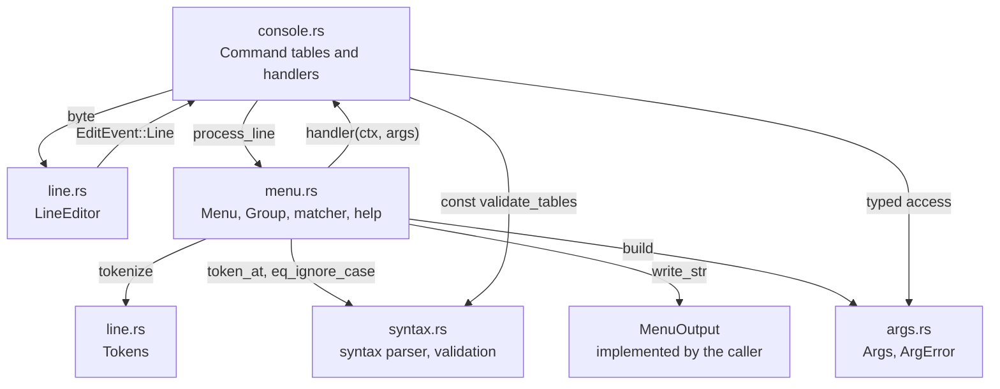
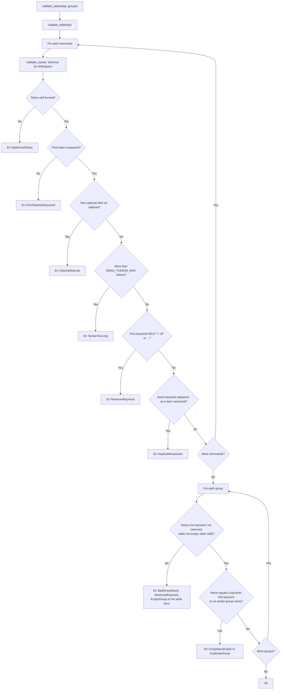
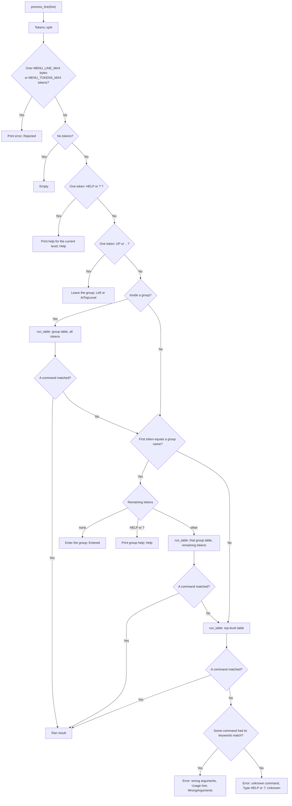
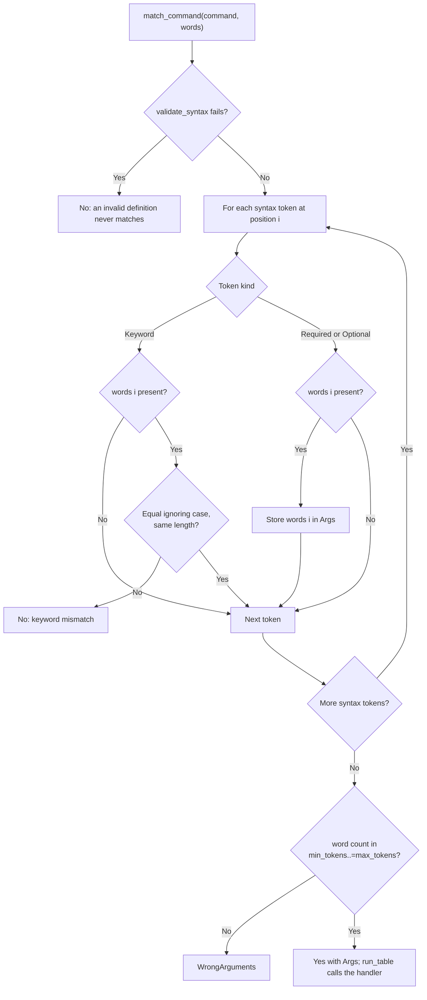
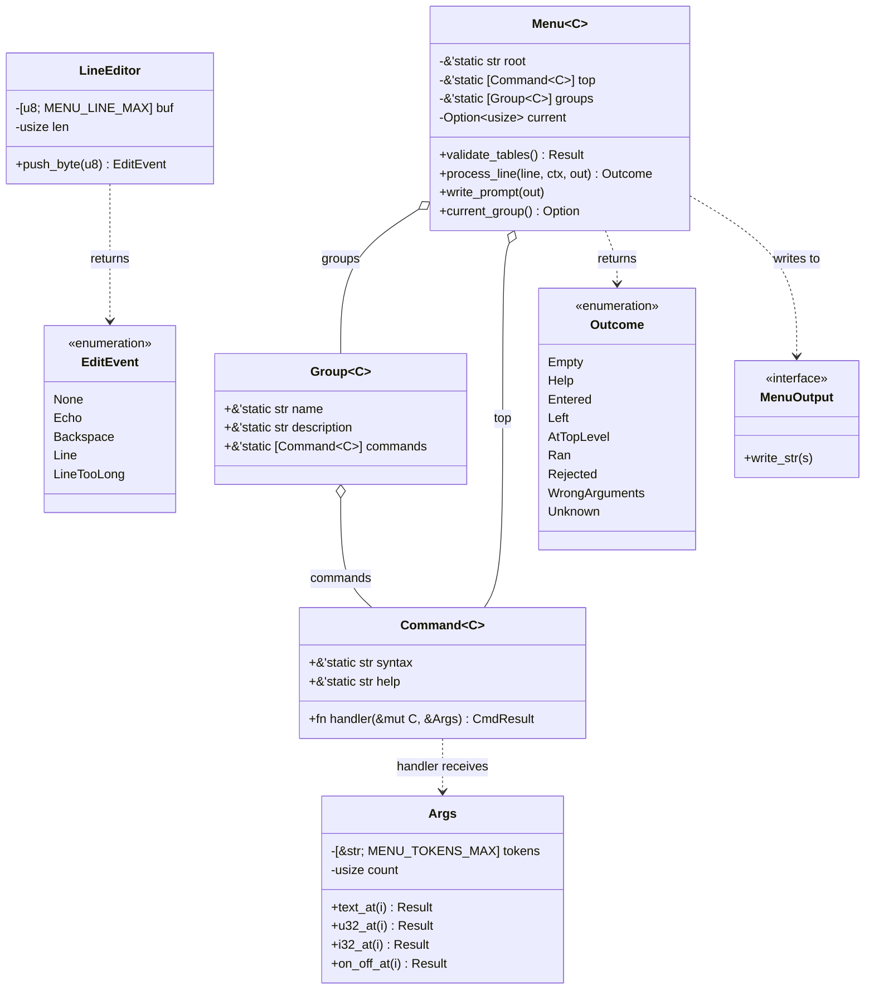

# ipmc-menu: Command Menu Engine

Revision 10-23-2026

## 1. Title and Overview

`ipmc-menu` is the command-line menu engine for the IPMC project. It implements the
`MenuBuilder.md` rules (command table of `FUNCTION:COMMAND:DESCRIPTION`, case-insensitive exact
keywords, `[REQUIRED]` and `{OPTIONAL}` parameters, explicit match signalling, aligned help) in
Rust, extended to tiers: commands are grouped into sub-menus, each with its own table.

The crate is `no_std`, has no dependencies, uses no heap and contains no `unsafe` code. The
caller supplies the command tables, a context value passed to every handler, and an output sink
(`MenuOutput`). The engine has no knowledge of any specific group and no UART.

Limits (named constants in `lib.rs`):

| Constant | Value | Meaning |
|---|---|---|
| `MENU_LINE_MAX` | 80 (`IPMC_MENU_LINE_MAX` in ipmi_defs.h) | Longest input line in bytes. A longer line is rejected with `LineTooLong`, never truncated. |
| `MENU_TOKENS_MAX` | 8 (`IPMC_MENU_TOKENS_MAX` in ipmi_defs.h) | Most tokens in a line or in a syntax string. More is `TooManyTokens` (line) or `SyntaxTooLong` (table). |

Input path: the firmware reads UART bytes and feeds each to `LineEditor::push_byte`, which
returns an event (echo this byte, erase one character, line complete, line too long). The
firmware performs all echo itself. A complete line goes to `Menu::process_line`.

Differences from `MenuBuilder.md`: the table is Rust (`Command<C>` values, not generated C);
there is no generated `main.c`, `Makefile` or `build.bat` (Cargo builds and tests the crate);
the handler return value is a `Result` (`CmdResult`) and the match indicator is a separate
enum (`Match`), so a return code never implies a match.

## 2. Architecture Overview



| File | Role |
|---|---|
| `lib.rs` | Constants, `Command`, `CmdResult`, `CmdError`, `MenuOutput`, re-exports |
| `syntax.rs` | `token_at`, `validate_syntax`, `validate_table`, `TableError`; all `const fn` |
| `line.rs` | `LineEditor`, `EditEvent`, `Tokens`, `MenuError`, `report_line_error` |
| `args.rs` | `Args`, `ArgError`, `optional`; decimal, hexadecimal, signed and on/off parsing |
| `menu.rs` | `Menu`, `Group`, `Outcome`, `match_command`, dispatch, help, prompt |

## 3. Initialization Flow

The engine keeps no parsed copy of a table. A table is plain `static` data and is checked once,
at compile time in firmware (`const _: () = assert!(Menu::validate_tables(..).is_ok())`) and in
unit tests on the host. The matcher and the help printer read each syntax string with the same
`token_at`.



Two commands have identical keyword sequences when their keywords, read in order, are the same
words ignoring case. `LED BLINK` and `LED BLINK {HZ}` are therefore duplicates.

## 4. Command Processing and Dispatch Flow



Rules:

- A matched handler ends dispatch, whether it returns `Ok` or `Err`. A command that does not
  match never runs and never ends dispatch, whatever a handler would have returned.
- Inside a group, that group's table is tried first, so its commands work without the prefix.
- A full command (`SENSORS SHOW`) works from any level and does not change the current group.
- A group name alone enters that group from any level. The prompt shows it (`ipmc/led> `).
- Top-level commands work from inside a group.
- `HELP`, `?`, `UP` and `..` are reserved at every level and only act alone on the line.

## 5. Token Matching Detail

`match_command` is the only matcher. It returns a `Match` value, so the match signal is explicit
and independent of any handler return code.



`min_tokens` is keywords plus required parameters; `max_tokens` adds the optional parameters.
Because optional parameters come last, every keyword and required position lies below
`min_tokens`, so a word count inside the range means every required parameter is present.

Parameter access: `Args` holds the parameter tokens only, by position (0 is the first
`[REQUIRED]` or `{OPTIONAL}` token). Accessors return `Result<_, ArgError>` and never panic:

| Accessor | Accepts | Errors |
|---|---|---|
| `text_at(i)` | any token | `Missing` |
| `u32_at(i)` | decimal `42` or hexadecimal `0x2A` (prefix in either case), no sign | `Missing`, `NotANumber`, `Overflow` |
| `i32_at(i)` | decimal with optional leading `-` | `Missing`, `NotANumber`, `Overflow` |
| `on_off_at(i)` | `on` or `off` in any case | `Missing`, `NotOnOff` |
| `optional(result)` | turns `Missing` into `Ok(None)` | other errors kept |

A handler that returns `Err(CmdError::Arg(e))` makes the engine print `Error: <fault>` and the
`Usage:` line. `Err(CmdError::Reported)` means the handler already printed its own message.

### Help output

Each help block computes one separator column from the longest syntax in the table being
printed, built-ins included, and prints every line as `  <syntax padded> - <description>`. The
built-ins `HELP` and `?` are listed like commands; inside a group `UP` and `..` are listed too.

## 6. Data Structures



Line editor rules: printable ASCII (0x20 to 0x7E) is stored and echoed; CR, LF and CR LF each end
one line; backspace (0x08) and delete (0x7F) remove the last stored byte (nothing on an empty
line); every other byte is ignored. A printable byte past `MENU_LINE_MAX` is dropped and marks
the line, and the line end then reports `LineTooLong`.

## 7. Command Reference

Firmware command tree (`crates/ipmc-nucleo-f401re/src/console.rs`). Prompt `ipmc> ` at the top level and
`ipmc/<group>> ` inside a group. The table shows the full form; inside a group, drop the group
keyword. Min and Max count the tokens of the full form.

```text
ipmc
  SYS     STATUS | RESET | VERSION
  LED     ON | OFF | BLINK [HZ] | AUTO | STATUS
  IPMB    ADDR | STATS | STATE
  SENSORS SHOW | SDR | TRACE {LEVEL}
  POWER   ON | OFF | CLEAR | STATUS
  SIM     RAIL {N} {MV} | TEMP {DC} | FAULT {NAME} {STATE} | SHOW
  FRU     SHOW | DUMP {OFFSET} {COUNT} | STORE | RESTORE
  STATUS  (alias of SYS STATUS)
  RESET   (alias of SYS RESET)
```

| # | Function | Command Syntax | Required | Optional | Min | Max | Description |
|---|----------|----------------|----------|----------|-----|-----|-------------|
| 1 | cmd_status | `SYS STATUS` | - | - | 2 | 2 | Uptime, clocks, geographic address, LED, last reset cause |
| 2 | cmd_reset | `SYS RESET` | - | - | 2 | 2 | System reset |
| 3 | cmd_version | `SYS VERSION` | - | - | 2 | 2 | Firmware and core library versions |
| 4 | cmd_led_on | `LED ON` | - | - | 2 | 2 | LD2 on |
| 5 | cmd_led_off | `LED OFF` | - | - | 2 | 2 | LD2 off |
| 6 | cmd_led_blink | `LED BLINK [HZ]` | HZ | - | 3 | 3 | LD2 blink; the limits print with LED STATUS, other rates are rejected |
| 7 | cmd_led_auto | `LED AUTO` | - | - | 2 | 2 | LD2 back to the heartbeat / IPMB activity pattern |
| 8 | cmd_led_status | `LED STATUS` | - | - | 2 | 2 | LD2 mode and rate |
| 9 | cmd_ipmb_addr | `IPMB ADDR` | - | - | 2 | 2 | Geographic address, IPMB address, parity and NVMRO with their sources |
| 10 | cmd_ipmb_stats | `IPMB STATS` | - | - | 2 | 2 | Per-bus receive, error, transmit, resend and replay counters |
| 11 | cmd_ipmb_state | `IPMB STATE` | - | - | 2 | 2 | Per-bus fitted, mode and enable state, the transmit policy and the link sensor bytes |
| 12 | cmd_status | `STATUS` | - | - | 1 | 1 | Alias of SYS STATUS |
| 13 | cmd_reset | `RESET` | - | - | 1 | 1 | Alias of SYS RESET |
| 14 | cmd_sensors_show | `SENSORS SHOW` | - | - | 2 | 2 | Rails, die temperature, inputs, power state, FRU state, the readings of sensors 0 to 6 and their Get Sensor Reading data bytes |
| 15 | cmd_sensors_trace | `SENSORS TRACE {LEVEL}` | - | LEVEL | 2 | 3 | Sensor trace level OFF, EVENTS (changes) or ALL (changes and samples); no argument shows it |
| 16 | cmd_power_on | `POWER ON` | - | - | 2 | 2 | Assert PWR_EN and wait for PGOOD |
| 17 | cmd_power_off | `POWER OFF` | - | - | 2 | 2 | Release PWR_EN and clear a latched fault |
| 18 | cmd_power_clear | `POWER CLEAR` | - | - | 2 | 2 | Clear a latched power fault |
| 19 | cmd_power_status | `POWER STATUS` | - | - | 2 | 2 | Power state, PWR_EN, latched fault |
| 20 | cmd_sim_rail | `SIM RAIL {N} {MV}` | - | N, MV | 2 | 4 | Simulated rail N (0 = VDDA) in millivolts; no argument lists them |
| 21 | cmd_sim_temp | `SIM TEMP {DC}` | - | DC | 2 | 3 | Simulated die temperature in tenths of a degree C |
| 22 | cmd_sim_fault | `SIM FAULT {NAME} {STATE}` | - | NAME, STATE | 2 | 4 | Assert (ON) or clear (OFF) a simulated input; no argument lists them |
| 23 | cmd_sim_show | `SIM SHOW` | - | - | 2 | 2 | Source of every group and the simulated values |
| 24 | cmd_sensors_sdr | `SENSORS SDR` | - | - | 2 | 2 | The Device SDR records: sensor number, type, event/reading type, ID string |
| 25 | cmd_fru_show | `FRU SHOW` | - | - | 2 | 2 | FRU image decoded: common header, board and product areas, checksums |
| 26 | cmd_fru_dump | `FRU DUMP {OFFSET} {COUNT}` | - | OFFSET, COUNT | 2 | 4 | Hex dump of the FRU image; default offset 0 and the rest of the area |
| 27 | cmd_fru_store | `FRU STORE` | - | - | 2 | 2 | Flash log state: records, newest sequence, free bytes, pending write, next erase |
| 28 | cmd_fru_restore | `FRU RESTORE` | - | - | 2 | 2 | Save the built FRU image as a new log record and put it back; refused while NVMRO is asserted |

Groups:

| Group | Description |
|---|---|
| `SYS` | System status, reset and version |
| `LED` | LD2 control |
| `IPMB` | IPMB address and bus state |
| `SENSORS` | Voltage rails, die temperature, inputs and Tier-1 readings |
| `POWER` | Payload power enable |
| `SIM` | Simulated sensor inputs |
| `FRU` | FRU image, its decoded areas and the flash log |

Further groups are added by the phases that own them; each is
a `Group` value with its own table, and the engine needs no change.

Session example:

```text
ipmc> led
ipmc/led> blink 2
OK: LED blink 2.00 Hz
ipmc/led> ..
ipmc> sys version
ipmc-nucleo-f401re v0.1.0 (ipmc-core v0.1.0)
ipmc> frobnicate
Error: unknown command 'frobnicate'
Type HELP or ?
```

## 8. Build Instructions

Host tests and lints (workspace root):

```text
cargo fmt --check
cargo clippy --all-targets -- -D warnings
cargo test -p ipmc-menu
cargo build -p ipmc-menu --target thumbv7em-none-eabihf
```

Firmware (`crates/ipmc-nucleo-f401re`):

```text
.\gen.ps1 build
.\gen.ps1 flash
.\gen.ps1 console help "sys status"
```
