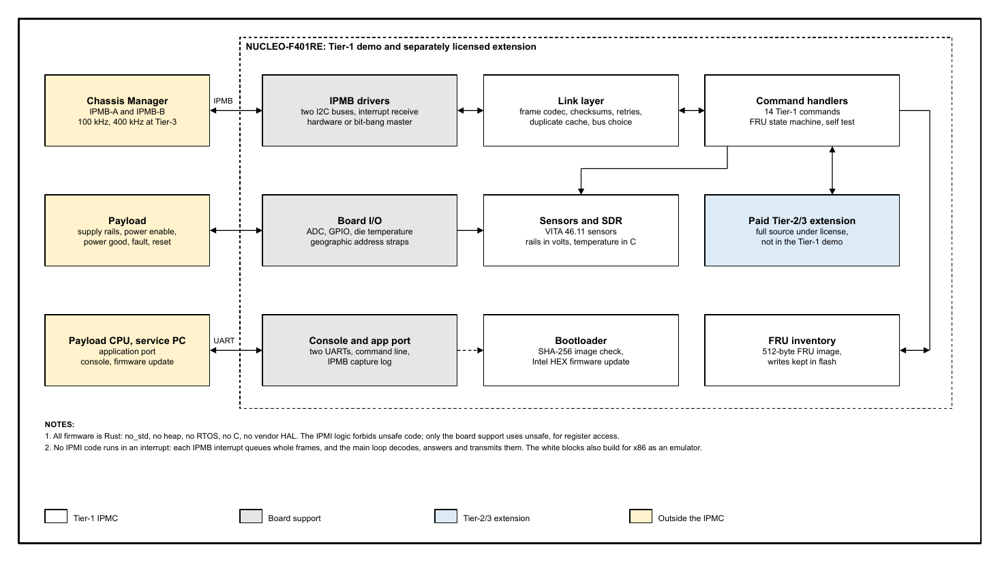

<style>
  .markdown-body h1, .markdown-body h2 { color: #1381ee; border-bottom: 2px solid #1381ee; }
  .markdown-body h3 { color: #242424; }
  .markdown-body table th { background: #e8f2fd; }
  .brief-band { background: #1381ee; color: #ffffff; padding: 10px 14px; margin: 6px 0 14px 0; font-size: 15px; }
  .brief-cols { display: flex; gap: 18px; }
  .brief-cols > div { flex: 1; }
  .markdown-body table { font-size: 12px; }
  .markdown-body table td, .markdown-body table th { padding: 4px 8px; }
  .markdown-body table td:first-child { white-space: nowrap; }
  .markdown-body { font-size: 11.5px; padding: 0; }
  .markdown-body table { font-size: 10.5px; }
  .markdown-body p { margin-bottom: 9px; }
  .markdown-body h2 { font-size: 18px; margin-top: 16px; margin-bottom: 10px; }
  .markdown-body h3 { font-size: 14px; margin-top: 14px; margin-bottom: 8px; }
</style>

<table style="width:100%; border:none; margin:0; padding:0;">
<tr>
<td style="text-align:left; border:none; padding:0; width:50%;"></td>
<td style="text-align:right; border:none; padding:0; width:50%; vertical-align:bottom;"><strong>NUCLEO-F401RE Demo Brief</strong><br>Revision 11-13-2026</td>
</tr>
</table>

<h1 style="font-size:30px; margin-top:18px;">VITA 46.11 IPMC in Rust</h1>

<div class="brief-band">Try the public Tier-1 IPMC on an STM32 NUCLEO-F401RE.
Free evaluation, a no-fee Open Product option, and paid commercial licenses.</div>

The IronKernel IPMC is management-controller firmware for VPX plug-in modules. The public
IPMIRustFRU repository supplies the Tier-1 firmware, bootloader, board support, PC emulator
and host tools. This demonstration targets the STM32F401RE Arm Cortex-M4F on the
NUCLEO-F401RE board. Firmware is written in Rust, with no heap, no RTOS and no C runtime.
The protocol logic forbids unsafe Rust; register access belongs to the board support.

Tier-1 answers the Chassis Manager, reports identity, FRU inventory and sensor readings,
and maintains the Tier-1 FRU state. The private Tier-2/3 extension adds event reporting and
further management functions under a separate paid agreement. The public demo contains
Tier-1 only; paid Tier-2/3 customers receive the full source under a commercial license.

## What the Tier-1 demonstration includes

| Area | Demonstration |
|---|---|
| Identity and inventory | Device ID, self test, FRU inventory read/write and geographic address information |
| Sensors | VITA 46.11 Tier-1 sensors, SDR records, supply-rail readings and die temperature |
| IPMB | IPMB-A on the standard bench setup; dual-bus support configurable in the source |
| Persistent FRU | Board and Product areas, flash-backed writes and write-protection handling |
| Boot and update | Public Tier-1 bootloader, image length and SHA-256 validation, firmware update over the console CLI or application UART |
| Diagnostics | Console, application UART, IPMB statistics and capture tools |
| PC evaluation | The same protocol logic in the emulator, without the NUCLEO hardware |

The default bench configuration uses IPMB-A. IPMB-B hardware testing needs the second bus
wired and enabled. Rail readings require the documented divider wiring or a deliberately
configured simulated source. The NUCLEO board is a development platform; a production VPX
module needs its own board support, wiring and integration checks.

## Protocol tiers at a glance

| Package | Coverage | Availability |
|---|---|---|
| Tier-1 | Discovery, inventory, sensor readings and Tier-1 FRU management | Public source and NUCLEO demo; terms on page 3 |
| Tier-2 | Tier-1 plus event receiver configuration, outbound Platform Event messages, Cold Reset and FRU Control Capabilities | Included in the combined Tier-2/3 commercial package |
| Tier-3 | Tier-1 and Tier-2 plus activation and policy, payload modes, event controls, SEL and further Tier-3 commands | Included in the combined Tier-2/3 commercial package |

<div style="page-break-after: always;"></div>

## NUCLEO-F401RE setup and image loading

Use a **NUCLEO-F401RE**, USB data cable and serial terminal. ST-LINK exposes the
programming drive and console COM port. Physical IPMI requests need a Chassis Manager
or IPMB adapter; the application UART needs a separate 3.3 V USB-to-UART adapter.

| Signal | NUCLEO pin | Connection |
|---|---|---|
| IPMB-A SCL | PB8, D15 | Chassis Manager / IPMB adapter SCL |
| IPMB-A SDA | PB9, D14 | Chassis Manager / IPMB adapter SDA |
| Console | PA2 TX / PA3 RX | Onboard ST-LINK virtual COM port, 115200 baud, 8N1 |
| Application UART | PB6 TX / PB7 RX | Separate adapter RX / TX and common ground |
| Ground | GND | Common ground with the IPMB or UART adapter |

Use open-drain I2C wiring and suitable pull-ups. Keep Aardvark target power off and
connect only SCL, SDA and GND for this IPMB-A test. Do not apply payload rail voltage
directly to an ADC pin: A0 needs a 4:1 divider and A1/A2/A3 need 2:1 dividers, with
ADC inputs kept within the MCU supply range. External rail wiring is separate from
the basic USB-and-IPMB demonstration.

### Image files

The packaging command produces two checked Tier-1 images, hashes and a build manifest
in `images/`. See [image availability](images/README.md) for this checkout.

| File | Use |
|---|---|
| `images/ipmc-board-tier1.bin` | Initial installation through the ST-LINK programming drive; bootloader and application combined |
| `images/ipmc-nucleo-f401re-tier1.hex` | Subsequent application update using the bootloader and `fwupdate.py` |
| `images/SHA256SUMS.txt` | SHA-256 checksums for both images |
| `images/manifest.json` | Build date, source revision, dirty-worktree state, toolchain and Tier |

1. Check each image's SHA-256 digest against `SHA256SUMS.txt`.
2. Connect ST-LINK USB and find its programming drive, normally **`NOD_F401RE`**.
3. Copy **`ipmc-board-tier1.bin`** to the drive. It installs bootloader and runtime
   at `0x08000000` and **erases saved FRU inventory and settings**.
4. Wait for programming and reset; check `FAIL.TXT` if it fails. Open the console
   COM port at 115200 baud, 8N1; try `HELP`, `IPMB STATS`, `SENSORS` and `FRU SHOW`.

Do not copy the application HEX file or an application-only binary to the ST-LINK drive.
The HEX file is for the UART update tool; its application address is `0x0800C000`.
A firmware hash verifies integrity, not publisher identity or a digital signature.

### Firmware update over the CLI: included in public Tier-1

The public Tier-1 release includes firmware update through the console CLI as well as
the application UART. From the runtime console, `DEBUG BOOTLOADER` enters the bootloader;
when interrupting payload power requires confirmation, use `DEBUG BOOTLOADER CONFIRM`.
The public host tool automates entry, application erase, Intel HEX loading, SHA-256
verification and restart. From the repository root, replacing COM3 with the console port:

```powershell
python tools/fwupdate/fwupdate.py --port COM3 --uart cli `
  --enter cli --enter-port COM3 update `
  demos/nucleo-f401re/images/ipmc-nucleo-f401re-tier1.hex
```

An ordinary application update preserves the bootloader and stored FRU data; restarting
into the bootloader interrupts the application and can drop payload power. This feature
needs no Tier-2/3 extension. It is a CLI/bootloader facility, distinct from standardized
IPMI/VSO commands in the command-support appendix.

<div style="page-break-after: always;"></div>

## License choices and fees

Two paid offerings are available: **Tier-1** and **Tier-2/3 (Tier-1 included)**.
Tier-2 is not sold separately. All prices below are **USD**, per product/SKU. Paid license fees are one-time;
there are **no royalties and no per-unit fees**. The signed commercial agreement identifies
the licensed product/SKU, deliverables and deployment rights. A different product/SKU needs its own license unless an enterprise agreement expressly
covers it. **Enterprise licensing for multiple product SKUs is available upon request
and quotation.**

| Option | License fee | Annual maintenance | What it permits |
|---|---:|---:|---|
| Tier-1 evaluation | **Free** | **Free public updates** | Evaluation and development, unsold prototypes, research, teaching, hobby and personal use under section 2 of the public license |
| Tier-1 Open Product | **Free** | **Free public updates** | Product deployment while every public-source, contribution and notice condition of section 3 is met |
| Tier-1 commercial | **$5,000** | **Free** | Deployment under a paid agreement when the Open Product conditions are not met, including a product with private Design Sources |
| Tier-2/3 commercial (Tier-1 included) | **$25,000** | **$5,000/year** | Full Tier-1/2/3 deployment under a paid agreement; full source included; private commercial license |

Tier-1 has no annual maintenance charge: updates are available from the public repository.
This does not promise a support response time or custom engineering. Tier-2/3 maintenance
covers updates and support as specified in the agreement; the agreement sets the start date,
coverage and renewal terms. Board ports, custom sensors, FRU/SDR work and integration services
are separately quoted. A paid Tier-1 license is credited in full toward a Tier-2/3 license for the same product/SKU.

### The no-fee Tier-1 Open Product conditions

The public repository uses the **IPMIRustFRU Source-Available License**. Commercial use
can qualify for the no-fee Open Product option, but access to the source alone is not enough:

1. Publish the Product's **complete Design Sources**, including your own parts of the design,
   at no charge and without registration under the public license, except components that
   retain their third-party licenses. Publish them no later than the first shipment, lease,
   licensing, customer deployment or paid-service use, and publish every later release too.
2. Offer every Change to IPMIRustFRU back to the IronKernel repository as a pull request
   within **90 days** of the Product release containing it. Acceptance is not required.
3. Name IPMIRustFRU in the Product documentation and link both this repository and the
   published Design Sources. Keep the required notices and mark modified files with a date.

These conditions continue while the Product is supplied or used to provide a paid service.
If you need to keep the Product's Design Sources private, or cannot meet every condition,
obtain a paid agreement before commercial delivery or deployment. The public license also
restricts offering IPMIRustFRU or a work mainly based on it as a competing IPMC software
product. A paid agreement must expressly cover any different rights you need.

This is a source-available license with commercial conditions, rather than an OSI open
source license. The [public LICENSE.md](../../LICENSE.md) is the governing text for Tier-1.
A signed commercial agreement governs the rights it grants and any differences from that text.
Contact **ironkernel.com** for commercial licenses, maintenance and engineering services.

<div style="page-break-after: always;"></div>

## Paid extension, build and verification

### Tier-2 and Tier-3 stay private

The Tier-2/3 repository stays private. **Paid Tier-2/3 customers receive the full source
code** for their licensed package under a commercial agreement. The license permits building,
modifying and using that source for the licensed product/SKU, or the products/SKUs covered
by an enterprise agreement. Copyright and ownership remain with IronKernel and the respective
rights holders.

Delivered source and derived source files remain confidential. Access is limited to
employees and contractors who need it for licensed work and are bound by confidentiality
and use restrictions. Customers may deliver the agreed compiled firmware with the licensed
Product, but may not publish or resell the source or sublicense the extension to others.
Neither the Tier-1 evaluation option nor the Open Product option licenses the extension.

This public demo is Tier-1. It contains no Tier-2/3 firmware images. Any commercial
Tier-2/3 image delivery requires the separate agreement; the public demo license grants no
right to unlock or use paid features. Licensed standards documents and private reference
material are also outside the public license.

### Build the Tier-1 demo package

From the repository root in PowerShell:

```powershell
powershell -NoProfile -ExecutionPolicy Bypass -File demos/nucleo-f401re/package.ps1
```

Install the Rust toolchain pinned in `rust-toolchain.toml`, the `thumbv7em-none-eabihf`
target and GNU Arm binutils (`arm-none-eabi-objcopy` and `arm-none-eabi-size`) first.
The packager sets `IPMC_TIER23=0` for the build, so the private extension is excluded even
on a developer PC where it is present. It restores the previous environment afterward.
It builds and checks the images, checks Tier-1 identity, and copies only the combined board
binary and application HEX file into this demo. It does not flash a connected board.

For firmware design details and independent checks, see the
[software specification](../../Documentation/ipmc_software_spec.md),
[command list](../../Documentation/ipmi_commands.md),
[test-coverage report](../../Documentation/ipmc_test_coverage.md) and
[Chassis Manager tools](../../tools/chassis-manager/README.md).
Historical test results describe their recorded builds; they are not a test certificate for
newly rebuilt demo images. On-board dual-bus checks need the corresponding hardware setup.

### Architecture



The IPMI logic also builds for a PC emulator. A port to another MCU replaces the board
support and must be validated for that board; this demo makes no portability or certification
claim for an untested target. Ferrocene qualification and DO-178C acceptance are not claimed
for these demo images.

<!-- generated: sync_demo_commands.py -->
<div style="page-break-after: always;"></div>

## Complete VITA 46.11-2022 command support

The catalog follows the IPMI and VSO groups of VITA 46.11-2022 Tables
10.1.1-1 and 10.1.2-1. Unsupported, optional, reserved and Chassis-Manager-only
entries remain visible. This product is an IPMC, not a Chassis Manager.

**Req T1/T2/T3:** M = mandatory; O = optional; NA = not applicable;
O/M = conditional mandatory support. Bracketed numbers refer to the notes
after the tables. Requirements and implementation are separate columns.

**Impl T1/T2/T3:** Yes = received command implemented; No = not implemented;
Transmit only = outbound operation, with incoming requests unsupported.
Unimplemented addressed commands normally return C1h. Reserved entries are
not commands. Conditional requirements depend on the interfaces and FRUs fitted.

Implemented received command forms: **14 at Tier-1, 18 at Tier-2,
36 at Tier-3**, counting Broadcast Get Device ID separately from unicast.
Outbound Platform Event generation is additional at Tier-2/3. The paid
Tier-2/3 package includes both configurations; Tier-2 is not sold separately.

**Mandatory-command coverage:** no entry marked M or M[n] is marked No. Conditionally mandatory O/M entries must be assessed against the scope below; this table is an implementation statement, not a conformance certificate.

IPMI references retain the source table's version and section notation.
VSO references identify VITA 46.11-2022 sections; VSO requests use NetFn 2Ch
and group identifier 03h. See the public
[command document](../../Documentation/ipmi_commands.md) for further context.

### IPMI commands: VITA Table 10.1.1-1

#### IPM Device "Global" Commands

| NetFn/Cmd | Command | Reference | Req T1 | Req T2 | Req T3 | Impl T1 | Impl T2 | Impl T3 |
|---|---|---|---|---|---|---|---|---|
| 06h/00h | Reserved | NA | NA | NA | N/A | No | No | No |
| 06h/01h | Get Device ID | 1.5:17.1 | M | M | M | Yes | Yes | Yes |
| 06h/02h | Cold Reset | 1.5:17.2 | O[2] | M[2] | M | No | Yes | Yes |
| 06h/03h | Warm Reset | 1.5:17.3 | O | O | M | No | No | Yes |
| 06h/04h | Get Self Test Results | 1.5:17.4 | M | M | M | Yes | Yes | Yes |
| 06h/05h | Manufacturing Test On | 1.5:17.5 | O | O | O | No | No | No |
| 06h/06h | Set ACPI Power State | 1.5:17.6 | O | O | O | No | No | No |
| 06h/07h | Get ACPI Power State | 1.5:17.7 | O[2] | O[2] | O | No | No | No |
| 06h/08h | Get Device GUID | 1.5:17.8 | O | O | O | No | No | No |
| 06h/01h | Broadcast "Get Device ID"[3] | 1.5:17.9 | M | M | M | Yes | Yes | Yes |
#### BMC Watchdog Timer Commands

| NetFn/Cmd | Command | Reference | Req T1 | Req T2 | Req T3 | Impl T1 | Impl T2 | Impl T3 |
|---|---|---|---|---|---|---|---|---|
| 06h/22h | Reset Watchdog Timer | 1.5:21.5 | O | O | O | No | No | No |
| 06h/24h | Set Watchdog Timer | 1.5:21.6 | O | O | O | No | No | No |
| 06h/25h | Get Watchdog Timer | 1.5:21.7 | O | O | O | No | No | No |
#### BMC Device and Messaging Commands

| NetFn/Cmd | Command | Reference | Req T1 | Req T2 | Req T3 | Impl T1 | Impl T2 | Impl T3 |
|---|---|---|---|---|---|---|---|---|
| 06h/2Eh | Set BMC Global Enables[6] | 1.5:18.1 | O | O | O/M[7] | No | No | No |
| 06h/2Fh | Get BMC Global Enables | 1.5:18.2 | O | O | M | No | No | Yes |
| 06h/30h | Clear Message Flags[6] | 1.5:18.3 | O | O | O | No | No | No |
| 06h/31h | Get Message Flags | 1.5:18.4 | O | O | O | No | No | No |
| 06h/32h | Enable Message Channel Receive[6] | 1.5:18.5 | O | O | O | No | No | No |
| 06h/33h | Get Message[6] | 1.5:18.6 | O | O | O | No | No | No |
| 06h/34h | Send Message | 1.5:18.7 | O | O | O/M[7] | No | No | No |
| 06h/35h | Read Event Message Buffer[6] | 1.5:18.8 | O | O | O | No | No | No |
| 06h/36h | Get BT Interface Capabilities | 1.5:18.9 | O[2] | O[2] | O[2] | No | No | No |
| 06h/52h | Master Write-Read | 1.5:18.10 | O[2] | O[2] | O/M[8] | No | No | No |
| 06h/37h | Get System GUID | 1.5:18.13 | O[2] | O[2] | O[2] | No | No | No |
| 06h/38h | Get Channel Authentication Capabilities | 1.5:18.12 | O[2] | O[2] | O[2] | No | No | No |
| 06h/39h | Get Session Challenge | 1.5:18.14 | O[2] | O[2] | O[2] | No | No | No |
| 06h/3Ah | Activate Session | 1.5:18.15 | O[2] | O[2] | O[2] | No | No | No |
| 06h/3Bh | Set Session Privilege Level | 1.5:18.16 | O[2] | O[2] | O[2] | No | No | No |
| 06h/3Ch | Close Session | 1.5:18.17 | O[2] | O[2] | O[2] | No | No | No |
| 06h/3Dh | Get Session Info | 1.5:18.18 | O[2] | O[2] | O[2] | No | No | No |
| 06h/3Fh | Get AuthCode | 1.5:18.19 | O | O | O | No | No | No |
| 06h/40h | Set Channel Access | 1.5:18.20 | O[2] | O[2] | O[2] | No | No | No |
| 06h/41h | Get Channel Access | 1.5:18.21 | O[2] | O[2] | O[2] | No | No | No |
| 06h/42h | Get Channel Info | 1.5:18.18 | O[2] | O[2] | O[2] | No | No | No |
| 06h/43h | Set User Access | 1.5:18.23 | O[2] | O[2] | O[2] | No | No | No |
| 06h/44h | Get User Access | 1.5:18.24 | O[2] | O[2] | O[2] | No | No | No |
| 06h/45h | Set User Name | 1.5:18.25 | O[2] | O[2] | O[2] | No | No | No |
| 06h/46h | Get User Name | 1.5:18.26 | O[2] | O[2] | O[2] | No | No | No |
| 06h/47h | Set User Password | 1.5:18.27 | O[2] | O[2] | O[2] | No | No | No |
#### Chassis Device Commands

| NetFn/Cmd | Command | Reference | Req T1 | Req T2 | Req T3 | Impl T1 | Impl T2 | Impl T3 |
|---|---|---|---|---|---|---|---|---|
| 00h/00h | Get Chassis Capabilities | 1.5:22.1 | O | O | O | No | No | No |
| 00h/01h | Get Chassis Status | 1.5:22.2 | O | O | O | No | No | No |
| 00h/02h | Chassis Control | 1.5:22.3 | O | O | O | No | No | No |
| 00h/03h | Chassis Reset | 1.5:22.4 | O | O | O | No | No | No |
| 00h/04h | Chassis Identify | 1.5:22.5 | O | O | O | No | No | No |
| 00h/05h | Set Chassis Capabilities | 1.5:22.6 | O | O | O | No | No | No |
| 00h/06h | Set Power Restore Policy | 1.5:22.7 | O | O | O | No | No | No |
| 00h/07h | Get System Reset Cause | 1.5:22.9 | O[2] | O[2] | O[2] | No | No | No |
| 00h/08h | Set System Boot Options | 1.5:22.10 | O[2] | O[2] | O[2] | No | No | No |
| 00h/09h | Get System Boot Options | 1.5:22.11 | O[2] | O[2] | O[2] | No | No | No |
| 00h/0Fh | Get POH Counter | 1.5:22.12 | O | O | O | No | No | No |
#### Event Commands

| NetFn/Cmd | Command | Reference | Req T1 | Req T2 | Req T3 | Impl T1 | Impl T2 | Impl T3 |
|---|---|---|---|---|---|---|---|---|
| 04h/00h | Set Event Receiver | 1.5:23.1 | NA | M | M | No | Yes | Yes |
| 04h/01h | Get Event Receiver | 1.5:23.2 | NA | M | M | No | Yes | Yes |
| 04h/02h | Platform Event (a.k.a "Event Message") | 1.5:23.3 | NA | M | M | No | Transmit only | Transmit only |
#### PEF and Alerting Commands

| NetFn/Cmd | Command | Reference | Req T1 | Req T2 | Req T3 | Impl T1 | Impl T2 | Impl T3 |
|---|---|---|---|---|---|---|---|---|
| 04h/10h | Get PEF Capabilities | 1.5:24.1 | NA | O[2] | O[2] | No | No | No |
| 04h/11h | Arm PEF Postpone Timer | 1.5:24.2 | NA | O[2] | O[2] | No | No | No |
| 04h/12h | Set PEF Configuration Parameters | 1.5:24.3 | NA | O[2] | O[2] | No | No | No |
| 04h/13h | Get PEF Configuration Parameters | 1.5:24.4 | NA | O[2] | O[2] | No | No | No |
| 04h/14h | Set Last Processed Event ID | 1.5:24.5 | NA | O[2] | O[2] | No | No | No |
| 04h/15h | Get Last Processed Event ID | 1.5:24.6 | NA | O[2] | O[2] | No | No | No |
| 04h/16h | Alert Immediate | 1.5:24.7 | NA | O[2] | O[2] | No | No | No |
| 04h/17h | PET Acknowledge | 1.5:24.8 | NA | O[2] | O[2] | No | No | No |
#### Sensor Device Commands

| NetFn/Cmd | Command | Reference | Req T1 | Req T2 | Req T3 | Impl T1 | Impl T2 | Impl T3 |
|---|---|---|---|---|---|---|---|---|
| 04h/20h | Get Device SDR Info | 1.5:29.2 | M | M | M | Yes | Yes | Yes |
| 04h/21h | Get Device SDR | 1.5:29.3 | M[2] | M[2] | M[2] | Yes | Yes | Yes |
| 04h/22h | Reserve Device SDR Repository | 1.5:29.4 | M[2] | M[2] | M[2] | Yes | Yes | Yes |
| 04h/23h | Get Sensor Reading Factors | 1.5:29.5 | O[2] | O[2] | O[2] | No | No | No |
| 04h/24h | Set Sensor Hysteresis | 1.5:29.6 | O | O | O | No | No | No |
| 04h/25h | Get Sensor Hysteresis | 1.5:29.7 | O | O | O | No | No | No |
| 04h/26h | Set Sensor Threshold | 1.5:29.8 | O | O | O | No | No | No |
| 04h/27h | Get Sensor Threshold | 1.5:29.9 | O[2] | O[2] | O[2] | No | No | No |
| 04h/28h | Set Sensor Event Enable | 1.5:29.10 | NA | O | M | No | No | Yes |
| 04h/29h | Get Sensor Event Enable | 1.5:29.11 | NA | O[2] | M | No | No | Yes |
| 04h/2Ah | Re-arm Sensor Events | 1.5:29.12 | NA | O[2] | O[2] | No | No | No |
| 04h/2Bh | Get Sensor Event Status | 1.5:29.13 | NA | O | O | No | No | No |
| 04h/2Dh | Get Sensor Reading | 1.5:29.14 | M | M | M | Yes | Yes | Yes |
| 04h/2Eh | Set Sensor Type | 1.5:29.15 | O | O | O | No | No | No |
| 04h/2Fh | Get Sensor Type | 1.5:29.16 | O[2] | O[2] | O[2] | No | No | No |
| 04h/30h | Set Sensor Reading | 2.0:35.17 | O | O | O | No | No | No |
#### FRU Device Commands

| NetFn/Cmd | Command | Reference | Req T1 | Req T2 | Req T3 | Impl T1 | Impl T2 | Impl T3 |
|---|---|---|---|---|---|---|---|---|
| 0Ah/10h | Get FRU Inventory Area Info | 1.5:28.1 | M | M | M | Yes | Yes | Yes |
| 0Ah/11h | Read FRU Data | 1.5:28.2 | M | M | M | Yes | Yes | Yes |
| 0Ah/12h | Write FRU Data | 1.5:28.3 | M | M | M | Yes | Yes | Yes |
#### SDR Device Commands

| NetFn/Cmd | Command | Reference | Req T1 | Req T2 | Req T3 | Impl T1 | Impl T2 | Impl T3 |
|---|---|---|---|---|---|---|---|---|
| 0Ah/20h | Get SDR Repository Info | 1.5:27.9 | O | O | O | No | No | No |
| 0Ah/21h | Get SDR Repository Allocation Info | 1.5:27.10 | O | O | O | No | No | No |
| 0Ah/22h | Reserve SDR Repository | 1.5:27.11 | O | O | O | No | No | No |
| 0Ah/23h | Get SDR | 1.5:27.12 | O[2] | O[2] | O[2] | No | No | No |
| 0Ah/24h | Add SDR | 1.5:27.13 | O[2] | O[2] | O[2] | No | No | No |
| 0Ah/25h | Partial Add SDR | 1.5:27.14 | O[2] | O[2] | O[2] | No | No | No |
| 0Ah/26h | Delete SDR | 1.5:27.15 | O[2] | O[2] | O[2] | No | No | No |
| 0Ah/27h | Clear SDR Repository | 1.5:27.16 | O[2] | O[2] | O[2] | No | No | No |
| 0Ah/28h | Get SDR Repository Time | 1.5:27.17 | O[2] | O[2] | O[2] | No | No | No |
| 0Ah/29h | Set SDR Repository Time | 1.5:27.18 | O[2] | O[2] | O[2] | No | No | No |
| 0Ah/2Ah | Enter SDR Repository Update Mode | 1.5:27.19 | O[2] | O[2] | O[2] | No | No | No |
| 0Ah/2Bh | Exit SDR Repository Update Mode | 1.5:27.20 | O[2] | O[2] | O[2] | No | No | No |
| 0Ah/2Ch | Run Initialization Agent | 1.5:27.21 | O[2] | O[2] | O[2] | No | No | No |
#### SEL Device Commands

| NetFn/Cmd | Command | Reference | Req T1 | Req T2 | Req T3 | Impl T1 | Impl T2 | Impl T3 |
|---|---|---|---|---|---|---|---|---|
| 0Ah/40h | Get SEL Info | 1.5:25.2 | O | O | M | No | No | Yes |
| 0Ah/41h | Get SEL Allocation Info | 1.5:25.3 | O | O | O | No | No | No |
| 0Ah/42h | Reserve SEL | 1.5:25.4 | O[2] | O[2] | M | No | No | Yes |
| 0Ah/43h | Get SEL Entry | 1.5:25.5 | O | O | M | No | No | Yes |
| 0Ah/44h | Add SEL Entry | 1.5:25.6 | O[2] | O[2] | O[2] | No | No | No |
| 0Ah/45h | Partial Add SEL Entry | 1.5:25.7 | O[2] | O[2] | O[2] | No | No | No |
| 0Ah/46h | Delete SEL Entry | 1.5:25.8 | O | O | O | No | No | No |
| 0Ah/47h | Clear SEL | 1.5:25.9 | O | O | M | No | No | Yes |
| 0Ah/48h | Get SEL Time | 1.5:25.10 | O | O | M | No | No | Yes |
| 0Ah/49h | Set SEL Time | 1.5:25.11 | O | O | M | No | No | Yes |
| 0Ah/5Ah | Get Auxiliary Log Status | 1.5:25.12 | O | O | O | No | No | No |
| 0Ah/5Bh | Set Auxiliary Log Status | 1.5:25.13 | O[2] | O[2] | O[2] | No | No | No |
#### LAN Device Commands

| NetFn/Cmd | Command | Reference | Req T1 | Req T2 | Req T3 | Impl T1 | Impl T2 | Impl T3 |
|---|---|---|---|---|---|---|---|---|
| 0Ch/01h | Set LAN Configuration Parameters | 1.5:19.1 | O[2] | O[2] | O[2] | No | No | No |
| 0Ch/02h | Get LAN Configuration Parameters | 1.5:19.2 | O[2] | O[2] | O[2] | No | No | No |
| 0Ch/03h | Suspend BMC ARPs | 1.5:19.3 | O[2] | O[2] | O[2] | No | No | No |
| 0Ch/04h | Get IP/UDP/RMCP Statistics | 1.5:19.4 | O | O | O | No | No | No |
#### Serial/Modem Device Commands

| NetFn/Cmd | Command | Reference | Req T1 | Req T2 | Req T3 | Impl T1 | Impl T2 | Impl T3 |
|---|---|---|---|---|---|---|---|---|
| 0Ch/10h | Set Serial/Modem Configuration | 1.5:20.1 | O[2] | O[2] | O[2] | No | No | No |
| 0Ch/11h | Get Serial Modem Configuration | 1.5:20.2 | O[2] | O[2] | O[2] | No | No | No |
| 0Ch/12h | Set Serial/Modem Mux | 1.5:20.3 | O[2] | O[2] | O[2] | No | No | No |
| 0Ch/13h | Get TAP Response Codes | 1.5:20.4 | O[2] | O[2] | O[2] | No | No | No |
| 0Ch/14h | Set PPP UDP Proxy Transmit Data | 1.5:20.5 | O[2] | O[2] | O[2] | No | No | No |
| 0Ch/15h | Get PPP UDP Proxy Transmit Data | 1.5:20.6 | O[2] | O[2] | O[2] | No | No | No |
| 0Ch/16h | Send PPP UDP Proxy Packet | 1.5:20.7 | O[2] | O[2] | O[2] | No | No | No |
| 0Ch/17h | Get PPP UDP Proxy Packet | 1.5:20.8 | O[2] | O[2] | O[2] | No | No | No |
| 0Ch/18h | Serial/Modem Connection Active | 1.5:20.9 | O[2] | O[2] | O[2] | No | No | No |
| 0Ch/19h | Callback | 1.5:20.10 | O | O | O | No | No | No |
| 0Ch/1Ah | Set User Callback Options | 1.5:20.11 | O[2] | O[2] | O[2] | No | No | No |
| 0Ch/1Bh | Get User Callback Options | 1.5:20.12 | O[2] | O[2] | O[2] | No | No | No |
#### Firmware Firewall Commands

| NetFn/Cmd | Command | Reference | Req T1 | Req T2 | Req T3 | Impl T1 | Impl T2 | Impl T3 |
|---|---|---|---|---|---|---|---|---|
| 06h/09h | Get NetFn Support | 2.0:21.2 | O[2] | O[2] | O[2] | No | No | No |
| 06h/64h | Get OEM NetFn IANA Support | 2.0:21.11 | O[2] | O[2] | O[2] | No | No | No |
| 06h/0Ah | Get Command Support | 2.0:21.3 | O[2] | O[2] | O[2] | No | No | No |
| 06h/0Bh | Get Command Sub-function Support | 2.0:21.4 | O[2] | O[2] | O[2] | No | No | No |
| 06h/0Ch | Get Configurable Commands | 2.0:21.5 | O[2] | O[2] | O[2] | No | No | No |
| 06h/0Dh | Get Configurable Command Sub-Functions | 2.0:21.6 | O[2] | O[2] | O[2] | No | No | No |
| 06h/61h | Get Command Enables | 2.0:21.8 | O[2] | O[2] | O[2] | No | No | No |
| 06h/63h | Get Configurable Command Sub-function Enables | 2.0:21.10 | O[2] | O[2] | O[2] | No | No | No |
| 06h/60h | Set Command Enables | 2.0:21.7 | O[2] | O[2] | O[2] | No | No | No |
| 06h/62h | Set Configurable Command Sub-function Enables | 2.0:21.9 | O[2] | O[2] | O[2] | No | No | No |
### VSO commands: VITA Table 10.1.2-1

| NetFn/Cmd | Command | Reference | Req T1 | Req T2 | Req T3 | Impl T1 | Impl T2 | Impl T3 |
|---|---|---|---|---|---|---|---|---|
| 2Ch/00h | Get VSO Capabilities | &sect;10.1.3.1 | M | M | M | Yes | Yes | Yes |
| 2Ch/01h | Get Chassis Address Table Info | &sect;10.1.3.2 | NA | NA | NA | No | No | No |
| 2Ch/02h | Get Chassis Identifier | &sect;10.1.3.4 | NA | NA | NA | No | No | No |
| 2Ch/03h | Set Chassis Identifier | &sect;10.1.3.5 | NA | NA | NA | No | No | No |
| 2Ch/04h | FRU Control | &sect;10.1.3.6 | O | O | O/M[6] | No | No | Yes |
| 2Ch/05h | Get FRU LED Properties | &sect;10.1.3.27 | O | O | O | No | No | No |
| 2Ch/06h | Get LED Color Capabilities | &sect;10.1.3.28 | O | O | O | No | No | No |
| 2Ch/07h | Set FRU LED State | &sect;10.1.3.30 | O | O | O | No | No | No |
| 2Ch/08h | Get FRU LED State | &sect;10.1.3.29 | O | O | O | No | No | No |
| 2Ch/09h | Set IPMB State | &sect;10.1.3.7 | M | M | M | Yes | Yes | Yes |
| 2Ch/0Ah | Set FRU State Policy Bits | &sect;10.1.3.9 | O/M[2] | O/M[2] | M | No | No | Yes |
| 2Ch/0Bh | Get FRU State Policy Bits | &sect;10.1.3.8 | O/M[2] | O/M[2] | M | No | No | Yes |
| 2Ch/0Ch | Set FRU Activation | &sect;10.1.3.10 | O | O | M | No | No | Yes |
| 2Ch/0Dh | Get Device Locator Record ID | &sect;10.1.3.11 | M | M | M | Yes | Yes | Yes |
| 2Ch/0Eh-13h | (reserved) | Reserved | - | - | - | No | No | No |
| 2Ch/14h | Get Fan Speed Properties | &sect;10.1.3.12 | O | O | O | No | No | No |
| 2Ch/15h | Set Fan Level | &sect;10.1.3.14 | O | O | O | No | No | No |
| 2Ch/16h | Get Fan Level | &sect;10.1.3.13 | O | O | O | No | No | No |
| 2Ch/17h | (reserved) | Reserved | - | - | - | No | No | No |
| 2Ch/18h | Get IPMB Link Info | &sect;10.1.3.17 | O | O | O | No | No | No |
| 2Ch/19h-1Ah | (reserved) | Reserved | - | - | - | No | No | No |
| 2Ch/1Bh | Get Chassis Manager IPMB Address | &sect;10.1.3.21 | NA | NA | NA | No | No | No |
| 2Ch/1Ch | Set Fan Policy | &sect;10.1.3.15 | NA | NA | NA | No | No | No |
| 2Ch/1Dh | Get Fan Policy | &sect;10.1.3.16 | NA | NA | NA | No | No | No |
| 2Ch/1Eh | FRU Control Capabilities | &sect;10.1.3.18 | O/M[3] | M | M | No | Yes | Yes |
| 2Ch/1Fh | FRU Inventory Device Lock Control | &sect;10.1.3.19 | NA | NA | NA | No | No | No |
| 2Ch/20h | FRU Inventory Device Write | &sect;10.1.3.20 | NA | NA | NA | No | No | No |
| 2Ch/21h | Get Chassis Manager IP Addresses | &sect;10.1.3.22 | NA | NA | NA | No | No | No |
| 2Ch/22h-3Fh | (reserved) | Reserved | - | - | - | No | No | No |
| 2Ch/40h | Get FRU Address Info | &sect;10.1.3.3 | M | M | M | Yes | Yes | Yes |
| 2Ch/41h | Get FRU Persistent Control | &sect;10.1.3.23 | O | O | O | No | No | No |
| 2Ch/42h | Set FRU Persistent Control | &sect;10.1.3.24 | O | O | O | No | No | No |
| 2Ch/43h | FRU Persistent Control Capabilities | &sect;10.1.3.25 | O | O | O | No | No | No |
| 2Ch/44h | Get Mandatory Sensor Numbers | &sect;10.1.3.26 | O | O/M[4] | M | No | No | Yes |
| 2Ch/45h | Get FRU Hash | &sect;10.1.3.31 | O | O | M | No | No | Yes |
| 2Ch/46h | Get Payload Mode Capabilities | &sect;10.1.3.32 | O | O | M | No | No | Yes |
| 2Ch/47h | Set Payload Mode | &sect;10.1.3.33 | O | O | M | No | No | Yes |
| 2Ch/48h | Get Write Protect Capabilities | &sect;10.1.3.34 | O | O | O | No | No | No |
| 2Ch/49h | Get Write Protect Enables | &sect;10.1.3.35 | O | O | O | No | No | No |
| 2Ch/4Ah | Set Write Protect Enables | &sect;10.1.3.36 | O | O | O | No | No | No |
| 2Ch/4Bh | Get Power Supply Capabilities | &sect;10.1.3.37 | O | O | O/M[5] | No | No | No |
| 2Ch/4Ch | Get Power Supply Status | &sect;10.1.3.38 | O | O | O/M[5] | No | No | No |
| 2Ch/4Dh | Set Power Supply Status | &sect;10.1.3.39 | O | O | O/M[5] | No | No | No |
| 2Ch/4Eh | Get Control Bits Capabilities | &sect;10.1.3.40 | O | O | O | No | No | No |
| 2Ch/4Fh | Get Control Bits | &sect;10.1.3.41 | O | O | O | No | No | No |
| 2Ch/50h | Set Control Bits | &sect;10.1.3.42 | O | O | O | No | No | No |
#### Bridged Firewall Commands

| NetFn/Cmd | Command | Reference | Req T1 | Req T2 | Req T3 | Impl T1 | Impl T2 | Impl T3 |
|---|---|---|---|---|---|---|---|---|
| 2Ch/51h | Get Bridged NetFn Support | &sect;10.1.3.47 | O | O | O | No | No | No |
| 2Ch/52h | Get Bridged Command Enables | &sect;10.1.3.43 | O | O | O | No | No | No |
| 2Ch/53h | Set Bridged Command Enables | &sect;10.1.3.44 | O | O | O | No | No | No |
| 2Ch/54h | Get Bridged Command Sub-function Enables | &sect;10.1.3.45 | O | O | O | No | No | No |
| 2Ch/55h | Set Bridged Command Sub-function Enables | &sect;10.1.3.46 | O | O | O | No | No | No |
| 2Ch/56h | Set Bridged NetFn Policy | &sect;10.1.3.48 | O | O | O | No | No | No |
| 2Ch/57h | Get Bridged NetFn Policy | &sect;10.1.3.49 | O | O | O | No | No | No |

### IPMI table requirement notes

- [2] Additional command-specific constraints apply in the IPMI definition.
- [3] The Device ID broadcast uses IPMB broadcast framing.
- [4] Chassis Manager operations apply to the whole chassis.
- [5] The Chassis Manager need not implement a full centralized SDR repository.
- [6] These commands are local Payload/System Interface operations.
- [7] Mandatory for a Tier-3 IPMC that includes a Payload Interface.
- [8] Mandatory for a Tier-3 IPMC with private I2C interfaces to subsidiary FRU EEPROMs.

### VSO table requirement notes

- [2] Mandatory if Set FRU Activation is supported.
- [3] Mandatory if Set FRU Activation or FRU Control is supported.
- [4] Mandatory when the IPMC exposes more than one FRU.
- [5] Mandatory for an IPMC representing a power supply.
- [6] Mandatory for a Tier-3 IPMC representing a resettable payload.

### Implementation scope

Platform Event is transmitted at Tier-2/3: this IPMC is an Event Generator, not an
Event Receiver. Incoming Platform Event requests are not implemented. Chassis
Manager functions, optional fan/LED control, subsidiary-FRU interfaces, IPMI
firmware-firewall commands and VSO bridged-firewall commands are not claimed by the
current implementation. Conditional M/O cells do not establish that an interface is
present on this board. The complete source-table qualifications still apply.

Current applicability: one FRU (FRU 0), no IPMI Payload/System Interface, no private
I2C subsidiary-FRU EEPROMs, and not a power-supply IPMC. The Tier-3 payload is
resettable and the applicable FRU Control command is implemented. Accordingly:

- Set BMC Global Enables (06h/2Eh) and Send Message (06h/34h) are not implemented;
  their Tier-3 mandatory condition requires a Payload Interface.
- Master Write-Read (06h/52h) is not implemented; its Tier-3 mandatory condition
  requires a private subsidiary-FRU EEPROM interface.
- Get Power Supply Capabilities/Status and Set Power Supply Status (2Ch/4Bh-4Dh)
  are not implemented; the mandatory condition applies to power-supply IPMCs.
- Set/Get FRU State Policy Bits (2Ch/0Ah, 0Bh) are absent at Tier-1/2, where the
  mandatory condition requires Set FRU Activation, which those builds do not offer.
  All three activation/policy commands are implemented at Tier-3.
- FRU Control Capabilities (2Ch/1Eh) is absent at Tier-1, which implements neither
  FRU Control nor Set FRU Activation. It is implemented at Tier-2 and Tier-3.
- Get Mandatory Sensor Numbers (2Ch/44h) is absent at Tier-2, where its mandatory
  condition requires multiple FRUs. It is implemented at Tier-3.

Changing the hardware or interface scope can make an unimplemented O/M entry
mandatory; review these conditions before offering that configuration.

The public Tier-1 software also supports firmware update over the console CLI and
application UART through its bootloader. This is a public software feature, not an
additional standardized IPMI/VSO firmware-update command. Runtime CLI entry is
`DEBUG BOOTLOADER` (with `CONFIRM` when payload-power interruption requires it).
The bootloader supports `INFO`, `ERASE APP`, `LOAD`, `VERIFY` and `RUN`; the public
`tools/fwupdate/fwupdate.py` automates entry, erase, HEX loading, verification and
restart. Ordinary APP update preserves the bootloader and stored FRU data.
<!-- end generated: sync_demo_commands.py -->
